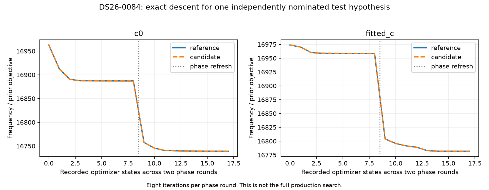
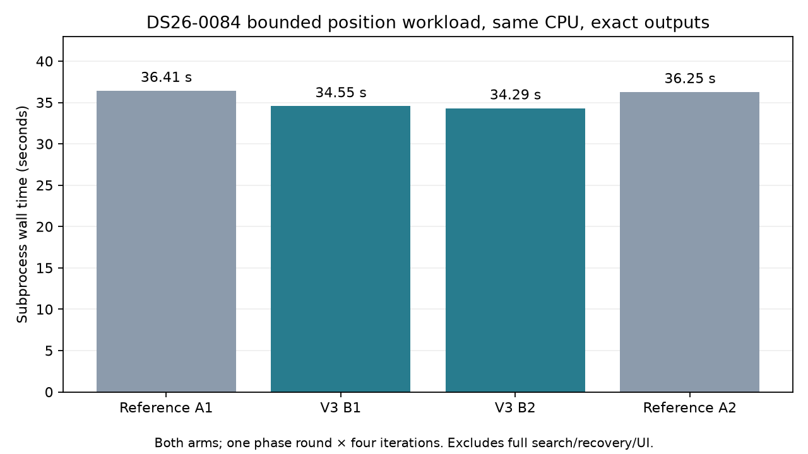

# ALGO07v3: joint position likelihood, descent and fresh discovery

**Complete-path speedup remains unavailable.** V3 now has an independent joint
position likelihood, bounded descent with phase refresh, and the production
four-seed fresh-discovery policy. The complete regional branch search, gate/refit
and later recovery policies are not yet connected. This is not a production
release or a claim of full ALGO07 equivalence. The
[standalone plan](../../docs/operations/algo07v3-plan.md) and 10× target remain open.

## New standalone components

The new `region`, `families`, `orbit_modes`, `marginal`, `hierarchical`, `position`
and `discovery` modules live in `src/leo/analysis/localization_v3`. They implement:

- An explicitly supplied regional search centre and 25 × 25 km bounds, distinct
  from the broad orbit-screening centre. No evaluation position is embedded.
- Original curved-track family layouts and anchored native-frequency aliases.
- Phase-aligned previous-orbit uncertainty, radial/mean-motion and cross-orbit
  modes, and the original multiple-RX/channel support requirement.
- Joint Gaussian receiver, band, phase and orbital nuisance integration, followed
  by the original grouped Gaussian/Gamma noise bound and residual/elevation terms.
- Matched c=0/fitted-c position fitting with the original bounded Gauss–Newton
  solver. Phase refresh updates the linearization reference while retaining the
  absolute zero-mean phase prior.
- Fresh all-catalogue hypotheses: the original four-seed order, shared-phase
  proposals, receiver mean/contrast constraints, nomination refresh and scoring.

Previous TLE evidence enters as explicit text plus its expected hash. No numerical
component opens a historical path or launches an older ALGO worker. Catalogue
selection/causality remains the responsibility of the previously verified input
preparation. The original previous-TLE selection is used for initial discovery;
the later genuine-previous prior is a separate prepared input, not silently
substituted into this stage.

Normal production likelihood operations have been extracted without the old
experimental model-control hierarchy. Both arms retain identical observations,
labels, aliases, other priors, bounds and iteration budgets. The fitted-c arm adds
its original RF-dependent calibration column. No new scientific prior or gate
was introduced.

## Exactness evidence

| Scope | DS26-0002 | DS26-0084 | DS26-0102 |
|---|---|---|---|
| Position design, likelihood/residual/state at three positions, both c arms | Exact | Exact | Exact |
| Two phase rounds × eight optimizer iterations, both arms | Not run | Exact | Not run |
| Four-seed fresh discovery | Exact | Exact | Exact |

The position-component oracle independently nominates its hypothesis from the
full supplied causal bank at zero calibration. It receives no saved labels or
position result. The fresh-discovery test separately exercises the original
calibrated seed proposals. Each side runs in its own environment; candidate
isolation runs hide `/opt` and reject legacy imports/process launches.

The joint design comparison includes track/label ordering, aliases, observations,
hardware/band/smooth columns, phase scales, physical-mode arrays and metadata,
noise groups/scales, masks and search bounds. Every numerical output is compared
using exact scalar representations or complete array dtype/shape/byte hashes.
No numeric tolerance is used. Source/input/output receipts and comparison hashes
are in [comparison.json](comparison.json). The raw fingerprint files remain under
`/srv/bulk/leo/research/algo07v3-20261104`.

This figure shows a declared component-test hypothesis, not the selected full
production solution. Both implementations have exactly the same objective,
accepted steps, phase references and endpoints. Most of these eight-iteration
fits stop at their declared iteration budget; this is not a convergence claim.
The implemented production defaults remain five phase rounds and 48 iterations.
No position-accuracy gain is inferred from these frequency-objective curves.

The DS26 full cohort denominator remains **159 fast members**, with track-only
parity established on all **158 available** inputs and one unavailable member.
The new likelihood/discovery comparisons cover the three replay cases above;
they do not constitute full DS26 localization qualification.

## Runtime and bottleneck

An initial overlapping shared-host descent test observed 95.72 s reference and
186.15 s candidate despite exact outputs. That uncontrolled difference prompted
a sequential, same-CPU ABBA test; the near-2× slowdown did not reproduce.

| Trial | Implementation | Subprocess wall time |
|---|---|---:|
| A1 | Reference | 36.406 s |
| B1 | V3 | 34.545 s |
| B2 | V3 | 34.290 s |
| A2 | Reference | 36.252 s |

Both sides ran on CPU 23 with one BLAS thread, the same prepared scientific
inputs and matching budgets: both c arms, one phase round, four iterations.
All four scientific fingerprint files match exactly. Mean time is
**36.329 → 34.417 s**, or **1.056×** (5.3% less time) on this bounded workload.
This small sample does not establish a population speedup or explain precisely
which host effect caused the earlier discrepancy. It includes process/setup
overhead and excludes full regional discovery, recovery and publication.
See [runner](benchmark.py) and [bound timings](benchmark.json).

The candidate evaluation-only [profile](profile-top.json) attributes 5.42 seconds
to 24 hierarchical likelihood calls and 4.97 seconds to initial full-bank geometry.
The likelihood executes thousands of small linear solves. The test repeats each
coordinate for calculated values, residuals, state and conditional frequency;
reusing identical evaluations is an opportunity, but is not implemented or
counted as a gain here. Profiling includes overhead and is not the timing benchmark.

## Tests and remaining work

All **97 focused tests pass**, covering the previous preparation/scoring modules
plus regional coordinates, explicit prior binding, matched calibration arms,
observation masks, Gaussian covariance agreement, noisy-fragment weighting,
bounded descent, phase refresh, coherent phase modes, receiver contrast limits,
curvature eligibility and duplicate-hypothesis rejection. Ruff passes. Golden
fixtures and production services are unchanged.

Next, connect the four regional-corner proposals, deduplicate/rank branches and
run the selected branches with full production budgets. Then extract conditional
association metrics, exclusion/refit and salvage, followed by the ordered later
recovery/reassociation policies. Exact complete outputs, all eight UI figures,
full DS26 qualification and measured complete-path speed remain release gates.
