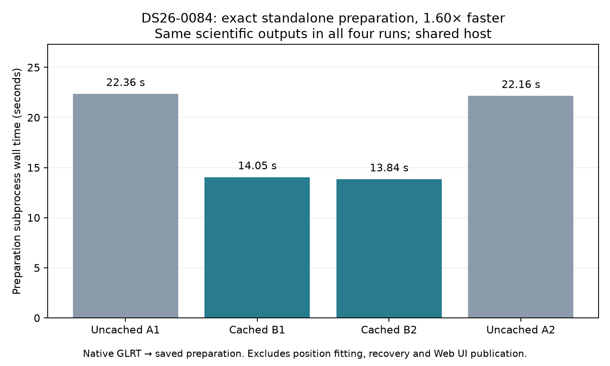

# ALGO07v3: independent causal preparation and exact parsing reuse

**The standalone preparation path is implemented and reproduces the frozen
reference. Its measured preparation speedup is 1.60× on DS26-0084. This is not
a complete localization pipeline, a production release, or a full-path speedup.**
The initial position optimizer, ordered recovery/reassociation, final publication
and full DS26 localization equivalence remain unfinished. The 10× complete-path
target in the [plan](../../docs/operations/algo07v3-plan.md) remains unchanged.

## What now runs independently

The new [application](../../src/leo/application/localization_v3.py) takes native
GLRT evidence, track configuration, an archive reader port and explicit regional
screening coordinates. It constructs winning observations and graph tracks,
selects causal elements, builds the regional orbit bank and previous-element
prior, estimates radio noise, constructs causal phase history and forecasts phase
priors. It does not read an earlier ALGO result or invoke an old worker.

The initial catalogue retains its 48-hour collection window. Phase history
retains its separate 72-hour window. Both element and collection timestamps must
be causal. The original distinctions remain: repaired previous-element selection
uses the latest collection of duplicate payloads; phase history uses the earliest
publication. Genuine previous epochs must differ by at least one second.

The original forecast's internal chronological calibration split is preserved
exactly for output equivalence. These are existing temporal calibration results,
not new randomized scientific validation. This work tests implementation parity
and runtime, not improved localization accuracy or scientific generalization.

The command is `PYTHONPATH=src python tools/prepare_algo07v3_inputs.py --help`.
It requires a native input hash, track configuration, archive and explicit
screening coordinates, writes a new bound preparation directory, and explicitly
reports `position_estimated=false`. Its `--no-element-cache` switch supports
controlled comparisons of the same preparation path. The separate comparison
command is `PYTHONPATH=src:tools python tools/compare_algo07v3_initial_inputs.py
--help`; `--with-phase-history` also requires both original source files.

## Exactness evidence and denominator

The full declared DS26 fast track cohort is **159 members: 158 available and one
unavailable**. Both implementations completed all available members with zero
failures; all **158 serialized outputs match exactly**. The comparison validates
input/source/output bindings, full observations, aliases, graph memberships,
polynomial pieces/coefficient values, metadata and curvature selections. This
finishes the track-only comparison begun in the [first report](../2026_11_04_algo07v3_start/README.md).
See [full track comparison](track-comparison.json); it is not a position comparison.

| Scan | Native winning points | Graph tracks | Cached preparation vs original |
|---|---:|---:|---|
| DS26-0002 | 4,211 | 127 | All 19 checks exact |
| DS26-0084 | 4,628 | 148 | All 19 checks exact in all four ABBA runs |
| DS26-0102 | 4,682 | 140 | All 19 checks exact |

Checks include selected/previous/repaired TLE bytes, their provenance, native
observations and tracks, noise outputs, phase history and all forecast fields,
and orbit-bank array keys/dtypes/shapes/bytes. Operational source/file hashes are
verified before their differing persistence bindings are excluded. No numerical
tolerance is used. The uncached extraction also passed all three scans.

All four timed runs and both additional cached replays ran in a private mount
namespace with `/opt` hidden by a read-only empty filesystem. Thus the preparation
path ran without the installed historical runtimes. Comparisons ran externally
afterward, where reference evidence was readable. This does not prove isolation
of the unfinished full engine, and old result directories were not separately
masked. Candidate inputs contained only native evidence, configuration and the
archive; no old result path was supplied.

## Measured bottleneck and optimization

The [profile](profile-top.json) shows 123 catalogue parses consuming 64.001 of
75.376 profiled application-preparation seconds, largely repeated textual
checksum validation. Profiling overhead is substantial; those times must not be
compared directly with unprofiled runs.

The new scan-scoped [element parser](../../src/leo/analysis/localization_v3/elements.py)
caches immutable, validated textual records keyed by the entire catalogue text.
It still reads through the archive port each time, preserving integrity checks.
Every parse returns fresh SGP4 objects, so propagation/mutation cannot contaminate
later calls. It never caches causal eligibility or provenance. The initial
catalogue helper accepts the parser as an optional callable; existing callers
retain their original uncached default.

| Trial, sequential order | Cache | Subprocess wall time | Internal preparation time |
|---|---|---:|---:|
| A1 | Off | 22.362 s | 20.314 s |
| B1 | On | 14.048 s | 12.147 s |
| B2 | On | 13.844 s | 11.863 s |
| A2 | Off | 22.163 s | 20.191 s |

Mean subprocess time falls **22.263 → 13.946 seconds: 1.596× faster, 37.4% less
time**. The subprocess interval includes interpreter startup through persisted
preparation; it excludes position optimization, recovery and final UI artifacts.
All runs used the same input, archive, configuration, interpreter and one BLAS
thread on a shared host. ABBA reduces order bias but does not establish a
population speedup or confidence interval. See [benchmark runner](benchmark.py),
[source/input-bound timings](benchmark.json), and [four exact comparisons](comparison1.json).

On DS26-0084, each cached run had 91 hits, 32 misses and no evictions. Retained
text/record accounting was 190,550,623 bytes (181.7 MiB), below the 256 MiB limit.
This excludes mapping overhead and transient arrays; it is not process peak
memory. DS26-0002/0102 likewise had no evictions, with 60/95 hits respectively.
The cache is scan-local and can be released after preparation.

## Verification and next work

All 74 focused tests pass, including existing track/orbit/geometry tests and new
archive causality, noise, forecasting, cache eviction, fresh orbit objects,
malformed text, repeated payload provenance, application composition and exact
comparator mutation tests. Tiny coefficient/forecast changes, missing bindings,
wrong native inputs and altered reference code are rejected. Ruff passes.

The next implementation step is the standalone scan likelihood and initial
position optimizer, preserving candidate ordering and matched c=0/fitted-c
observations, priors and budgets. Both arms must eventually pass the full
localization and artifact gates. No position-accuracy improvement, full-pipeline
speedup or production deployment is claimed by this report.
