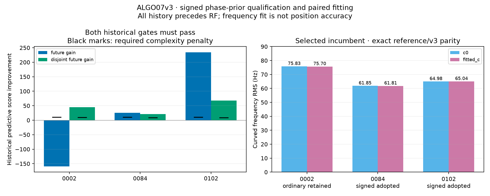

# ALGO07v3: standalone signed causal phase-prior context

Completed 2026-11-05 using the November 4 qualification corpus.

This iteration extracts signed phase-prior qualification and its paired position
refit from the original engine. It prepares the numerical incumbent and
all-catalogue priors required by family-cavity selection. Cavity nomination and
selection, subsequent recovery and final publication remain separate unfinished
work. Production is unchanged.

Fresh full-budget outputs match exactly on all three replay scans. The separate
archived-incumbent audit also passes for every compared scientific field in both
calibration arms. This is another completed component of the independent engine,
not complete ALGO07 equivalence or a speedup result.

## Scan results

| Scan | Historical signed model | Coefficient | Adopted by paired RF gates? | Curved / predictive linear points | Fresh / archived incumbent comparison |
|---|---|---:|---|---:|---|
| DS26-0002 | Unqualified; ordinary means retained | 0 | No | 2,748 / 0 | Exact / exact |
| DS26-0084 | Age squared | −0.059926240 | Yes | 2,797 / 918 | Exact / exact |
| DS26-0102 | Standardized phase | −0.208693692 | Yes | 2,864 / 573 | Exact / exact |

The coefficients multiply different features and are not interchangeable
frequency offsets. Age squared uses `(age_s / 43200)^2`; standardized phase uses
the nominal phase standard deviation times the historical scale multiplier.
For the scan prediction, age is evaluated at the original 150-second midpoint.
The resulting phase mean is capped by the original phase limits.

| Scan | c=0 east, north (km) | Fitted-c east, north (km) | Curved RMS c=0 / fitted-c (Hz) |
|---|---|---|---:|
| DS26-0002 | 5.021500, −5.679299 | 4.981329, −5.656909 | 75.826651 / 75.698326 |
| DS26-0084 | 4.055799, −6.342017 | 4.006817, −6.320471 | 61.852174 / 61.813503 |
| DS26-0102 | 5.823540, −5.220964 | 5.843017, −5.247087 | 64.983915 / 65.041883 |

Coordinates are relative to the configured regional center. These rounded
displays summarize exact binary-value comparisons, not an accuracy improvement.
The v3 and reference endpoints are identical; frequency RMS is distinct from
localization error. Point counts are this policy's fitting evidence, not final
published GLRT coverage.



DS26-0002 improves the disjoint-satellite historical subset but worsens the
larger later-history subset, so its signed model is rejected. DS26-0084 and
DS26-0102 clear both historical penalties and then pass both RF fit arms.
In the figure, “future” denotes later historical validation innovations;
every one of those innovations still precedes the RF scan.

## Preserved scientific decisions

The ordinary phase mean comes from previous causal orbital innovations. The
signed model can add a correction expressed as seconds, standardized phase,
age or age squared. It chooses the form on the original earlier-history split
with a coefficient penalty and a model-search complexity term. Qualification
requires improvement on both later historical innovations and a disjoint
satellite group, all strictly before the RF scan. The all-past fit can still
select the nested zero-correction model.

This preserves the original chronological/satellite-disjoint qualification for
exact production parity. It is not a new randomized validation protocol or a
claim of independent validation of a new scientific model.

Even a historically qualified correction is only a proposal. Both c=0 and
fitted-c are refit from the regional origin with the same observations,
identities, masks, weights, physical priors and budgets. Adoption requires both
arms' original residual, alias, elevation and phase-convergence gates. If either
fails, the original pair and ordinary means remain. On acceptance the same
correction also applies to the all-catalogue phase means used by later searches.

The fixed-position curved posterior supplies predictive covariance for linear
evidence; linear measurements never update its nuisance normal equations. The
event-capable likelihood retains the original parameter slots. This signed
stage uses an empty event list, so it introduces no frequency-step variables.

## Implementation and isolation

`signed_phase.py`, `signed_context.py` and `event_position.py` live in
`src/leo/analysis/localization_v3/`. Their inputs are owned in-memory evidence;
they do not import workers, open old results or access evaluation coordinates.
The application binds the history digest and builds a fresh context with the
genuine previous-element prior. All candidates run with old `/opt` installations
hidden and the existing import/process guard enabled.

The development environment lacked SciPy although it was already declared by
the project. SciPy 1.18.1 was installed to match the frozen reference. This
changes the development environment only, not production. The independent
engine still uses ordinary numerical libraries; independence forbids old ALGO
runtime dependencies, not NumPy, SciPy or SGP4.
Both comparison environments use Python 3.12.14, NumPy 2.5.2, SciPy 1.18.1 and
SGP4 2.27; the executable/version receipts are in
[environments.json](environments.json).

The first candidate attempts were stopped by the isolation guard because a
shared comparison serializer lived in an oracle-named module. The guard was
retained. The serializer was moved into the external checker, and the affected
candidate runs were restarted from native prepared evidence. These failed
attempts do not qualify parity or timing.
The completed references used the original harness; the candidate uses the
same serializer body in its allowed checker module. The exact reference
[checker](reference-checker.py.txt) and [oracle adapter](reference-oracle.py.txt)
are preserved, and the renderer verifies their hashes against the run receipts.

## Evidence scope

Fresh comparisons cover initial search, conservative recovery, family/history
fitting, signed qualification/refitting and the resulting context's likelihood,
state, residuals and orbital prediction. A separate audit compares the archived
incumbent entering family-cavity selection: both arms, node, predictive entries,
means, mask, likelihood powers and prior model. It does not compare later cavity
trials or final ALGO07 output.

The focused suite passes **158 tests**. New tests cover signed historical
qualification/fallback, causal contamination, both-arm acceptance, shared
all-catalogue mean updates, event design slots and independent predictive-density
calculations. An isolated subprocess test prevents the serializer/import-guard
mistake from recurring.

Two mathematical dependencies for the next stage are also extracted:
`cavity_prediction.py` and `feasible.py`. Tests compare correlated prediction and
phase marginalization to independent dense-covariance formulas, exercise recovery
of the legacy phase-round reference, and check a known constrained optimum and
an infeasible solver termination. These are component tests; the complete
family-cavity policy has not yet been implemented or qualified on scans.

No complete-path runtime improvement is established by this stage. The
[runtime scorecard](../../docs/operations/algo07-runtime-scorecard.md) remains
the authoritative separation of measured component timings from the unfinished
10× complete-path target.

| Scan | Reference through signed context (s) | Candidate through signed context (s) |
|---|---:|---:|
| DS26-0002 | 144.529 | 187.646 |
| DS26-0084 | 128.169 | 220.619 |
| DS26-0102 | 272.787 | 366.337 |

The candidate is slower in these observed runs. This was an uncontrolled
shared-host correctness batch with overlapping production work; the host load
average was approximately 31 near completion. These timings neither demonstrate
an optimization nor establish a controlled regression ratio. They exclude native
preparation, later recovery and publication. The 10× full-path goal remains open.

## Reproduction and bindings

[comparison.json](comparison.json) includes source/input/output bindings, selected
policy values and the archived audit receipts. [artifact-bindings.json](artifact-bindings.json)
binds the comparator, renderer, preserved reference harness, environments and
generated figure/summary. The renderer rechecks all numerical source and evidence
digests and repeats the archived comparison before rendering.

```sh
PYTHONPATH=src:tools OPENBLAS_NUM_THREADS=1 python tools/check_algo07v3_position.py \
  --side candidate --source PREPARED_INPUTS --output OUTPUT.json \
  --signed-policy --rounds 5 --iterations 48 --search-center 37.906 -122.545
```

Use the frozen reference runtime for its separate invocation. Candidate runs in
this report hide `/opt` using a private mount namespace and retain the legacy
import/process guard. The 900-second external watchdog did not terminate any
successful comparison. No internal scientific budget or acceptance threshold
was relaxed.

```sh
PYTHONPATH=src:tools OPENBLAS_NUM_THREADS=1 python \
  reports/2026_11_04_algo07v3_signed/render.py \
  --reference /srv/bulk/leo/research/algo07v3-20261104/signed001 \
  --candidate /srv/bulk/leo/research/algo07v3-20261104/signed002 \
  --output reports/2026_11_04_algo07v3_signed
```

Archive reads require local archive read permissions. The next integration is
the complete family-cavity nomination and paired selection policy, using the
extracted covariance and constrained-refinement primitives. No production
release is qualified by these partial-path comparisons.
