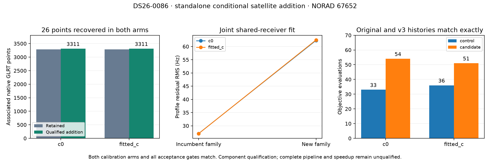

# ALGO07v3: owned conditional satellite addition

The additional-family controller and position fit now live in v3. They consume
the selected likelihood, native observations, causal catalogue and screened
targets as values. They do not launch or read the older ALGO workers.

On DS26-0086, the original controller and v3 qualify the same **26 native points
for NORAD 67652**. Both c=0 and fitted-c retain their **3,285 incumbent owners**,
giving **3,311 associated points per arm** after the qualified addition. The
complete scientific outputs match exactly: candidate ordering, control fits,
candidate fits, objective histories, phase references, exact orbital audits,
ownership checks, residual diagnostics and quadrature refinement.

This qualifies one accepted additional-family case, not the complete engine.
Final ALGO07 guarded reassociation and all eight WebUI artifacts still need
integration and qualification. No deployment occurred. Complete-path matched
scans remain **zero**, and no end-to-end speedup is established.

## What is preserved

The controller uses the approved **72-hour causal / ±30-second** policy, without
a recency penalty. It preserves the original target order: descending minimum
fold margin, then point count, then fragment identity. Existing satellite families
are excluded from this new-family route; two incumbent mixtures retain the
original compute cap. At most one new family is tried.

Every eligible proposal gets a freshly reconstructed control and candidate in
both calibration arms. The candidate changes only its private scan view. An
expanded orbit window is private to prediction and does not alter the calibration
bank. A rejected trial cannot append satellites, tracks or cache entries to the
retained scan.

Position fitting retains three phase-refresh epochs, L-BFGS-B with the original
30-iteration / 100-evaluation options, ±12.5 km bounds and 600-second objective
deadlines per pair. The caller still owns process cancellation. With one existing
predictive family and one new family, their phase/orbit mixture is integrated
jointly using shared receiver covariance and the original contraction order.
The new-family quadrature is checked at 0.05, 0.025 and 0.0125 seconds at the
endpoint and four nearby positions; the incumbent quadrature stays fixed.

Adoption requires both arms of **both the control and candidate** to pass all
seven checks: optimizer completion, phase closure, exact incumbent orbital gates,
incumbent owner preservation, family residual gates, interior phase support and
quadrature agreement. Location error is not an input to any decision.

## Connected application evidence

A fresh isolated DS26-0002 run reaches the new application entry point from the
prepared native scan. All previous scientific fields match the earlier committed
prefix exactly, including its **2,783 retained owners in each arm** and residual
screen. The screen-pass fragment `15b645d768181a7f14ac` nominates NORAD 57809,
which is already represented. The controller therefore returns
`no_qualified_new_family`; it neither refits a control unnecessarily nor credits
those 25 points through the wrong recovery route.

This run tests the connected no-addition branch. The accepted DS26-0086 comparison
separately exercises the complete numerical controller from an explicit selected
fixture. It does not establish accepted-addition parity from fresh native input
over the full population.

The application retains an in-memory reconstruction callable and selected owners.
Before fitting it checks that the screen's case and native targets match the
prepared packet and that the catalogue cutoff still matches the scan. It returns
`additional_position_evaluated` with `recovery_complete=False`: final reassociation
and publication are not silently skipped.

## Evidence and timing limits

The fresh connected DS26-0002 prefix took **260.781 seconds**. It excludes native
preparation, final guarded reassociation and publication. It has no matched
whole-prefix reference timing in this experiment. Component timings and exact
output bindings are recorded in [comparison.json](comparison.json) and
[artifact-bindings.json](artifact-bindings.json); overlapping shared-host runs
are observations, not a controlled speedup benchmark.

The focused component, application, adapter and tool suite passes **397 tests**,
with no failures, errors or skips. New tests cover candidate-view isolation,
both-arm acceptance, failed controls, target ordering, existing-family exclusions,
prediction-window isolation and strict comparisons that reject changed controls,
histories, identities or endpoints.

The first external comparison found a historical fixture-label discrepancy:
the selected input was named `SCAN`, while its saved screen retained `DS26-0086`.
Every other output field matched. The test adapter now scopes that historical
screen to the explicitly supplied input, as a fresh production preflight does.
The numerical algorithm and comparator were not relaxed. The strict pair was
rerun with that input correction; the initial evidence remains in `additional001`.
An initial test run also exposed a misplaced test assertion; it was corrected
before the clean 397-test run.

## Reproduction

`tools/check_algo07v3_additional_recovery.py` runs either the frozen controller or
the owned controller from explicitly supplied fixture paths. Its current fixture
adapter supports a selected new-family incumbent; it rejects unsupported gap or
graph-bundle inputs rather than silently reconstructing another model. Supply
`--side`, `--input`, `--screen`, `--catalogue`, `--runtime` and a new `--output`.
The reference executes the original `position.one` with file IO redirected.
The candidate uses only v3 components. Candidate qualification runs hide `/opt`
and reject legacy imports, file reads and process launches.

`tools/compare_algo07v3_additional_recovery.py` compares every output field and
also checks both-arm gate consistency and unique native point counts.
`tools/check_algo07v3_position.py --additional-position` runs the connected
implemented prefix; it requires `--recovery-catalogue` and the existing prepared
scan and regional-search arguments.

Run this report's `render.py` to verify receipt hashes, compare complete results,
check the unchanged earlier prefix and regenerate the figure. The evidence root
is `/srv/bulk/leo/research/algo07v3-20261104`. The accepted component pair is in
`additional002`; the connected prefix and test XML are in `additional001`.

## Remaining work

Carry the qualified addition's exact selected likelihood and native ownership
into the final guarded-reassociation stage. Extract and qualify that stage,
connect all required artifact rendering and publication, then complete full-DS26
equivalence and matched complete-path timing. Broader incumbent branches,
ordinary-clock admission and cancellation also remain release gates. The 10×
complete-path goal is still open.
