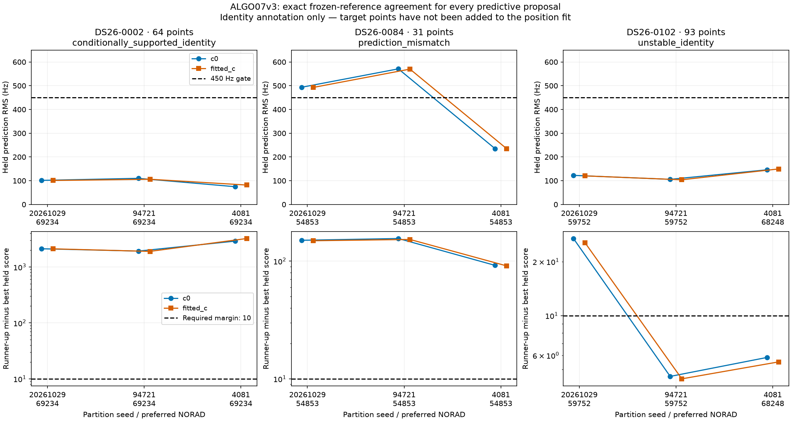

# ALGO07v3: causal predictive annotation of unused tracks

The independent engine now tests unused native graph curves against the causal
satellite catalogue, using the original grouped validation and uncertainty
models. It reproduces the complete annotation calculation for the largest
recovery target on each of three DS26 scans, including both successful and
rejected identities.

**The three complete candidate outputs match the frozen reference exactly.**
The comparison covers timestamp schedules, all catalogue nominations, both-arm
training results, every candidate's predictive mean/covariance and phase
diagnostics, held scores, identity votes and final annotations. The preceding
initial-search-through-inventory outputs also remain exactly unchanged.

This stage annotates identities; it does not add target points to position
fitting. Shared/new-family inclusion, exact ownership checks for those additions,
later recovery/reassociation policies and final publication remain unfinished.
Full DS26 equivalence and the 10× complete-path performance target are still
open. Production is unchanged.

## Three deliberately different outcomes

| Scan / largest target | Native points | Preferred satellite | Held RMS range across c arms and partitions | Minimum competitor margin | Annotation |
|---|---:|---|---:|---:|---|
| DS26-0002 RX1 CH8 T000 | 64 | 69234 in all six votes | 74.8–110.0 Hz | 1,899.36 | Conditionally supported identity |
| DS26-0084 RX2 CH5 T001 | 31 | 54853 in all six votes | 234.8–571.0 Hz | 91.02 | Prediction mismatch |
| DS26-0102 RX1 CH2 T004 | 93 | 59752 in the first two partitions; 68248 in the third | 104.0–149.5 Hz | 4.44 | Unstable identity |

Margins are runner-up minus best held negative-twice-log-density scores. They
are conditional comparisons within the searched hypotheses, not calibrated
probabilities of satellite identity. The minimum required margin is 10.

For DS26-0002, satellite 69234 already has active curved evidence elsewhere in
the incumbent. The unused CH8 curve agrees with its shared calibrated posterior
across all three holdouts, so it is eligible to proceed to the separate shared
family inclusion test. Annotation alone does not authorize adding its 64 points.

For DS26-0084, every vote prefers 54853, but this is not enough. The first two
partitions have approximately 493 and 570 Hz held RMS in both arms, exceeding
the 450 Hz gate. The third partition passes at about 235 Hz. Phase convergence
and visibility pass, but the residual failure prevents a supported annotation.
V3 preserves that rejection rather than converting a consistent ranking into
an accepted association.

For DS26-0102, both arms favor 59752 in the first two partitions and 68248 in
the third. All six winners have acceptable residual RMS, visibility and phase
convergence, but the identity changes and some margins are below 10. This is
the complementary failure case: a small residual does not establish a stable
satellite identity. The incumbent cavity policy previously selected 59752 for
an existing family; that does not force the unused 93-point curve into that
family.

## Preserved scientific procedure

1. Select the same largest commonly unused target identified by the preceding
   inventory, retaining the production session ID and stable track ID.
2. Choose three distinct randomized block holdouts from timestamps alone.
   Preserve 12-second blocks, 2-second guards, seeded block-origin shifts,
   at least eight target training points and four target held points. If three
   usable distinct holdouts cannot be formed, stop before frequency fitting.
3. For each partition, refit receiver calibration using only retained training
   observations from existing curved tracks. The target never enters these
   equations. Use fixed 150 Hz noise and unit family weights instead of
   full-data learned noise or RF confidence weights. Retain the original five
   phase rounds and 48 optimization iterations per round in each c arm.
4. Nominate satellites from the complete supplied causal bank using only target
   training observations, at the regional center, both trained endpoints and
   the original nine ±10 km regional probes. Preserve the coarse ±15-second
   phase search, alias handling, stable ordering and cap of 12 unique nominees.
   The three cases produce respectively 3/4/3, 5/4/6 and 3/3/4 nominees across
   their partitions; the cap is not a requirement to invent extra competitors.
5. Predict the target without updating calibration. For an actively calibrated
   family, propagate its existing posterior. For a new or inactive family,
   integrate the causal phase prior on the original 0.1-second grid over ±15 s,
   physical orbital-mode covariance, receiver covariance, independent 300 Hz
   track bias and the predeclared noise variance multiplier of two. Visibility
   removes below-horizon phase hypotheses.
6. Target training points determine mixture weights and conditional prediction;
   held target values enter only the predictive score and residual. Position
   uncertainty and learned noise-precision uncertainty remain plug-in quantities,
   matching the original algorithm's limitations.
7. Require the same winner in all three partitions and both c arms, at least
   two competitors per partition, margin ≥10, held RMS ≤450 Hz, phase change
   ≤0.01 s and nonnegative minimum elevation. Return an annotation, with
   position-inclusion authorization explicitly false.

The holdouts are randomized **blocks**, not independent point draws. This is an
exact reproduction of production's correlation-aware validation. Its inference
is conditional on the preconstructed graph and incumbent identities; it is not
an independent end-to-end holdout assessment of graph construction and the
entire association process.

## Owned implementation and verification

The new `prediction`, `predictive_annotation`, `recovery_partitions`,
`recovery_fragments` and `phase_reference` modules live under
`leo.analysis.localization_v3`. The application exposes
`annotate_recovery_target`, which returns an incomplete recovery state.
The numerical code has no old-worker imports, subprocesses, historical result
readers or evaluation-site inputs.

The history problem now also owns the later solver's explicit orbital-support
options. Prior-only orbital uncertainty remains distinct from learned orbital
corrections requiring multiple receiver/channel owners. Default nominal behavior
remains exact across the entire previously qualified prefix. Phase convergence
is measured before clipping the next linearization reference, so hitting the
phase limit cannot masquerade as convergence.

Partial graph support is exposed through an appended predictive-only fragment
with copied measured values and receiver basis. The parent graph and calibration
arrays remain intact. This path, event-coordinate placement and extended
reference-domain handling are implemented for the following inclusion stages;
the three real-scan annotation comparisons here use whole tracks and no events.
Do not infer whole-scan qualification of every optional path from this trio.

The candidate runs freshly from its own prepared native evidence through all
implemented policies. `/opt` is hidden in a private mount namespace and the
legacy-import/subprocess audit guard remains enabled. The separate frozen
ALGO03 reference may replay its archived cavity incumbent. An external adapter
captures its original annotation writes in memory and removes operational job
metadata and elapsed time; it retains the mathematical branches and all
scientific records. Arrays compare by dtype, shape and byte hashes; floats by
exact hexadecimal values. A second comparison checks every preceding scientific
field against the prior inventory qualification.

Component tests cover pre-clipping convergence, timestamp binding, distinct
holdouts, fragment ownership and copying, fixed training noise and weights,
nomination independence from held values, causal phase-mixture covariance,
coefficient preservation, rejection before fitting on insufficient geometry,
prior-only versus learned-mode ownership qualification, application authority,
the external adapter and exhaustive comparison rejection paths.

The focused v3 analysis, application, operations and verification-tool suite
passes **190 tests**. Owned Ruff checks and `git diff --check` also pass.

## Timing scope and remaining work

The recorded candidate durations include the entire initial-search-through-
annotation prefix. Reference durations include only replay and annotation from
an archived cavity decision. They have **different scopes and are not a speed
comparison**. Both ran on the shared host. The current timings are retained in
[comparison.json](comparison.json) for provenance; no new speedup is claimed.

The next step is shared-family and new-family inclusion, with matched c-arm
controls, phase-resolution checks, preserved incumbent owners and the original
acceptance/numerical-retry rules. Later policy stages and all final UI artifacts
must follow before the complete ALGO07 equivalence and performance benchmarks.

Evidence and reproduction:

- `/srv/bulk/leo/research/algo07v3-20261104/annotation001`: fresh complete fingerprints, receipts and exact-comparison results.
- `/srv/bulk/leo/research/algo07v3-20261104/inventory002`: previously qualified scientific prefixes.
- [comparison.json](comparison.json): outcomes and per-partition diagnostics.
- [artifact-bindings.json](artifact-bindings.json): evidence and figure hashes.
- [render.py](render.py): validates bindings and exact comparison before plotting.

Candidate verification uses `tools/check_algo07v3_position.py
--predictive-annotation --target-rank 0 --rounds 5 --iterations 48`, with the
same explicit native input source, session ID and regional center as the
[inventory qualification](../2026_11_05_algo07v3_inventory/README.md).
`tools/algo07v3_annotation_oracle.py` runs the external reference;
`tools/compare_algo07v3_annotation.py` compares both and the prior prefix.
