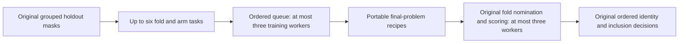
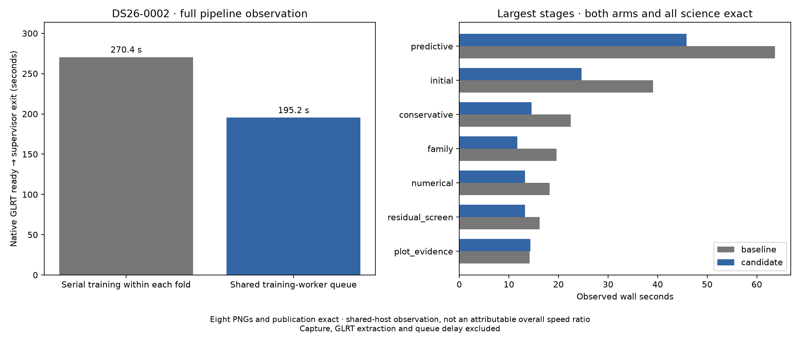

# ALGO07v3: bounded training queue for predictive annotation

2026-11-05. Development optimization; production is unchanged.

The complete DS26-0002 comparison is exact through both calibration arms, all
scientific audits, observation/satellite ownership, eight PNG bytes and published
grid/path values. Native-input-to-publication time is **270.401 → 195.246 s**:
**75.155 s shorter**, an observed **1.385× ratio / 27.79% reduction**. This is
one scan and a changing-load host, not a stable population speedup. Unchanged
upstream stages also improve substantially, so the complete difference cannot
be attributed to the new scheduler.

This iteration integrates the scheduling change motivated by the
[DS26-0066 profile and external experiment](../2026_11_05_algo07v3_predictive_0066_profile/README.md).
That experiment reduced one complete slow fold from 99.051 to 51.607 seconds
over three alternating pairs, with exact outputs and 1.81% more CPU work.
Those are prepared-fold measurements, not a whole-pipeline speedup.

## What changes

Previously each annotation launched three fold workers, and each worker fitted
`c0` and `fitted_c` sequentially. A fold with two expensive fits could leave
the other CPUs idle after their folds finished. The owned worker now queues
the independent `(fold seed, calibration arm)` fits under a shared limit of
**three live training children**. It starts the next queued task when a child
has returned and exited, preserving the original result order.

Training and scoring worker groups do not overlap. Each training child runs
the unchanged five phase-refresh rounds and 48-iteration position budget.
Candidate sets, aliases, priors, phase bounds, convergence rules, holdout masks,
nomination, prediction mixtures and acceptance decisions are unchanged.

Each completed fit returns its final reference, endpoint, calibration-arm label,
training mask and metadata. The scoring child rebuilds the final likelihood
from that recipe and the same owned scan context. It validates the arm/mask and
replays the exact training objective. Component tests compare every final
calculation and state field, not just that scalar objective. Live closures and
storage objects are never transported as task results.

Calls without the new execution port retain the previous path. Stateful
numerical-policy replay and proposal callbacks explicitly retain serial
execution and ordered side effects. The new port is wired only into the
original predictive checkpoint; later numerical replay is not parallelized.

The existing process adapter owns cancellation, pipes, process-group membership,
and cleanup. Queued tasks do not add local scientific deadlines. A child failure
aborts execution and cannot become a successful scientific rejection. Successful
child teardown completes before the slot is reused, maintaining the worker cap.

## Validation

The component suite passes **672 tests**. It includes actual forked worker
completion, queue order and three-slot occupancy, queued-child failure,
cancellation and reaping; exact training-problem reconstruction under both
calibration arms and prior configurations; changed-recipe rejection; all fold
proposals and holdout receipts; insufficient training support; and preservation
of stateful callback/policy behavior. Application and operations tests verify
the port is forwarded only to its intended stage.

The earlier focused run passes 124 tests; a 36-test follow-up checks the two
files whose formatting changed after the broad run. These overlap with the
672-test suite and are not additive test counts. No golden scientific fixture
was changed. Runtime source and new/updated helper lint checks pass; pre-existing
line-length warnings in the application test file remain outside the changed
lines.

`tools/profile_algo07v3.py` now labels queued children with both fold seed and
calibration arm, with real-process profiling tests. The previous external
paired-arm prototype remains usable on the explicit serial branch of the
updated fold function.

## Native qualification and timing scope

| DS26-0002 scope | Baseline | Candidate |
| --- | ---: | ---: |
| Complete native-input-to-publication process | 270.401 s | 195.246 s |
| Process CPU, user + system | 374.490 s | 255.370 s |
| GNU-time maximum resident set | 2,267,884 KiB | 2,284,736 KiB |
| Native preparation | 12.538 s | 8.723 s |
| Recovery catalogue | 9.490 s | 5.934 s |
| Initial search | 39.095 s | 24.632 s |
| Predictive recovery | 63.668 s | 45.856 s |
| Later numerical replay | 18.220 s | 13.221 s |
| Diagnostic plot evidence | 14.174 s | 14.311 s |
| PNG rendering | 5.741 s | 5.664 s |

Both executions complete without resuming or timing out. The measured predictive
stage is 17.812 seconds shorter, but host variation also affects that difference;
it is not an isolated scheduling benchmark. CPU accounting and maximum RSS are
GNU-time process-tree observations, not a measurement of aggregate simultaneous
resident memory. Full numerical results remain identical; no position-accuracy
or frequency-fit improvement is claimed from this runtime change.

DS26-0066 is the next qualification, because it exercises accepted guarded
reassociation and the slow training fold that motivated the work. A fresh
candidate-first/baseline pair has been launched at
`/srv/bulk/leo-dev/algo07v3-annotation-training-0066-20261105` using these same
source snapshots. Its result is **pending**, not included in the passing scan
count or timing claims above. The copied test XML files refer to the same-byte
component suites, not additional scan-specific test executions.

Fresh baseline and candidate runs use separate output stores and private,
read-only source overlays. They share frozen native GLRT observations, causal
TLEs, radio-noise inputs, search region, all fit budgets, three-CPU affinity and
one BLAS thread. Prior installations/results and networking are hidden. The
outer bound is 1,200 seconds per complete run. Evaluation GPS is presentation
only; it never selects a task, association or position.

The comparator requires exact scientific audits, both calibration arms,
observation/satellite ownership, all eight PNG bytes and published grid/path
values. Seven changed implementation modules are explicitly declared; no
persisted public contract changes.

The full-process clock starts with native GLRT available and ends after owned
publication/supervisor exit. Capture, GLRT extraction and queue delay are
excluded. Per-stage times, GNU-time CPU and maximum RSS, host pressure,
source/input bindings, isolation records and comparison receipts accompany the
figures. This shared host requires caution when attributing an overall timing
difference; changing preparation/catalogue times are particularly useful
controls for unrelated load and cache effects.

## Reproduction

The DS26-0002 comparison root is
`/srv/bulk/leo-dev/algo07v3-annotation-training-20261105`. It contains frozen
baseline/candidate source maps and fresh native requests. With the pinned Python
environment, the report's `run_pair.py` executes the matching overlays, then
runs the strict comparator. It also supports reversed execution order through
`--candidate-first`. `render.py` verifies completion, source bindings, all
comparisons and test receipts before publishing the timing figure and summary.

Full DS26, ordinary production admission and a stable cumulative ratio against
the original ALGO07 worker remain unqualified. Ratios from the older geometry,
gate and scheduling experiments must not be multiplied into a cumulative claim.
This development iteration does not deploy ALGO07v3.

## Next measured opportunity

Initial search currently runs each branch's two arms concurrently but waits for
that pair before fitting the next independent branch. It can therefore leave
one of the three available CPUs idle. Once this iteration is qualified, test
whether a bounded queue across branch/arm pairs helps complete initial search,
retaining common `c0` branch selection, zero-phase controls and callback order.
This is a hypothesis to measure, separate from the earlier discovery-seed
scheduling experiment that remained external because its CPU cost increased.
