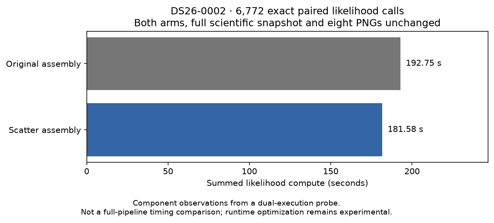

# ALGO07v3: full-scan exact assembly experiment and expanded reference audit

2026-11-05. Development evidence; neither experimental optimization is enabled
in the numerical runtime. Production is unchanged.

The scatter-assembly prototype passes **every one of 6,772 likelihood calls** in
a complete DS26-0002 native-input run. Each call runs both implementations,
compares every output's dtype, shape and bytes, and returns the experimental
result to the optimizer. The complete resulting scientific snapshot has the
same SHA-256 as the previous native qualification, including both calibration
arms, all 179 diagnostic grid locations and all eight PNG hashes.

| Measurement | Original | Scatter assembly |
| --- | ---: | ---: |
| Summed likelihood compute in the interleaved probe | 192.753 s | 181.576 s |
| Calls compared exactly | 6,772 | 6,772 |
| Distinct observation/feature shapes exercised | 77 | 77 |

The observed component saving is **11.177 seconds, or 5.80%**. This is not a
complete-path speedup. Both implementations execute inside this diagnostic
run, which takes 644.717 seconds including the comparison work. Subtracting
component observations from this dual-execution total would not establish
normal runtime. The earlier fresh reference/native pair remains the latest
complete-path observation: **675.455 versus 504.041 seconds**, with the caveats
in its [report](../2026_11_05_algo07v3_pair/README.md).

The [probe](../../tools/probe_algo07v3_assembly.py) alternates reference/candidate
order on successive calls and aborts on any difference. It uses the existing
native qualification driver and legacy-access guard. This is not a repeat of
the private namespace isolation test, which is documented separately. The
prototype retains the per-entry addition order, all priors, all stopping rules
and the original linear solves. It introduces no new satellite or position
selection. The [receipt](probe.json) includes the implementation hashes,
per-shape call counts and timings; the result snapshot SHA-256 is
`4f7c74a132b415e9bd6e130dcbc0d7082fa72c822d53f76810f8a9fa13323d68`.

## Additional exact reference mappings

The external [publication comparator](../../tools/compare_algo07v3_published.py)
now maps **11 of 17** scientific audit sections on this fresh pair, up from
eight. All **25 checks** pass. The three added comparisons cover:

- The complete ranked satellite-family list, including families not selected.
- Final reassociation screening: both cavity fits, catalogue propagation,
  coarse/whole-curve proposals, folds, partitions and rejection evidence.
- The completed no-proposal fallback, including both final numerical solutions.

Only the two explicit cavity timing fields are removed from screen comparison.
Catalogue/input paths are verified against hash-bound public exports, and the
final protocol hash is checked. The comparison receipt now includes hashes of
its request, timings, export descriptors, comparator and scientific receipt.
Unknown scientific fields and changes to rejected candidates fail the checks.

These additions qualify the branches actually exercised here. Accepted or
reviewed reassociations and extra intermediate fits deliberately fail the new
fallback mapping until their independent reference mappings exist. A passing
no-proposal case does not establish accepted-branch equivalence.

Six audit mappings remain: signed context, recovery inventory, numerical
recovery, gap recovery, additional-recovery preparation and reassociation
handoff. Metadata semantic checks, other recovery branches, the full DS26
denominator and ordinary production wall-clock admission remain open. The
[comparison](comparison002.json) still returns exit code **2**, with
`full_intermediate_equivalence=false` and no qualified speedup.

## Separate factorization-reuse experiment

The [second prototype](probe_factor_reuse.py) reuses the LU factorization of the
Cholesky root for its vector and identity-matrix solves. It retains separate
right-hand sides and the original transpose solve. This differs from the
previous combined-right-hand-side experiment, which failed exactness.

All eight hash-bound captured calls remain exact. Component timings are small
and variable, so all three observations are retained:

| Experiment | Original mean-summed time | Factor reuse | Interpretation |
| --- | ---: | ---: | --- |
| First short ABBA | 0.287132 s | 0.253340 s | Faster |
| Second short ABBA | 0.229457 s | 0.233536 s | Slightly slower |
| 20 ABBA repetitions per input | 0.163290 s | 0.156394 s | 4.22% less component time |

These are eight-call component observations on a shared host, not full
localization measurements. Both the improvement and slowdown remain visible.
The factorization variant has **not** run through a complete native scan, and
combining it with scatter assembly has not been tested. It is not enabled.
The three receipts preserve exactness and timing evidence:
[first](factor-reuse.json), [second](factor-reuse002.json),
[longer repetition](factor-reuse003.json).

## Verification and next work

The focused suite passes **642 tests**, with no failures or skips and one
existing Starlette deprecation warning. Tests cover changed owners/scores,
unselected-family rankings, rejected proposals, missing cavity arms, altered
source bytes and unsupported fit branches. Both numerical prototypes are
also compared on sparse matrices with empty/nonempty feature widths and
C/Fortran layouts. Golden scientific fixtures are unchanged.

Evidence root: `/srv/bulk/leo-dev/algo07v3-assembly-20261105`. The
[report verifier](render.py) checks the full native snapshot, every generated
PNG, source/prototype hashes, reference comparison bindings and test XML before
regenerating the figure and [summary](summary.json).

Next, integrate the qualified assembly operation into the owned implementation
and measure an ordinary candidate execution; keep its original arithmetic as
an external oracle. Finish the six remaining mappings and accepted-branch
coverage before making full equivalence claims. The factorization variant needs
broader numerical evidence before adoption. The full DS26 and **10× complete-path
target remain unachieved**; no production deployment is authorized by this report.
