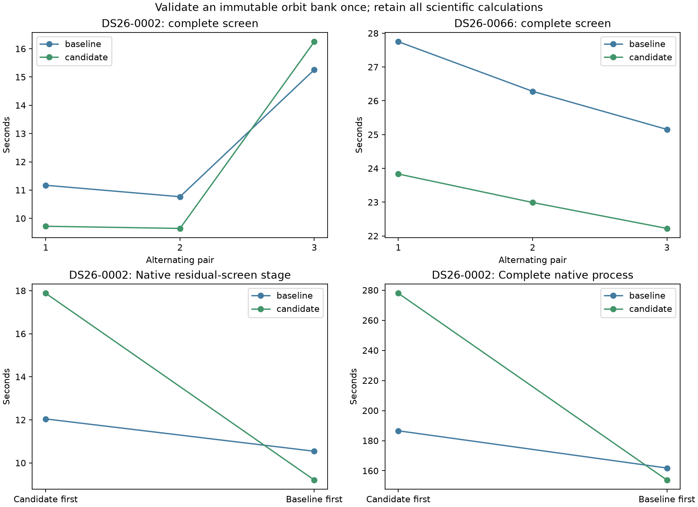

# ALGO07v3: validate an immutable orbit bank once per screen

The immutable-bank optimization is integrated in development following
complete DS26-0002 native qualification and **845 passing tests**. It removes
repeated full-bank validation while preserving every orbital interpolation,
candidate, phase hypothesis, observation, fold, numerical prior and acceptance
gate. Production and full-DS26 qualification are unchanged.

Complete native timing is **mixed**, so this iteration does not establish a
stable whole-pipeline speedup. The first pair regresses; the opposite-order pair
improves. Both pairs and their exact cross-pair comparisons are retained below.

The final prototype's twelve complete-screen trials on DS26-0002/0066 match
the previously qualified scientific result and callbacks exactly. Mean elapsed
and CPU improve on both scans. All individual timings, including the slower
DS26-0002 candidate in pair 3, are retained.

| Complete prepared screen | Baseline mean | Candidate mean | Elapsed reduction | Baseline CPU | Candidate CPU |
| --- | ---: | ---: | ---: | ---: | ---: |
| DS26-0002 | 12.397 s | 11.871 s | **4.25%** | 12.388 s | 11.857 s |
| DS26-0066 | 26.394 s | 23.015 s | **12.80%** | 26.339 s | 22.940 s |

The prepared trial clock includes fresh catalogue propagation, immutable snapshot
copying/validation, the complete coarse search and all finalist calculations.
Loading saved evidence is outside the timer. These are component observations,
not population estimates or original-ALGO07 cumulative speedup ratios.

## Measured reason for the change

The [post-nomination profile](../2026_11_05_algo07v3_runtime_priorities/README.md)
shows coarse geometry consuming 80–83% of residual-screen time. The general
phase interpolator calls the common interpolator with an empty query to validate
the entire state bank before each phase projection. On DS26-0002 this happens
99 times and costs 3.376 cumulative profiled seconds. All calls inspect the same
locally constructed, unchanged orbital bank. That profile cost identifies a
target; it is not a promised unprofiled saving.

## Implementation and ownership

`FrozenOrbitBank` converts the three bank arrays to the same floating-point
representation used by interpolation, copies their contents into immutable byte
buffers and retains immutable shape tuples. It applies the original full-bank
validation once. Each lookup creates a fresh read-only NumPy header over the
immutable bytes. Neither changing the original input, writing through a returned
array, enabling its write flag, nor changing its shape can mutate the stored
snapshot. The snapshot exists only for this screen and is not persisted or
cached across scans.

The generic phase function retains its original validation on ordinary mutable
banks. Only the validated snapshot bypasses the repeated whole-bank scan.
Per-call phase shape/finiteness, observation time and non-extrapolation checks
remain. Interpolation, Earth rotation, look-angle arithmetic, point ordering,
nomination columns and finalist fits are unchanged. Empty target lists retain
their original path. Exactly two existing runtime modules change; there are
no new runtime dependencies or execution workers.

The first external prototype stored read-only arrays. Its scientific trials
were exact, but an additional mutation test demonstrated that an array's shape
metadata could still change. That version was never integrated. The final
byte-and-shape representation fixes this, and all complete-screen trials were
repeated before integration. The failing test receipt and earlier trials remain
in this report. Initial tool-test mistakes comparing integer versus float bytes
and inserting infinity into an integer fixture were corrected without changing
any scientific golden fixture or numerical expected output.

## Every final complete-screen trial

| Scan / pair | Order | Baseline | Candidate | Exact science and callbacks |
| --- | --- | ---: | ---: | --- |
| DS26-0002 / 1 | Baseline first | 11.170 s | 9.720 s | Yes |
| DS26-0002 / 2 | Candidate first | 10.765 s | 9.644 s | Yes |
| DS26-0002 / 3 | Baseline first | 15.257 s | **16.248 s** | Yes |
| DS26-0066 / 1 | Baseline first | 27.748 s | 23.833 s | Yes |
| DS26-0066 / 2 | Candidate first | 26.280 s | 22.990 s | Yes |
| DS26-0066 / 3 | Baseline first | 25.153 s | 22.223 s | Yes |

All inputs remain unchanged. Both calibration arms keep the same candidate sets,
priors, reproducible grouped random folds and numerical budgets. Trials use one
CPU and one BLAS thread. The faster first two DS26-0002 pairs do not justify
discarding its 6.49% slower third candidate; overall timing variation remains
material. Earlier array-snapshot trial means were 10.347 → 9.244 seconds and
12.717 → 11.583 seconds, but those are for the superseded representation and
are not the integrated candidate's claimed gains.



## Fresh native qualification

The first fresh DS26-0002 pair runs candidate first, then baseline, with the same
three-CPU affinity, one BLAS thread, causal input catalogue, regional search,
observations, priors and solver budgets. Each execution starts from native GLRT,
uses a new private output store and ends after artifact publication and worker
supervision. Private namespaces hide earlier installations and reports and
mount the frozen input read-only. The baseline overlays exactly the two declared
old modules; the candidate overlays the final checked implementation.

The first pair **regresses**: baseline 186.553 s versus candidate 277.921 s.
Screening also regresses, 12.043 → 17.878 s, and CPU rises 267.520 → 412.240 s.
Unchanged initial fitting varies 33.250 → 47.434 s, predictive recovery
41.724 → 63.667 s and PNG rendering 5.784 → 8.003 s. The precise cause of the
variation is not established. It is incorrect to dismiss the observed regression
or treat CPU waiting alone as its explanation.

This unresolved timing evidence prompted one opposite-order pair, baseline
first, with identical code and requests. Every timing from both pairs is retained;
the second pair does not replace the first. The cross-pair verifier additionally
requires repeated baselines and repeated candidates to agree in all science and
PNG bytes, with explicitly no source changes between same-side executions.

| Native measurement | Pair 1 baseline | Pair 1 candidate | Pair 2 baseline | Pair 2 candidate |
| --- | ---: | ---: | ---: | ---: |
| Complete native process | 186.553 s | 277.921 s | 161.808 s | 153.847 s |
| Residual screen | 12.043 s | 17.878 s | 10.542 s | 9.205 s |
| User + system CPU | 267.520 s | 412.240 s | 234.930 s | 229.310 s |
| Maximum reported RSS | 2,453,888 KiB | 2,375,948 KiB | 2,375,908 KiB | 2,453,948 KiB |
| Initial search | 33.250 s | 47.434 s | 21.513 s | 21.686 s |
| Predictive recovery | 41.724 s | 63.667 s | 39.935 s | 38.618 s |

Pair 1 is candidate first; pair 2 is baseline first. The second pair's screen
improves **12.68%**, saving **1.337 seconds**. Only that measured stage saving
directly targets this change; do not credit the complete 7.961-second difference
to it. Total CPU falls 5.620 seconds in that pair, while observed peak RSS rises
78,040 KiB. The first pair shows the opposite RSS ordering. Copy allocation is
included, and this sample does not establish a population peak-memory effect.

The integration decision rests on unchanged outputs, immutable ownership and
the repeated complete-component evidence, supported by the second native stage
observation. It is not a claim that the first native regression is explained or
that this change improves every complete scan. Production admission and a
dataset-wide runtime distribution remain separate outstanding qualifications.

The strict comparator requires all scientific values, both c arms, complete
audits, ownership, every public grid/path value and all eight PNG bytes to match.
The native source files equal the integrated files byte-for-byte. The report
renderer verifies these bindings before exporting the summary and figure.

See [summary.json](summary.json), [native/comparison.json](native/comparison.json),
[native-reverse/comparison.json](native-reverse/comparison.json) and all four
native logs for the complete elapsed and per-stage timings. Native
wall-clock changes outside screening cannot all be attributed to this change.
This full native qualification covers one scan; DS26-0066 has complete-screen
qualification for this iteration, not a fresh complete native replay.

The existing DS26-0002 association and localization results remain unchanged:
2,783/4,211 points (66.0888%), 74 fragments and 28 satellites in both arms.
c=0 retains RMS 76.3332809324593 Hz and previously reported error 665.210 m;
fitted c retains RMS 76.1981250553178 Hz and error 697.464 m. No localization
improvement is claimed for this runtime optimization. GPS remains evaluation-only.

## Tests and reproduction

The 845-test suite includes 33 external prototype tests, 13 component-owned
snapshot checks, the original generic orbit-phase tests and the existing complete
four-policy screen/oracle comparisons. Tests exercise immutable ownership,
metadata isolation, malformed banks, per-call validation, ordinary-bank mutation,
empty requests, scalar/per-satellite phases and byte-exact states across multiple
array layouts. The deliberately attempted shape mutation emits NumPy's expected
deprecation warning in three tool cases; it still verifies that the bank is safe.

The reusable external probe now uses explicit frozen pre-change screen and
phase oracles; neither is a runtime dependency. The originally measured tool
bytes are retained in `measured/`. Run fresh alternating trials with:

```sh
PYTHONPATH=src:tools OPENBLAS_NUM_THREADS=1 timeout -k 2 360 taskset -c 0 python -B \
  tools/probe_algo07v3_bank_validation.py --request REQUEST --output FRESH_ROOT
```

The `run_pair.py` and `run_baseline.sh` helpers reproduce the two-module private
overlay pair using the archived source snapshots/manifests in a fresh root.
Run `verify_repeats.py --pair NATIVE_ROOT --reverse REVERSE_ROOT` after both pairs.
`render.py --pair NATIVE_ROOT --reverse REVERSE_ROOT --tests TEST_XML` validates
both native comparisons, cross-pair exactness, source bindings, every screen trial
and the full test receipt before exporting.
All final raw screen roots are
`/srv/bulk/leo-dev/algo07v3-bank-validation-immutable-{0002,0066}-20261106`;
the native root is `/srv/bulk/leo-dev/algo07v3-bank-validation-native-0002-20261106`.
The reverse root is
`/srv/bulk/leo-dev/algo07v3-bank-validation-native-reverse-0002-20261106`.

Capture, GLRT extraction, production queue latency and whole-dataset throughput
are outside these clocks. Do not multiply this component ratio by earlier
optimization ratios. Next investigate common scalar-phase interpolation indices
across satellites, retaining all original arithmetic and exact-output gates.
