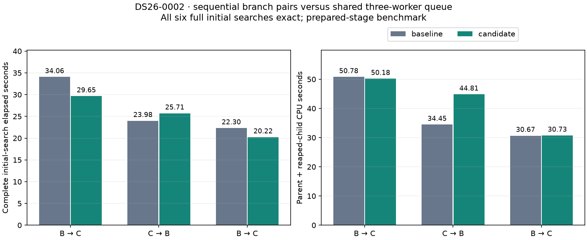

# ALGO07v3: initial branch queue experiment

2026-11-05. External prototype; runtime and production are unchanged.

Queuing independent initial-search branch/arm fits across three workers preserves
all six complete DS26-0002 initial-search results. Mean elapsed time decreases
**26.781 → 25.195 s (5.92%)**, while parent-plus-child CPU increases
**38.633 → 41.907 s (8.48%)**. One alternating pair regresses. Keep this as an
experiment: these measurements do not yet justify runtime integration or a
whole-pipeline speed claim.

## Hypothesis and implementation

The current initial search fits two calibration arms concurrently for each
branch, waiting for that pair before starting the next branch. The prototype
queues all six independent `(branch, arm)` tasks under the existing three-worker
limit. It extracts the original fit expression without changing it; branch
ranking, common `c0` selection, result construction and both zero-phase controls
remain unchanged. Discovery still uses its original execution order.

The experiment is isolated in `tools/probe_algo07v3_branch_queue.py`; it does
not patch runtime source files. It refuses branch callbacks and budgets above
three rather than altering their semantics. Five tests cover extraction,
complete search equality with one and three branches using real workers,
unsupported-call rejection, alternating order and mismatch detection.

## Results

| Pair | Execution order | Baseline elapsed | Queue elapsed | Baseline CPU | Queue CPU |
| --- | --- | ---: | ---: | ---: | ---: |
| 1 | Baseline, queue | 34.058 s | 29.650 s | 50.780 s | 50.178 s |
| 2 | Queue, baseline | 23.982 s | 25.710 s | 34.453 s | 44.813 s |
| 3 | Baseline, queue | 22.302 s | 20.224 s | 30.667 s | 30.731 s |
| Mean | Alternating | 26.781 s | 25.195 s | 38.633 s | 41.907 s |



Every run matches the previously qualified full initial-search fingerprint,
including all three fully fitted hypotheses, both calibration arms and
zero-phase controls. The original fit budgets, priors, observations and causal
catalogue are held fixed. No accuracy improvement is claimed: this changes only
scheduling, and the scientific outputs are exact.

Timing covers complete initial search on a newly constructed owned context.
Context construction is outside the timer. Capture, GLRT extraction, native
preparation, later recovery and publication are excluded. Each run uses CPUs
0–2 and one BLAS thread. CPU totals include the parent and reaped children.
The source and request bindings are checked before publication; prepared inputs
are checked for mutation. `result.json` preserves all trial receipts, host
pressure and CPU-policy snapshots. Those endpoint snapshots cannot establish
continuous clock behavior or explain the observed host variation.

## Decision and next evidence

The mean saving is only 1.586 seconds, with inconsistent elapsed gains and higher
mean CPU consumption. Retain the prototype without integrating it. A larger
initial-search case such as DS26-0066 would be the next discriminating experiment
if this scheduling direction is revisited. Require exact complete search
outputs and then fresh full native qualification before any integration claim.

The separately integrated annotation-training queue has now passed complete
native qualification on two scans; see its
[report and figures](../2026_11_05_algo07v3_annotation_training/README.md).
These are distinct experiments and their timing ratios must not be multiplied.

## Reproduction and artifacts

From the repository root with the pinned Python environment:

```bash
env PYTHONPATH=src:tools OPENBLAS_NUM_THREADS=1 timeout -k 2 600 \
  taskset -c 0,1,2 python -B tools/probe_algo07v3_branch_queue.py \
  --request /srv/bulk/leo-dev/algo07v3-annotation-training-20261105/candidate-request.json \
  --output /path/to/fresh-output-directory --repeats 3
```

The retained run is `/srv/bulk/leo-dev/algo07v3-branch-queue-20261105`.
`render.py` verifies six exact trials, source bindings and five passing tests
before rendering the figure. The report includes the original and extracted
search functions, plan, results, summary and test receipt. Full DS26 and
end-to-end production performance remain outside this experiment's scope.
