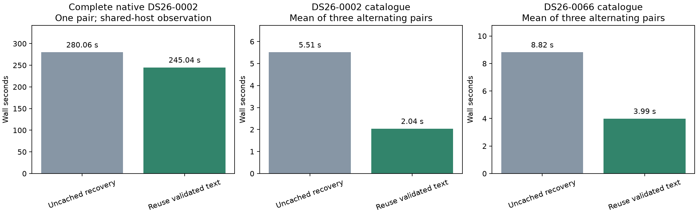
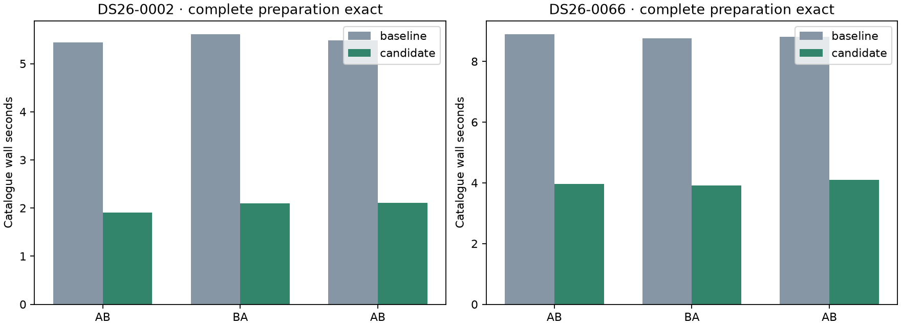

# ALGO07v3: reuse validated TLE text during recovery preparation

The fresh DS26-0002 native pair takes **280.056 → 245.043 seconds**, an observed
**35.013-second reduction (1.143×)**. Both calibration arms, all scientific audits,
point ownership, public grid/path and **all eight PNG bytes match exactly**.
The catalogue stage itself improves **9.211 → 4.653 seconds**. Unchanged later
stages also become faster, so the full 35-second difference is not attributable
to this cache change.

The repeatable component evidence is stronger: three alternating pairs on each
of two scans reduce catalogue time **55–63%**, with lower complete-preparation
CPU use and all twelve preparation outputs exact. The change is integrated in
development after **722 passing tests**. Production remains unchanged.

## Measured repeated work

Initial preparation already uses a bounded cache of validated TLE text. It
shares that cache across initial catalogue selection, previous-element priors
and phase history. Recovery-catalogue preparation then parsed the same snapshot
text again through the uncached parser.

The new path passes the same scan-local parser into recovery preparation, then
releases it **before position fitting**. The cache implementation and its
256 MiB accounting budget are unchanged. Only validated immutable text records
are reused: each call still constructs fresh mutable SGP4 objects. Every archive
read still verifies its content digest, and collection/epoch cutoffs, candidate
selection, previous-element rules and recovery provenance are recalculated.
No cross-scan cache, new numerical model or changed scientific gate is added.

## Alternating complete preparation trials

Each scan has three fresh baseline/candidate pairs, alternating AB/BA/AB order.
Every trial reconstructs native preparation and the recovery catalogue from
the bound native input and causal archive. The candidate starts with an empty
cache, populated only by that trial's initial preparation; it does not receive
a cache from a previous trial. The comparison covers the complete preparation
and catalogue, not merely the selected satellite list. All **12 executions**
match exactly, including numerical arrays and floating-point fingerprints.

| Scope, mean of three executions | DS26-0002 baseline → candidate | DS26-0066 baseline → candidate |
| --- | ---: | ---: |
| Recovery catalogue | 5.513 → **2.040 s** | 8.819 → **3.994 s** |
| Recovery parser calls alone | 4.904 → **1.467 s** | 7.723 → **2.944 s** |
| Complete preparation + recovery catalogue | 14.107 → **10.427 s** | 22.422 → **18.821 s** |
| Complete preparation CPU | 14.097 → **10.421 s** | 22.392 → **18.803 s** |

Catalogue latency falls **63.0%** and **54.7%**, respectively. Complete preparation
latency falls **26.1%** and **16.1%**, with similar CPU reductions. These are
prepared-component measurements, excluding position fitting, artifact production,
queue delay, native GLRT extraction and capture. Initial-preparation timing varies
between pairs; retain that variation rather than attributing it to the change.

DS26-0002 keeps 11,144 causal catalogue members and reads 38 recovery snapshots;
DS26-0066 keeps 11,133 and reads 39. All recovery parser calls are cache hits:
DS26-0002's cumulative counters change from 60 hits/24 misses to 98 hits/24 misses,
and DS26-0066's from 75 hits/31 misses to 114 hits/31 misses. Both have zero
evictions. Retained text/record accounting is 142,945,898 and 184,607,574 bytes,
already populated during initial preparation. Neither cache gains another record
during recovery. The cache is released before any numerical workers start.

The experiment uses one CPU, one BLAS thread and an external 360-second timeout
per scan. Parser timers are nested within catalogue/preparation time; do not add
them to the complete clock. Fingerprinting occurs outside the timed component.
The original probe source is archived because it was later adapted to the new
explicit parser argument. That adaptation is not falsely included in the
earlier measured source bindings.

## Native pipeline qualification

The [complete comparison](native/comparison.json) passes. The pair uses
DS26-0002, frozen baseline/candidate overlays for
the three changed runtime modules, fresh private output stores, read-only frozen
input, private mount/network namespaces, CPUs 0–2 and one BLAS thread. Each side
has a 1,200-second supervisor bound; the baseline runs first. Required parity
includes both calibration arms, all scientific audits, point ownership, public
diagnostic grid/path and all eight PNG bytes.

| Scope | Baseline | Candidate |
| --- | ---: | ---: |
| Complete native process | 280.056 s | 245.043 s |
| Native preparation | 12.622 s | 12.760 s |
| Recovery catalogue | 9.211 s | 4.653 s |
| Residual screening, unchanged | 25.798 s | 18.521 s |
| Admission, unchanged | 15.666 s | 8.341 s |
| Grid evidence, unchanged | 10.232 s | 6.048 s |
| Total CPU, GNU time wrapper | 414.01 s | 370.27 s |
| Maximum RSS | 2,382,916 KiB | 2,341,984 KiB |
| Major page faults | 0 | 1 |

The targeted catalogue saving is **4.558 seconds**. The remainder of the
35.013-second complete-run difference is in unchanged work and host variation.
The GNU time wrapper clocks are 282.55 and 247.05 seconds; they include harness
setup and are distinct from native supervisor time. All stage and resource
measurements are retained in [the native evidence](native/stages.json).

This experiment follows the paired numerical-replay optimization, which is
enabled on both sides. It does not rerun or replace the original-ALGO07 reference.
It preserves position, frequency fit and association; lower runtime is not a
localization-accuracy improvement.

Native timing starts at process launch and ends after successful publication
and process exit. It excludes capture, queue delay and native GLRT extraction.
Shared-host variability remains part of the evidence. Original-ALGO07/current-v3
cumulative speedup is unavailable in this experiment. The two preparation cases
do not establish two complete native cases or full DS26 qualification.
Production deployment and ordinary-admission qualification remain unchanged.

## Tests and reproduction

The final broader suite passes **722 tests**, with no skips or failures. Tests
cover cache release before inference, parser forwarding, unchanged archive reads
and collection provenance, causal-window selection even on cache hits, archive
failure propagation, malformed changed text, fresh SGP4 objects, bounded eviction
and the existing pipeline/ownership/publication behavior. The initial 81-test
focused result overlaps with that suite and must not be added to its count.

`tools/probe_algo07v3_catalogue_cache.py --request REQUEST --output FRESH_ROOT
--repeats 3` performs the complete preparation trials. Pin one CPU and one BLAS
thread and use an external `timeout -k 2 360`. The measured roots are
`/srv/bulk/leo-dev/algo07v3-catalogue-probe-0002-20261106` and
`/srv/bulk/leo-dev/algo07v3-catalogue-probe-0066-20261106`.

`run_pair.py --root ROOT --request REQUEST` runs the fresh native pair over
frozen three-module source trees. The native root is
`/srv/bulk/leo-dev/algo07v3-catalogue-cache-0002-20261106`.
`render.py --pair ROOT --benchmarks BENCHMARK_0002 BENCHMARK_0066` validates native
parity, source bindings, all twelve exact preparation trials and the 722-test
receipt before generating figures and copying compact evidence. Preintegration
bindings resolve against the archived original probe and frozen baseline modules;
current edited files are never passed off as the original measured sources.

See [summary.json](summary.json), [the native plan](native/plan.json),
[DS26-0002 trials](benchmarks/DS26-0002/trials.json),
[DS26-0066 trials](benchmarks/DS26-0066/trials.json) and
[the 722-test receipt](native/tests-broad.xml). Complete preparation fingerprints
remain in each measured root; their digests are archived beside the trial receipts.

## Further work

The main remaining runtime cost is repeated numerical fitting. This change
removes measured repeated parsing with no new infrastructure, but its complete
pipeline saving is bounded by the catalogue stage's share of runtime. Further
work should use the latest complete timings to choose between repeated likelihood
calculations and evidence serialization/publication, then measure before changing
either. Do not infer a large cumulative speedup by combining ratios from different
scans or runs.
