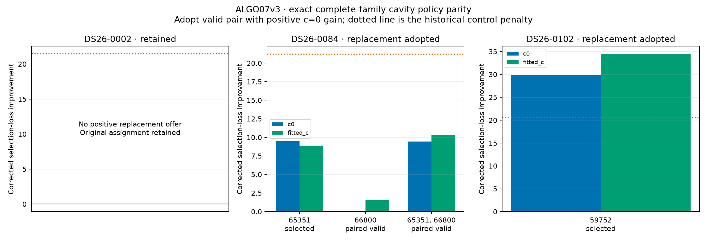

# ALGO07v3: complete-family cavity nomination and selection

This iteration implements the family-cavity policy in the independent engine:
exclude one entire active satellite family from calibration, score its curved
and predictive-linear observations jointly against the causal catalogue, then
fit qualified replacement proposals using the full original evidence.

**All three full-budget replay scans match exactly**, both against fresh frozen
mathematical oracles and against every archived cavity scientific field. The
comparison includes all nominations and full trials, not only the final position.

This is a component of ALGO07v3, not completion of the independent pipeline.
Subsequent ALGO03–07 recovery, final publication, full DS26 localization parity
and the 10× complete-path performance target remain open. Production is unchanged.

## Results

| Scan | Families challenged | Full replacement trials | Selected replacement | Corrected c=0 / fitted-c loss gain | Fresh / archived comparison |
|---|---:|---:|---|---:|---|
| DS26-0002 | 27 | 0 | Original assignment retained | — | Exact / exact |
| DS26-0084 | 26 | 3 | 49734 → 65351 | 9.482999 / 8.886669 | Exact / exact |
| DS26-0102 | 21 | 1 | 68248 → 59752 | 29.917275 / 34.449733 | Exact / exact |

DS26-0084 tests two individual proposals and their joint replacement. The joint
proposal improves fitted-c more, but its c=0 gain is 9.456831, slightly below the
selected single replacement's 9.482999. Production selects with c=0 after both
arms pass, so the single replacement wins. Its gain is also below the historical
sticky penalty of 21.219793: that older control rejects, while production's
equal-prior policy accepts. Both decisions are reproduced and retained.

| Scan | Selected c=0 east, north (km) | Selected fitted-c east, north (km) | Curved RMS c=0 / fitted-c (Hz) |
|---|---|---|---:|
| DS26-0002 | 5.021500, −5.679299 | 4.981329, −5.656909 | 75.826651 / 75.698326 |
| DS26-0084 | 3.987466, −6.369093 | 3.944174, −6.349224 | 61.870322 / 61.894408 |
| DS26-0102 | 5.681084, −5.508375 | 5.709809, −5.533335 | 64.746163 / 64.803662 |

Coordinates are relative to the configured regional search center. The displayed
values are rounded; exact binary-value comparisons pass. The original evidence
is preserved in each replacement trial. Curved calibration counts remain
2,748, 2,797 and 2,864 respectively; this policy does not recover additional GLRT
points. No new localization accuracy gain is claimed because v3 reproduces the
original endpoints and identities.



No real-scan trial in this trio required constrained refinement or legacy
reference repair. Those branches have component tests, but their whole-scan
equivalence remains to be exercised in broader qualification.

## Preserved nomination and selection rules

For each active curved family, all its active observations are removed from
calibration. The other curved families determine the receiver posterior and its
covariance. The disputed family's curved and predictive-linear points then form
one held family prediction. Held observation IDs must be disjoint from the
calibration IDs. Five fixed-position phase refreshes preserve the existing
convergence gate.

The coarse screen considers the complete supplied causal catalogue, including
per-fragment integer aliases, phase uncertainty and correlated receiver
uncertainty. The original identity is always included alongside at most seven
other candidates. Exact prediction then includes the existing physical orbit
modes and phase refresh, horizon checks and phase bounds. These are proposal
scores, not calibrated probabilities of satellite identity.

At most four families with positive proposal gains proceed to full fits. The
policy tests their individual replacements and, where applicable, the top two
jointly. It excludes dependent targets in the joint proposal. Configuration
changes resolve against original identities, preventing a simultaneous A→B,
B→A exchange from relabeling a row twice.

Both c=0 and fitted-c use the same original observations, masks, likelihood
powers, priors and budgets. Each fit starts at the regional origin, with five
phase-refresh rounds of up to 48 position iterations. A failed pair may receive
the original constrained refinement only when its minimum gate slack is at
least −0.25. Refinement keeps all original gates, uses five rounds of up to 40
iterations, and cannot be accepted from solver success alone.

The selection objective removes the known variational normalization gap only
for phase coordinates supported by neither curved nor predictive data. The
original legacy phase-reference replay is preserved for older curved summaries:
it reconstructs the reference used in the last fit from earlier saved round
endpoints, without refitting position.

Production uses **equal assignment priors**: among valid paired alternatives,
choose the smallest corrected c=0 loss only if it improves the unchanged
assignment. The older search-penalized decision is still returned as a diagnostic
control. The implementation does not silently restore that older sticky penalty.
No position-error value participates in nomination or adoption.

## Implementation and validation scope

`src/leo/analysis/localization_v3/family_cavity.py` takes the owned signed context
directly. It does not call older workers or read their results. Its application
entry point is `fit_family_cavity`; later recovery remains explicitly incomplete.
Candidate processes hide `/opt` and retain the legacy import/process guard.

The fresh oracle executes the frozen mathematical bodies with explicit inputs.
It removes file reads/writes, progress printing, elapsed-time fields, digest
bookkeeping and OS signal management. Completed scientific work uses the original
proposal and solver budgets. An external 1,200-second watchdog bounds each
comparison. This is a scientific-stage equivalence test, not a qualification of
the complete production worker's timeout/restart behavior.

The separate archived audit checks every scientific field of both the nomination
and position documents, including unselected candidates, failed trials, incumbent
and replacement arms, masks, aliases, nuisance values, phase histories and
adoption decisions. It excludes only the root elapsed-seconds fields and the
position document's nomination-file digest. It does not exclude scientific
intermediate results or compare selected endpoints alone.

The focused suite passes **169 tests**. New cases cover held-family calibration
exclusion, simultaneous identity exchanges, near-feasible refinement admission,
all-satellite phase bounds, both-arm gates, predictive-only phase support,
equal-prior adoption and exhaustive archived-field comparison. The original
scientific fixtures were not changed.

The same three development scans used in earlier extraction stages are reused
for equivalence. They are not independent validation of a new scientific model.
Frequency-fit improvements are distinct from localization accuracy, and no new
localization improvement is claimed when v3 reproduces the original result.

## Timings, bindings and reproduction

| Scan | Fresh reference through cavity (s) | Candidate through cavity (s) |
|---|---:|---:|
| DS26-0002 | 113.085 | 114.265 |
| DS26-0084 | 164.741 | 164.528 |
| DS26-0102 | 232.013 | 231.927 |

These are concurrent shared-host observations, not a controlled speed benchmark.
The fresh oracle also uses in-memory explicit inputs rather than the production
worker's repeated filesystem reconstruction. The figures therefore do not
establish production latency or end-to-end speedup. Native preparation, later
recovery and publication are excluded. No speedup is claimed for this iteration.

[comparison.json](comparison.json) binds the native prepared inputs, frozen
reference modules, candidate modules, harnesses, fresh outputs and archived
scientific audits. [artifact-bindings.json](artifact-bindings.json) binds the
renderer, comparators and generated artifacts. The renderer verifies every
source/input/output hash and repeats the archived comparison before plotting.

```sh
PYTHONPATH=src:tools OPENBLAS_NUM_THREADS=1 python tools/check_algo07v3_position.py \
  --side candidate --source PREPARED_INPUTS --output OUTPUT.json \
  --cavity-policy --rounds 5 --iterations 48 --search-center 37.906 -122.545
```

Use the frozen reference runtime for its separate invocation. Qualification
runs additionally hide `/opt` for the candidate and retain the legacy guard.
The report can be reproduced with the bound local research evidence:

```sh
PYTHONPATH=src:tools OPENBLAS_NUM_THREADS=1 python \
  reports/2026_11_05_algo07v3_cavity/render.py \
  --source /srv/bulk/leo/research/algo07v3-20261104/cavity001 \
  --output reports/2026_11_05_algo07v3_cavity
```

Archive reads require local archive read permissions. The next dependency is
recovery inventory and exact baseline ownership replay, followed by the bounded
predictive recovery policies. This partial-path milestone does not qualify a
production release or satisfy the full DS26/complete-artifact gates.
