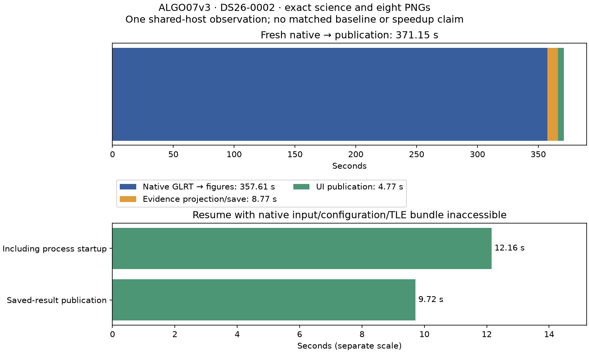

# ALGO07v3 standalone run/resume qualification

2026-11-05. Development only; no deployment.

The owned CLI now runs native GLRT through both localization arms, its scientific
archive and all eight WebUI figures. A fresh DS26-0002 run reproduces the full
previous scientific/PNG comparison exactly, including all **179 grid locations**.
It finishes in **371.153 seconds** from native input to publication, or
**373.342 seconds** including worker startup/imports and outcome writing.

This is one shared-host observation. There is still **no matched complete-path
baseline/current speedup**. The earlier 477.365-second observation used a different
wrapper and archive encoding under different load; their ratio is not a qualified
optimization result. Capture, native GLRT extraction and queue delay are excluded.



## Implementation

The [CLI](../../src/leo/cli/algo07v3.py) starts one owned process, using the
[job composition](../../src/leo/operations/localization_v3_job.py). The new
`leo-algo07v3` entry point accepts `run` and `resume`, a pinned JSON request, a
fresh attempt directory and an explicit job timeout. The numerical/rendering
dependency versions, native input/configuration hashes, source identity,
scientific provenance and original stage limits remain explicit.

The supervisor applies a hard process deadline and cleans up the entire worker
process group. Stage cancellation uses a dedicated `BaseException`, preventing
ordinary scientific exception handling from turning interruption into a rejected
candidate and fallback result. There is no publication of an incomplete fit.
The public result port now distinguishes a missing committed receipt from a
committed receipt whose archive is missing or corrupt. The latter fails closed
instead of starting a second fit under the same identity.

The [usage document](../../docs/operations/algo07v3-cli.md) records the exact
request fields, command examples, clock scopes, restart boundary and limitations.
The command's only qualified policy is currently `validation-all-work`. This
preserves the prior v3 validation admission policy; it does not silently claim
equivalence to the older production wall-clock discovery cutoff.

## Isolated native run and exact evidence

The external [namespace harness](../../tools/qualify_algo07v3_cli.sh) hides `/opt`,
older `/srv/bulk/leo` results and repository reports, mounts the frozen native/TLE
bundle read-only, and disables network access. A separate observation of the
live numerical child confirms these conditions. The candidate receives no
reference comparison or previous scientific result. Source copies for all
**301 loaded owned modules** are frozen with their recorded hashes.

The independent [verifier](verify.py) runs after completion. Its comparison hash
is the previously established
`4f7c74a132b415e9bd6e130dcbc0d7082fa72c822d53f76810f8a9fa13323d68`.
It checks the full scientific audit and plot data through the established
comparison mapping, all eight PNG hashes, the complete grid, published artifacts,
both sidecar bindings, input identity, request binding and source provenance.
Only previously declared operational timing/provenance fields are outside the
scientific comparison. The [machine-readable result](comparison.json) records
the observed clocks and still-open release gates.

Both arms retain **2,783 / 4,211 points (66.0888%)**, 74 components and 28 satellites.

| Arm | Latitude | Longitude | Residual RMS |
| --- | ---: | ---: | ---: |
| c = 0 | 37.854825525185696 | -122.48777832614799 | 76.3332809324593 Hz |
| Fitted c | 37.855019909306286 | -122.48823203934822 | 76.1981250553178 Hz |

No evaluation GPS was supplied to this qualification request. These unchanged
endpoints and residuals establish equivalence, not improved position accuracy.

| Exclusive worker interval | Seconds |
| --- | ---: |
| Native preparation through numerical work and all figures | 357.610 |
| Evidence projection and scientific save | 8.774 |
| UI publication | 4.770 |
| **Native input → public artifacts** | **371.153** |
| Entire supervised worker process, including startup | **373.342** |

Predictive recovery alone takes 108.487 seconds. Initial fitting takes 43.694,
residual screening 38.308, conservative fitting 25.723, numerical recovery 25.664,
admission 20.982 and family fitting 20.340 seconds. These are selected substeps
inside the first table row, not additional time to add to it. Other production
and test activity ran on the shared host; there is no dedicated-host timing claim.

## Saved-result recovery

A second CLI process executes `resume` with the same request, while the entire
original native/configuration/TLE bundle is hidden. It succeeds in **9.718 seconds**
inside the worker, **12.160 seconds** including startup. No fitting, TLE lookup or
figure rendering occurs. The resulting public manifest and all artifact bindings
are unchanged. This proves recovery after the scientific commit; it does not
claim continuation from an interrupted optimizer step.

The focused suite passes **611 tests**, with zero failures or skips and one
existing Starlette test-client deprecation warning. New tests exercise an actual
CLI resume subprocess, hard timeout, a descendant that ignores termination,
parent cancellation, stage-timer restoration, preservation of an existing timer,
missing/corrupt committed evidence, changed runtime/request bindings and invalid
input configuration. SIGKILL of the supervisor itself remains outside its own
cleanup guarantee; production service supervision is still needed.

## Rejected speed experiment: combining posterior right-hand sides

The existing profile identifies repeated linear solves as a major cost. The
external [probe](probe_combined_rhs.py) tests computing the coefficient and
inverse-root right-hand sides in one solve, preserving the surrounding algorithm.
It changes no runtime source. On eight hash-bound captured likelihood inputs
(2,757 rows, 189–190 columns), **all eight fail exact output equality**. Coefficient
differences are about 1.7–4.0 × 10⁻¹⁰, with changes in other reported fields too.

The ABBA component observations total 0.445 seconds for the reference and 0.456
seconds for the combined variant, averaging repeated calls before summing across
inputs. This short shared-host probe establishes no speed benefit and cannot
support a complete-pipeline claim. The [full differences and timings](combined-rhs.json)
are retained. The variant is rejected and **not enabled**, regardless of the
small absolute numerical discrepancies.

## Evidence and remaining work

Local immutable experiment root:
`/srv/bulk/leo-dev/algo07v3-cli-20261105`.
It contains request/runtime pins, independent run/resume attempts, isolation
observations, the saved scientific/publication state, frozen source copies and
the test XML. Reproduce the comparison from the checkout root with:

```sh
sudo env PYTHONPATH=src:tools OPENBLAS_NUM_THREADS=1 \
  /home/mouse9911/gits/leo-tracker-reduxredux/.venv/bin/python -B \
  reports/2026_11_05_algo07v3_cli/verify.py \
  --root /srv/bulk/leo-dev/algo07v3-cli-20261105 \
  --tests /srv/bulk/leo-dev/algo07v3-cli-20261105/tests.xml
```

Full DS26 equivalence, native accepted-branch coverage, ordinary production
admission equivalence and matched complete-path timing remain open. The next
performance measurement must pair fresh reference and candidate runs with equal
completed scientific and grid work; saved results or timings from different scans
cannot supply the missing baseline. The 10× target remains unproven. No services,
scan cadence, golden fixtures, scientific policies or production deployment changed.
