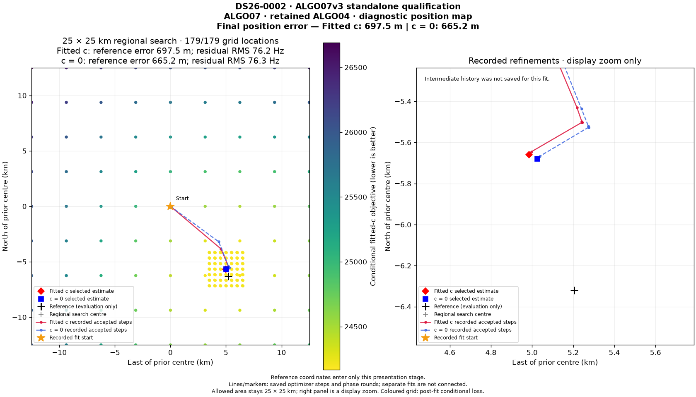
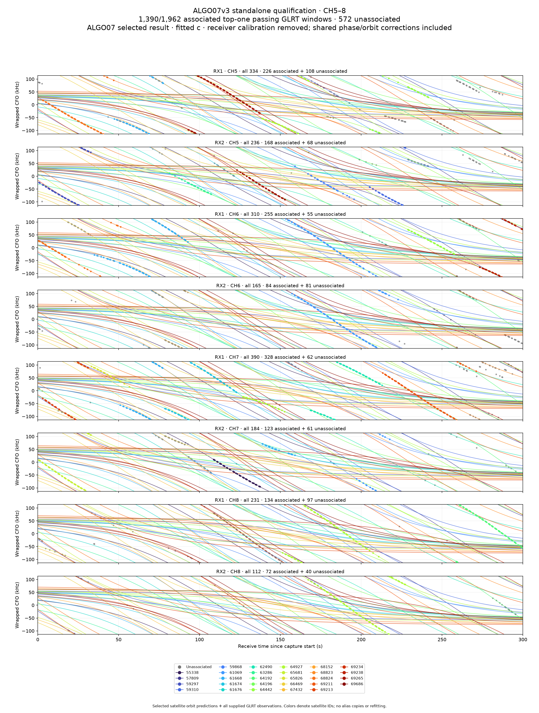
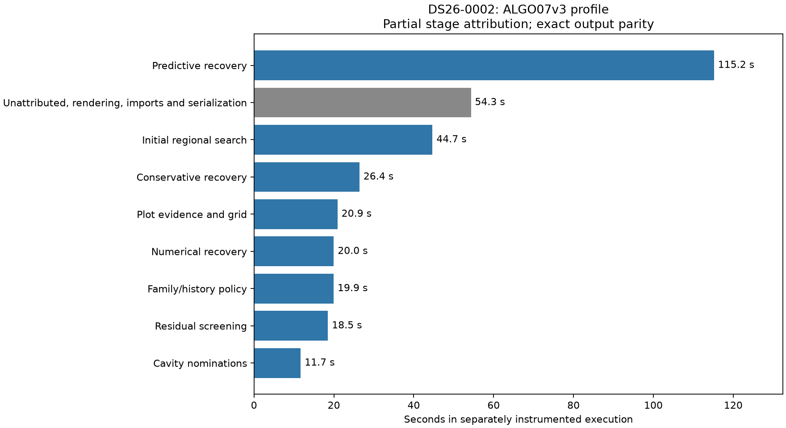

# ALGO07v3: fresh positions, owned search path and all eight figures

**Complete-path baseline/current latency and speedup: unavailable; zero matched
native-input-to-publication scans.** The new prepared-input-to-PNG execution
takes **484.617 seconds** on DS26-0002 under shared-host load. It includes all
numerical policies, the diagnostic grid, eight rendered figures and qualification
fingerprint/JSON overhead, but excludes
native preparation and WebUI publication. It is not a controlled speed comparison.

V3 now constructs the recorded search path from its own accepted decisions. It
no longer needs an older public terminal to supply this presentation evidence.
A fresh DS26-0002 execution connects numerical inference to all eight figures
in one process, with `/opt` hidden and legacy imports, reads and worker launches
rejected. Every earlier numerical output matches the saved completed v3 run
exactly. A separate DS26-0084 frozen-reference comparison confirms exact plot
data, all **179/179 grid locations**, and **eight byte-identical PNGs** with the
new owned path enabled.

## Fresh scan results

| Metric | c = 0 | Fitted c |
|---|---:|---:|
| Associated native GLRT points | 2,783 / 4,211 | 2,783 / 4,211 |
| Associated fraction | 66.09% | 66.09% |
| Evaluation-only position error | 665.2 m | 697.5 m |
| Selected scientific policy | ALGO04 numerical recovery | ALGO04 numerical recovery |

These positions and associations are unchanged; this work improves execution
independence rather than localization accuracy. The final guarded identity
screen admits no replacement and retains the selected numerical recovery.
Both calibration arms use the unchanged observations, candidates, priors and
solver budgets. The comparison checks all saved scientific fields, not only
the selected coordinates.

The confirmed evaluation coordinate is added only by the report renderer after
verification of the saved scientific result. The qualification process itself
has no evaluation-position input. Its unmodified [position PNG](position.png)
therefore states that the evaluation reference is unavailable. The report image
above adds that reference and prominently displays both final errors.

## All fresh figures

| Channels | GLRT and orbital curves | Unassociated GLRT | Associated residuals |
|---|---|---|---|
| CH1–4 | [All](ch1-4-all.png) | [Unassociated](ch1-4-unassociated.png) | [Residuals](ch1-4-residuals.png) |
| CH5–8 | [All](ch5-8-all.png) | [Unassociated](ch5-8-unassociated.png) | [Residuals](ch5-8-residuals.png) |

The other figures are [track RMS](track-rms.png) and the
[original qualification position figure](position.png). All eight are the
unmodified bytes generated by the fresh execution. The conditional grid and
recorded path are also retained as [grid JSON](position-grid.json) and
[path JSON](position-path.json).

## Path fidelity and state transfer

`leo.presentation.localization_v3_path.recorded_decision_path` projects only
adopted policy stages. It consumes owned numerical values, without a terminal
chain, storage access, prior worker or evaluation coordinate. Public model names
remain labels for the unchanged scientific policies.

The existing terminal adapter and new direct adapter share `recorded_fit_path`.
The default regional arithmetic and persisted path shape remain unchanged.
NumPy values are converted without rounding. Rejected policies add no stage;
incomplete or ambiguously selected reassociation records cannot supply a path.

Detail matches what the original policy published. Baseline fits preserve
optimizer histories; compact numerical and gap decisions preserve endpoint-only
detail. Gap coordinates retain the original latitude/longitude-to-local
conversion. Additional-family histories lacking coordinates do not become
invented trajectories. Final reassociation preserves its recorded phase-round
endpoints. This is why the position figure truthfully labels missing intermediate
history for the accepted numerical fit.

The fresh harness passes the final in-memory likelihood directly to the plot
adapter. A rejected final repair keeps the incumbent state; an accepted repair
must supply exactly one selected state. Position and native-point counts must
match the completed numerical decision before rendering. The plot adapter also
checks objective replay, coordinate agreement and full owner prediction coverage.
There is no second optimization to generate the figures.

## Verification and limits

The focused suite passes **515 tests**. New coverage exercises every accepted
path stage against the existing terminal projection, compact and missing
histories, NumPy values, alternate regional coordinates, both final-selection
branches and rejection of partial/stale presentation state.

The DS26-0084 reference and candidate produce scientific-packet/PNG digest
`4f9d7bdd61371571bf8b7f6e687082d3a30815b2f99dc238a7b7a11eb2f44265`.
Their concurrent fixture-to-PNG durations, **61.874 / 44.056 seconds**, include
external fixture reconstruction and are not a speedup estimate. Those PNGs
are identical to the already published [eight-figure report](../2026_11_05_algo07v3_presentation/README.md).

The fresh result digest is
`4f7c74a132b415e9bd6e130dcbc0d7082fa72c822d53f76810f8a9fa13323d68`.
Removing only the newly added presentation payload gives exactly the previously
verified numerical result. The fresh grid completes all 179 locations. This is
an execution/equivalence check, not a fresh frozen-reference full-pipeline pair.

`render.py` verifies the receipts, source/input bindings, previous numerical
digest, all scientific fields, PNG bytes and test receipt before publishing
the report artifacts. The external fixture oracle still reads historical
evidence to compare implementations; the owned presentation adapter and fresh
execution do not consume prior scientific outputs.

Still required: one production application/CLI from native GLRT through atomic
publication; restart/cancellation/deadline qualification; accepted-recovery
artifact coverage; full DS26 equivalence with the full denominator; independent
validation; package qualification; and controlled complete-path speed measurement.
No deployment occurred, and the 10× target remains unproven.

## Measured next optimization targets

A separate `cProfile` execution produces the **identical complete result digest
and all eight PNGs**. It records 350.494 seconds inside the harness timer and
353.108 seconds across profiled functions, including startup. The lower elapsed
time than the unprofiled run reflects different execution conditions, not a code
change or measured speedup. Both executions use the same source and inputs.

The largest attributed stage is predictive track recovery, **115.184 seconds
(32.6%)**. Initial regional search takes 44.691 seconds, conservative recovery
26.409 seconds, and plot evidence/grid preparation 20.908 seconds. All stage
values are in [profile-stages.md](profile-stages.md); raw summaries and function
counts are in [profile.json](profile.json).

Across stages, **6,772 hierarchical likelihood evaluations consume 163.129
seconds inclusive (46.2%)**, including **92,133 posterior calculations**. This
is a nested kernel measurement and must not be added to the stage totals.
NumPy's general linear solves account for 59.018 seconds of self time across
283,422 calls. Phase-state interpolation/rotation is another material target:
5,306 full-bank phase-state evaluations consume 29.227 seconds inclusive, and
56,331 paired-state evaluations consume 15.160 seconds inclusive.

The suspected redundant integrated Gaussian calculation totals only **5.281
seconds (1.5%)**. Even eliminating all its calls would not materially approach
the 10× target. The higher-value next work is to measure exact repeated
likelihood/geometry inputs and reuse validated results or immutable derived
geometry, retaining identical arithmetic and stopping schedules. Solver changes
that alter numerical output do not satisfy this task's equivalence requirement.

This profile omits the harness and rendering wrapper frames, so **54.321
seconds remain unattributed to the named stages**, including rendering, imports,
serialization and harness work. The predictive stage is computed explicitly as
the two-call controller total minus its one captured numerical-replay caller;
the script verifies those call counts. It does not silently sum overlapping
stages. The JSON-writing function itself accounts for 25.918 seconds inclusive
in this instrumented qualification harness; those full fingerprints are test
evidence rather than a required production output format. Explicit phase timers
in the final application runner are still needed for complete attribution.

`profile_summary.py` verifies exact scientific/PNG equality and source/input
bindings before analyzing the locally generated profile. No inference code or
production service changed during profiling. This remains one workload, without
an accepted final reassociation; the cost mix must be checked on those other
branches before generalizing it to DS26.

## Reproduction

Use `tools/check_algo07v3_position.py --side candidate --presentation
--presentation-directory NEW_DIRECTORY` with the DS26-0002 prepared input,
causal catalogue, scan identities and unchanged production fitting budgets.
This qualification mode runs the complete implemented numerical sequence and
writes the grid, recorded path and eight PNGs. It requires a fresh output
directory and refuses incomplete final recovery.

Use `tools/check_algo07v3_presentation.py` for the separate pinned-renderer
comparison. Run this report's `render.py` with `PYTHONPATH=src:tools` to verify
the recorded evidence and regenerate the report artifacts.
