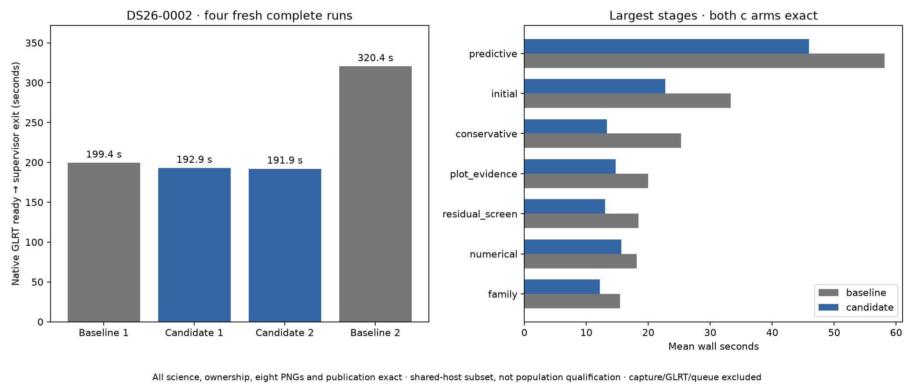
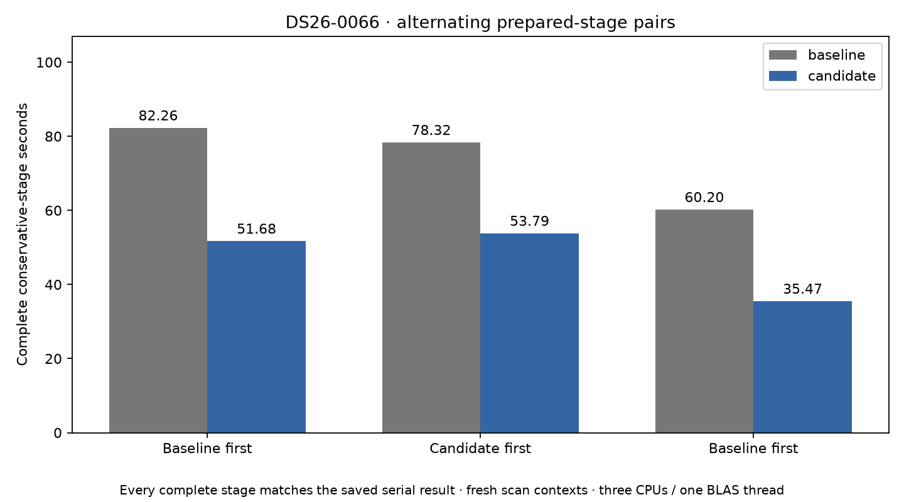

# ALGO07v3: concurrent conservative calibration fits

2026-11-05. Development qualification; production unchanged.

Four fresh DS26-0002 executions all pass exactly through both calibration arms,
scientific audits, ownership, all eight PNGs and publication. Their complete-path
times, in execution order, are **199.368 s baseline, 192.892 s candidate,
191.880 s candidate, 320.444 s baseline**. Cross-pair science and PNG bytes also
match exactly. There are four completed runs on one matched full-pipeline scan.

The first pair saves **6.476 seconds**, an observed **1.034×** ratio. Averaging
both pairs gives **259.906 → 192.386 seconds**, a **67.520-second difference**
and **1.351×** ratio, but this is **not an attributable 25.98% code speedup**:
the final baseline slows substantially in unchanged stages as host load rises.
The separate stage benchmark below supplies stronger evidence for the specific
concurrency gain. A stable complete-path population ratio remains unqualified.



| Execution order | Version | Complete path s | Conservative stage s | Process-tree CPU s |
| --- | --- | ---: | ---: | ---: |
| 1 | Baseline | 199.368 | 18.545 | 258.950 |
| 2 | Candidate | 192.892 | 13.665 | 257.180 |
| 3 | Candidate | 191.880 | 12.889 | 260.020 |
| 4 | Baseline | 320.444 | 32.057 | 419.880 |

Unchanged initial search grows **25.227 → 41.344 s** between the two baselines;
plot-evidence generation grows **14.358 → 25.586 s**. CPU totals also grow,
so scheduler waiting alone cannot explain the difference. Keep both results:
the current measurements cannot apportion the regression between host CPU/cache
conditions and other execution effects. Maximum RSS and host-pressure receipts
are retained in [summary.json](summary.json) and the accompanying GNU time files;
GNU time's maximum RSS is not summed concurrent process memory.

All four runs retain **2,783/4,211 GLRT points (66.09%), 74 fragments and 28
satellites** in both arms, with exactly unchanged positions and residuals. The
selected scientific policy remains `algo04-causal-numerical-v1` within ALGO07v3's
guarded pipeline; no association or acceptance policy was changed.

The [preceding targeted profile](../2026_11_05_algo07v3_reassociation_benchmark/README.md)
measured 42.765 of 55.625 conservative-stage seconds in paired fitting and
rejection rounds. This iteration runs each independent c=0/fitted-c pair through
the existing ordered two-child executor. Rejection masks, salvage, phase rounds,
fit budgets and acceptance decisions retain their original sequence.

On DS26-0066, three alternating prepared-stage pairs average
**73.595 → 46.980 seconds (36.16% lower)**. Parent-plus-child CPU averages
**73.507 → 75.042 seconds (2.09% higher)**. All six complete stages match the
saved serial result exactly. Host load changes materially across the pairs;
the individual measurements below are retained rather than replaced by a
claim that every scan will gain this percentage.



| Pair order | Serial wall s | Concurrent wall s | Serial CPU s | Concurrent CPU s |
| --- | ---: | ---: | ---: | ---: |
| Baseline first | 82.262 | 51.678 | 82.085 | 83.607 |
| Candidate first | 78.319 | 53.793 | 78.256 | 85.955 |
| Baseline first | 60.203 | 35.469 | 60.181 | 55.564 |
| Mean | **73.595** | **46.980** | **73.507** | **75.042** |

The benchmark's 361.964-second total includes all six executions and comparison
work. It is not a pipeline latency. These results support a conservative-stage
latency improvement, with comparable overall CPU work; they do not establish
improved multi-scan throughput.

## What changed

`conservative_recovery` and `fit_and_gate` accept an optional `map_arms` port.
Their default serial path remains available as a reference and for callers that
do not supply an executor. The standalone owned job now supplies its existing
bounded pair executor through application and engine ports.

Each child fits one arm and computes its retained-track metrics. It returns only
fit and metric records. The parent reconstructs the fitted-c likelihood layout
and phase widths needed for the original rejection-mask update, rather than
transferring the scan, cached orbital states or likelihood object over a pipe.
Only after both results are present does it take the union of rejected tracks,
emit the round callback and update the shared mask. Salvage remains serial.
The next paired round receives exactly the same mask and budgets in both arms.

Child failures propagate as operational failures through the existing executor;
they cannot become scientific rejection or fallback. Existing process-group
deadline/cancellation cleanup remains in use. There are no new worker pools,
threads, stored scientific contracts, priors or satellite-selection rules.
Random holdouts and group assignments are unchanged. GPS remains evaluation-only.

## Qualification design

The frozen pre-change conservative module has SHA-256
`1980c199bb2a195e06e11d5bd4ebc56cf00ea30ee7c65bcaa21d17bc16544d5b`.
The [external serial oracle](../../tools/algo07v3_preconservative_arms_oracle.py)
is a byte-for-byte copy and is never imported by runtime inference.

The [prepared-stage benchmark](../../tools/benchmark_algo07v3_conservative.py)
loads native preparation and initial-fit evidence through the public owned
result store for **DS26-0066**. Every trial builds a fresh scan context, then
runs the complete conservative stage. It alternates baseline/candidate order
for three pairs. Every result must exactly match the previously saved full
conservative result, including both arms, masks, histories, trims and coverage.
Input fingerprints and bound sources must remain unchanged. CPU accounting
includes the parent plus reaped children. Prepared-stage times exclude upstream
inference, propagation and publication.

The complete pipeline comparison uses **DS26-0002**, with four fresh executions
in **baseline → candidate → candidate → baseline** order. Requests differ only
in private output roots. Both versions receive the same native GLRT input,
causal catalogue, regional prior, numerical runtime and budgets, on CPUs 0–2
with one BLAS thread. The isolated baseline overlays only the four original
modules in a private mount namespace; neither run reads a previous result.
Each execution has a 1,200-second outer limit.

The existing exact comparator checks both calibration arms, scientific audit
values, point/satellite ownership, all eight PNG bytes, public result fields and
position grid/path. Runtime and declared source provenance are checked
separately. The four changed runtime modules are conservative recovery, its
application wrapper, the engine execution ports and the owned job wiring.

## Tests

**940 tests pass**, with zero failures, errors or skips. New real-fork tests
compare serial and concurrent mask histories, callbacks and reconstructed
likelihood state for immediate acceptance, paired rejection, exhausted round
budget and all-rejected masks. A deliberately unpicklable likelihood fixture
checks that it is not transported. Another test verifies that a child exception
emits no completed round. Application, engine and job tests verify that the port
is supplied only to conservative recovery. Benchmark tests check alternating
order, complete-stage equality, child CPU accounting and bounded repetitions.

The initial focused suite passed 100 tests before final forwarding and benchmark
coverage were added. The full final suite is the qualification count above.
See [test receipt](tests.xml) and [test command](test-command.json).

## Runtime scope and remaining work

The complete-pipeline clock starts with native GLRT already available and ends
after all figures and private publication, at supervisor exit. It excludes RF
capture, native GLRT extraction and production queue waits. Component savings
must not be presented as complete-path savings. Concurrency is expected to
reduce elapsed time while doing comparable CPU work; per-arm imbalance and
fork/serialization costs determine the actual gain.

This is a two-scan subset with full publication qualification on DS26-0002 and
prepared-stage qualification on DS26-0066. It does not establish full DS26
equivalence, ordinary production admission or the tenfold goal. The earlier
[original-ALGO07/v3 cumulative measurements](../2026_11_05_algo07v3_cumulative_repeat/README.md)
remain separately scoped; ratios from different runs must not be multiplied.

The largest remaining candidate-stage cost is predictive recovery, averaging
**45.902 s** across the two full candidate runs. The next profile should split
that work into control fits, new-family fits, numerical retries and validation
audits, including child CPU. In particular, investigate repeated control fits
only after proving their likelihood inputs identical; keep numerical replay's
ordered policy receipts intact. Further improvements should target CPU work as
well as latency, rather than continuing to add processes to already parallel work.

## Reproduction

[run_pair.py](run_pair.py) creates fresh requests and verifies bound sources,
then invokes the existing exact comparator. `--candidate-first` reverses the
pair order. [run_baseline.sh](run_baseline.sh) supplies the external frozen
modules. [render.py](render.py) verifies qualification receipts before rendering.
The benchmark command is:

```sh
PYTHONPATH=src:tools OPENBLAS_NUM_THREADS=1 OMP_NUM_THREADS=1 \
  taskset -c 0,1,2 timeout -k 2 600 python -B \
  tools/benchmark_algo07v3_conservative.py --request DS26_0066_OWNED_REQUEST \
  --output NEW_JSON --repeats 3
```

Raw evidence is retained at
`/srv/bulk/leo-dev/algo07v3-conservative-arms-20261105`, with the reverse pair
under `reverse/`. No production release or collection cadence was changed.
