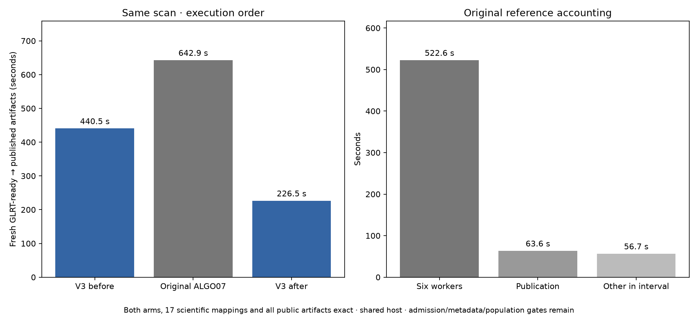

# ALGO07 versus standalone ALGO07v3: fresh cumulative timing observation

2026-11-05. No production changes or RF collection.

Both fresh DS26-0002 runs complete, and **all public results, both calibration
arms, all eight PNG bytes, grid/path values and all 17 mapped scientific audit
sections match exactly**. The comparison retains its open historical metadata
and admission-policy gates. [Complete comparison](comparison.json).

| Path | GLRT ready through publication |
| --- | ---: |
| Standalone v3, before reference | **440.510 s** |
| Original six-worker ALGO07 reference | **642.886 s** |
| Standalone v3, after reference | **226.531 s** |

The observed ratio is **1.459×**, or
**31.48% less elapsed time**. This is a
fresh cumulative comparison on one scan, not a controlled population estimate
or a demonstrated tenfold speedup. The v3 leg ran first; both legs used CPUs
0–2, one BLAS thread per process, fixed input/archive evidence and fresh output
directories. No reference answers enter v3. The candidate hides old installations,
bulk results and reports in a private namespace. [Execution plan](plan.json).

An additional fresh v3 execution after the reference takes
**226.531 s** and again matches all 17 scientific sections and public
artifacts exactly. Relative to the intervening reference its observed ratio is
**2.838×**. This third leg was declared after
the first pair exposed differing CPU pressure and major page faults. Both v3
observations are retained; their variation prevents treating either ratio as a
stable dataset-wide guarantee. The second comparison reuses the middle
reference, so these are three executions, not two independent pairs.
[Repeat plan](after-reference/plan.json), [comparison](after-reference/comparison.json).

## Separate algorithm work from research-harness cost

The reference's recorded interval contains **522.619 s** in its six
executed watcher/worker calls and **63.576 s** in first publication.
The remaining **56.690 s** includes orchestration, terminal checks and
frozen-runtime verification. Do not label all of this remainder scientific
computation or assume production incurs identical verification overhead.

The worker-plus-publication subtotal is **586.195 s**.
Dividing that subtotal by the complete v3 time gives
**1.331×**. This deliberately omits
reference orchestration gaps, so it is a separately labeled subtotal ratio,
not another continuous end-to-end measurement. Capture, GLRT extraction and
production queue delay are excluded from both paths.

| Original executed stage | Seconds |
| --- | ---: |
| ALGO02 | 133.237 |
| ALGO03 | 170.228 |
| ALGO04 | 52.867 |
| ALGO05 | 26.885 |
| ALGO06 | 57.538 |
| ALGO07 | 81.865 |

## Resource observations and limits

| Invocation | User CPU s | System CPU s | Major page faults | Max RSS KiB |
| --- | ---: | ---: | ---: | ---: |
| reference | 585.21 | 45.45 | 302 | 1962828 |
| candidate | 429.91 | 53.49 | 15722 | 2406404 |
| candidate_after | 253.04 | 5.34 | 6 | 2310980 |

GNU time includes descendants and pre/post verification outside the primary
interval; CPU totals therefore have a wider scope than the primary wall clock.
Maximum RSS is per-process accounting, not concurrent aggregate memory.
The current v3 run incurs 15,722 major page faults;
the earlier 228.848-second observation is not substituted for this slower run.
Shared-host CPU, I/O, cache and frequency effects remain uncontrolled. Boundary
resource snapshots are retained rather than assuming constant load.

The original workers retain ordinary elapsed-time admission and their six
1,200-second allowances. V3 uses validation-all-work with a 1,200-second outer
bound. Exact completed science establishes agreement here; it does not prove
the admission policies equivalent under other inputs/load. Both grids complete
their requested 179 locations; original presentation has its documented 300 s
research allowance. No inference thresholds, priors or search budgets were
relaxed to make the comparison pass.

## Metadata audit progress

A separate read-only verifier now checks **21 previously excluded metadata
fields across five initial policies**: exact case/algorithm identities,
radio-noise mode, source-code hashes against the frozen manifest, prior-TLE and
ordered input-read links, history/forecast/baseline digests and cavity nomination
links. Timing fields must be finite nonnegative observations; their values need
not be equal. All checks pass against this fresh export. [Audit](initial-metadata.json).

**19 component-owned tests pass**, including altered source bytes, swapped
history links, incomplete/duplicate reads, wrong scan identity, redirected TLE
links and invalid elapsed times. The earlier 843-test runtime suite remains
the runtime qualification; no inference code changes in this benchmark.
[Tests](metadata-tests.xml).

Later-policy metadata, broader accepted branches, full DS26 localization,
production admission/deadlines and the tenfold target remain open. The new
metadata verifier does not silently override the existing comparator's verdict.

Reproduce using [run.py](run.py) with a fresh `--root`; it prepares native-only
exports through the public store port, runs both legs, then reconstructs the
three independent scientific oracles and performs the full comparison. Run
[repeat_v3.py](repeat_v3.py) with `--parent` pointing to that root for the third
execution. The [metadata verifier](../../tools/check_algo07v3_initial_metadata.py)
takes `--evidence`, `--runtime`, `--manifest` and a fresh `--output`; its receipt
binds the exact source and exported artifacts. Raw
evidence: `/srv/bulk/leo-dev/algo07v3-cumulative-20261105`. Runtime commit: `d9fbe5bb9`.
