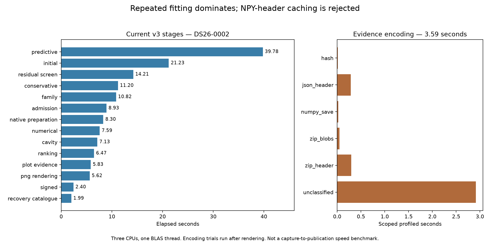

# ALGO07v3 current runtime profile and encoding experiment

The largest current cost is **repeated scientific fitting**, not archive I/O.
Fresh DS26-0002 stage clocks measure predictive recovery at **39.785 s**, initial
search at **21.225 s**, and residual screening at **14.210 s**. Together these
take 75.220 s of the 153.125-second native-input-through-render interval.

The live archive-header cache prototype is **rejected for integration**.
Three alternating complete encoding pairs average **3.569 → 3.734 s**, 4.62%
longer, despite exact archive bytes. Runtime and production are unchanged.
Fourteen focused tests pass, and the fresh execution matches the normal owned
CLI in complete science, both calibration arms, ownership, public grid/path and
all eight PNG bytes. Sources stayed unchanged throughout execution.

Full-path baseline/candidate speedup: **unavailable**. This experiment executes
eight complete encodings, so its **187.850 s** supervised clock is deliberately
instrumented. It is not normal pipeline latency. Saving evidence takes 30.698 s
including those trials; subsequent publication takes 2.602 s. Neither the
153-second pre-encoding interval nor a subtraction of measured overhead should
be presented as a measured complete normal run. Capture, GLRT extraction and
queue delay are excluded. Original-ALGO07 cumulative qualification is unchanged.



## Current stage ranking

| Stage | Elapsed seconds | What it does / implication |
| --- | ---: | --- |
| Predictive recovery | 39.785 | Training, inclusion fits, retries and decision audits; highest priority |
| Initial position search | 21.225 | Repeated candidate position/phase fitting |
| Residual screening | 14.210 | Tests remaining track evidence against satellite candidates |
| Conservative recovery | 11.197 | Independent calibration-arm fits plus sequential rejection/refitting |
| Family recovery | 10.818 | Fits and checks shared satellite families |
| Candidate admission | 8.930 | Validates candidate changes before accepting them |
| Native preparation | 8.303 | Constructs owned scan and causal input evidence |
| Numerical-policy replay | 7.586 | Replays selected fits with numerical policy and ordered receipts |
| Family-omitted analysis | 7.127 | Tests what happens when a satellite family is removed |
| Ranking | 6.475 | Compares candidates under the existing selection rules |
| Diagnostic grid evidence | 5.833 | Computes the public position-loss map |
| PNG rendering | 5.624 | Renders eight figures |
| Signed-prior stage | 2.404 | Applies the existing signed-prior analysis |
| Recovery catalogue | 1.990 | Prepares additional causal satellite candidates |

The remaining named stages sum to less than one second. All 20 stage rows are
in [summary.json](summary.json). These are independent stage wall clocks from
the current execution, not summed overlapping child profiles. Encoding trials
start only after rendering. Three CPU cores and one OpenBLAS thread were used;
the host is shared, so the table is not a dataset-wide runtime percentile.

## What the encoding experiment establishes

The live scientific object graph produced a 79,909,068-byte archive. Encoding
made 4,365 NumPy save calls, with 2,962 distinct live array objects and only 107
dtype/shape/order keys. There were 4,258 repeated shape keys. That made header
reuse look promising by call count, but the scoped clock disproved the premise:

| Scoped encoding work | Seconds |
| --- | ---: |
| NumPy array serialization | 0.0253 |
| Content hashing | 0.0147 |
| JSON header serialization | 0.2849 |
| ZIP compression of JSON header | 0.2976 |
| ZIP binary members | 0.0470 |
| Remaining, not separately attributed | 2.9158 |
| Total instrumented encoding | 3.5852 |

Do not label the 2.916-second remainder entirely as object traversal without a
further profile. The instrumented array-save timer excludes bookkeeping in its
wrapper. Even eliminating all measured array serialization would save only
about 25 milliseconds here.

| Alternating pair | Original seconds | Header-cache seconds |
| --- | ---: | ---: |
| 1, original first | 3.317 | 3.941 |
| 2, candidate first | 3.853 | 3.731 |
| 3, original first | 3.535 | 3.528 |
| Mean | **3.569** | **3.734** |

All six archives and the instrumented original are byte-identical to the first
original encoding. The candidate caches only NPY headers for eligible simple
contiguous dtypes, never data or hashes. Structured, metadata-bearing and
noncontiguous arrays retain the original NumPy path. Live input matters:
decoding saved evidence merges equal array blobs, so repeated-object identity
counts from reloaded evidence would misrepresent the original in-memory graph.

Tests cover endian changes, Fortran layouts, noncontiguous fallback, structured
dtypes, metadata warnings, object rejection, signed zero, NaN/Inf, unaligned
arrays and a mapping that mutates an array during traversal. This supports
exactness on tested inputs, not an unqualified all-dtype theorem.

## Where to look next

1. **Profile repeated likelihood inputs across predictive fits and retries.**
   Record complete input identity, array contents, priors, phases, observation
   membership and numerical-policy state; measure duplicate work before adding
   a cache. Existing geometry, annotation and fixed-audit reuse must remain in
   place. Reusing by satellite or position alone is invalid. The earlier initial
   cache was exact but did not establish full-run benefit; do not repeat it
   without evidence of a materially larger opportunity.
2. **Target the posterior loop shared by all expensive fitting stages.** The
   [isolated hard-case profile](../2026_11_05_algo07v3_full_runtime_profile/README.md)
   attributes 36.7% of captured likelihood time to inverse solving, 15.4% to
   lower LU factorization, 15.2% to covariance multiplication and 9.7% to
   Cholesky. These proportions are from DS26-0066, not this scan's total runtime.
   Measure avoidable layout conversions and copies around the existing LAPACK
   calls while retaining operations and ordering. Qualify complete training
   fits, including signed-zero behavior, before full native comparison.
3. **Re-profile residual screening after existing geometry reuse.** At 14.2 s
   it is still material. Separate orbital propagation, interpolation, residual
   scoring and candidate bookkeeping; only then test exact shared work across
   families/arms. Preserve candidate order and all acceptance gates.
4. **Keep latency and throughput separate when scheduling more work.** The
   bounded annotation queue already uses up to three workers; nested workers
   risk oversubscription. Parallel numerical replay is integrated. Any further
   scheduling experiment needs wall time, total CPU and memory together.

Halving predictive recovery alone would save about 19.9 seconds in this run.
A hypothetical 20% reduction in predictive plus initial fitting would save
about 12.2 seconds before overhead. These are opportunity estimates, not measured
improvements. A common likelihood optimization could help multiple stages;
small publication optimizations cannot deliver another large overall speedup.

Do not reduce the 256 precision iterations, phase rounds, candidate set, held-out
checks or scientific priors to obtain an exact-equivalence speedup. Prior combined
and direct triangular-solve shortcuts failed exactness; scratch-buffer reuse was
flat or slower. Owner-only gradient concurrency regressed its targeted fits and
remains rejected. Grid batching and catalogue validation reuse are already
integrated, so they are not new proposals.

Recommended next experiment: instrument repeated predictive likelihood inputs,
then test only the largest confirmed redundant calculation. Use DS26-0002 and
the difficult accepted-reassociation case DS26-0066, with fresh alternating
normal runs. Require exact complete scientific audits, both c arms, ownership,
public grids/paths and all eight PNGs. No inference change is integrated here.

## Scientific and provenance checks

Both arms retain 2,783/4,211 points (66.0888%), 74 fragments and 28 satellites.
c=0 remains at (37.854825525185696, −122.48777832614799), RMS 76.3332809324593 Hz;
fitted-c remains at (37.855019909306286, −122.48823203934822), RMS
76.1981250553178 Hz. Previously measured evaluation errors remain 665.210 m and
697.464 m. The fitted arm has slightly lower residual RMS but slightly worse
position error; these metrics are distinct. Evaluation GPS enters presentation
only. Catalogue and observations are causal and unchanged.

Runtime revision: `06bae9a4eca30940716852191230ef9dd7a91c65`.
[plan.json](plan.json) binds every source and input file;
[parity.json](parity.json) verifies normal-CLI science and PNGs;
[encoding.json](encoding.json) retains all timings and exact archive hashes;
[tests.xml](tests.xml) records 14 passing tests. The unrelated dirty research
module is included in source bindings but is not imported by this owned worker.
No production deployment or population qualification is implied.

## Reproduce

From the checkout, use the profiling skill and a fresh output directory:

```sh
PYTHONPATH=src:tools OPENBLAS_NUM_THREADS=1 taskset -c 0,1,2 python -B \
  tools/probe_algo07v3_codec_headers.py --request /absolute/native-request.json \
  --output /absolute/new-profile

PYTHONPATH=src:tools OPENBLAS_NUM_THREADS=1 taskset -c 4 python -B \
  reports/2026_11_05_algo07v3_recovery_arms/profile_parity.py \
  --reference /absolute/native-request.json \
  --profile /absolute/new-profile/request.json \
  --output /absolute/new-profile/parity.json
```

The probe has a 1,200-second process-group supervisor. Do not edit bound sources
while it runs. `render.py --root ROOT --tests TEST_XML` verifies source bindings,
completion, all exactness receipts and the 14-test result before plotting.
Raw root: `/srv/bulk/leo-dev/algo07v3-codec-header-probe-0002-20261106`.
