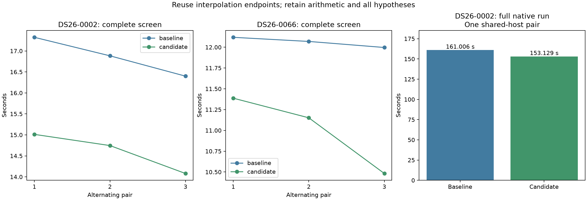
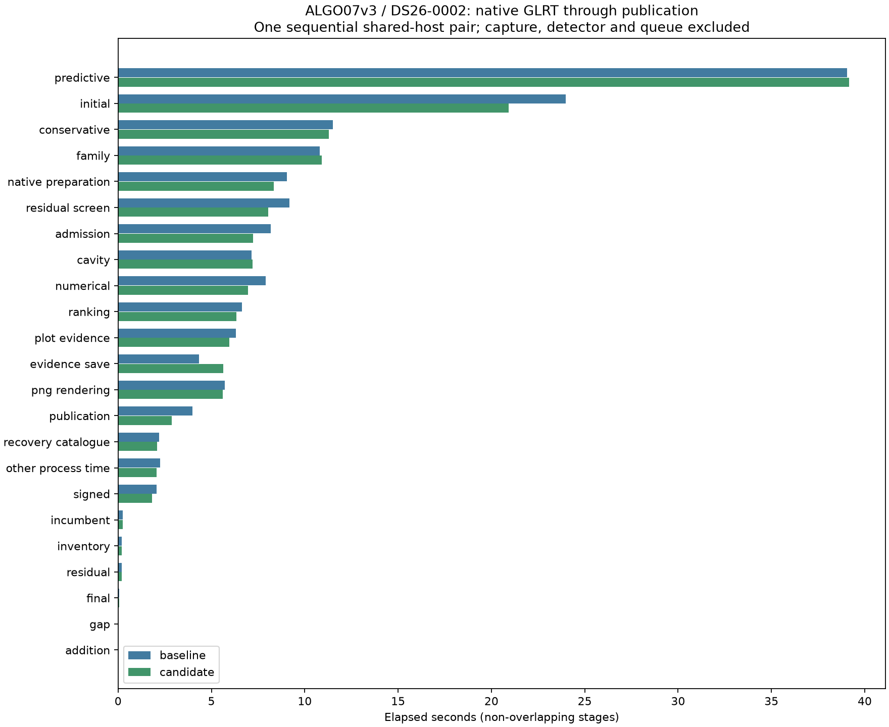

# ALGO07v3: runtime profile and interpolation endpoint reuse

This iteration removes a repeated orbital-state lookup while retaining the
original arithmetic. Twelve alternating complete-screen trials on DS26-0002 and
DS26-0066 are exact. Mean screen latency falls **13.38%** and **8.74%**, with
similar CPU reductions. **1,132 tests pass**. Production is unchanged.

The fresh complete native pair is **161.006 → 153.129 seconds**, saving 7.877 s,
an observed **1.051×** ratio on one scan. All scientific outputs and eight PNGs
match exactly. Residual screening falls **9.176 → 8.032 seconds**, a measured
1.144-second stage saving (12.47%). Other stages also vary; do not attribute the
entire native difference to this optimization. The change is integrated in
development, with subset qualification.

The original-ALGO07 versus current-v3 cumulative speedup is unavailable in this
iteration. Capture, native GLRT extraction and queue delay are outside these
native-input-to-publication clocks. Do not multiply separate iteration ratios.

## Fresh profile: where screening time goes

The profile runs the complete current screen before this change, without forks,
on one CPU and one BLAS thread. It includes 11,144 catalogue satellites and
three targets containing 64, 24 and 25 points. Full-screen values, callbacks and
unchanged inputs match the saved owned evidence. Profiler accounting checks pass.

| Profiled work | Seconds | Calls |
| --- | ---: | ---: |
| Complete screen | 19.784 | 1 |
| Coarse geometry | 13.488 | 99 |
| Catalogue propagation | 3.601 | 1 |
| Coarse frequency/rate scoring | 0.867 | 660 |
| Fine finalist geometry | 0.057 | 18 |

Coarse geometry accounts for **68.18%** of the screen. The phase-state function
takes 7.251 exclusive and 7.660 cumulative seconds; look-angle evaluation takes
3.751 exclusive and 5.741 cumulative seconds. These function times are nested
inside the stage times and must not be added to them. The profile is diagnostic,
not a normal-run latency measurement or a speed comparison with older profiles.

Source inspection identifies two identical advanced-index gathers of the lower
interpolation endpoint for every state array. Such indexing creates a copied
array. The candidate gathers it once, retains the subtraction/multiplication/
addition order, and releases the temporary before rotating the state. No
satellite, observation, phase hypothesis, numerical iteration or acceptance
check is removed. Scalar and per-satellite phase paths both retain their behavior.

## Controlled complete-screen comparisons

Each trial includes fresh catalogue propagation, immutable-bank construction,
coarse nomination, fine finalist fits and callbacks. Evidence loading is outside
the timer. Three sequential pairs alternate baseline-first, candidate-first,
baseline-first, on one CPU and one BLAS thread. Every complete screen and callback
matches the saved owned result; input fingerprints remain unchanged.

| Scan / pair | Baseline seconds | Candidate seconds | Exact |
| --- | ---: | ---: | --- |
| DS26-0002 / 1 | 17.325 | 15.012 | Yes |
| DS26-0002 / 2 | 16.884 | 14.746 | Yes |
| DS26-0002 / 3 | 16.400 | 14.080 | Yes |
| DS26-0066 / 1 | 12.119 | 11.387 | Yes |
| DS26-0066 / 2 | 12.069 | 11.151 | Yes |
| DS26-0066 / 3 | 11.997 | 10.482 | Yes |

| Complete screen | Baseline mean | Candidate mean | Reduction | Baseline CPU | Candidate CPU |
| --- | ---: | ---: | ---: | ---: | ---: |
| DS26-0002 | 16.869 s | 14.613 s | 13.38% | 16.864 s | 14.610 s |
| DS26-0066 | 12.062 s | 11.007 s | 8.74% | 12.061 s | 11.006 s |

All six candidate trials are faster. Both sequences also show time variation;
the means describe these trials, not dataset-wide percentiles. Do not compare
absolute durations across the two scans as a complexity ranking: host conditions
are not held fixed between sequences. CPU reductions closely track elapsed
reductions, strengthening the component evidence.

## Native qualification and full stage breakdown

The fresh native pair uses CPUs 0–2 and one BLAS thread, baseline first. Both
executions use the same frozen native input and causal catalogue, separate
private output stores and read-only mount/network isolation. Exactly one loaded
module changes. All scientific audits, both calibration arms, point ownership,
public grid/path and all eight PNG bytes must match. No tolerance or intermediate
comparison exception is added.

| Native measurement | Baseline | Candidate |
| --- | ---: | ---: |
| Complete supervised process | 161.006 s | 153.129 s |
| Residual screening | 9.176 s | 8.032 s |
| User + system CPU | 238.000 s | 226.940 s |
| Maximum reported RSS | 2,341,828 KiB | 2,375,764 KiB |
| Initial search | 23.970 s | 20.912 s |
| Predictive recovery | 39.053 s | 39.162 s |
| PNG rendering | 5.722 s | 5.596 s |

Predictive recovery is slightly slower; retain that observation. Most of the
whole-run difference is outside residual screening. The phase helper also serves
other callers, but their isolated savings are unmeasured. System CPU changes
11.500 → 8.250 s, minor faults 3,508,075 → 3,417,930, and major faults 2 → 0.
This single pair does not establish a stable whole-pipeline speed ratio. The
alternating complete-screen trials are stronger evidence for the narrow change.

In the new candidate, predictive recovery is **25.6%** of complete time, initial
search **13.7%**, conservative recovery **7.4%**, family recovery **7.1%**, and
residual screening **5.2%**. Fitting remains the largest total-time opportunity;
screen geometry is a smaller, directly measured and readily isolated target.

See [native/comparison.json](native/comparison.json), [summary.json](summary.json)
and the complete [stage table](stage-table.md). Independent stage clocks are
non-overlapping. Publication, evidence save and remaining process time are shown
separately so the table accounts for the complete supervised process clock.

## Profile after integration

The fresh, exact, accounting-valid [post-change profile](profile-after.json)
takes 8.055 s for the complete screen. Coarse geometry takes 5.804 s (**72.06%**),
catalogue propagation 1.170 s, coarse scoring 0.509 s and fine geometry 0.047 s.
Look-angle calculation now leads exclusive function time at 2.250 s (3.440 s
cumulative), alongside phase-state interpolation/rotation at 2.229 s exclusive
(2.337 s cumulative). The next geometry target is therefore still justified.
The large absolute difference from the earlier profile is **not** an estimate of
this optimization's effect: different host conditions and profiling runs are not
a controlled pair. Use the alternating unprofiled trials for the measured gain.

## What to optimize next

1. **Avoid calculating discarded look-angle outputs.** Coarse screening consumes
   elevation and range rate but the shared helper also calculates azimuth. Test
   a narrow internal projection that retains the original elevation/rate math,
   full ENU multiplication and array layouts while omitting only unused azimuth
   arithmetic. Do not replace the original elevation formula or alter reductions.
   The 3.440 post-change look-angle seconds includes necessary work; it is an upper
   bound, not a promised saving. Compare every satellite/phase projection, then
   complete screens and native publication.
2. **Return to predictive fitting, the larger pipeline target.** The new
   native run spends 39.162 of 153.129 seconds there. Independent fold fits already
   use bounded concurrency. Existing observations place substantial work in the
   hierarchical posterior's inverse, factorization and covariance operations.
   Test layout/copy reduction or exact repeated-factor reuse only where inputs
   demonstrably remain identical. Preserve all precision iterations and optimizer
   retries. Prior combined-solve prototypes changed floating-point outputs and
   were rejected; variance-buffer reuse was flat for c=0 and 9.33% slower for
   fitted c. A difficult fold previously performed 62,737 posterior evaluations,
   with 220/350 likelihood calls reaching the existing 256-iteration ceiling.
   These historical workload counts motivate kernel-level investigation, not
   removal of precision updates or another unmeasured general cache. A
   hypothetical 20% reduction of a 25% stage saves about 5% of
   total time; it is not a 20% pipeline improvement.
3. **Measure initial-search reuse selectively.** Initial search is the next large
   stage. Retain every starting hypothesis and both arms. Earlier generic caching
   and scheduling experiments did not establish a robust complete-run benefit;
   profile explicit immutable context preparation before adding more caches or
   workers. Extra concurrency can trade latency for higher CPU and worse queue
   throughput.
4. **Requalify cumulative speed on a declared scan subset.** Keep identical inputs,
   budgets, CPU affinity, cache policy and complete artifacts, alternate reference
   and candidate order, and include accepted-reassociation branches. Report every
   failure and regression, per-scan ratios and aggregate median/p90. Fresh paired
   original-ALGO07/current-v3 runs are still needed for a cumulative claim.

General likelihood hashing is low priority: the earlier predictive observation
finds only 1.999 accumulated seconds of repeated calls versus 4.200 seconds of
fingerprinting. Those are process-summed observations, not wall-clock savings.
Serialization and rendering also have smaller measured budgets; the previous
header-cache prototype regressed. These negative findings should prevent repeating
the same unsupported optimizations. See the
[likelihood report](../2026_11_05_algo07v3_likelihood_repeats/README.md) and
[encoding report](../2026_11_05_algo07v3_encoding_profile/README.md), plus the
[posterior experiments](../2026_11_05_algo07v3_posterior_buffers/README.md).

## Reproduction and evidence

`tools/probe_algo07v3_endpoint_reuse.py --request REQUEST --output FRESH_ROOT`
runs the alternating complete-screen trials with one CPU, one BLAS thread and an
external 360-second timeout. The explicit frozen phase oracle is an external
benchmark reference, never a runtime dependency. Both implementations compile
against the owned globals, including the same immutable-bank class; substituting
a separately imported class would unfairly revalidate the baseline bank.

`prove_states.py` checks both position and velocity at **all 99 real DS26-0066
coarse-phase calls**, including every satellite, shape, strides, dtype and value
bytes; all match. The final screen and callbacks match too. This doubled-work
run is an exactness proof, not a speed benchmark. Owned tests cover mutable and
frozen banks, scalar and per-satellite phases, zero/one/many satellites, empty
queries, C/Fortran/strided layouts, input preservation and projected observations.
The external probe also tests failure behavior and restoration after exceptions.

`run_pair.py` and `run_baseline.sh` reproduce the one-module isolated native pair.
`render.py` verifies source/input bindings, native parity, 1,132 passing tests,
all prepared trials and real-state proof before exporting the figures and
summary. It checks the integrated function's syntax tree against the measured
candidate and its complete module bytes against the qualified native source.
The three test warnings are existing NumPy deprecations from intentional array
metadata-mutation tests, with no failures or skips.

DS26-0002 retains 2,783/4,211 associated points (66.0888%), 74 fragments and 28
satellites. The unchanged c=0 arm has RMS 76.3332809324593 Hz and previously
reported error 665.210 m; fitted c has RMS 76.1981250553178 Hz and error 697.464 m.
Evaluation coordinates enter presentation only. This is subset development
qualification, not full-DS26 or production admission.
