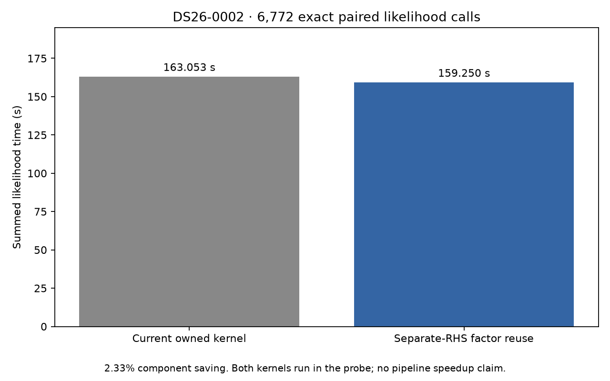
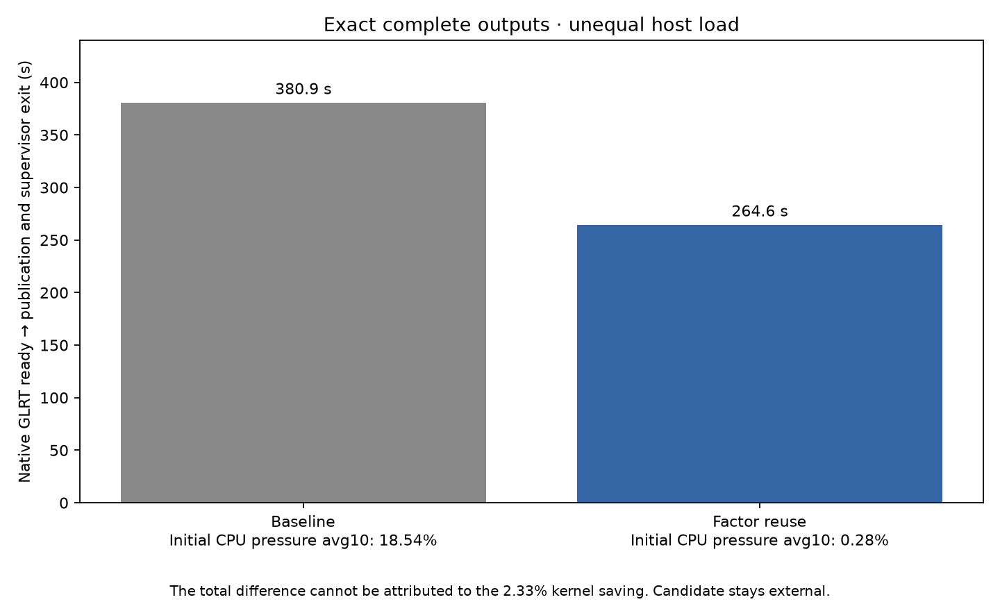

# ALGO07v3: exact factor reuse, completed timing pair and 17 mapped audits

2026-11-05. External experiment; the numerical runtime and production remain
unchanged. Complete-pipeline speedup is not established by this experiment.

Follow-up completed: the [upper-root optimization](upper-root.md) preserves every
native likelihood call and all complete published outputs. Its independent
kernel measurement saves 11.63%; one candidate-first native-to-publication pair
takes **266.242 → 252.572 s (5.13% less)**. This remains a single-scan observation,
not a qualified cumulative or dataset-wide gain. The original experiment below
retains its own results and limitations.

The factorization-reuse candidate matches **all 6,772 likelihood calls** in a
complete native DS26-0002 run. Every field's dtype, shape and bytes match. The
complete scientific snapshot, both c arms, all 179 grid locations, recorded
paths and eight PNG hashes also match the previous native qualification.

| Measurement | Current owned kernel | Factor reuse candidate |
| --- | ---: | ---: |
| Summed likelihood time | 163.053 s | 159.250 s |
| Exact likelihood calls | 6,772 | 6,772 |
| Observed component saving | — | **3.803 s / 2.33%** |

The diagnostic executes both kernels on every input, alternating their order,
and returns the candidate result only after exact comparison. Any difference
aborts outside ordinary scientific exception handling. The diagnostic's
**536.354 s** total includes doubled likelihood work and comparisons, and is
not a normal pipeline runtime. The modest component saving does not justify
enabling the candidate without a complete-path measurement. It is not evidence
of the cumulative 10× target or a dataset-wide gain.

The existing scatter assembly remains unchanged. This candidate factors the
same Cholesky root once with LAPACK DGETRF and reuses it for the separate vector
and identity-matrix DGETRS solves. It retains the original transpose solve,
right-hand-side separation, priors, precision iterations and stopping rules.
Unlike the earlier failed combined-right-hand-side prototype, it does not change
the solve's right-hand-side shape. The previous eight-call experiment used the
older pre-scatter implementation; this run tests the current owned kernel.

The [probe](../../tools/probe_algo07v3_factor_reuse.py), [receipt](probe.json),
[native input/source bindings](native-receipt.json) and
[summary](summary.json) record the result. The raw native snapshot SHA-256 is
`4f7c74a132b415e9bd6e130dcbc0d7082fa72c822d53f76810f8a9fa13323d68`.
The probe ran on CPU 0 with one BLAS thread and a 1,200-second outer bound.
The native qualification driver blocks legacy access. This diagnostic itself is
not the separate mount/network namespace isolation test.

## Completed complete-path comparison

After the exact native probe completed, two fresh isolated CLI runs were launched
in baseline/candidate order. Both use CPUs 0–2, one BLAS thread, the same native
GLRT, causal archive, search region, validation budgets and presentation-only
evaluation reference. Only the kernel module differs, mounted read-only inside
a private namespace. The checkout and production installation are unchanged.
Each run includes scientific persistence, all PNGs and atomic publication.

[Predeclared pair plan](paired-plan.json), [isolated runner](run_kernel.sh).
Evidence directory:
`/srv/bulk/leo-dev/algo07v3-factor-reuse-20261105/paired`.
Both runs completed successfully. All owned science, both calibration arms,
PNG bytes, grid/path data and published fields match exactly. The candidate also
matches the preceding independently qualified native result exactly, connecting
it to the historical comparison below. [Pair comparison](paired-comparison.json),
[prior-run comparison](prior-native-comparison.json).

| Measurement | Baseline | Factor reuse |
| --- | ---: | ---: |
| Complete supervised process | 380.865 s | 264.616 s |
| Initial host load average | 28.47 | 16.46 |
| Initial CPU pressure, avg10 | 18.54% | 0.28% |
| Native preparation, unchanged | 12.753 s | 8.833 s |
| Initial search | 47.857 s | 30.100 s |
| Predictive recovery | 121.602 s | 78.217 s |

The observed ratio is 1.439×, but **this is not an attributable pipeline
speedup**. Baseline contention was much greater, and unchanged preparation also
sped up substantially. The 2.33% interleaved kernel saving cannot explain the
whole difference. [Resource observations](paired-resources.jsonl),
[all stages](paired-stages.md), [summary](paired-summary.json).
Neither production workers nor capture settings were changed.

**Decision: keep factor reuse external for now.** Its correctness on this scan
is supported; its small total benefit and population behavior are not established.
The cumulative 10× target remains open. Repeated unqualified ratios are not
substituted for that metric.

## Historical audit: residual preparation now checked

The existing fresh published native result now matches **17 of 17 mapped
scientific audit sections** on DS26-0002. The residual-recovery mapping covers the
selected-one-family/no-gap branch and checks all fragments, selected
and eligible targets, preflight corrected measurements in both arms, ownership
maps, replay checks and the complete selected family's physical prior.

The original preflight carries extra preparation metadata. Before mapping it to
the compact native receipt, the verifier checks an exact known field set,
screen/search policy constants, epoch/collection causal cutoffs, the input
binding, and the original bank/latest-TLE/repaired-previous-TLE file hashes in
the exported descriptor. Unknown fields, changed bytes, altered policies and
future epochs fail. The selected-family protocol is bound through its original
source receipt. Its family prior is compared in full; it is not reconstructed
from the candidate. Only the original preflight elapsed-time field is excluded
from scientific comparison. Other incumbent/gap branches require their own
mappings and are rejected by this one.

The [first metadata-mismatch result](historical-before-metadata-mapping.json)
and [16-section checkpoint](historical-comparison.json) are retained. The
[17-section comparison](historical-17.json) also checks the numerical recovery
decision, selected and rejected trials, retained result, every conditional reuse
decision, completed targets, optimizer records and phase/domain updates.

Its initial comparison found a real **counter-scope difference**, preserved in
[the failure receipt](historical-before-count-mapping.json):

| Numerical stage | Original worker constructions | Context-only constructions | Native stage constructions |
| --- | ---: | ---: | ---: |
| Target 1 inclusion | 22 | 2 | 20 |
| Target 1 audit | 6 | 2 | 4 |

The original worker rebuilds the two incumbent calibration arms before its stage.
V3 reuses the already prepared context, so its numerical-policy receipt starts
after that construction. An independent execution of the frozen original context
under the original counter verifies exactly two problems and **zero optimizer
calls or phase updates** in each worker. Twelve read inputs are bound to the
original export. [Context trace](context-count-oracle.json),
[external tool](../../tools/algo07v3_context_count_oracle.py).
The comparator requires this hash-bound trace before mapping the counts; arbitrary
counter changes, changed inputs, extra fitting, or other context branches fail.
Every subsequent numerical value remains exactly compared. No tolerance was added.

This is complete coverage of the **mapped scientific sections for this case**,
not byte identity of differently structured legacy files or full release
qualification. Excluded operational metadata semantics, ordinary admission,
unexercised accepted branches and the full DS26 population remain open. The
gate still returns `full_intermediate_equivalence=false` and exit code 2.

## Tests and remaining work

The final broad suite passed **777 tests**; eight separate tests cover the next
experimental upper-root solver. No fixture was changed. The kernel probe
tests include zero/nonzero feature widths, sparse C/Fortran arrays, preserved
invalid-input errors and mismatch propagation that cannot become a fit rejection.
The comparator tests reject changed owners, priors, replay values, target sets,
unknown fields and unsupported branches. The new counter tests reject an incorrect
adjustment, unbound input/source bytes, and attempted normalization of real
optimizer work. [Final broad results](tests-final.xml), [upper-root tests](upper-tests.xml).

Next: the transpose of the Cholesky root is already upper triangular. An external
follow-up supplies it to the same LAPACK solve with identity pivots, avoiding a
second redundant factorization while keeping right-hand sides separate. It
passes [32 synthetic exactness cases](upper-synthetic.json) and eight regression
tests. Its native probe and isolated complete-path pair subsequently completed;
see the [follow-up report](upper-root.md) for the exact results and expanded
14-test suite. Neither factorization variant is enabled in the runtime.
The full DS26 denominator, metadata, production deadlines and cumulative 10×
target remain open. No deployment.

`render.py` at the initial report commit reproduces the component figure.
`render_pair.py --root /srv/bulk/leo-dev/algo07v3-factor-reuse-20261105` checks
completed isolated runs, comparison/source bindings, the 17-section audit,
counter trace and tests before rendering the complete-pair figure.
