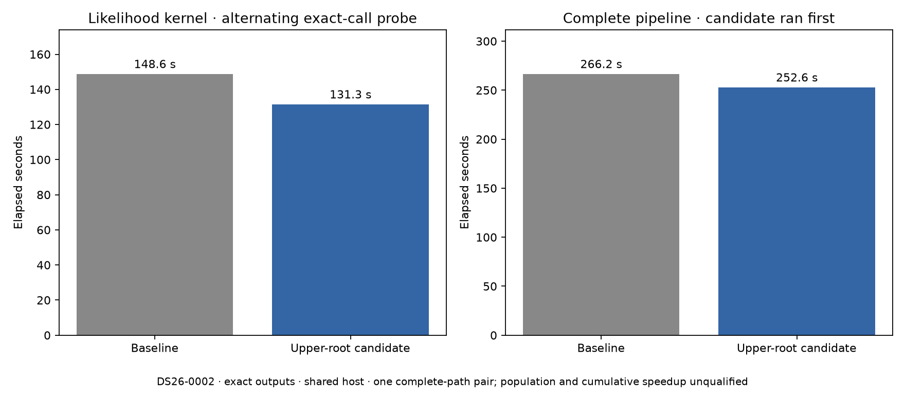

# ALGO07v3: avoid the redundant upper-root factorization

2026-11-05. External optimization experiment; no production deployment.

The updated numerical prototype preserves all **6,772 likelihood calls** in a
complete native DS26-0002 run, comparing every output's shape, dtype and bytes.
The entire scientific snapshot, both calibration arms, 179 grid locations,
recorded paths and eight PNG hashes also match the qualified native snapshot.
No acceptance tolerance, satellite gate, prior or iteration budget changed.

| Alternating exact-call measurement | Current kernel | Upper-root candidate |
| --- | ---: | ---: |
| Summed likelihood time | 148.611 s | 131.331 s |
| Difference | — | **17.280 s / 11.63% less** |

This diagnostic executes both kernels on every input, alternating the order.
Its 466.541-second process time includes doubled likelihood work and comparison;
it is not the normal pipeline runtime. These component timings are also not a
measurement of the cumulative legacy-ALGO07-to-v3 speedup.

The earlier factor-reuse prototype retained a general solve of the transpose
of the Cholesky root. That transpose is already upper triangular: its lower LU
factor is the identity and it needs no row pivots. The new prototype passes it
to the same LAPACK DGETRS solve with identity pivots, eliminating that redundant
factorization. It also retains the earlier reuse of the lower root's LU for
separate vector and identity-matrix right-hand sides. Keeping those right-hand
sides separate preserves the original operation shapes.

The [external driver](../../tools/probe_algo07v3_upper_root.py) changes no runtime
source. A numerical mismatch raises outside the scientific fit's ordinary
exception handling, so it cannot masquerade as a rejected satellite hypothesis.
The complete native snapshot SHA-256 is
`4f7c74a132b415e9bd6e130dcbc0d7082fa72c822d53f76810f8a9fa13323d68`.

Fourteen component tests pass, including zero-width features, C/Fortran layouts,
full 256-iteration budgets, widely differing feature/noise scales, rank-deficient
designs and more nuisance coefficients than observations. Input bytes remain
unchanged. Earlier evidence also contains 32 synthetic exactness cases.

## Complete-path measurement

A fresh isolated pair runs the candidate first, then the unchanged baseline.
Both use CPUs 0–2, one BLAS thread, the same pinned native input/causal archive,
search region and validation budgets. Each includes scientific persistence,
all eight PNGs and atomic WebUI publication. Earlier installations and results
are hidden, input files are read-only and networking is isolated. The kernel
override exists only inside each private mount namespace.

The [runner](run_upper_pair.py) freezes source/request/kernel hashes before
execution, records host CPU pressure every five seconds, requires fresh output
directories and compares the complete science and published artifacts. The
[renderer](render_upper.py) independently checks those bindings and successful
terminal/isolation receipts before emitting the figure and timing summary.

Both runs completed and the exact comparison passed, including all scientific
outputs, both calibration arms, eight PNG bytes, grid/path artifacts and public
document fields. The only loaded source change was the hierarchical kernel.

| Complete-path measurement | Baseline | Upper-root candidate |
| --- | ---: | ---: |
| Native GLRT ready through supervised publication | 266.242 s | **252.572 s** |
| Initial fitting | 27.130 s | 24.913 s |
| Predictive recovery | 82.720 s | 73.723 s |
| Unchanged native preparation | 8.504 s | 8.252 s |
| Initial host CPU pressure, avg10 | 0.24% | 0.01% |
| Maximum sampled CPU pressure, avg10 | 3.00% | 1.26% |

The observed complete-path saving is **13.670 seconds / 5.13%**, or 1.054×.
Host pressure was much closer than in the earlier factor-reuse pair, although
the baseline still experienced somewhat more contention. The independently
alternated kernel measurement supports a real computational saving; this one
pair does not isolate an exact population-level latency benefit.

Evidence: [complete comparison](upper-comparison.json),
[native exact-call receipt](upper-probe.json), [native output binding](upper-native-receipt.json),
[driver binding](upper-driver.json), [predeclared plan](upper-plan.json),
[resource observations](upper-resources.jsonl), [all stages](upper-stages.md),
[summary](upper-summary.json), [14 passing tests](upper-expanded-tests.xml).

This is a single scan and one candidate-first complete-path pair on a shared
host. It does not qualify all DS26, ordinary production admission/deadlines or
the cumulative 10× target. Capture, queueing and GLRT extraction are outside
the measured interval. The candidate remains external to the numerical runtime.

Raw evidence: `/srv/bulk/leo-dev/algo07v3-upper-root-20261105`.

## Next measured opportunity

Code review found two likelihood paths that still compute a Gaussian posterior
before replacing every returned posterior field with the hierarchical result:
`NormalPosition.calculate` and `DiscoveryPosition.calculate`. Other paths already
use the parent's geometry-only mode, which retains its input validation.

The [next external probe](../../tools/probe_algo07v3_discarded_gaussian.py) applies
that existing mode to those two paths. Twelve focused tests compare every field
for both calibration arms and three regional positions. A bounded complete native
probe is running at `/srv/bulk/leo-dev/algo07v3-discarded-gaussian-20261105`;
no native pass or speed gain is claimed yet. Each real calculation executes both
implementations and aborts on any discrepancy. Neither prototype is deployed.
