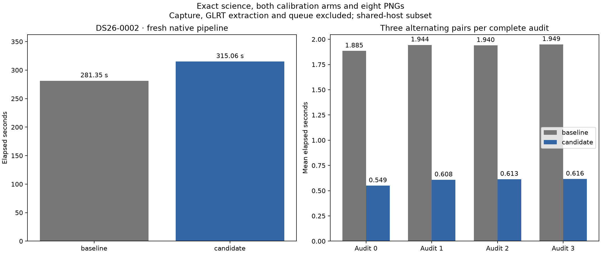

# ALGO07v3: reuse unchanged gates in exact satellite replay

2026-11-05. Development qualification; production unchanged.

Fresh complete DS26-0002 runs take **281.351 s baseline → 315.061 s candidate**:
**33.710 seconds longer**, observed ratio **0.893×**. All scientific values,
both calibration arms, all eight PNG bytes and public grid/path fields match
exactly. This one-pair result does **not** establish a complete-pipeline speedup.
The component experiment below measures the specific audit change separately.

This iteration removes repeated residual-gate work from predictive recovery's
post-fit audits. Every satellite still receives its exact-orbit replay, and
every original gate and diagnostic remains in the saved audit. No observations,
satellites, priors, optimizer budgets, holdouts or acceptance thresholds change.

## Why this work

The [targeted predictive profile](../2026_11_05_algo07v3_predictive_profile/README.md)
measured three serial audit substages totaling 8.314 seconds. Its parent profile
contained 50,966 noise-screen calls; 324 calls to `gate_slacks` accounted for
6.492 cumulative seconds. Those are profiled timings, not ordinary-run latency.

For each fixed control/target role and c arm, the audit replaces one family's
approximate orbit with its exact orbit. It previously recomputed all retained
and predictive track gates for every family. The replacement only changes the
selected family's frequencies, elevations and residuals. Other families retain
the same data, fitted coefficients, receiver calibration and position.

The audit now calculates a complete baseline gate dictionary once per fixed
problem and endpoint, then copies it for each replay and updates only the
selected family's entries. Existing dictionary keys retain their order. Failing
gates from unaffected satellites stay present and still prevent acceptance.
There is no cache across positions, arms, roles, targets or scans.

`exact_gate_replay` retains its complete-recomputation default for other callers.
The optional baseline is used only inside the fixed-problem inclusion audit.
Exceptions still restore the temporary calculation and frequency hooks and
propagate. The change touches only `recovery_gates.py` and
`recovery_inclusion.py` in the owned analysis component.

## Full native-path observations

| Measurement | Baseline | Candidate |
| --- | ---: | ---: |
| Native GLRT ready through publication/supervisor exit | 281.351 s | 315.061 s |
| Predictive recovery | 69.392 s | 65.798 s |
| Initial search, unchanged | 24.869 s | 41.078 s |
| Native preparation, unchanged | 8.436 s | 13.035 s |
| Plot evidence, unchanged | 24.021 s | 24.385 s |
| Process-tree CPU | 383.040 s | 428.770 s |
| GNU time maximum RSS | 2,329,012 KiB | 2,282,848 KiB |

Unchanged work slows materially across this sequential shared-host pair. CPU
totals also rise, so scheduler waiting alone does not explain the difference.
Both runs report zero major page faults. Host-pressure receipts are retained;
the experiment cannot apportion all timing variation to a particular cause.
Maximum RSS is not the summed memory of concurrently active processes.

The scientific outcome is unchanged: both arms retain 2,783/4,211 GLRT points
(66.09%), 74 fragments and 28 satellites. c=0/fitted-c position errors remain
665.210/697.464 m and residual RMS remains 76.333/76.198 Hz. The evaluation
reference is used only in presentation, not fitting. All acceptance gates and
original holdout assignments remain intact.

Capture, GLRT extraction and queue delay are outside these complete native
timings. The [earlier original-ALGO07 comparison](../2026_11_05_algo07v3_cumulative_repeat/README.md)
remains the latest cumulative evidence; its 642.886-second historical run cannot
be divided by this candidate time to claim a new controlled speedup. A stable
population ratio and the 10× complete-path objective remain unqualified.

## Qualification

The reference is commit `f20e388e8`. The two original source files were frozen
before editing; their SHA-256 values are recorded in `baseline-sources.json`.
Fresh baseline and candidate runs use the same DS26-0002 input, causal TLEs,
region, runtime, configuration and evaluation-only reference. The baseline
mounts the two original modules in a private namespace. Both runs hide legacy
installations and report results, disable network access, and expose the frozen
native input bundle read-only. CPU affinity is 0–2, with one BLAS thread.

The first launch failed before inference because the user process could not
create a mount namespace. Its receipt is retained at
`/srv/bulk/leo-dev/algo07v3-family-gates-20261105`. The new `-r2` output root was
launched with the existing passwordless administrator capability solely for
the namespace harness. No running inference was restarted and no production
service was modified. The failed launch is excluded from speed measurements.

The component benchmark independently alternates the old and new complete
audits three times each on live contexts from a fresh native run. An untimed
normal invocation supplies the expected audit and warms the context. Every
repetition must match its complete fingerprint, including both c arms, all
replayed families, ownership, gate values, witnesses and decisions. One CPU is
used during these serial component measurements. The old audit and its context
builders match the frozen reference source; they are external benchmark code,
never runtime dependencies.

The first instrumented benchmark completed, but its final strict parity check
failed: repeated numerical-stage audits appended to the live ordered receipt.
The numerical audit's problem count and reference-update count were **28 instead
of 4**. The remaining scientific snapshot sections and all eight PNGs matched.
This instrumentation mistake did not affect the ordinary full-pipeline pair.
The failed benchmark remains at
`/srv/bulk/leo-dev/algo07v3-family-gates-benchmark-20261105`; it is excluded from
the qualified benchmark. The corrected tool deep-copies the numerical policy
for each extra trial, verifies the live receipt is unchanged, and publishes
only the normal invocation. Regression tests cover both successful and failing
repeated trials with mutable receipts. The rerun uses a new `-r2` directory.

## Alternating complete-audit result

The corrected benchmark completes **24 exact audit executions**: three old/new
pairs for each of four live audits. The sum of the four per-audit mean times is
**7.718 → 2.386 seconds**, a **69.09% reduction** (3.235× ratio), saving about
**5.332 seconds** for this audit set. Corresponding CPU time is **7.715 → 2.385
seconds**. These are component measurements, not a 69% pipeline improvement.

| Audit | Baseline mean s | Candidate mean s |
| --- | ---: | ---: |
| Shared-family inclusion | 1.885 | 0.549 |
| New-family inclusion | 1.944 | 0.608 |
| New-family optimizer retry | 1.940 | 0.613 |
| Numerical-stage inclusion | 1.949 | 0.616 |
| Sum | **7.718** | **2.386** |



The benchmark's final scientific values, complete audit snapshot and all eight
PNG bytes also match the uninstrumented candidate exactly, including the
numerical policy receipt. Its **223.082-second instrumented total** includes all
repetitions and is not an ordinary complete-pipeline latency. The raw per-pair
wall/CPU values and host conditions are retained in
[component-audits.json](component-audits.json); see
[component-parity.json](component-parity.json) and [summary.json](summary.json).

The measured CPU reduction supports retaining this development optimization.
A reversed full-run pair and a second DS26 branch case are the next validation
steps; the slower full-run observation above is retained. The next computational
opportunity is repeated orbital interpolation inside fixed-phase position fits:
the prepared-geometry mechanism already used in recovery may apply there too,
provided phase/reference changes invalidate it and exact outputs are preserved.

## Tests and reproduction

The focused analysis/application/execution suite passed **627 tests**. A further
**150 tests** passed across CLI, storage, run comparison and the audit benchmark.
The benchmark's expanded **7-test** suite also passes after the receipt fix
(two additional parameterized cases).
New coverage checks partial-family work, exact full-replay equivalence, inactive
tracks, predictive-only families, both calibration arms, preservation of failing
unaffected gates, unchanged inputs/key order, exception restoration, bounded
alternating benchmark order and rejection of any audit mismatch. Ruff checks
pass for all changed and new Python files.

Use `run_pair.py --root ROOT --request REQUEST` after freezing the two reference
modules under `ROOT/baseline-src/` and recording their hashes in
`ROOT/baseline-sources.json`. The private namespace harness requires administrator
capability on this host. Its source and request bindings are checked again after
both runs. `tools/compare_algo07v3_runs.py` declares exactly those two modified
implementation modules and checks complete scientific/publication equivalence.

For a separate alternating component measurement:

```sh
PYTHONPATH=src:tools OPENBLAS_NUM_THREADS=1 taskset -c 0,1,2 python -B \
  tools/benchmark_algo07v3_family_gates.py --request REQUEST \
  --output FRESH_DIRECTORY --repeats 3 --timeout 900
```

Compare that instrumented run's final science and PNGs against the fresh
candidate using
`reports/2026_11_05_algo07v3_recovery_arms/profile_parity.py`. Its overall time
includes repeated audits and must not be used as normal pipeline latency.

The primary raw comparison is
`/srv/bulk/leo-dev/algo07v3-family-gates-20261105-r2`. This is a matched DS26
subset qualification. Full-dataset speed, full historical production admission
equivalence, capture/GLRT/queue latency and deployment are separate work.
