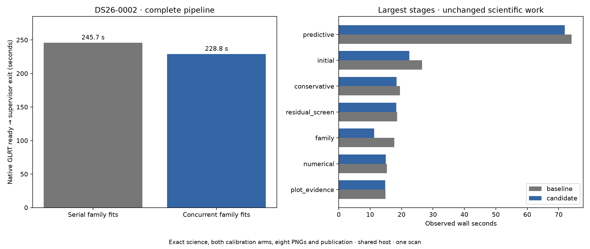

# ALGO07v3: concurrent family fits in the standalone CLI

2026-11-05. Development integration; production unchanged.

The c=0 and fitted-c family fits now execute in two owned child processes. The
parent retains the original arm order, combines failed-track gates and applies
the shared mask before the next fitting round. The linear trial also uses two
independent children; its paired acceptance decision remains sequential.
Catalogue, priors, budgets, arithmetic and scientific selection are unchanged.
The existing bounded executor handles failures and cancellation. An incomplete
child fit aborts the stage instead of becoming a scientific track rejection.

**843 component tests pass.** Tests compare the integrated numerical path
with a frozen serial oracle for whole/masked synthetic evidence, successive
rejection rounds, and child failures. Application and job tests verify that
only the family policy receives the new execution port. The focused suite is
included in the broad count. [Tests](tests.xml), [command](test-command.json).

Both fresh isolated DS26-0002 runs complete, with older installations, bulk
results and reports hidden, the input bundle read-only, and networking isolated.
**All scientific outputs, both calibration arms, eight PNG bytes, grid/path
values and public fields are exact.** Only the four declared implementation
modules differ; no runtime modules are added. [Comparison](comparison.json).

The serial-family baseline takes **245.714 s** and the concurrent
candidate **228.848 s** from native GLRT input through supervisor
exit after publication: an observed **6.86% lower** wall time. This excludes
capture, GLRT extraction and production queue delay. It is one sequential pair
on a shared host, with the baseline first, CPUs 0–2, one BLAS thread per process
and identical 1,200 s outer deadlines. It is not a cumulative legacy-to-v3 or
population-wide speedup. [Plan and source bindings](plan.json).

Unchanged stages also become faster: initial fitting takes
26.495 → 22.482 s,
before either run reaches the modified family stage. Consequently the full
wall-time difference cannot be attributed solely to family concurrency.
Family fitting itself takes 17.675 →
11.301 s. Retain both the stage and complete-path
measurements instead of treating the whole observed difference as a causal gain.

| Stage | Serial family fits (s) | Concurrent family fits (s) |
| --- | ---: | ---: |
| native_preparation | 8.701 | 8.487 |
| recovery_catalogue | 5.816 | 5.510 |
| initial | 26.495 | 22.482 |
| conservative | 19.514 | 18.365 |
| family | 17.675 | 11.301 |
| signed | 3.168 | 2.410 |
| cavity | 7.727 | 7.399 |
| inventory | 0.200 | 0.194 |
| predictive | 74.108 | 71.971 |
| numerical | 15.325 | 14.947 |
| gap | 0.002 | 0.001 |
| residual | 0.196 | 0.190 |
| residual_screen | 18.584 | 18.294 |
| addition | 0.002 | 0.002 |
| incumbent | 0.266 | 0.264 |
| ranking | 6.919 | 6.792 |
| admission | 11.099 | 10.484 |
| final | 0.060 | 0.057 |
| plot_evidence | 14.877 | 14.749 |
| png_rendering | 5.646 | 5.603 |

| Whole-process accounting | User CPU s | System CPU s | Maximum RSS KiB |
| --- | ---: | ---: | ---: |
| baseline | 262.77 | 9.25 | 2410836 |
| candidate | 253.87 | 6.12 | 2377360 |

CPU accounting includes waited-for children. Maximum RSS is the reported
per-process maximum, not the sum of simultaneously resident child processes.
Concurrency trades additional process work for latency; stage savings must not
be added to older complete-path observations.

Full DS26 localization, broader accepted branches, production admission and
deadlines, historical metadata semantics and the cumulative tenfold target
remain open. The CLI remains qualified for validation-all-work only. This
change is not deployed.

Reproduce from this checkout using the source-bound baseline module copies in
`/srv/bulk/leo-dev/algo07v3-family-integration-20261105/baseline-src` and fresh request/output paths; [run_pair.py](run_pair.py)
and [run_baseline.sh](run_baseline.sh) preserve the isolated comparison procedure.
Raw evidence: `/srv/bulk/leo-dev/algo07v3-family-integration-20261105`.
