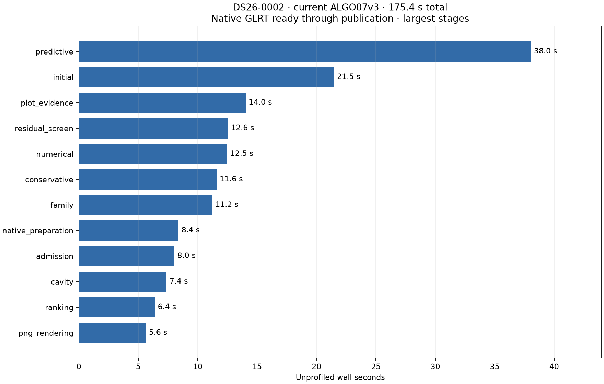
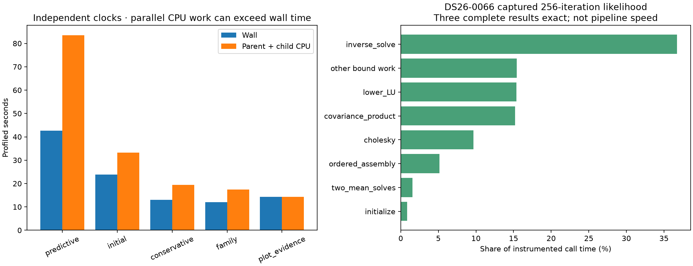

# ALGO07v3: fresh complete runtime profile and next optimization targets

Current ALGO07v3 takes **175.426 seconds (2 min 55 s)** on a fresh unprofiled
DS26-0002 run, from prepared native GLRT input through successful artifact
publication and supervisor exit. A separate instrumented run takes **215.765 s**.
The complete scientific output, both calibration arms, point ownership, public
grid/path and all eight PNG bytes match exactly. This is profiling evidence for
the unchanged implementation, not a new optimization or a production release.

Original-ALGO07 versus current-v3 paired speedup: **unavailable in this experiment**.
Do not divide an older original-ALGO07 duration by this fresh 175-second result.
The earlier 244.609-second current-v3 observation used the same numerical
implementation; timing variation does not establish a code improvement.
See the [previous original/v3 comparison](../2026_11_05_algo07v3_cumulative_repeat/README.md).

## Measurement scope

- One complete scan, DS26-0002; fresh private result stores, no resumed stages.
- CPUs 0–2, one OpenBLAS thread, sequential full runs on a shared host.
- Capture, queue delay and native GLRT extraction are excluded.
- Both `c = 0` and fitted-`c` keep the same observations, causal catalogue,
  priors, search budgets and scientific acceptance gates.
- GNU time observes 237.32 CPU seconds, approximately 1.35 occupied cores on
  average, and 2,293,476 KiB maximum RSS. Its broader wrapper clock is 176.79 s;
  the reported native-process clock is 175.426 s.
- Eleven profiler/component tests pass. Three separately instrumented complete
  posterior calls are exact and preserve their inputs.

Bindings and receipts are retained in [summary.json](summary.json),
[control/plan.json](control/plan.json), [profile/plan.json](profile/plan.json),
[profile/fresh-parity.json](profile/fresh-parity.json), and [tests.xml](tests.xml).
Evaluation coordinates enter presentation only. This experiment is not a full
DS26 qualification and does not measure population runtime percentiles.

## Where time goes

| Work | Unprofiled seconds | Share of complete time |
| --- | ---: | ---: |
| Predictive recovery and its repeated position fits | 38.05 | 21.7% |
| Initial position search | 21.48 | 12.2% |
| Diagnostic position-grid evidence | 14.05 | 8.0% |
| Residual association screening | 12.55 | 7.2% |
| Numerical-policy replay | 12.48 | 7.1% |
| Conservative recovery | 11.60 | 6.6% |
| Family recovery | 11.22 | 6.4% |
| Native preparation | 8.38 | 4.8% |
| Candidate admission | 8.03 | 4.6% |
| Family-omitted analysis (`cavity`) | 7.38 | 4.2% |
| Candidate ranking | 6.39 | 3.6% |
| PNG rendering | 5.64 | 3.2% |
| Recovery catalogue | 5.41 | 3.1% |

The [complete stage table](stage-table.md) includes small stages and corresponding
instrumented timings. Saving evidence takes another 4.406 s and publication
2.696 s; process setup and other unscoped work explain the remaining difference.
These clocks are nested in the complete run, not additional time beyond 175 s.

Predictive recovery is the largest individual stage, but it is only 22% of the
total. Halving it would save about 19 seconds, or 11% overall. Multiple stages
must improve to deliver another large overall reduction.

The independently timed profiled predictive stage consumes 42.687 wall seconds
and 83.532 parent-plus-child CPU seconds. It already benefits from concurrency.
Its target-1 retry alone takes 15.146 seconds. Annotation and inclusion fits
account for most of the rest; the four decision audits total about three seconds.
Later numerical-policy replay performs a further target-1 inclusion fit taking
12.469 seconds. Replay has different numerical-policy state: it cannot simply
be dropped or assumed identical to the earlier fit.

## Numerical bottleneck inside difficult fits

The separate DS26-0066 captured likelihood has 1,560 observations and a
175-column design, and reaches the existing 256 precision iterations. Three
complete instrumented calls total 0.554 seconds and exactly match the original.
Within those calls, inverse solving accounts for **36.7%**, lower LU
factorization **15.4%**, covariance multiplication **15.2%**, Cholesky **9.7%**,
ordered assembly **5.2%**, and the two mean solves only **1.6%**. These are
captured-call proportions, not fractions of the complete pipeline.

The [preceding full-training profile](../2026_11_05_algo07v3_posterior_buffers/README.md)
found 220 of 350 likelihood calls reaching that iteration ceiling. This explains
why repeated fits can dominate difficult scans. It does not justify reducing the
ceiling: that changes results. Combined solves already failed exactness, direct
upper solves failed signed-zero equivalence, and scratch buffers did not improve
complete-fit timing. Those rejected experiments remain external.

## Recommended experiments, in order

1. **Run independent diagnostic grid evaluations concurrently.** The current
   `sample_position_grid` evaluates fixed-context locations serially; this scan
   has 179 locations. Batch them across the existing bounded worker capacity,
   preserve ordering, both arms, every score, exception behavior and final PNG
   bytes. Avoid forking once per point. Its 14-second stage is a relatively
   isolated first target. The existing wall-clock budget can affect completion
   near a deadline, so deadline behavior needs explicit qualification too.
2. **Parallelize independent finite-difference evaluations where capacity is
   free.** `bounded_gauss_newton` computes four central-difference residual
   evaluations serially for a two-dimensional position step. Preserve the same
   evaluations and arithmetic order. Use bounded batches only in serial fits;
   predictive training already fills the worker pool. Do not multiply three
   outer workers by three inner workers. Mutable numerical-policy receipts must
   be reconciled exactly or kept serial. Measure startup overhead and CPU cost
   as well as latency.
3. **Measure and deduplicate immutable catalogue validation.** Native preparation
   plus recovery catalogue takes 13.8 seconds, including work beyond parsing.
   Investigate content-keyed reuse of exact TLE-line validation and parsing
   without skipping malformed-line checks or causal archive binding. Do not
   share mutable propagator objects casually. This is a source-informed
   hypothesis; we do not yet have a trustworthy measured checksum speed target.
4. **Look for exact reusable subproblems across recovery retries and replay.**
   Key reuse by the full model, observations, priors and numerical policy, not
   just position or satellite ID. Existing geometry caches, annotation reuse
   and unchanged-fit reuse are already implemented. The previous initial-cache
   prototype was exact but did not improve complete runtime; repeating that
   proposal without new evidence is not useful.

Recommendation: start with grid concurrency, then finite differences. These
offer opportunities to preserve exact outputs without replacing the scientific
model or its convergence criteria. A different sparse/structured posterior
solver could have larger potential, but changing floating-point operations
would require a different equivalence agreement; it is not an exact drop-in
optimization today. No speed claims for these new proposals have been measured.

Qualify each proposal separately on fresh DS26-0002 and DS26-0066 baseline/current
runs, alternating order. Require full audits, both arms, ownership and all eight
PNG bytes to match. Keep total CPU and memory alongside wall time: reduced
single-scan latency does not necessarily increase queue throughput.

## Profiling integrity

Independent stage timers use monotonic clocks plus parent and reaped-child CPU
counters. The global parent cProfile trace is **rejected for function ranking**:
its exclusive times sum to 409.587 seconds despite a 213.639-second worker,
and a Matplotlib text function reports self time greater than cumulative time.
That is inconsistent with the separately timed 9.343-second rendering stage.
The rejection and original profile digest are retained in
[parent-accounting-rejected.json](profile/parent-accounting-rejected.json).

A small fork-and-render test reproduced inconsistent accounting; a non-forking
render test did not. Pausing the parent profiler around forked execution did
not fix the problem and was reverted. The exact cause is not established.
Do not attribute the invalid trace's apparent cost to Matplotlib or TLE parsing.
The stage counters and separately instrumented posterior expressions are
independent of that trace. Child metadata and accounting flags are retained in
[children.json](profile/children.json); overlapping child times must not be
summed into elapsed pipeline time.

## Reproduction

Use the repository's [profiling skill](../../.agents/skills/profile-algo07v3/SKILL.md).
`run_unprofiled.py` records a fresh isolated control; `render.py` validates
bindings, exactness receipts and tests before generating this report's figures.
`tools/profile_algo07v3_posterior_parts.py --capture CAPTURE --output FRESH_DIR`
uses the bound `hardest.npz`/`hardest.json` from the training profiler, on one CPU
with one BLAS thread. Its source and instrumented expressions are archived in
`posterior/`. The measured profiler source is retained in `measured/`.
