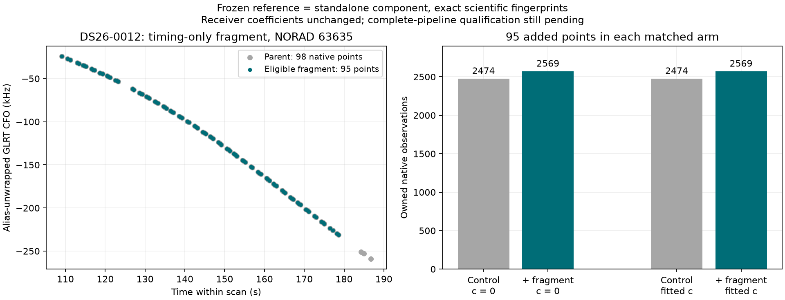

# ALGO07v3: standalone conditional gap recovery components

Complete-path baseline seconds, candidate seconds, savings and speedup remain
**unavailable**. Complete-path matched scans: **0**. The 10× target is unproven.
Production is unchanged. This iteration implements and verifies another required
scientific component; it does not complete the standalone engine.

## Result

Fresh timing-gap preparation, three-partition satellite annotation, conditional
position fits and exact owner/orbit audits agree with the frozen ALGO05 numerical
implementation on DS26-0012. V3 runs with `/opt` hidden under a read-only empty
mount and an audit hook rejecting old worker imports, subprocesses and concrete
storage modules. Its numerical functions receive explicit observations, context,
inventory and annotation data, not an old worker or result-directory interface.
The qualification harness supplies a frozen numerical context; this is not yet
a fresh native-input-to-publication run.

| Matched arm | Control owned points | With fragment | Added | Receiver coefficient change | Maximum exact-vs-linear orbital error |
|---|---:|---:|---:|---:|---:|
| c = 0 | 2,474 | 2,569 | 95 | 0 | 0.00005382 Hz |
| Fitted c | 2,474 | 2,569 | 95 | 0 | 0.00002639 Hz |

The original 98-point parent has one eligible 95-point timing component. The
remaining three points fail the minimum component size. Independent annotation
selects **NORAD 63635**, with minimum conditional identity margin
**3255.1597218324637**, using three distinct randomized group partitions. Both
position arms pass the paired gates and all four control/addition exact audits
verify. Positions, objectives, complete point/satellite ownership, phase histories,
diagnostics and numerical receipts have identical scientific fingerprints.
This demonstrates preservation of an existing recovery, not a new localization
accuracy improvement. Objectives of control and addition score different evidence
sets and must not be interpreted as an accuracy comparison.



## Preserved scientific rules

- Split only when consecutive native timestamps differ by **more than 5 s**.
  Keep complete components with at least 12 points and a span of at least 10 s.
  Fragment preparation uses no satellite residual or position-error criterion.
- Preserve native observation IDs, times, measured CFO plus existing integer
  alias lifts, receiver, channel and actual RF. Reject occupied observations from
  either calibration arm, active curved points or existing predictive evidence.
  Append a predictive view while preserving original graph/calibration arrays.
- Re-nominate satellites for each fragment with three distinct unshifted-origin
  randomized block holdouts: 12 s blocks, 2 s guards, original seed schedule,
  three candidate identities and both calibration arms. Parent confidence is
  not transferred. Target data never enter receiver calibration equations.
- Condition excluded coefficients at their posterior means. Only the selected
  family's phase, supported orbital coordinates and its existing curved-track
  bias coefficients may change. Conditioning is not marginalizing excluded
  uncertainty; its predictive objective must remain exactly as published.
- Preserve the 25 × 25 km search, five phase rounds, original position fitter,
  priors and noise policy. Numerical reference refresh may use ±30 s, while the
  physical shared-family phase gate stays at ±15 s and orbital linearization
  error must remain at most 1 Hz. Audit both arms and every active family.

No evaluation GPS or later TLE is used in these operations.

## Evidence and tests

Evidence root: `/srv/bulk/leo/research/algo07v3-20261104`.

| Comparison | Scientific SHA-256, equal on both sides |
|---|---|
| Gap preparation + fresh annotation + numerical receipts | `0d25ea7cbcaceff57ada4e792543331bbb5d1599aff887175837dd8ae8b54e98` |
| Fresh conditional fits + exact audit + numerical receipts | `aec4b0cae656eda9c1150265894c4f6ecac9f3f0fcfbf7e7419abb98f428f176` |
| Default predictive joint policy, all six fits/audits unchanged | `efd1dc11516547837bd5a0f3ee63f160dea431cd9503570ca6f46724e4f3a1c3` |

The final annotation pair is `gap003/{reference,candidate}.json`; inclusion is
`gap002/inclusion-{reference,candidate}.json`. The inclusion comparison uses the
same explicitly sealed earlier annotation on both sides; fresh annotation is
qualified separately. The default regression is
`gap003/default-joint-candidate.json`, compared with the previously qualified
frozen reference digest. Receipt bindings and complete scientific hashes are in
[artifact-bindings.json](artifact-bindings.json) and
[comparison.json](comparison.json). Only operational path/hash envelopes and
elapsed time are normalized; these are bound independently in receipts.

Initial checks exposed a legacy `scan.case` assumption and a negative seed-key
parsing mistake in the external comparison adapter. V3 now derives the case label
from the supplied track source identity. The adapter uses the complete filename
prefix when parsing seed keys. Fresh reruns passed without changing numerical
tolerances, fixtures or satellite competition.

**271 tests pass**, including 19 new tests covering exact gap boundaries,
point/span minima, invalid timestamps, native CFO and RF-lane integrity, occupancy
in either arm, immutable graph/calibration state and an independent dense
Gaussian calculation verifying the conditional update and fixed coordinates.
Ruff and `git diff --check` pass for the changes.

Observed annotation reference/candidate durations were **49.039/33.064 s**;
conditional fit/audit durations were **33.171/26.544 s**. These concurrent
shared-host component runs are not a controlled benchmark. They establish no
complete-path speedup. The unchanged six-fit default check took 85.663 s.

Reproduce receipt verification and the figure:

```bash
PYTHONPATH=src:tools OPENBLAS_NUM_THREADS=1 .venv/bin/python -B \
  reports/2026_11_05_algo07v3_gap/render.py \
  --evidence /srv/bulk/leo/research/algo07v3-20261104
```

External numerical entry points are `tools/check_algo07v3_gap.py` and
`tools/check_algo07v3_gap_inclusion.py`; each requires explicit pinned runtime,
fixture, source, output and side arguments. Neither belongs in production.

## Remaining work

Wire these components into the owned gap controller: original parent eligibility,
proper-fragment filtering, independent stage admission/caps, preservation of every
published incumbent owner, qualification and deterministic one-fit selection.
Carry the owned numerical checkpoint's retained annotations into that controller;
do not reconstruct legacy output directories. Then implement additional-family
recovery, guarded reassociation and final publication. Full DS26 coverage,
ordinary-clock equivalence, all eight UI artifacts and controlled end-to-end
performance remain release requirements. No deployment is justified yet.
