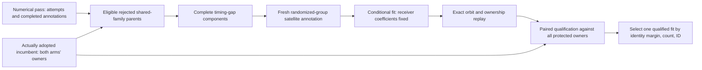
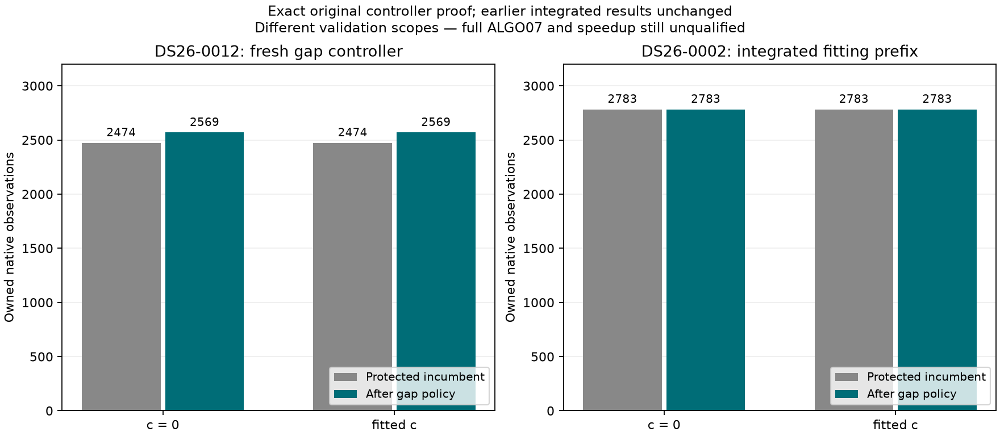

# ALGO07v3: owned gap controller and application boundary

Complete-path baseline seconds, candidate seconds, savings and speedup remain
**unavailable**. Complete-path matched scans: **0**. The 10× target is unproven.
Production is unchanged. This iteration adds ordered gap recovery and connects
it to the owned numerical checkpoint; later policies and publication remain open.

## Preserving the two distinct inputs

The original gap controller examines rejected attempts from the numerical pass,
including when that pass falls back to the preceding solution. It protects every
owner from the actually adopted incumbent. Using the retained pass's attempts,
or protecting only the original baseline, would change the algorithm.



V3 now carries these through explicit in-memory checkpoints. No old terminal,
export directory, relocated file tree or earlier worker is a runtime input.
The numerical component takes explicit stage-execution and monotonic-clock ports;
it does not launch subprocesses or read storage. It preserves:

- Original parent order and eligibility: shared-family RF rejection, supported
  identity, complete original graph parent and no occupied parent points.
- Proper timing fragments only, with unchanged 5 s gap, 12-point and 10 s span
  thresholds. The whole parent is not submitted again as a fragment.
- Stage caps of 180/240/240/180 seconds for preparation/annotation/inclusion/audit,
  integer remaining-time admission and the original 20 s reserve. The caller
  supplies the remaining overall budget and enforces stage cancellation.
- Matched c=0/fitted-c qualification, complete incumbent ownership protection,
  one selected fit, stable ordering on equal ranking keys, and retention of an
  already qualified result when a later stage exhausts the budget.
- Explicit incomplete-source status when numerical attempts are unavailable.
  The application does not manufacture a successful empty recovery.

The scientific checkpoint is not yet a production publication envelope. Final
proof validation, operational cancellation and public artifact emission still
need integration into the final standalone job.

## Scientific checks

The fresh DS26-0012 comparison executes the frozen ALGO05 controller body and
its original numerical stage entry points. Only its export/relocation ports use
an explicit immutable fixture. The candidate uses the owned controller with old
installations hidden under a read-only empty `/opt` mount and the unchanged
dependency audit hook. Both receive the same numerical context, six preceding
attempts, their completed annotations and 2,474 explicitly protected source
owners per arm. This is a controller qualification over a frozen context, not
an assertion that old export/publication adapters ran in v3.

Both select the same eligible 98-point parent and its 95-point proper fragment,
assigned to NORAD **63635**. All four stages complete. Positions, owners, compact
proof, qualification, targets, exclusions and all three numerical receipts match
exactly after documented operational provenance and JSON-array normalization.
The controller's complete scientific SHA-256 is:

`9568fb3039013b37118ab960f5ed25df2610cbd804ff81433fd1d1117db64f63`

The second check runs the implemented DS26-0002 fitting prefix from previously
prepared tracks/orbits/noise through initial, conservative, family/history,
signed-prior, cavity, predictive, numerical and gap policies. It uses the real
application checkpoint functions. Its comparator requires every preceding
scientific value to equal the previously qualified numerical-prefix fingerprint,
and checks gap recovery against the actually selected numerical owners.
This run does not rerun GLRT extraction or graph preparation and does not include
the remaining ALGO06/07 policies or UI publication.

The integrated comparison passes exactly. One rejected parent is eligible, but
its timing partition yields no proper fragment to evaluate. Only preparation is
needed; no annotation or fit is forced. All **2,783 selected owners remain in both
arms**, including the 35-point addition from preceding recovery. The earlier
prefix still has SHA-256
`9144935a99b4a877913a63a54bd825816906071faf93bf85a094c011bebc32cb`
when the new gap result is removed. The new complete implemented-prefix output is
`c26667e5895dcd92a7b7c463dd83ab5fda5882a8ef6fedef9b7921da19949f4a`.

Detailed outcomes, counts and timings are in [comparison.json](comparison.json).
The two panels below deliberately identify their different verification scopes.



## Import dependency found during integration

The first integrated run reached the application boundary and was correctly
rejected by the dependency guard. `leo.application.__init__` eagerly imported
unrelated calibration/acquisition applications, eventually loading
`leo.storage.writer`. The localization application also eagerly imported its
archive preparation adapter even when fitting an already prepared scan.

Public package exports now load on request. Their names, `__all__` ordering,
object identity and discoverability are preserved. Archive preparation adapters
load only when the native input-preparation functions are called. The fitting
application can now import with storage, acquisition, operational adapters,
database, web and old-worker imports explicitly rejected. The guard was not
relaxed or bypassed.

## Tests and limitations

**308 focused tests pass**, including controller eligibility, proper fragments,
failed stages, both-arm owner protection, selection ties, budget exhaustion,
checkpoint fallback, strict comparators and fresh-interpreter import tests.
Ruff passes for the new modules and package initializer; `git diff --check`
passes. The public import test resolves every existing application export and
compares it to the original defining module's object.

The wider application suite is **not fully green**: 260 pass, 10 fail and 2 have
setup errors. Replaying the previous eager package initializer before collecting
the same older tests yields 258 pass and the exact same 10 failures/2 errors,
including identical failure messages. The two additional passes are the new
import tests. The remaining failures concern absent sparse-worktree profiles and
golden files, the unavailable `_regional_orbits` compiled kernel, and an adaptive
test double without the current `search_geometry` argument. They were not hidden,
skipped or fixed by changing scientific fixtures. XML evidence and the prior
initializer bytes are bound by [artifact-bindings.json](artifact-bindings.json).
This control isolates the package-loading change; it is not a whole historical
checkout qualification.

Observed component and prefix times are reported separately. The reference and
candidate controller runs overlapped on a shared host, so they are not a
controlled speed benchmark. The longer prefix covers substantially more science
and must not be divided by the component reference duration. Ordinary-clock
admission equivalence, binding cancellation and broader multi-parent scientific
qualification remain open.

| Measured scope | Frozen reference | Candidate |
|---|---:|---:|
| DS26-0012 frozen-context gap controller | 41.064 s | 34.766 s |
| DS26-0002 implemented fitting prefix through gap policy | Not rerun in this experiment | 375.066 s |
| Complete ALGO07 through all UI artifacts | Unavailable | Unavailable |

## Reproduction and next work

Evidence root: `/srv/bulk/leo/research/algo07v3-20261104`.
The controller pair is under `gap-controller002`; the corrected application
prefix and application-suite controls are under `gap-controller003`.

```bash
PYTHONPATH=src:tools OPENBLAS_NUM_THREADS=1 .venv/bin/python -B \
  reports/2026_11_05_algo07v3_gap_controller/render.py \
  --evidence /srv/bulk/leo/research/algo07v3-20261104
```

`tools/check_algo07v3_gap_controller.py` runs either side of the frozen-context
controller check with explicit runtime/input paths. The candidate executes with
old installations hidden. `tools/check_algo07v3_position.py --gap-recovery` runs
the fresh implemented prefix with all predeclared earlier work admitted; it is
a qualification harness, not the final production CLI.

Next: reconstruct the selected incumbent from owned scientific stage data for
72 h / ±30 s additional-family recovery, then implement guarded reassociation
and final publication. Complete all eight UI artifacts, full DS26 parity and a
controlled full-path benchmark before claiming standalone equivalence, speedup
or deployment readiness.
