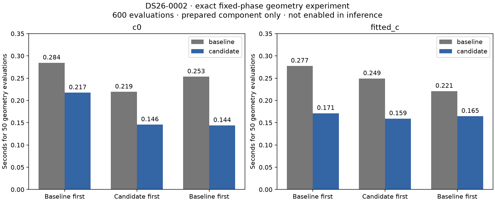
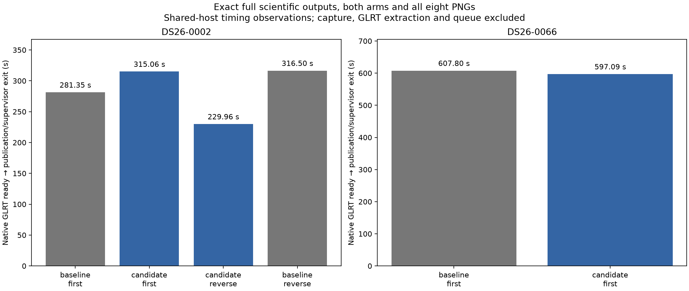

# ALGO07v3 gate-reuse follow-up and fixed-phase geometry experiment

2026-11-05. Development qualification; production unchanged.

This follow-up retains the reversed DS26-0002 timing pair after the
[gate-reuse optimization](../2026_11_05_algo07v3_family_gate_reuse/README.md).
The full scientific comparison passes, including both calibration arms, all
audit fields, ownership, all eight PNGs and public position grid/path values.

## DS26-0002: all four full-run observations

| Execution order | Version | Native GLRT through publication/supervisor exit |
| --- | --- | ---: |
| 1 | Baseline | 281.351 s |
| 2 | Candidate | 315.061 s |
| 3 | Candidate | 229.958 s |
| 4 | Baseline | 316.503 s |

The first pair is slower; the reverse pair is faster. The candidate alone varies
by 85.103 seconds between its two executions. These shared-host observations
cannot attribute the full difference to this edit. The preceding report's 24
alternating complete-audit executions provide more direct evidence: their
four-audit set averages **7.718 → 2.386 seconds**, with a comparable CPU reduction.
That component saving is about 5.332 seconds, not the full observed run difference.

Capture, GLRT extraction and queue delay remain excluded. The baseline is the
same pair of frozen modules from `f20e388e8`; runtime inference remains at
`29ec222c2`. No further inference changes were made during these measurements.

## Preliminary next optimization: fixed-phase orbital interpolation

`JointMarginal.calculate` repeatedly interpolates the central phase, positive
and negative derivative offsets, and physical orbital-mode states for each
trial receiver position. During one fixed-phase problem, these states do not
depend on receiver position. The external prototype prepares them once, then
uses the existing projection functions and exact derivative arithmetic at every
new position. It snapshots time/label/reference values and checks orbit-buffer
identity; changed phase grids or replaced banks build a new snapshot. Orbit
buffers remain fixed inputs, as in the existing prepared-geometry contract.

The probe uses DS26-0002's selected initial hypothesis and a genuine causal scan
context, containing **2,850 observations**. Fifty positions are generated within
the 25 × 25 km regional box with seed **20261105**. Both calibration arms receive
the identical positions. Three alternating pairs per arm produce **600 exact
geometry evaluations**, including the full feature matrices. Each trial creates
a fresh problem; candidate timing includes its first preparation. Problem
construction, evidence loading, posterior fitting, optimization and publication
are outside this component timer. CPU affinity is 4, with one BLAS thread.

| Scope | Baseline mean | Prototype mean |
| --- | ---: | ---: |
| Fifty geometry evaluations, mean across both arms and three pairs | 0.250763 s | 0.167064 s |



This is **33.38% less geometry time**. It is not a full-fit or pipeline speedup,
and this prototype is **not enabled in runtime inference**. Five focused tests
pass, covering both c arms, complete Gaussian calculations, phase/time/label
changes, replaced mode/orbit arrays, shallow copies, immutable prepared states
and invalid phase bounds. Full native-path qualification remains necessary
before integration. The probe stores all sample positions, per-pair wall/CPU
times, runtime versions, source hashes and the input scientific receipt.

Run the experiment from the repository using its bound Python environment:

```sh
PYTHONPATH=src:tools OPENBLAS_NUM_THREADS=1 taskset -c 4 python -B \
  tools/probe_algo07v3_position_geometry.py --request REQUEST --output FRESH_JSON
```

The raw probe is
`/srv/bulk/leo-dev/algo07v3-position-geometry-probe-20261105.json`.
The reversed pair is
`/srv/bulk/leo-dev/algo07v3-family-gates-20261105-r2/reverse`.

## Completed second-scan qualification

DS26-0066 exercises accepted guarded reassociation. Its fresh baseline and
candidate both completed, with exact scientific outputs, both calibration arms,
all eight PNGs and public position grid/path values.

| Scan | Baseline | Candidate | Observed difference |
| --- | ---: | ---: | ---: |
| DS26-0066 | 607.804 s | 597.093 s | 10.711 s shorter (1.76%) |

This is one shared-host pair, not an attributable or dataset-wide speedup. The
two-scan renderer also checks all four DS26-0002 outputs against each other:
all six completed runs pass their respective scan's exact comparison. The
runtime observations and component improvements remain separate evidence.



The raw second-scan pair is retained at
`/srv/bulk/leo-dev/algo07v3-family-gates-0066-20261105`. Each run uses the same
1,200-second outer bound, three-CPU affinity and one BLAS thread. Old
installations/reports are hidden, network access is isolated, and frozen native
inputs are read-only. The committed `summary.json`, comparison receipts,
supervisor records and resource snapshots retain the measured evidence.

Qualification covers two DS26 scans. Full DS26 qualification, full historical
equivalence and production admission remain open. No deployment is included.

## Next measured opportunities

The next larger scheduling opportunity is independent initial-discovery seeds
and branch/arm fits. An earlier DS26-0002 parent profile measured 45.102 seconds
in initial search, including 18.961 seconds in `fresh_discovery`; its three arm
pairs have maximum child profile totals of about 5.076, 5.277 and 8.953 seconds.
These are older profiled measurements, not current normal latency or exclusive
CPU totals. They motivate measuring bounded three-worker scheduling while
preserving proposal, tie, callback and publication order. No such scheduling
change is included here.
