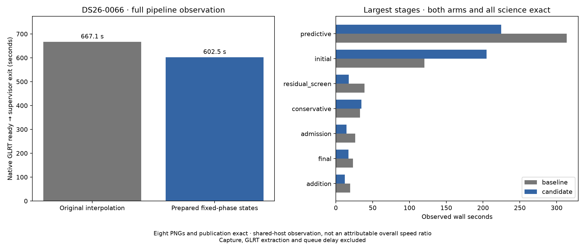
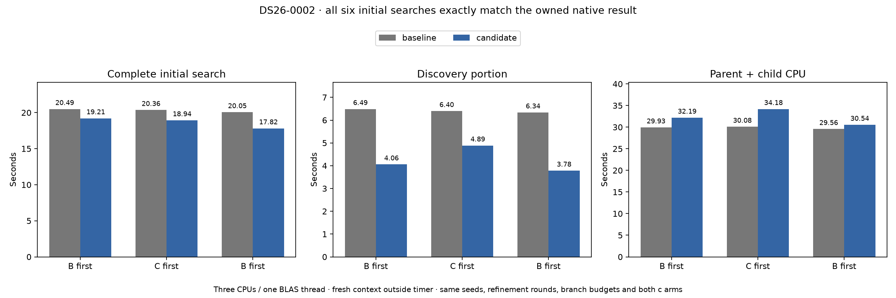

# ALGO07v3 fixed-phase geometry: second-scan qualification

2026-11-05. Development evidence; production unchanged.

The [fixed-phase geometry optimization](../2026_11_05_algo07v3_position_geometry/README.md)
now passes a second fresh complete native comparison on **DS26-0066**, which
exercises accepted guarded reassociation. Both calibration arms, every scientific
audit, observation/satellite ownership, all eight PNG bytes and public grid/path
values match exactly. This extends the original DS26-0002 qualification to a
different recovery branch without changing its scientific answer.

## Complete-path observations

| Scope | Baseline | Candidate |
| --- | ---: | ---: |
| Native GLRT ready through publication/supervisor exit | 667.114 s | 602.497 s |
| Process CPU, user + system | 977.300 s | 830.270 s |
| Maximum RSS reported by GNU time | 2,181,968 KiB | 2,206,908 KiB |
| Native preparation | 9.479 s | 14.875 s |
| Recovery catalogue | 5.226 s | 8.697 s |
| Initial search | 120.382 s | 204.640 s |
| Conservative recovery | 32.821 s | 34.695 s |
| Predictive recovery | 313.690 s | 224.730 s |
| Residual screening | 38.946 s | 17.446 s |
| Diagnostic plot evidence | 16.849 s | 10.286 s |
| PNG rendering | 6.925 s | 5.067 s |



The complete observation is **64.617 seconds shorter (9.69%)**. It does not
establish an attributable 9.69% pipeline improvement. Initial search is
**84.258 seconds slower** in the candidate; unchanged preparation/catalogue
loading also slow down, while later stages improve. Shared-host conditions
vary within and between executions. The record preserves this regression and
the CPU/resource observations rather than attributing the entire difference to
the cache change.

The preceding alternating prepared-fit benchmark is the more direct component
evidence: full five-round fits average **9.96% less time for c=0** and **9.37%
less for fitted c**, with comparable CPU reductions and all twelve fit
histories/calculations exact. Those measurements concern DS26-0002's selected
initial hypothesis under the stated prepared context, not all DS26-0066 fits.

## Scope and reproducibility

Runtime inference remains at the qualified source from `7f52d1248`. The only
baseline/candidate numerical source difference is `marginal.py`: baseline
SHA-256 `38535668aa81bb2116250225c457721b91a77fbd81084e8675a109ad3aa21c3f`,
candidate `c80ac51249578e8a2c6c6a13a04aaa22a168353b2c758155858106b91507b609`.

Both runs use the same frozen native observations, causal TLE catalogue,
receiver priors, search region and full optimizer budgets. The matched c=0 and
fitted-c arms are unchanged. Evaluation GPS enters only presentation. Each
execution starts with fresh private outputs, CPUs 0–2, one BLAS thread and the
existing 1,200-second outer bound. Neither execution timed out or resumed.
Network access and old installations/results are hidden during inference.

Raw runs are at
`/srv/bulk/leo-dev/algo07v3-position-geometry-0066-20261105`. The committed
comparison, plan, source manifests, supervisor/isolation records, resource
snapshots and `summary.json` retain the evidence. The copied 636-test and
14-focused-test XML files are the **previous tests of these exact candidate
bytes**, not newly run scan-specific suites or additive unique test counts.

Regenerate this report's figure and receipts with the pinned environment:

```sh
PYTHONPATH=src:tools OPENBLAS_NUM_THREADS=1 python -B \
  reports/2026_11_05_algo07v3_position_geometry/render.py \
  --root /srv/bulk/leo-dev/algo07v3-position-geometry-0066-20261105 \
  --out reports/2026_11_05_algo07v3_geometry_followup --scan DS26-0066
```

This remains a **two-scan qualification**. Whole DS26, full original-worker
historical equivalence, ordinary production admission and a stable cumulative
speed ratio remain open. Capture, GLRT extraction and queue delay are excluded
from the measured native-input-to-publication interval. No deployment occurred.

## Independent discovery seeds: exact but modest benefit

Initial search and predictive recovery are still substantial costs. The external
`tools/probe_algo07v3_discovery_schedule.py` extracts the existing discovery seed
body unchanged and schedules batches of at most three through the existing
bounded executor. It retains every seed, both within-seed refinement rounds,
proposal order, subsequent branch selection, both calibration arms and all
search budgets. Runtime inference is not modified by this experiment.

Nine tests pass, including unchanged scientific results under real child
processes, extraction/body identity, ordered batching, failed-batch propagation
and restoration of the temporary external substitution. The full prepared
initial-search benchmark ran sequentially after the native pair. All six
complete initial searches match the saved owned DS26-0002 initial result,
including every branch, both c arms, selection and zero-phase controls.

| Mean over three alternating pairs | Baseline | Prototype | Change |
| --- | ---: | ---: | ---: |
| Complete initial search | 20.303 s | 18.655 s | 8.12% less elapsed time |
| Discovery portion | 6.407 s | 4.242 s | 33.79% less elapsed time |
| Parent + reaped-child CPU | 29.855 s | 32.304 s | 8.20% more CPU |



Each trial creates a fresh scan context before timing, using the original
initial-stage previous-TLE prior (`genuine=False`). Both sides retain the
existing two-arm concurrency for later branch fits. The prototype uses at most
three children for independent discovery seeds, with no overlap between seed
and branch phases. Affinity is CPUs 0–2 with one BLAS thread. The preparation
bytes are checked unchanged afterward. Extra context construction and upstream
native preparation are outside this timer.

The new tool is reproducible from an owned completed request:

```sh
PYTHONPATH=src:tools OPENBLAS_NUM_THREADS=1 timeout -k 2 600 taskset -c 0,1,2 python -B \
  tools/probe_algo07v3_discovery_schedule.py --request OWNED_REQUEST \
  --output FRESH_DIRECTORY
```

The exact extracted source bodies, runtime/source bindings, host observations,
test receipt and all six timings are retained here. The raw experiment is
`/srv/bulk/leo-dev/algo07v3-discovery-schedule-20261105`. Its `discovery_seconds`
are nested within total initial-search time and must not be added to it.

**Decision: keep discovery scheduling external for now.** Saving 1.649 seconds
of this prepared initial search costs 2.449 additional CPU seconds. This is a
real latency/throughput tradeoff, not a demonstrated full-pipeline gain. It does
not yet justify making the default execution path more complex, particularly
while scan queue throughput matters.

## Next target

Predictive recovery still takes **224.730 seconds** on DS26-0066. It is the
larger measured opportunity. The next run will use `--only-stage predictive`
with the profiling skill to identify the dominant child fits and numerical
kernels on this scan, then verify its scientific outputs against the completed
unprofiled candidate. Profiled elapsed time will not be used as a speed result.
