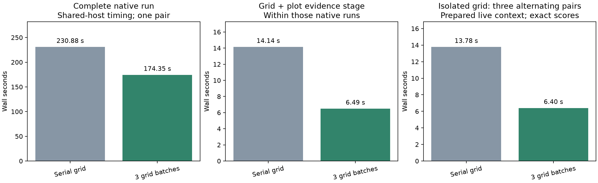
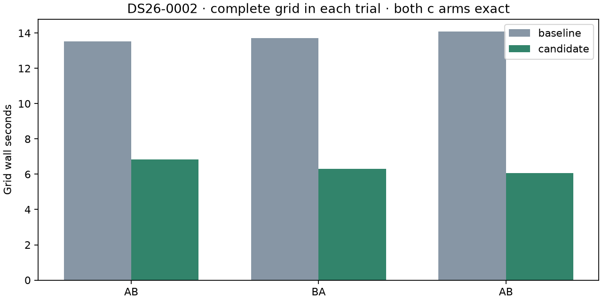

# ALGO07v3: exact diagnostic grid batching

The standalone ALGO07v3 diagnostic grid now evaluates independent locations in
three bounded process batches. On DS26-0002, a fresh complete native pair takes
**230.877 → 174.353 seconds**: **56.524 seconds lower**, an observed **1.324×**
ratio. All scientific audits, both calibration arms, native point ownership,
public grid/path and all eight PNG bytes are exact. One scan is qualified.

The full-run difference includes large variation in unchanged stages and is
**not attributable entirely to batching**. The isolated, repeated grid benchmark
is the stronger attribution evidence: **13.778 → 6.404 seconds**, a **2.151×**
speedup and **7.374 seconds saved**. Grid CPU rises **13.774 → 15.063 seconds**,
or **9.36%**. This is a latency improvement, not a demonstrated increase in queue
throughput. The change is retained in development; production is unchanged.

Original-ALGO07 versus current-v3 cumulative speedup is **unavailable in this
experiment**. Do not multiply this stage ratio into earlier pipeline ratios.
Capture, queue wait and native GLRT extraction remain outside these clocks.
The [preceding profile](../2026_11_05_algo07v3_full_runtime_profile/README.md)
identified diagnostic grid preparation as a 14-second serial stage.

## Results and scope

| Measurement | Serial | Three batches | Qualification |
| --- | ---: | ---: | --- |
| Complete native input through publication | 230.877 s | 174.353 s | One fresh sequential pair; all science and PNGs exact |
| Grid plus plot-evidence stage in that pair | 14.144 s | 6.494 s | 7.650 s lower |
| PNG rendering | 5.649 s | 5.676 s | Renderer unchanged |
| Isolated grid, three alternating pairs | 13.778 s | 6.404 s | All six complete grids exact |
| Isolated grid, parent plus reaped-child CPU | 13.774 s | 15.063 s | 1.290 CPU seconds additional work |
| Whole-command user plus system CPU | 312.44 s | 244.81 s | Includes substantial variation in unchanged work |
| Maximum process RSS reported by GNU time | 2,284,168 KiB | 2,284,548 KiB | Not aggregate concurrent-process memory |

The initial search, which this patch does not change, takes 38.217 seconds in
the baseline and 21.989 in the candidate. Preparation similarly drops from
12.213 to 8.379 seconds. Thus the 56.5-second complete-run difference cannot be
claimed as this change's causal effect. About seven to eight seconds of grid
latency improvement is supported by both the native pair and repeated trials.

The full pair uses a private mount/network namespace, frozen read-only inputs,
hidden earlier installations/results, three CPUs (0–2), one BLAS thread and the
same 1,200-second outer deadline. The grid retains its 300-second budget.
Baseline source is frozen before editing from commit `94c700594`; both versions
are mounted through explicit five-module overlays. Both native runs are fresh
and complete, not resumed. See [native/comparison.json](native/comparison.json),
[native/plan.json](native/plan.json), [native/stages.json](native/stages.json)
and the archived source snapshots under `measured/`.

Both arms retain 2,783 of 4,211 GLRT points (66.0888%), 74 tracks and 28 satellites.
Their endpoint coordinates, residual RMS and every association decision are
unchanged. Evaluation coordinates remain presentation-only; causal TLEs,
observations, physical priors, optimizer budgets and candidate sets are matched.

## Repeated grid measurement

`tools/benchmark_algo07v3_grid.py` executes fresh native inference to obtain the
actual selected likelihood, then evaluates three serial/batched grid pairs in
AB, BA, AB order. Each evaluates the same 179 planned locations and both arms.
The baseline is the frozen original sampler, not a rewritten imitation.
Complete grid fingerprints compare exact float values, score failures, ordering,
endpoints and policy fields; only elapsed time is excluded.

All six grids are complete and exact. The instrumented run's final scientific
output and all eight PNGs also match the fresh uninstrumented candidate. The
shared implementation hashes match, accounting explicitly for identical CLI
entry-point module aliases. See [benchmark/trials.json](benchmark/trials.json)
and [benchmark/parity.json](benchmark/parity.json).

Context preparation is outside the individual grid timers. These repeated trials
use an already prepared live context, so they do not establish a cold-start or
dataset-wide speedup. The benchmark's overall process duration includes extra
grid repetitions and must never be reported as native pipeline performance.

## Implementation and guarantees

The sampler retains its serial default for existing callers. An optional narrow
execution port dispatches at most three contiguous point batches; the owned v3
worker supplies the existing bounded process adapter. This
adds no worker service or persistent pool and does not introduce a runtime
dependency on earlier ALGO implementations.

Each child evaluates a complete c=0/fitted-c pair at a location, using the same
score arithmetic and expected numeric-error handling. The parent merges batches
in original order. Unexpected child failures remain operational failures, and
the existing executor terminates and reaps children on interruption. The grid
stage runs after inference, so it does not nest under fitting workers. Rendering
itself remains serial.

Each location checks the original shared deadline before starting. If a batch
expires, only the contiguous completed prefix is published; later batch results
cannot create holes. Faster execution can change point counts near a wall-clock
deadline. This experiment qualifies **complete grids only** and does not claim
identical partial-grid output on every possible scan. Published schemas and
scientific time/iteration budgets are unchanged.

## Tests and next iteration

The relevant component suite passes **704 tests**, and the external benchmark
adds **three passing tests**, for **707 distinct tests**. A further 17-test job
suite rerun verifies that the actual worker wires the new port. Tests cover
complete paired-grid equality, numeric failures, prefix truncation after an
expired middle batch, child failure, process reaping, presentation forwarding,
and exclusion of evaluation coordinates from inference. The initial unit run's
one outdated execution-port fixture is retained in `native/tests.xml`; the
fixture was updated to exercise port forwarding, then all checks passed.
No golden scientific fixture changed.

The profiler skill and CLI/runtime documentation are updated. Reproduce the
native pair with `run_pair.py` and bound baseline/candidate source snapshots.
Run the grid benchmark on three CPUs with one BLAS thread, redirecting stdout
to a log because the retained exact fingerprints include every grid value.
`render.py` verifies source bindings and parity before publishing these figures.

Next, extend qualification to the harder DS26-0066 accepted-reassociation case,
then profile independent finite-difference evaluations inside serial position
fits. They offer a larger opportunity than further optimizing the six-second
grid, but fork overhead, existing outer concurrency and mutable numerical-policy
receipts must be measured before integration. Full DS26 qualification and a
stable new original-ALGO07 comparison remain outstanding.
