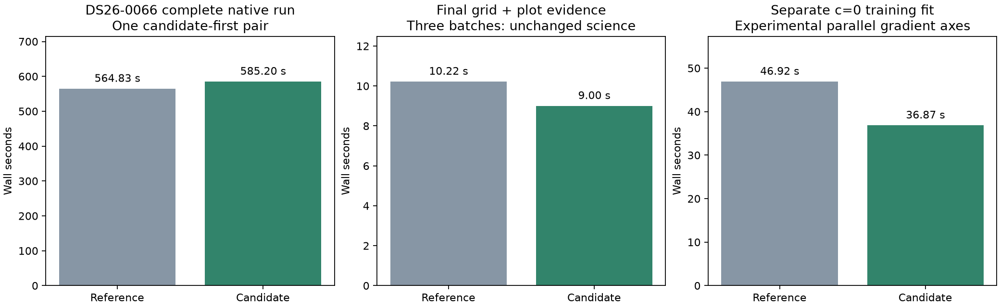

# ALGO07v3: hard-scan grid qualification and parallel-gradient prototype

DS26-0066 now passes a fresh exact comparison of serial versus batched diagnostic
grids, including both calibration arms, every scientific audit, native ownership,
public grid/path and all eight PNG bytes. The new output also exactly matches the
earlier qualified DS26-0066 output across the intervening covariance-index and
grid changes. Grid batching is therefore qualified on two complete DS26 scans.

The complete candidate-first native pair takes **564.831 s baseline → 585.201 s
candidate**: **20.370 s slower**, an observed **0.965×** ratio. Retain this regression.
Grid plus plot-evidence preparation improves **10.222 → 9.005 s**, but other
unchanged stages vary substantially. This experiment does not establish an
overall pipeline speedup. Capture, queue delay and GLRT extraction are excluded.

A separate external parallel-gradient prototype reduces complete five-round
training-fit latency by **21.44% for c=0** and **18.06% for fitted c**, with exact
optimizer histories and final state. It increases CPU by approximately 10–12%
and is **not integrated into runtime**. Production remains unchanged.

## Native qualification, including the unfavorable timing

| Scan | Complete serial-grid run | Complete batched-grid run | Serial plot evidence | Batched plot evidence | Exact science and eight PNGs |
| --- | ---: | ---: | ---: | ---: | --- |
| DS26-0002, preceding iteration | 230.877 s | 174.353 s | 14.144 s | 6.494 s | Yes |
| DS26-0066, this iteration | 564.831 s | 585.201 s | 10.222 s | 9.005 s | Yes |

Both are fresh sequential native-input-to-publication comparisons with three
CPUs and one BLAS thread. The first runs baseline first; the second reverses that
order. Inputs and source overlays are read-only in isolated mount/network
namespaces; earlier installations and reports are hidden. Each complete run
has the same 1,200-second outer supervisor limit. Neither is resumed.

The unchanged DS26-0066 initial search varies **201.485 → 114.467 s**, while
predictive recovery varies **170.746 → 237.154 s**. Rendering varies **5.182 →
6.850 s**. These changes occur outside the grid implementation. Whole-command
user plus system CPU is **859.38 → 976.22 s**; maximum process RSS is
**2,201,044 → 2,197,200 KiB**, and major page faults are **0 → 1**. The saved host
pressure snapshots document a shared machine, not an isolated benchmark host.
They do not identify a single definitive cause for every timing change.

The [preceding repeated grid experiment](../2026_11_05_algo07v3_grid_batches/README.md)
on DS26-0002 establishes a narrower repeatable component benefit: 13.778 →
6.404 seconds over three alternating pairs. That ratio must not be applied to
DS26-0066 or the entire pipeline. On the hard scan, plotting is a small fraction
of total runtime; repeated fitting remains the priority.

Both DS26-0066 arms retain **2,770 / 3,927 GLRT points (70.5373%)**, 89 tracks
and 20 satellites. Their positions and residual RMS are exactly unchanged:

| Arm | Latitude | Longitude | Residual RMS |
| --- | ---: | ---: | ---: |
| c=0 | 37.85971669372918 | −122.49009926661317 | 88.12274800877016 Hz |
| fitted c | 37.85958863924463 | −122.4896053030657 | 86.98662872563048 Hz |

Observations, candidate sets, causal catalogues, nuisance priors, search budgets
and calibration-arm treatment are matched. Evaluation coordinates enter only
presentation. No position improvement is claimed from a runtime change.

See [native/comparison.json](native/comparison.json),
[native/stages.json](native/stages.json), and
[native/history-parity.json](native/history-parity.json). The historical check
compares complete scientific values and PNG bytes, and explicitly records all
six changed source modules. It is not a cross-version timing comparison.
Full DS26 qualification and a new matched original-ALGO07 timing comparison
remain outstanding.

## Parallel finite-difference experiment

The existing two-dimensional Gauss–Newton fit evaluates both sides of each
position axis serially. The external prototype starts two children per gradient:
each evaluates its axis's positive and negative perturbation in the same order.
The parent forms the derivative columns and executes all remaining optimizer
arithmetic in the original order. Step sizes, damping trials, accepted-step
history, evaluation counts and convergence criteria are unchanged.

The experiment uses the previously identified slow DS26-0066 annotation training
case: target 1, fold 1, randomized grouped seed **94721**, **1,560 training points**,
five phase-refresh rounds and 48 optimizer iterations per round. Each trial
reconstructs a fresh context outside its timer. The c=0 pair runs baseline first;
the fitted-c pair runs candidate first. All four complete results match within
their arm, including history, reference, state and full final likelihood.

| Arm | Serial wall | Parallel axes wall | Wall reduction | Serial CPU | Parallel total CPU | CPU increase |
| --- | ---: | ---: | ---: | ---: | ---: | ---: |
| c=0 | 46.923 s | 36.865 s | 21.44% | 46.915 s | 51.598 s | 9.98% |
| fitted c | 45.185 s | 37.024 s | 18.06% | 45.180 s | 50.478 s | 11.73% |

CPU includes the parent and reaped children. These are **prepared-fit timings**,
one pair per arm, not fresh discovery/recovery/publication measurements or stable
dataset statistics. They do not prove that nested parallelism would speed up
the existing training queue, which already uses three workers. The prototype is
restricted to two position parameters and remains an external tool.

Four new tests pass: exact full optimizer results at an interior start and two
opposite box boundaries, plus restoration after failure. The preceding runtime
patch's 707-test qualification remains referenced; this iteration changes no
runtime implementation. The AST transformation checks the expected derivative
loop before replacing it, and archives both source strings. Bindings, all
training receipts and timings are retained under `gradient/`.

## Recommendation and next experiment

Keep grid batching in development based on exactness and the isolated component
benefit, while retaining both favorable and unfavorable complete timings.
Do not claim a dataset-wide speedup or deploy from these two scans alone.

Next, test the gradient prototype in a complete native run **only for serial
fits in the owning worker**. Fits already running in child processes must keep
their current serial gradients, preserving the three-child cap. Compare all
science, both arms, ownership, grid/path and eight PNGs before introducing a
runtime execution port. Record whole-run CPU alongside latency.

If repeated child creation proves costly, a bounded executor reused within one
fixed-phase fit is a possible subsequent experiment. That would require its own
cancellation, cleanup and exact-cache-behavior tests; it is not implemented here.
The existing serial zero-phase controls are another eligible site to measure.
The immediate objective is a verified complete-pipeline gain, not multiplying
the prepared-fit ratios into a speculative cumulative speedup.

## Reproduction

The frozen-overlay pair runner is in the
[grid-batches report](../2026_11_05_algo07v3_grid_batches/run_pair.py). Its five
baseline/candidate source snapshots are unchanged; this pair adds
`--candidate-first` and uses the DS26-0066 native request. The native plan records
the exact commands and bindings.

Use `tools/probe_algo07v3_gradient_axes.py --request REQUEST --output FRESH_DIRECTORY
--repeats 1` with CPUs 0–2, one BLAS thread and `timeout -k 2 900`. Run it
sequentially with complete native timing trials. The profiling skill includes
this recipe. `check_history.py` performs the separate prior-output audit;
`render.py` verifies bindings, tests and all comparisons before creating figures.
