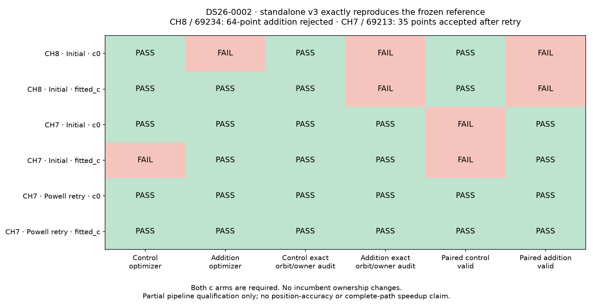

# ALGO07v3: exact predictive position inclusion and numerical retry

2026-11-05. The standalone numerical engine now implements shared-family and
new-family position inclusion, matched control fits, exact orbit/owner audits,
scoped adoption and the numerical-only Powell retry. Two complete fresh runs
through this stage match the frozen ALGO03 implementation exactly, including
all preceding v3 scientific results. This is an extraction milestone, not full
ALGO07 completion or a production deployment.

## Results

Both examples are the two eligible large unused targets in DS26-0002, using
production native session identity `fast-af5f79e905d946a6e38f9e3e8243460c`.
All tests use causal evidence and the same 25 × 25 km region centered at
37.906, −122.545. Evaluation GPS is not supplied to inference.

| Target | Points | Predictive identity | Position decision in reference and v3 | Exact full records | Earlier prefix |
|---|---:|---|---|---|---|
| RX1 CH8 T000 | 64 | 69234, shared family | Reject | Pass | Unchanged |
| RX1 CH7 T004 | 35 | 69213, new family | Accept after matched Powell retry | Pass | Unchanged |



Strong identity support does not by itself authorize position inclusion. The
CH8 addition fails the exact orbit audit in both arms; its c=0 optimizer also
stops without an accepted damped step. Incumbent ownership is preserved, but
that does not override the failed physical/optimization checks. No retry is
permitted to bypass those failures.

For CH7, the initial addition passes in both arms, but its fitted-c **control**
ends with an abnormal L-BFGS-B termination. Its physical and ownership audits
pass, permitting the original numerical-only retry. Powell refits both the
control and addition, under both c arms, with identical evidence and physical
gates. All checks then pass and the candidate credits exactly 35 target points.
No incumbent point changes owner. The final selection credits protected
publication support plus the explicitly tested target; it does not silently
promote other post-fit memberships.

The two rightmost figure columns are paired decisions, repeated on both arm
rows. A control failure in either arm disqualifies the matched pair.

## Implementation

- `new_family.py` owns causal phase integration, receiver/orbit covariance,
  shared conditioning on incumbent predictive evidence, continuous-phase audit
  and quadrature-resolution audit. Defaults retain the original ±15 s range
  and 0.025 s inclusion grid. Expanded ranges must remain in the causal bank.
- `recovery_inclusion.py` performs the shared and new-family trials and audits
  entirely with v3 numerical components. The original calibration equations,
  noise policy, 5 phase rounds, 48 solver iterations and optimizer options are
  preserved. The target does not calibrate receiver coefficients.
- `recovery_gates.py` replays exact orbital predictions one family at a time,
  retaining fitted coefficients and restoring likelihood methods even if a
  gate raises.
- `recovery_acceptance.py` preserves completion checks, native-ID ownership,
  regional bounds, matched-arm agreement, scoped publication and numerical-only
  retry eligibility. It also owns the original disjoint-family pair selector;
  the full joint fitting/controller integration remains outstanding.
- `include_recovery_target` exposes one inclusion through the application API
  and explicitly leaves `recovery_complete=False`.

## Verification and reproducibility

Candidate runs start from v3-prepared native evidence and freshly compute
initial search, conservative recovery, family/history policy, signed context,
cavity selection, inventory, annotation and inclusion. `/opt` is hidden in a
private mount namespace; the candidate import/process guard is enabled. No
completed ALGO03 result or old worker is available to candidate inference.

The external oracle uses the frozen ALGO03 installation
`f286f3e3029ec17479f4aa2b41312e4220258944`. It replays the archived cavity
context and executes original annotation, inclusion, audit, acceptance and retry
functions. An explicit adapter replaces file reads/writes and directory creation;
the scientific bodies and their frozen helper functions execute unchanged.
This oracle currently qualifies whole-track additions only. Inactive-fragment
inclusion requires additional qualification.

The comparator checks exact float hexadecimal values and array dtype, shape and
byte hashes. It includes every intermediate trial, all audit diagnostics, both
c arms, rejected initial fits and retry output. Operational job/timing fields
and file paths are explicitly normalized. Actual source/input/output hashes are
verified separately by the renderer; none of these checks use tolerance fitting.

Evidence directory:
`/srv/bulk/leo/research/algo07v3-20261104/inclusion001`.
The [comparison data](comparison.json) and [artifact bindings](artifact-bindings.json)
bind the full external fingerprints and receipts. The reusable CLI is:

```bash
PYTHONPATH=tools .venv/bin/python -B tools/compare_algo07v3_inclusion.py \
  --reference /absolute/path/to/rank-reference.json \
  --candidate /absolute/path/to/rank-candidate.json \
  --earlier-inventory /absolute/path/to/inventory-candidate.json \
  --output /absolute/path/to/new-exact-receipt.json
```

`check_algo07v3_position.py --predictive-inclusion --target-rank N` runs the fresh
candidate path. `algo07v3_inclusion_oracle.py` is the separate reference adapter.
Both bind production scan identities to preserve target ordering. The renderer
checks the complete source/input receipts before drawing the figure.

Focused tests cover physical/ownership/phase-resolution retry rejection,
matched control completion, exact-orbit restoration after exceptions, exclusion
of unscored post-fit points, identity failure before fitting, causal integration
support, application wiring, external IO substitution and comparator sensitivity
to a one-bit float change. The complete focused suite passes **193 tests**.

## Timing and remaining work

| Target | Fresh candidate, full implemented prefix | External reference, cavity replay + annotation/inclusion |
|---|---:|---:|
| CH8 | 132.204 s | 30.111 s |
| CH7, including retry | 186.780 s | 83.127 s |

These columns have **different scopes** and were collected under concurrent
shared-host load. They are not a speedup comparison. No complete-path speedup
or new position-accuracy gain is claimed: the purpose here is exact preservation
of the original policy while eliminating its runtime dependency.

Next: qualify inactive fragments and successful shared additions; integrate the
ordered multi-target recovery controller and joint-family fits; then incorporate
the remaining recovery/reassociation and eight-artifact publication stages.
Full DS26 equivalence, deterministic deadline/work handling, clean standalone
packaging and controlled complete-path 10× performance remain open. Production
has not changed.
