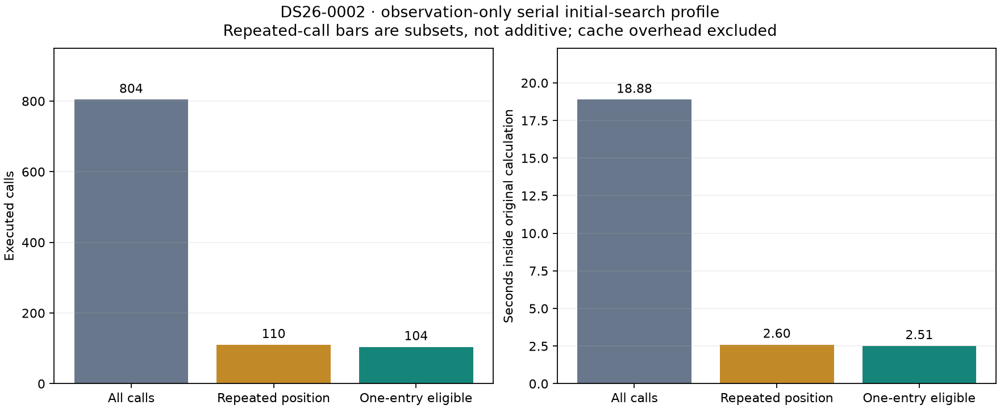
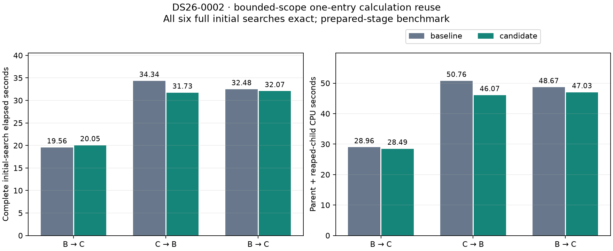
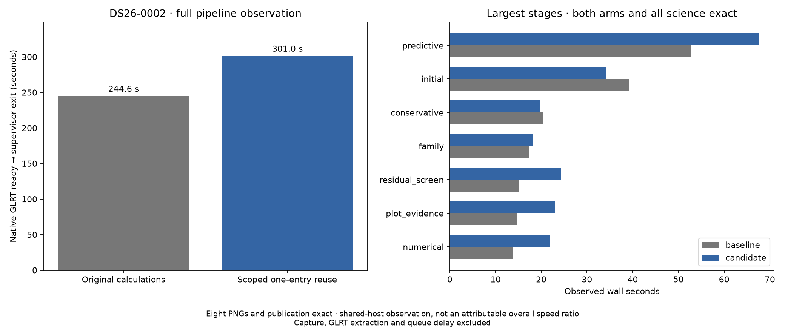

# ALGO07v3: scoped reuse during initial fitting

2026-11-05. Development experiment; no production deployment.

The complete native-input-to-publication comparison is exact, but the candidate
is slower in this pair: **244.609 → 301.029 s**, saving **−56.420 s**, a baseline /
candidate ratio of **0.813×**. This covers one matched scan, DS26-0002, run
candidate first. Both calibration arms, all scientific audits, point ownership,
eight PNG bytes and public grid/path match. **Keep the cache external**: there
is no established complete-pipeline speedup. Original-ALGO07 cumulative speedup
and capture-to-publication speedup remain unavailable for this experiment.

A one-entry calculation cache reduces mean complete DS26-0002 initial-search
time **28.792 → 27.950 s (2.93%)** and process CPU **42.795 → 40.529 s (5.29%)**
over three alternating pairs. All six searches exactly match the previously
qualified initial result, including all three branches, both calibration arms,
optimizer histories and zero-phase controls. The latency result is small and
one pair regresses; all observations are retained.

## What the profile found

The observation-only profiler executes every original normal-position
calculation and compares complete result fingerprints at repeated coordinates.
It checks the full search against owned saved evidence. On DS26-0002:

| Profile observation | Result |
| --- | ---: |
| Distinct normal-position problems | 36 |
| Original calculation calls | 804 |
| Unique problem/position pairs | 694 |
| Repeated problem/position pairs | 110 |
| Repeats eligible for one-entry reuse | 104 |
| Repeats eligible for two- or eight-entry reuse | 104 |
| Total time inside original calculations | 18.883 s |
| Time in one-entry-eligible repeats | 2.511 s |



Callers include 694 residual requests, 54 state requests, 32 final fit
calculations, and six each from conditional frequency, original metrics,
extension metrics and final arm-result construction. A larger cache offered no
additional hits on this trace, so the candidate retains only one result.
The profiler runs serially and includes fingerprint overhead outside those
calculation timers; its 31.033-second instrumented clock is not a production
benchmark. Eligible repeat cost is an upper bound before copying overhead and
the candidate's additional scope boundaries, not an asserted wall-time saving.

## Scope and correctness

Reuse is restricted to three explicitly fixed-model regions: fitting and phase
readout within one refresh round, final initial-arm metrics, and each zero-phase
control fit. Every new phase round creates a new problem. Exiting a scope
restores the original method, including on failure. No cache remains attached
to the returned problem, so later noise, mask or reference changes are observed.
Later recovery and numerical-policy replay keep their original behavior.

The key contains position dtype, shape and exact bytes, distinguishing signed
zero. Both cached storage and returned hits are copied, preventing a caller's
array/dictionary changes from contaminating later results. Only the most recent
position is retained. Model mutation inside the private fixed-model scopes is
not supported; none of the scoped owners performs such mutation or invokes
user callbacks there. This is not an automatic cache on every position object.

The prototype wraps original statements without changing their order or
arithmetic. Candidate sets, shared c0 branch selection, observations, aliases,
priors, phase rounds, iteration limits, convergence rules, gates and optimizer
evaluation receipts remain unchanged. Eight focused tests cover source-scope
extraction, full searches, copied-result isolation, one-entry eviction, signed
zero/dtypes, between-scope model changes and restoration after failure.

## Alternating complete initial searches

| Pair | Order | Baseline elapsed | Candidate elapsed | Baseline CPU | Candidate CPU |
| --- | --- | ---: | ---: | ---: | ---: |
| 1 | Baseline, candidate | 19.559 s | 20.053 s | 28.959 s | 28.491 s |
| 2 | Candidate, baseline | 34.340 s | 31.731 s | 50.755 s | 46.068 s |
| 3 | Baseline, candidate | 32.479 s | 32.065 s | 48.669 s | 47.029 s |
| Mean | Alternating | 28.792 s | 27.950 s | 42.795 s | 40.529 s |



The search uses its existing paired-arm executor on CPUs 0–2 with one BLAS
thread. Each trial reconstructs a fresh owned context outside the timer. The
measured scope includes discovery, every branch/arm fit, metrics, extension,
selection and zero-phase controls. Parent and reaped-child CPU are included.
The substantial variation across pairs prevents treating the mean as a stable
population ratio. CPU decreases in each pair, supporting full native testing.

## Native qualification

The candidate-first/baseline pair completed at
`/srv/bulk/leo-dev/algo07v3-initial-cache-native-20261105`, using private source
overlays with the same frozen native input, causal catalogue, search region,
priors, budgets and three-CPU affinity. The strict comparator passed without
relaxing any scientific or artifact requirement.

| Native measurement | Baseline | Candidate |
| --- | ---: | ---: |
| Complete process, native input through publication | 244.609 s | 301.029 s |
| User + system CPU | 341.840 s | 408.750 s |
| Initial search | 39.160 s | 34.244 s |
| Predictive recovery | 52.716 s | 67.566 s |
| Plot evidence | 14.602 s | 22.955 s |
| PNG rendering | 5.627 s | 7.447 s |
| Maximum resident set size | 2,284,564 KiB | 2,284,652 KiB |



Initial search improves in this pair, but later unchanged stages slow down.
This is consistent with changing host conditions; it neither establishes that
the cache causes the overall regression nor permits discarding that regression.
The publication keeps the complete timing, host observations, source bindings
and exact comparison in [native evidence](native/summary.json). **741 tests
passed**, including six model-level prototype checks and the original eight
profiling/probe checks; Ruff also passed. The broader test suite and the focused
prototype receipts are included alongside it.

The runtime remains at the previously qualified covariance-index implementation.
The proposed cache is available through the external probe and archived native
source overlays only. Next: repeat matched full runs in alternating order and
test DS26-0066 before reconsidering integration. Hardware counters, if measured
with child-process inheritance verified, could help distinguish computation
from host clock/load variation; no ALGO hardware-counter result is claimed here.

## Reproduction

Use the pinned environment and fresh output directories:

```bash
env PYTHONPATH=src:tools OPENBLAS_NUM_THREADS=1 timeout -k 2 300 \
  taskset -c 0 python -B tools/profile_algo07v3_initial_repeats.py \
  --request /absolute/native-request.json --output /fresh/profile
env PYTHONPATH=src:tools OPENBLAS_NUM_THREADS=1 timeout -k 2 600 \
  taskset -c 0,1,2 python -B tools/probe_algo07v3_initial_cache.py \
  --request /absolute/native-request.json --output /fresh/benchmark --repeats 3
```

The measured roots are `/srv/bulk/leo-dev/algo07v3-initial-repeats-20261105` and
`/srv/bulk/leo-dev/algo07v3-initial-cache-20261105`. The benchmark freezes the
original position and search implementations in external oracles; runtime
never imports them. Source/request bindings, extracted function scopes, profile
rows, individual trial results, host observations and tests accompany this report.
GPS is evaluation-only and never enters this experiment's fitting or decisions.
Capture, GLRT extraction, queue delay and later publication are outside the
prepared-search clock. Full native timing above includes publication but excludes
capture, GLRT extraction and queue delay. To reproduce the native experiment,
copy `native/baseline-src`, `native/candidate-src` and their source manifests into
a fresh root, then run `run_pair.py --root FRESH_ROOT --request REQUEST
--candidate-first` under the same private-namespace environment used in
`native/plan.json`. The archived modules are external references, never imports
of the production runtime.
