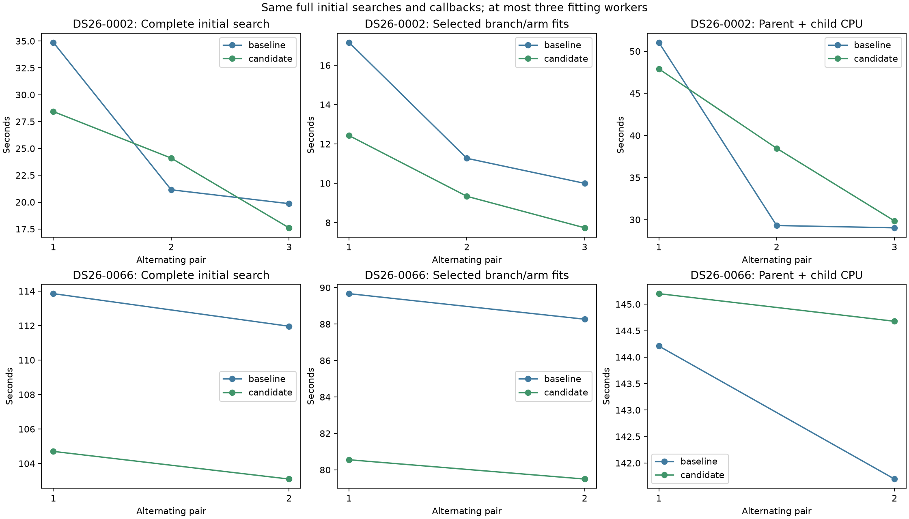
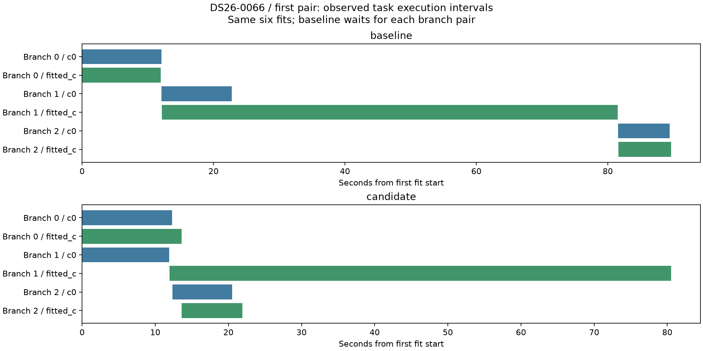
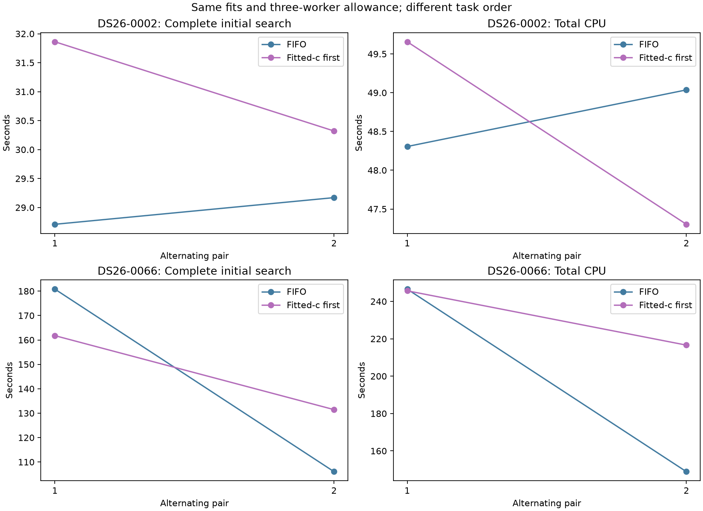
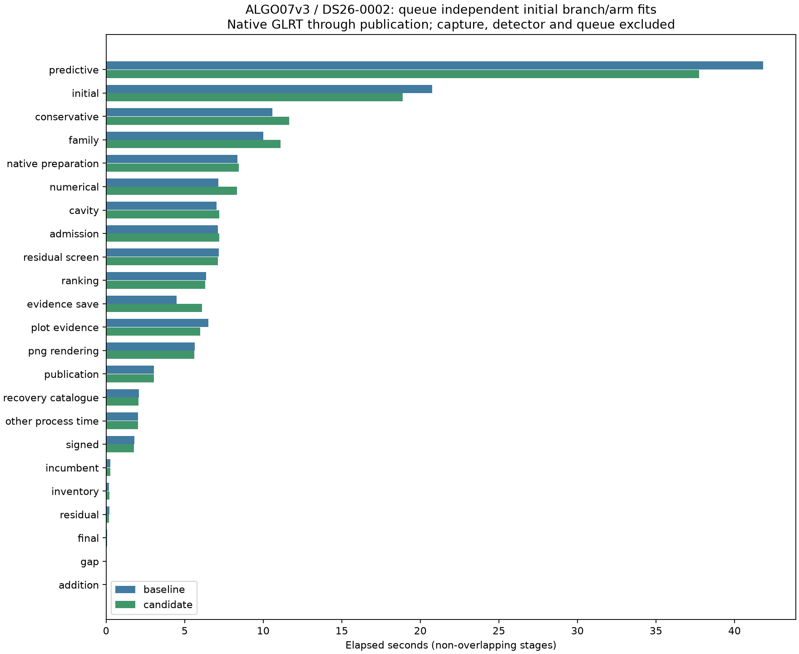
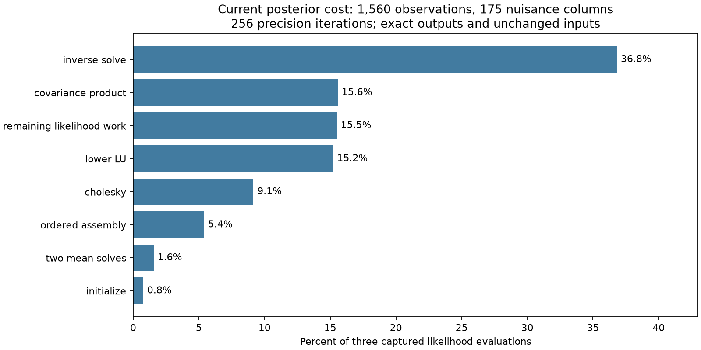

# ALGO07v3: initial branch scheduling and the remaining fitting bottleneck

The FIFO queue is integrated in development after **1,203 passing tests** and a
fresh exact native DS26-0002 comparison. Initial search improves **20.744 →
18.877 seconds (9.0%)**. The full native run improves **152.602 → 151.305 seconds
(0.85%, observed 1.009×)**, while CPU increases **224.770 → 227.200 seconds**.
Both calibration arms, complete scientific audits, point/satellite ownership,
public grid/path and all eight PNG bytes match. This is a modest incremental
gain, not a new original-ALGO07 cumulative speedup. Production is unchanged.

The current measured bottleneck is fitting. In the preceding complete
DS26-0066 run, predictive recovery takes **158.329 seconds (39.1%)** and initial
search **112.536 seconds (27.8%)** of **404.752 seconds**. Together they account
for **66.9%** of native-GLRT-to-publication time. Rendering is **5.193 seconds
(1.3%)**. These are non-overlapping stage clocks; capture, GLRT detection and
queue delay are outside this clock. See the
[preceding complete stage table](../2026_11_05_algo07v3_screen_azimuth/stage-table.md).

## What is unnecessarily serial

Initial discovery nominates up to three branches. Each branch has a c=0 fit
and a fitted-c fit, with matching observations, priors and numerical budgets.
The preceding paired executor waits for both arms of one branch before starting
the next branch. These six fits are independent. That barrier leaves capacity
unused within the existing three-CPU allowance.

The FIFO prototype queues all six fits on at most three child processes and
returns results in original branch/arm order. Branch selection still uses c=0.
Discovery, corner proposals, cold scoring, zero-phase controls, phase refreshes,
optimizer budgets and acceptance are unchanged. No scan-specific timing,
satellite or evaluation location chooses the queue order.

The optional branch callbacks contain identical values in the same order. In
the queued path they arrive after the whole queue completes; the normal native
engine currently supplies no branch callback. Numerical child failures abort
the stage, rather than creating a missing hypothesis or scientific rejection.

## Complete initial-search trials

Each side constructs a fresh fitting context from the same saved native
preparation. Timing includes fresh discovery, all selected fits and the
zero-phase controls. Loading/preparing the context and fingerprint comparison
are outside the timer. Each complete result and ordered callback list matches
the original owned result, and preparation fingerprints remain unchanged.
Trials alternate baseline-first and candidate-first, with three-CPU affinity
and one BLAS thread. All pairs, including regressions, are retained.

| Scan | Complete initial search mean | Selected fits mean | Total CPU mean |
| --- | ---: | ---: | ---: |
| DS26-0002 | 25.294 → 23.381 s (7.6% lower) | 12.810 → 9.833 s (23.2% lower) | 36.463 → 38.745 s (6.3% higher) |
| DS26-0066 | 112.911 → 103.900 s (8.0% lower) | 88.970 → 80.025 s (10.1% lower) | 142.953 → 144.939 s (1.4% higher) |

There are three pairs for DS26-0002 and two for DS26-0066. The short scan's
middle complete-stage comparison regresses **21.151 → 24.101 seconds**, although
its targeted fits improve **11.270 → 9.338 seconds**. Every targeted fit group
improves, but faster elapsed time does not imply lower aggregate CPU cost or
higher production queue throughput. See [every pair](component-table.md).

On the first hard-scan pair, branch 1's fitted-c arm takes about 69 seconds.
The ordinary branch barrier starts branch 2 only after that long arm finishes.
The queue overlaps branch 2 with it. The long arm itself still starts roughly
12 seconds after the first fits, which motivates the second experiment below.

## Fixed fitted-c-first experiment

The second external prototype starts all fitted-c arms first, then c=0 arms,
and restores canonical output order. It uses the same three-worker allowance
and all six fits. It compares against the FIFO queue, not the original paired
baseline; its ratio must not be multiplied into a cumulative speed claim.

On DS26-0002, both pairs regress: complete initial-search mean is
**28.940 → 31.091 seconds**, while CPU is **48.671 → 48.480 seconds**. Starting
fitted-c first can create a worse schedule when c=0 work dominates. This result
rules out assuming that fitted-c is universally the slow arm. The hard scan's
first pair improves **180.816 → 161.762 seconds**, but the reverse-order pair
regresses **106.040 → 131.456 seconds**. Its mean is **143.428 → 146.609 seconds**,
2.2% slower, and mean CPU increases **197.736 → 231.151 seconds**. Large host
variation prevents a stable estimate of ordering alone; the aggregate evidence
does not justify adopting this priority. The priority prototype remains external.

All eight complete results and callbacks are exact. See
[every priority pair](priority-table.md). These trials took place after the FIFO
trials under different load, so compare within each experiment rather than
combining their absolute means.

## Component qualification

**1,203 tests pass**, with no failures or skips. The three warnings are existing
NumPy deprecations in deliberate array-metadata mutation tests. The new tests
cover preserved cold starts and common c=0 branch selection, complete result and
callback equality, missing/extra results, conflicting execution ports, and
forwarding through application and job boundaries. Real worker tests check the
three-child limit, progression past a slow first task, original result order,
array layouts, cancellation, worker failure and reaping. Variable branch counts
verify that the execution adapter introduces no new scientific branch limit.
The original `fit_initial_arm` body is unchanged.

The implementation changes five loaded modules: numerical initial search,
application forwarding, engine port selection, job wiring and the bounded
execution adapter. The existing serial and per-branch paired paths remain
available when no queue port is supplied. No persisted contract changes.

## Fresh complete native qualification

Both runs start from the same native GLRT and frozen causal catalogue, with
the same priors, random grouped folds, numerical budgets, three-CPU affinity,
one BLAS thread and 1,200-second outer limit. Private mount/network namespaces
hide historical installations and reports. The baseline overlays the five
frozen pre-change modules; the candidate overlays the five tested modules.
Both complete normally, without resuming or reusing a published fit.

| DS26-0002 measurement | Baseline | FIFO queue |
| --- | ---: | ---: |
| Complete supervised native run | 152.602 s | 151.305 s |
| Initial search | 20.744 s | 18.877 s |
| Predictive recovery, unchanged code | 41.822 s | 37.747 s |
| Conservative fit, unchanged code | 10.594 s | 11.652 s |
| Family fit, unchanged code | 10.003 s | 11.107 s |
| Numerical replay, unchanged code | 7.143 s | 8.331 s |
| Evidence save | 4.473 s | 6.112 s |
| PNG rendering | 5.629 s | 5.622 s |
| User + system CPU | 224.770 s | 227.200 s |
| Maximum reported RSS | 2,452,896 KiB | 2,453,572 KiB |
| Major faults | 0 | 0 |
| Minor faults | 3,497,437 | 3,481,998 |

Initial search saves **1.867 seconds**; the complete run saves **1.298 seconds**.
Unchanged stages vary in both directions, so neither every green bar nor the
entire native delta is an isolated attribution to scheduling. Total CPU rises
1.08%; lower single-scan latency does not establish greater queue throughput.
RSS is the process accounting tool's maximum, not the sum of concurrent shared
memory mappings. See the [complete non-overlapping stage table](stage-table.md)
and [exact comparison receipt](native/comparison.json).

The result retains **2,783/4,211 GLRT points (66.0888%)**, 74 fragments and 28
satellites in both arms. c=0 remains at (37.854825525185696, -122.48777832614799)
with 76.3332809324593 Hz RMS; fitted c remains at
(37.855019909306286, -122.48823203934822) with 76.1981250553178 Hz RMS. Evaluation
GPS is presentation-only. Runtime optimization changes neither location nor
association coverage. This iteration includes a complete native qualification
on DS26-0002 and complete prepared initial-search comparisons on DS26-0066; it
does not rerun the hard scan's entire post-search pipeline or all DS26 members.

## Next opportunities, ranked by measured cost

1. **Optimize the predictive posterior work.** Difficult fits spend most time
   repeatedly solving dense nuisance-parameter systems. An earlier captured
   DS26-0066 likelihood has 1,560 observations and 175 design columns. In that
   fresh replay of this capture, inverse solves take **0.206 s (36.8%)**, lower
   LU **0.085 s (15.2%)**, covariance multiplication **0.087 s (15.6%)**, and
   Cholesky **0.051 s (9.1%)**, across three exact calls totaling **0.560 s**.
   The profile preserves every input and output and still reaches 256 precision
   iterations. These are captured-likelihood proportions, not complete-pipeline
   shares. Look for invariant setup or repeated copying around the same ordered
   numerical operations. Existing solve-metadata reuse had only tiny mixed
   kernel gains, so it needs new complete-fit evidence before adoption.
2. **Measure remaining idle worker time in predictive fitting.** It already
   queues annotation training on three workers. Any further scheduling change
   must respect dependency order and mutable numerical receipts; adding nested
   workers would risk contention rather than speed. Measure critical-path
   tasks before choosing a new parallel boundary.
3. **Expand queue qualification across exercised branches.** The prepared hard
   scan and native short scan are exact, but broader native qualification and
   production admission remain open. Include hard accepted-reassociation cases
   and retain CPU and memory costs beside latency. Avoid choosing cases by
   evaluation position error.
4. **Re-measure the complete original-ALGO07/current-v3 ratio.** Earlier totals
   were taken under different cache and host conditions. New matched native
   runs are required for a cumulative claim. A separate capture/queue/detector
   measurement is required for the user's full production latency metric.

Halving predictive recovery alone would save about 79 seconds, or 19.6% of the
preceding hard-scan total, if everything else stayed constant. Halving both
major fitting stages would save about one third of the total. Eliminating
rendering entirely would save only about 1.3%. These are arithmetic bounds,
not measured promises.

The [captured-call profile](posterior/result.json) is scoped independently from
the stage clocks. Its three exact trials preserve inputs; their nested operation
times sum to less than total call time. The remaining bar includes uninstrumented
likelihood work and instrumentation overhead. Do not add these kernel times to
the complete native timings or treat them as a new training-fit benchmark.

Several attractive-looking approaches already failed: general likelihood
hashing costs more than predictive repeats save; scratch buffers regress the
fitted-c fit; owner-only gradient concurrency increases CPU sharply; combined
or reordered solves fail exactness. Preserve those negative results. Reducing
iterations, dropping hypotheses or changing tolerances would change ALGO07v3
and would not meet the current identical-output requirement.

## Reproduction and status

`tools/probe_algo07v3_initial_queue.py` compares original paired branches with
the FIFO queue. `tools/probe_algo07v3_initial_priority.py` compares FIFO with
fixed fitted-c-first scheduling. Both accept `--request`, a fresh `--output`,
and `--repeats`; use CPUs 0–2, one BLAS thread and an outer timeout. The frozen
oracle is an external comparison reference, never a runtime import. All source
and request bindings are retained in each result.

`render_components.py` verifies and exports the complete FIFO measurements;
`render_priority.py` does the same for priority ordering. `run_pair.py` and
`run_baseline.sh` define the five-module isolated native comparison, and
`render_native.py` checks its scientific/artifact comparison, frozen component
source bindings, unchanged fit body, current posterior profile and test receipt.
The FIFO path is integrated in development; fitted-c-first remains an external
negative experiment. The profiling skill and CLI limits documentation are
updated. No production deployment, full-DS26 qualification or new cumulative
original-ALGO07 speed ratio is claimed.
