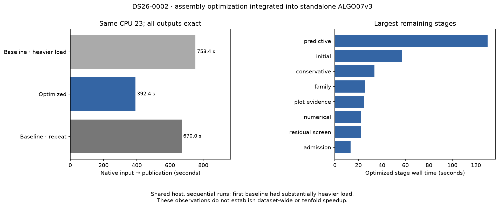

# ALGO07v3: exact assembly optimization integrated

2026-11-05. Development only; no deployment.

The scatter-assembly kernel is now part of the owned standalone implementation.
Two fresh comparisons against the preceding native kernel reproduce every
checked scientific field, both calibration arms, all 179 grid locations, the
recorded paths, eight PNG bytes and published artifacts exactly. The focused
suite passes **670 tests**, with no failures or skips.

This establishes integration correctness on DS26-0002. It does not establish
full DS26 equivalence, every accepted recovery branch, or a tenfold speedup.

## What changed

The likelihood previously added each small noise-group matrix in a Python loop
on every posterior iteration. It now flattens the blocks once and accumulates
them with `numpy.add.at`. Duplicate indices retain their original addition
order. Priors, solves, stopping criteria and scientific budgets are unchanged.

The previous [full-scan experiment](../2026_11_05_algo07v3_assembly/README.md)
compared all 6,772 calls exactly, over 77 shapes. Interleaved component time
decreased **192.753 → 181.576 seconds (5.80%)**. This is the better evidence for
the kernel's modest saving; it is not an end-to-end speed ratio.

An external frozen oracle preserves the preceding implementation. Runtime code
does not import it. Component tests verify its source identity, the integrated
kernel's AST against the qualified prototype, and exact dtype/shape/bytes on
24 dense/sparse, C/F layout and zero/nonzero-width cases, including shared indices
and input nonmutation. Historical experiments now explicitly use that oracle.

## Complete-path observations

| Fresh run | Native GLRT → all artifacts and worker outcome |
| --- | ---: |
| Previous native kernel | 753.412 s |
| Integrated kernel | 392.368 s |
| Previous native kernel, repeated | 670.025 s |

These runs used the same inputs, all-work policy, pinned numerical dependencies,
one BLAS thread and CPU 23. That CPU is an **efficiency core** on the Core Ultra 9
285K; earlier unrestricted timings are not directly comparable. The first
baseline experienced substantially heavier host load than the optimized run.
Load rose again during the repeated baseline. Both comparisons are confounded:
**the observed 41–48% latency reduction cannot be credited to the kernel.** No
controlled complete-path speedup is established. Capture, GLRT extraction and
queue time are outside these clocks.

Predictive recovery remains the largest optimized stage at **129.945 s**, followed
by initial fitting at **57.184 s**, conservative fitting at **33.707 s**, and family
fitting at **25.478 s**. [All stage timings](stage-timings.md) are retained for all
three runs. Independent fits are the next concurrency opportunity to test;
round-to-round dependencies and ordered numerical receipts must remain intact.

The [first](owned-comparison.json) and [second](owned-comparison2.json) comparisons
verify fresh terminal receipts, exact source-change scope, input bindings,
scientific data and publication bytes. Only the hierarchical module differs
between the loaded implementation sources. Both comparisons succeeded.

## Standalone and historical equivalence

Each run completed with older installations/results and repository reports
hidden, a read-only native/TLE bundle, and a separate network namespace.
[Isolation receipts](isolation.json) confirm these conditions. The previous
kernel was read-only bind-mounted inside its private namespace; host source and
production services were unchanged. `run_baseline.sh` records that harness.

The fresh comparison with the original ALGO07 chain now passes **26 checks**,
including **12 of 17 intermediate audit mappings**. The additional mapping covers
gap preparation that retains each full parent support without admitting a split.
It verifies referenced export files, protocol hashes, stage invocation, targets
and branch identities; it refuses actual split branches pending their own mapping.

Five mappings remain: additional recovery, numerical recovery, reassociation
handoff, recovery inventory and signed policy. Metadata semantics and broader
accepted-branch coverage also remain open. Exact owned baseline/candidate science
does not close those historical qualification gaps. See the
[historical comparison](historical-comparison.json).

DS26 input availability was revalidated: **159 fast members, 158 usable native
inputs, one without a native run (DS26-0172)**. This matches the prior inventory.
The first attempt lacked read permission and recorded permission failures; it
is preserved alongside the correctly privileged second inventory. Those initial
failures do not indicate missing recordings. No cohort members were dropped,
and this inventory is not a numerical evaluation of all 159 members.

## Reproduction and remaining gates

The immutable local evidence root is
`/srv/bulk/leo-dev/algo07v3-integrated-20261105`. It contains requests, frozen
kernels, worker logs, supervision receipts, resource observations and test XML.
`render.py --root <evidence-root>` checks these bindings before producing this
report's receipts and figure. The original numerical tests and timing runs
precede documentation-only changes; the historical oracle is not a runtime input.

Full DS26 equivalence, ordinary production wall-clock admission equivalence,
accepted-branch qualification and controlled end-to-end timing remain unfinished.
The 10× target is still open. No production deployment occurred.
