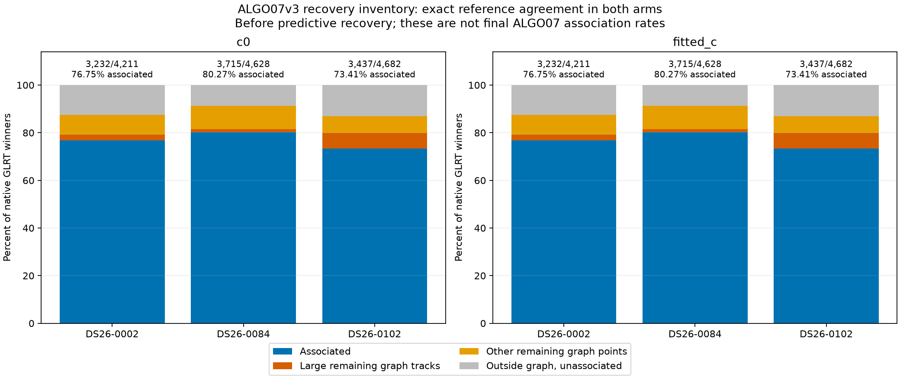

# ALGO07v3: independent recovery inventory and point ownership

The engine now reconstructs the selected cavity incumbent in memory, verifies
both saved objectives, replays native-point satellite ownership, and ranks the
unused graph tracks that predictive recovery should examine. It does not launch
ALGO03 or read an old ALGO result to perform these steps.

**All three representative scans match the frozen ALGO03 inventory exactly.**
Both calibration arms, full likelihood summaries, point-to-satellite owners,
protected publication support, all remaining graph-track statistics and the
ordered target list agree. The entire preceding initial-search-through-cavity
result remains exactly equal to the previously qualified output.

This is progress toward a standalone engine, not a completed release. Predictive
track recovery, subsequent recovery/reassociation policies, all eight final UI
artifacts, full DS26 equivalence and the 10× complete-path target remain open.
These results do not establish a new speedup or localization improvement.

## Native-point accounting before predictive recovery

Both c=0 and fitted-c give the following counts on these three scans. They were
computed and compared separately; equal counts are not used as a substitute for
checking exact observation IDs and satellite owners.

| Scan | All GLRT winners | Associated | Associated % | Published/protected | Postfit-only associated | Large remaining tracks | Points in those tracks | Unassociated outside graph |
|---|---:|---:|---:|---:|---:|---:|---:|---:|
| DS26-0002 | 4,211 | 3,232 | 76.75% | 2,748 | 484 | 2 | 99 | 527 |
| DS26-0084 | 4,628 | 3,715 | 80.27% | 3,715 | 0 | 2 | 57 | 406 |
| DS26-0102 | 4,682 | 3,437 | 73.41% | 3,437 | 0 | 7 | 301 | 608 |



DS26-0002 illustrates an important distinction: 484 points are already associated
by the frozen-calibration extension, beyond the 2,748 points reported in the
preceding policy's gates. The inventory counts those 484 as associated and does
not offer them for recovery. The publication proof separately records the
protected reported owners and the additional postfit IDs. Collapsing these two
sets would either mislabel associated points as unused or change the baseline
ownership contract.

Large means at least 20 remaining native points spanning at least 20 seconds.
Active curvature additionally requires at least 250 Hz detrended RMS. Curvature
is recorded but is not an extra eligibility requirement in this existing target
selector. A large graph track is a recovery candidate, not proof of a satellite
association. Points outside the graph are counted but are not nominated here.

## Ordered targets

| Scan | Target order | Receiver/channel/graph track | Remaining native points |
|---|---:|---|---:|
| DS26-0002 | 1 | RX1 CH8 T000 | 64 |
| DS26-0002 | 2 | RX1 CH7 T004 | 35 |
| DS26-0084 | 1 | RX2 CH5 T001 | 31 |
| DS26-0084 | 2 | RX1 CH3 T005 | 26 |
| DS26-0102 | 1 | RX1 CH2 T004 | 93 |
| DS26-0102 | 2 | RX1 CH4 T001 | 55 |
| DS26-0102 | 3 | RX1 CH2 T008 | 34 |
| DS26-0102 | 4 | RX1 CH7 T003 | 34 |
| DS26-0102 | 5 | RX2 CH6 T003 | 33 |
| DS26-0102 | 6 | RX1 CH1 T006 | 30 |
| DS26-0102 | 7 | RX2 CH1 T007 | 22 |

These are whole unused tracks in this trio. Partial-fragment eligibility and
arm disagreement are tested at component level. Target order is descending
remaining-point count, then the original stable track ID. Production derives
that ID from its native session ID plus sorted observation IDs; the qualification
uses those exact session IDs. This matters for the two 34-point targets in
DS26-0102. The original maximum of eight targets is preserved.

## Implementation and verification

`leo.analysis.localization_v3.recovery_inventory` owns context reconstruction,
masked membership replay, publication-support validation, remaining-track
statistics and target selection. `prepare_track_recovery` exposes this through
the v3 application layer. It returns an explicitly incomplete recovery state;
no new satellite association is claimed by inventory preparation.

The context uses the selected cavity replacement when accepted and otherwise
the incumbent. It reconstructs each likelihood at the saved phase reference,
checks its objective against the saved value, and preserves the original legacy
phase-reference repair when needed. Nonfinite replay values are rejected.
Predictive ownership takes precedence over a competing whole-track postfit
extension. Reported owners must replay exactly and agree across c arms.

Frozen ALGO02 and ALGO03 helpers differ in three relevant ways: the later
predictive attachment caches copies of curved calculations; the orbital-owner
gate can distinguish prior-only uncertainty from learned modes; and its problem
factory supports additional orbital-support policies. This inventory uses the
nominal support policy. Direct full-state comparison against the ALGO03 runtime
verifies the extracted nominal behavior on this trio. Later predictive recovery
must explicitly implement the additional policies; this comparison does not
qualify them by implication.

The candidate runs the full original initial-search and fit budgets, then all
implemented policies freshly from its own prepared native evidence. `/opt` is
hidden in a private mount namespace, and the existing audit guard rejects old
imports, subprocesses and old-runtime reads. The reference runs separately in
the frozen ALGO03 runtime and may read its archived cavity incumbent. Only the
external comparator reads both outputs.

The reference adapter executes the original inventory arithmetic with explicit
in-memory inputs. It omits only job ID, dataset label, aliases and scope labels.
All scientific fields remain, including dtype/shape/byte hashes for arrays and
exact hexadecimal float values. Exact comparison also verifies that the new
candidate's preceding cavity output equals the prior qualified result.

The first exploratory batch used dataset labels as the explicit identity input;
it passed the mathematical comparison but was not sufficient to certify the
production target tie-break. `inventory002` repeats all three complete candidate
runs with their native production session IDs and is the reported evidence.

Tests cover retained fragments, outside-graph accounting, unequal c-arm support,
predictive versus postfit ownership, conflicting reported owners, selected-node
replay, nonfinite objective rejection, stable ranking, the eight-target cap,
application failure propagation, the reference extraction, and comparisons that
reject changes to owners or preceding solver outputs.

The focused v3 analysis, application, operations and verification-tool suite
passes **179 tests**; the owned Ruff checks and `git diff --check` also pass.

## Timing and reproducibility

The candidate timing includes initial search through recovery inventory; the
reference inventory oracle starts from a saved cavity decision. **These timings
have different scopes and must not be divided to claim speedup.** They are
recorded in [comparison.json](comparison.json) for provenance only. Both also
ran on a shared production host. A complete-path alternating benchmark remains
required once all policies and publication are implemented.

The new application can retain its in-memory incumbent and return ownership
alongside the likelihood summary. It avoids the old inventory/proof pair's
repeated context loading and reconstruction. The end-to-end benefit of that
architectural change has not yet been measured.

Evidence:

- `/srv/bulk/leo/research/algo07v3-20261104/inventory002`: complete candidate and reference fingerprints and source/input receipts.
- `/srv/bulk/leo/research/algo07v3-20261104/cavity001`: previously qualified prefix results.
- [comparison.json](comparison.json): exact-comparison outcome and point counts.
- [artifact-bindings.json](artifact-bindings.json): evidence and figure hashes.
- [render.py](render.py): rechecks source/input/output bindings before plotting.

Example candidate command, from the authoritative worktree:

```sh
sudo -n timeout 1200 unshare --mount --propagation private sh -c \
  'mount -t tmpfs -o ro,size=1m tmpfs /opt && exec "$@"' isolated-v3 \
  env PYTHONPATH=src:tools OPENBLAS_NUM_THREADS=1 OMP_NUM_THREADS=1 \
  /home/mouse9911/gits/leo-tracker-reduxredux/.venv/bin/python -B \
  tools/check_algo07v3_position.py --side candidate \
  --source /srv/bulk/leo/research/algo07v3-20261104/inputs004/DS26-0002 \
  --output /tmp/new-inventory-candidate.json --recovery-inventory \
  --scan-identities fast-af5f79e905d946a6e38f9e3e8243460c \
  --rounds 5 --iterations 48 --search-center 37.906 -122.545
```

The next stage is predictive annotation and shared/new satellite-family
inclusion for these targets, with matched c arms, causal catalogue inputs and
exact incumbent ownership protection. Subsequent recovery and reassociation
policies are still required before final output and runtime qualification.
