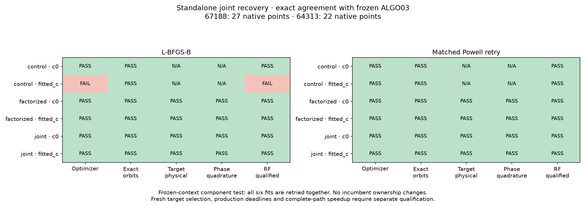

# ALGO07v3: ordered recovery and exact joint-family fitting

2026-11-05. V3 now owns the ordered predictive recovery controller and the
two-family likelihood, position fits, physical audits and matched numerical
retry. The original ALGO03 workers are external comparison oracles only.
Production has not changed; complete ALGO07 equivalence and the 10× complete-path
performance target remain open.

## Exact joint component comparison

The numerical fixture comes from production session
`fast-461673e62c78d334b6ba544df8b9f4c1`, preserved in the earlier runtime
qualification. It has two independently qualified whole-track additions:

| Track | Satellite | Native points |
|---|---:|---:|
| RX1 CH3 T003 | 67188 | 27 |
| RX2 CH2 T000 | 64313 | 22 |

The comparison supplies the same frozen cavity context and target groups to
both implementations. V3 reconstructs its own scan and likelihood and runs
with `/opt` inaccessible. This tests numerical reconstruction, not fresh
nomination of these two targets. The separate fresh controller test below
covers target enumeration on DS26-0002.

All six initial fits (control, factorized, joint × c=0, fitted-c) match the
frozen reference exactly, including phase grids, receiver covariance, integrated
orbital predictions, endpoints, objectives, optimizer histories, physical gates,
continuous-phase checks, quadrature refinement and native-point owners.

The fitted-c control has a numerical failure; every physical/ownership check
needed for a retry passes. Both implementations therefore qualify this as a
numerical-only failure. The six matched Powell fits and audits also match
exactly, and all six pass. The two fingerprint documents are byte-identical
between reference and candidate for each optimizer.



Shared receiver uncertainty is integrated once across both satellite families.
The factorized diagnostic retains each family's marginal covariance but drops
the cross-family covariance. The two methods are explicitly compared; separate
individual endpoints are never added together to claim a joint position.

## Controller behavior

`recovery_controller.py` retains the original scientific ordering and fallbacks:

1. Inspect the predeclared largest unused targets, with the original stable
   identity tie-break and maximum of eight supplied by the inventory.
2. Require distinct predictive holdouts and a stable satellite identity before
   inclusion; fit matched controls and additions and replay exact orbit/owners.
3. Permit a numerical-only retry when all physical, ownership and phase tests
   allow it. A better target fit cannot override an unfinished control.
4. Retain the **first qualified target in the original order**. Select the
   largest disjoint pair of distinct new satellite families for joint testing;
   partial/shared/same-family alternatives remain individual choices.
5. Run control, factorized and joint fits in both c arms, including audits.
   A numerical joint retry must repeat the entire six-fit experiment.
6. Adopt a passing joint candidate only if it adds more explicitly scored
   native points than the retained individual. Preserve protected owners and
   exclude unscored post-fit extensions from publication credit.

Execution and target-admission callbacks are explicit ports. They allow the
application to own timeout/cancellation behavior without importing process or
storage code into the analyzer. Ordinary-clock deadline equivalence is not yet
qualified. The CLI's new `--predictive-recovery` mode intentionally completes all
predeclared work for testing; this is not a changed production time policy.

The application entrypoint is `recover_predictive_tracks`. It keeps
`recovery_complete=False`, because later ALGO04–07 policies and publication are
still outside this implemented prefix.

## Fresh controller verification

A fresh DS26-0002 run starts from independently prepared native evidence and
recomputes the entire implemented prefix. It evaluates both eligible targets,
rejects the 64-point CH8 shared addition and accepts the 35-point CH7 new-family
addition after retry. Its selected result, all attempt decisions and stage order
match the two separately executed frozen reference cases from the
[inclusion milestone](../2026_11_05_algo07v3_inclusion/README.md).
Its complete preceding scientific output remains unchanged.
The [controller comparison](controller-comparison.json) and
[verified source/input bindings](controller-bindings.json) record this run.
Its full implemented prefix took 205.262 seconds; this is not the duration of
the full ALGO07 pipeline or a matched speedup measurement.

This is one real complete target-loop case with one qualified individual. The
joint controller branches additionally have synthetic execution/failure tests;
a fresh full target-loop case that nominates and adopts a joint pair is still
required. So are inactive-fragment and successful shared-inclusion qualification.

## Bugs caught and verification limits

An initial fixture adapter omitted the genuine previous-epoch provenance; the
candidate refused to construct its phase prior. The corrected adapter reads
the frozen causal-prior receipt and catalogue explicitly.

The first extracted Powell implementation reused the fitted-method variable in
the loop reporting joint and factorized endpoint scores. This corrupted the
reported control/joint objectives while leaving the optimization itself intact.
The independent objective audit rejected it. A six-case regression test reproduced
the two failures, and the loop now uses a separate score-method variable. The
corrected complete L-BFGS-B and Powell comparisons pass; no gate was relaxed.
Exploratory evidence remains in `joint001`/`joint002`; final candidate receipts
are in `joint003` under `/srv/bulk/leo/research/algo07v3-20261104`.

Focused tests also check direct Gaussian integration, ownership scope, all six
required retry records, factorized physical failures blocking retry, explicit
omissions and stage failures, protected-owner fallback, application ports and
comparison sensitivity. The focused suite contains **212 passing tests**.

The joint renderer verifies every bound source/input/output hash before creating
[comparison data](comparison.json), [artifact bindings](artifact-bindings.json)
and the figure. Array bytes/dtypes/shapes and float hexadecimal values must match
exactly. Only operational paths, elapsed times and job/hash metadata are omitted
from the scientific comparison; actual provenance is bound separately.

Reusable comparison commands:

```bash
PYTHONPATH=tools .venv/bin/python -B tools/compare_algo07v3_joint.py \
  --reference /absolute/path/to/reference.json \
  --candidate /absolute/path/to/candidate.json \
  --output /absolute/path/to/new-exact-receipt.json

PYTHONPATH=src:tools .venv/bin/python -B tools/compare_algo07v3_recovery_controller.py \
  --candidate /absolute/path/to/controller-candidate.json \
  --inventory-prefix /absolute/path/to/inventory-candidate.json \
  --references /absolute/path/to/rank0-reference.json /absolute/path/to/rank1-reference.json \
  --output /absolute/path/to/new-controller-receipt.json
```

## Runtime and next work

| Joint component experiment | Frozen reference | V3 |
|---|---:|---:|
| Six L-BFGS-B fits and audits, including context/geometry replay | 66.013 s | 63.933 s |
| Six Powell fits and audits, including context/geometry replay | 131.868 s | 133.712 s |

These are single shared-host measurements, not a controlled speedup result.
They show comparable component runtime at this extraction stage. Neither column
includes complete ALGO07 recovery/reassociation or the eight UI artifacts.

Next: qualify the complete joint target loop and remaining recovery branches;
integrate later policies and publication; then profile and optimize the complete
standalone path with matched work and output checks. Full DS26 parity, deployment
packaging, clock-limit behavior and the complete-path 10× target remain open.
