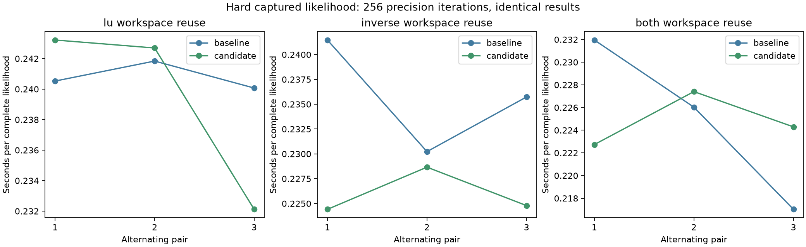
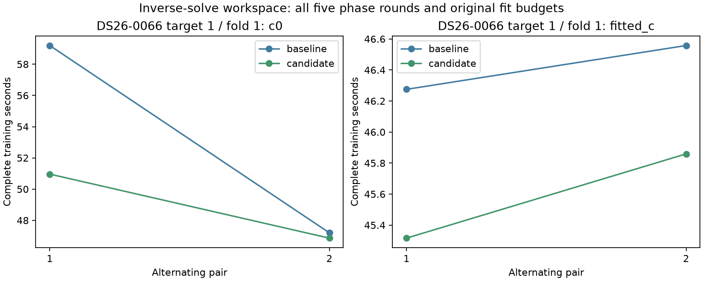
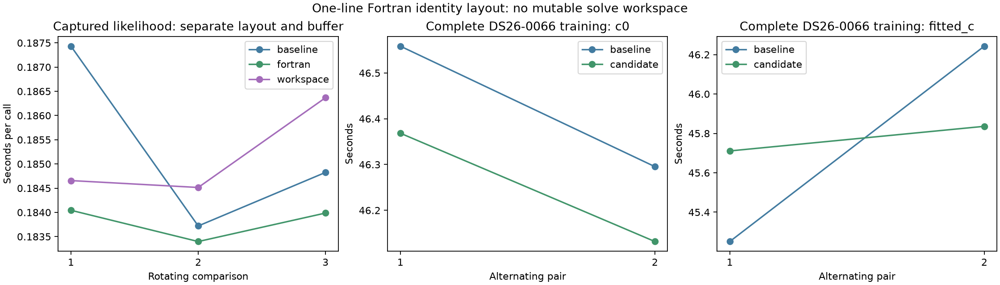
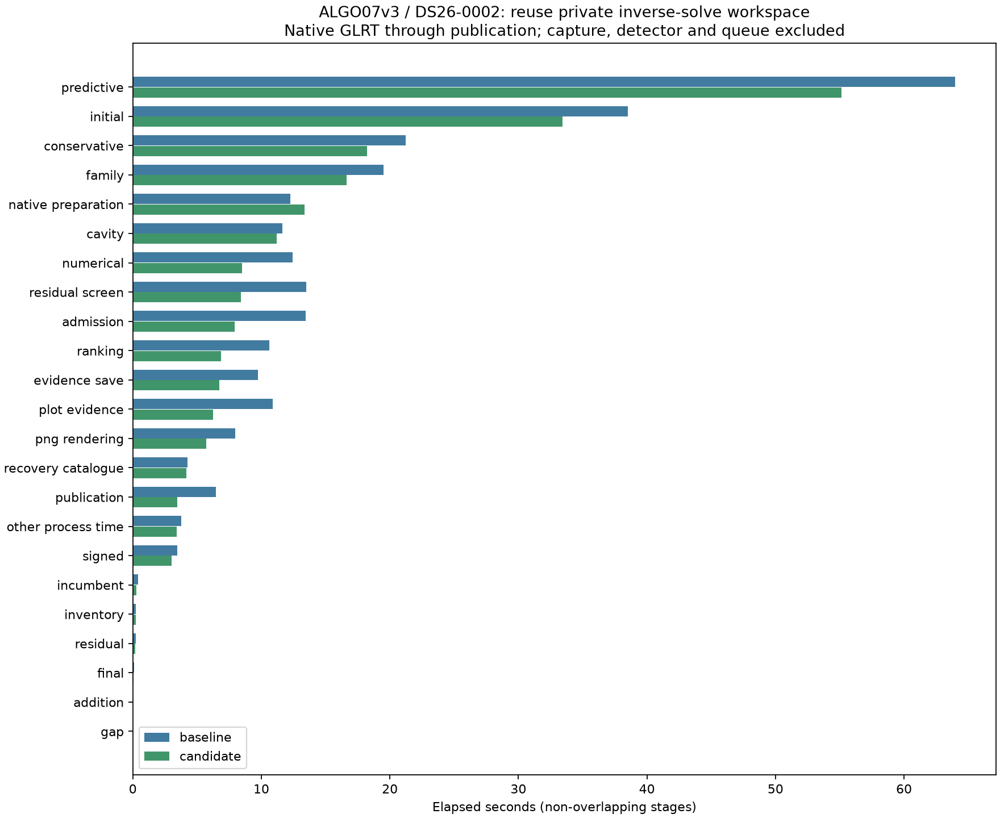
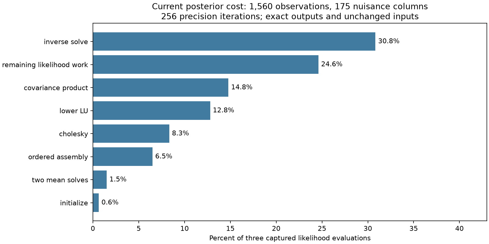

# ALGO07v3: LAPACK workspace and identity-layout experiments

Inverse-workspace reuse is integrated in development after **1,332 passing
tests**, eight exact complete DS26-0066 training fits and fresh native DS26-0002
qualification. All four complete training pairs improve; fitted-c mean falls
1.79%, while c=0's 8.06% mean is inflated by a slow first baseline and its
reverse-order pair improves only 0.72%. The full native observation is
**264.628 → 213.191 seconds**, with exact science and all eight PNGs. Unchanged
stages also improve substantially, so the 51.437-second difference is not an
isolated gain from this change. Production and full-DS26 admission are unchanged.

The current predictive fitting bottleneck repeatedly solves dense nuisance
systems. The [fresh preceding profile](../2026_11_05_algo07v3_initial_queue/README.md)
attributes 36.8% of a captured hard likelihood's time to inverse solves, 15.2%
to lower LU and 15.6% to covariance multiplication. This iteration tests whether
the allocation and layout conversion surrounding those same LAPACK operations
can be reduced while preserving every output bit.

These experiments retain both c arms, all observations, the original random
grouped holdouts, causal catalogue, priors, five phase-refresh rounds and 48
position iterations per round. They do not reduce the 256 precision-iteration
ceiling or change the stopping test. Evaluation GPS never enters these fits.

## Hypotheses

1. **Reuse a private LU workspace.** Copy the same Cholesky root into a local
   Fortran-order array, then call the same `DGETRF` with permission to overwrite
   that private copy. The original root remains available to the mean solve.
2. **Reuse a private inverse-solve workspace.** Create the identity in Fortran
   order, copy it into one local workspace each precision iteration, and call
   the same `DGETRS` with permission to overwrite that private workspace. The
   covariance multiplication and all later arithmetic are unchanged.
3. **Combine those two workspaces.** Measure the combination rather than assume
   that independently small changes have additive gains.
4. **Change only the identity layout.** Create `np.eye(width, order='F')` while
   retaining the original solve calls and fresh returned arrays. This separates
   the cost of layout conversion from the proposed buffer reuse. `DGETRS` still
   copies its input; the experiment does not claim a zero-copy solve.

The earlier rejected variance-buffer experiment gathered covariance blocks into
scratch arrays. This experiment targets a different measured cost: the inputs
to the full inverse solve and LU factorization. All candidates remain external
until complete-fit timing and native publication qualification support adoption.

## Captured hard likelihood

The bound DS26-0066 capture contains 1,560 observations and 175 nuisance columns
and reaches 256 precision iterations. Each timing sample averages three complete
likelihood calls. Each candidate has three alternating baseline/candidate pairs;
all 54 timed calls preserve the complete result and input fingerprints.

| Candidate | Baseline mean | Candidate mean | Observed reduction |
| --- | ---: | ---: | ---: |
| LU workspace | 0.240813 s | 0.239345 s | 0.61% |
| Inverse workspace | 0.235809 s | 0.225957 s | 4.18% |
| Both workspaces | 0.225004 s | 0.224812 s | 0.09% |

LU-only and combined workspace trials each contain regressions; neither offers
a compelling gain. Inverse-workspace reuse improves in all three pairs and
advances to complete training. These kernel ratios are not pipeline ratios.

## Complete inverse-workspace training

The measured workload is DS26-0066, target 1 / fold 1 / seed 94721. Each trial
reconstructs a fresh fitting context from the same native prepared evidence.
The timer includes all five phase rounds and optimizer work; context loading
and final fingerprint checks are outside it. Every endpoint, optimizer history,
phase reference, final likelihood and fitted state matches the previously
qualified full training result, rather than only matching a new baseline.

| Arm | Baseline mean | Workspace mean | Baseline CPU | Workspace CPU |
| --- | ---: | ---: | ---: | ---: |
| c=0 | 53.199 s | 48.912 s | 53.172 s | 48.908 s |
| Fitted c | 46.417 s | 45.588 s | 46.405 s | 45.574 s |

All four pairs improve. The c=0 mean falls 8.06%, but is strongly influenced by
the first pair, **59.197 → 50.963 seconds**. Its reverse-order pair saves only
**0.339 seconds (47.200 → 46.861)**, or 0.72%. Fitted-c pairs are
**46.275 → 45.316** and **46.558 → 45.859 seconds**, with a mean reduction of
1.79%. Keep the smaller gains and the host variation; the first large difference
does not establish a stable 8% optimization. See [all pairs](training-table.md).

## Is a one-line layout change enough?

A separate three-way replay compares the original identity, Fortran identity
alone and the inverse workspace. Each rotating comparison averages five complete
calls per implementation, for 45 exact timed calls. Mean time is **0.185326 s**
for the baseline, **0.183809 s** for layout alone, and **0.185180 s** for the
workspace. The workspace's earlier 4.18% kernel gain is not stable in this replay.
The layout-only candidate is smaller and merits its own complete-training check.
These clocks were measured under different host conditions from the first
kernel trials; do not interpret 0.235809 → 0.183809 as an optimization ratio.

The separate complete layout-only comparisons are exact, but essentially flat:

| Arm | Baseline mean | Layout-only mean | Change |
| --- | ---: | ---: | ---: |
| c=0 | 46.427 s | 46.250 s | 0.38% faster |
| Fitted c | 45.747 s | 45.773 s | 0.06% slower |

The first fitted-c pair regresses **45.251 → 45.711 seconds**; the reverse pair
improves **46.243 → 45.836 seconds**. See
[every layout training pair](layout-training-table.md). This does not reproduce
the inverse workspace's four improving complete pairs. Nor do separate batches
prove an exact incremental percentage for buffering over layout alone. The
inverse workspace is the stronger complete-fit candidate and passes native
qualification below; LU-only, combined and layout-only variants remain external.

## Complete native qualification

Baseline then candidate execute sequentially on CPUs 0–2 with one BLAS thread,
the same native inputs, causal catalogue, priors, random grouped folds and
numerical budgets. Both complete normally under the same 1,200-second limit.
Private mount/network namespaces hide historical installations and results.
The only changed loaded module is `leo.analysis.localization_v3.hierarchical`;
there are no added runtime modules or dependencies.

The [exact comparison](native/comparison.json) passes both c arms, all scientific
audits and point/satellite ownership, every public diagnostic grid/path value,
and all eight PNG byte strings. Positions, residual metrics and the existing
2,783/4,211 associated points (66.0888%) remain unchanged. The code affects
execution cost, not position accuracy or satellite-association policy.

| DS26-0002 measurement | Baseline | Workspace |
| --- | ---: | ---: |
| Complete supervised native run | 264.628 s | 213.191 s |
| Initial search | 38.500 s | 33.438 s |
| Predictive recovery | 63.973 s | 55.138 s |
| Conservative refit | 21.238 s | 18.234 s |
| Family fit | 19.517 s | 16.640 s |
| Native preparation | 12.245 s | 13.358 s |
| Residual screening | 13.502 s | 8.416 s |
| PNG rendering | 7.947 s | 5.694 s |
| Evidence save | 9.757 s | 6.740 s |
| Publication | 6.454 s | 3.457 s |
| User + system CPU | 404.400 s | 328.920 s |
| Maximum reported RSS | 2,419,956 KiB | 2,419,732 KiB |
| Major faults | 28 | 221 |
| Minor faults | 3,965,705 | 3,584,309 |

The observed ratio is 1.241× (19.44% lower elapsed time), but it is not a stable
attributable optimization ratio. Unchanged screening, rendering and publication
also get substantially faster, while preparation regresses. Major faults rise;
system CPU falls 24.720 → 14.040 s. These observations establish variation,
not its precise cause. The complete DS26-0066 training comparisons provide the
narrower performance evidence; their smaller repeat gains are more conservative
than crediting the entire native difference to the workspace.

The previous iteration's 151.305-second candidate is not this pair's baseline.
It was measured under different conditions. Do not combine 151.305, 264.628 or
213.191 into a cumulative speed claim or infer that the new code became slower
from those unmatched clocks. See [every native stage](stage-table.md).

Qualification covers one complete native scan and the difficult training fold
in a second scan. It does not establish full DS26 or ordinary production
admission, and excludes capture, detector/native GLRT extraction and queue waits.
Production is unchanged.

## Exactness and reproduction

The external prototype suite passes **101 tests**, with no failures or skips.
The broader integrated suite passes **1,332 tests**, with no failures or skips;
its three NumPy warnings come from existing intentional metadata-mutation tests.
Tests cover C/F layouts, sparse
and dense nuisance evidence, zero/one/many columns, learned and fixed priors,
signed zeros, degenerate designs, changing inputs across calls, and complete
training histories in both arms. They verify actual shared storage with LAPACK
when overwrite is requested, local buffer reuse, failure propagation and
restoration of temporary test substitutions. No golden fixture or tolerance
changes. The owned likelihood's syntax tree matches the measured inverse
prototype, and its result arrays cannot alias the private workspace.

The first broad run has one structural failure, preserved in
[initial-structural-test-failure.xml](initial-structural-test-failure.xml): an
older test asserted that Cholesky was the only edit to the full likelihood.
That historical proof is retained against the frozen pre-workspace reference,
with an explicit unchanged-Cholesky-helper assertion. The new owned-body proof
then covers the workspace edit. Existing full numerical comparisons against the
older reference continue to pass. This updates the declared implementation
history without changing a numerical oracle or relaxing equality.

The posterior profiler now recognizes both original and buffered inverse-solve
boundaries, including zero-width inputs. The new post-change capture has three
exact calls totaling **0.687 profiled seconds**. Inverse solving takes 30.8%,
lower LU 12.8% and covariance multiplication 14.8%. The private workspace reset
is outside the inverse-call timer and remains in the uninstrumented remainder.
These nested timings must not be added to native stage times or compared with
earlier host clocks as an optimization ratio.

Use the pinned environment, `PYTHONPATH=src:tools`, one BLAS thread and CPU 0.
All commands require fresh output roots. `tools/probe_algo07v3_lapack_workspace.py`
takes `--capture` and `--output`; its three candidates are backed by the frozen
external oracle. `tools/probe_algo07v3_inverse_layout.py` performs the separate
layout ablation. The corresponding `benchmark_algo07v3_lapack_workspace.py` and
`benchmark_algo07v3_inverse_layout.py` take `--request`, `--expected-root` and
`--output`. Use an outer 1,200-second bound for each complete-training batch.
Every source/request binding and exact comparison is retained in its result.

Prepared training excludes native GLRT extraction, discovery, other recovery
stages, rendering and publication. No complete-pipeline or original-ALGO07
cumulative speedup follows from these component measurements.

`run_pair.py` and `run_baseline.sh` reproduce the one-module isolated native
comparison. `render_components.py` verifies all component bindings before runtime
integration; `render_native.py` maps earlier bindings to the frozen baseline,
checks the measured candidate body and broad test receipt, and exports the
native and post-change profile figures. The profiling skill and runtime
scorecard record both positive and negative variants.

## Next iteration

Prioritize a fresh matched original-ALGO07/current-v3 comparison to update the
cumulative latency metric. Repeated small improvements and unmatched historical
clocks must not substitute for it. Preserve complete output equivalence and
report both elapsed and CPU costs.

For further fitting improvements, first measure remaining worker idle time and
cache eviction costs on the slow predictive fold. A local immutable-problem
cache keyed by a short position vector is a different proposition from the
rejected full-input hashing cache; measure actual reusable work before changing
its capacity. Likewise, any wider worker allocation must report the additional
CPU/memory allowance separately from code efficiency and cannot be called a
same-resource speedup. Neither proposal is an established gain.

The current post-change profile still spends most captured-call time in dense
solving/factorization/covariance work. Larger solver changes that alter floating
point results remain outside the current identical-output requirement. Keep
the original budgets and all failed or flat experiments in the record.
