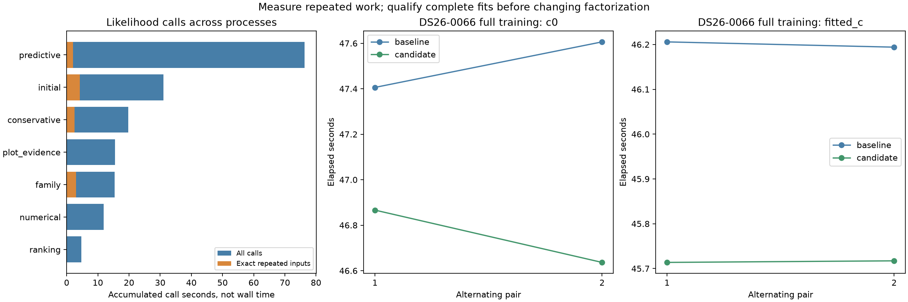

# ALGO07v3: repeated likelihood work and exact Cholesky experiment

The direct LAPACK Cholesky path is now **integrated in development** after exact
native DS26-0002 qualification and **772 passing tests**. The full native pair
measures **184.748 → 158.609 s**, 26.138 seconds shorter, an observed **1.165×**
ratio. This is one matched scan, candidate first. Unchanged stages also vary, so
the controlled complete-training gain of **1.05–1.59%** is the stronger evidence
for the optimization's size. Production and full-DS26 qualification are unchanged.

The complete DS26-0002 observation run preserves both calibration arms, every
scientific audit, ownership, public grid/path and all eight PNGs. It executes
all original calculations. Its **289.216-second** supervised clock includes
fingerprinting and changing shared-host conditions; it is not a normal-run
speed benchmark or a regression comparison with the preceding profile.

The measurement rules out a general input-hashing cache as a compelling next
optimization for predictive recovery. That stage has only **1.999 seconds** of
repeated likelihood calls across **76.317 accumulated call seconds**, while
computing input fingerprints costs **4.200 seconds**. These are sums across
processes, not elapsed stage time. Existing per-problem position caches already
remove much of the easy repetition in predictive fitting.

The full-pipeline speedup against original ALGO07 is **unavailable** in this
iteration; do not divide a historical ALGO07 time by the new native result.

## Whole-pipeline observation

The profiler wraps the five owned hierarchical-likelihood call sites. It binds
all function arguments and defaults, array dtype/shape/content, strides,
alignment and writeability. Every original call still executes; repeat outputs
must match by complete scientific fingerprint. Each fork starts a fresh table,
so inherited parent observations are not counted as child cache hits. The 56
process receipts are independent; this experiment does not measure a shared
cross-process cache or communication costs.

| Measurement | Result |
| --- | ---: |
| Likelihood calls | 6,784 |
| Exact repeated inputs within a process | 507 |
| Accumulated original-call time | 180.038 s |
| Accumulated repeated-call time | 12.664 s |
| Input-fingerprint time | 9.703 s |
| Output-check/bookkeeping time | 0.798 s |
| Repeats first seen under a different stage/call-site label | 18 |

The 12.664 seconds is an upper bound on removed computation for a hypothetical
unbounded per-process cache before keying, copies and cache maintenance. It is
not a possible 12.664-second wall-clock saving: workers overlap. A real cache
could use a cheaper key than this diagnostic, but the current evidence does not
justify introducing one throughout the pipeline.

| Stage | Calls | Repeat calls | Accumulated call time | Repeat time | Key time |
| --- | ---: | ---: | ---: | ---: | ---: |
| Predictive | 3,148 | 96 | 76.317 s | 1.999 s | 4.200 s |
| Initial, normal position | 804 | 111 | 30.199 s | 4.051 s | 1.259 s |
| Conservative | 871 | 115 | 19.779 s | 2.486 s | 1.357 s |
| Family, history position | 645 | 134 | 15.420 s | 2.946 s | 0.964 s |
| Diagnostic grid | 356 | 0 | 15.556 s | 0 s | 0.525 s |
| Numerical-policy replay | 472 | 0 | 11.823 s | 0 s | 0.707 s |
| Candidate ranking | 232 | 0 | 4.758 s | 0 s | 0.330 s |

Bounded LRU simulations retain keys only; they do not avoid work. Capacities
1/8/64/512 identify 360/423/503/507 hits, corresponding to
9.546/10.918/12.576/12.664 accumulated seconds. Predictive recovery has no
one-entry hits, about 1.053 seconds with eight entries and 1.999 seconds with 64.
Initial and family fits offer cheaper opportunities for explicitly scoped
reuse, but the [earlier initial-cache experiment](../2026_11_05_algo07v3_initial_cache/README.md)
did not establish a full-pipeline benefit. Do not discard that negative result.

## Exact factorization experiment

The separate captured DS26-0066 likelihood has 1,560 observations and 175 design
columns and reaches the existing 256 precision iterations. The external
candidate replaces only `np.linalg.cholesky(gram)` with SciPy's direct LAPACK
`dpotrf` call, retaining the lower triangle, positive-definite failure and the
original C-contiguous result layout. Empty matrices retain NumPy's path.
The LU factorization, inverse solve, covariance multiplication, all later
arithmetic, priors, convergence thresholds and iteration ceilings remain intact.

Five alternating captured-call pairs are exact in every returned field, with
unchanged inputs. They average approximately **0.1892 → 0.1856 seconds**, about
**1.9% less**. This is a single captured-call experiment, not a complete-fit or
pipeline result. Thirty-one focused tests pass: four observer tests and 27
Cholesky tests, including 24 seeded complete-likelihood cases spanning empty,
scalar and 175-column designs, C/F layouts, sparse support, non-unit likelihood
powers and learned coefficient priors. These tests do not establish exactness
on every possible matrix or numerical-library build.



All eight complete DS26-0066 training fits are exact. Both candidate trials are
faster in each arm, including the reversed-order pair. This supports a small
common-kernel improvement; it does not establish a population speedup.

| Arm | Baseline mean | Candidate mean | Elapsed reduction | Baseline CPU | Candidate CPU |
| --- | ---: | ---: | ---: | ---: | ---: |
| c=0 | 47.506 s | 46.751 s | 1.59% | 47.499 s | 46.733 s |
| Fitted c | 46.200 s | 45.715 s | 1.05% | 46.180 s | 45.701 s |

| Arm / pair | Order | Baseline | Candidate |
| --- | --- | ---: | ---: |
| c=0 / 1 | Baseline first | 47.406 s | 46.866 s |
| c=0 / 2 | Candidate first | 47.606 s | 46.636 s |
| Fitted c / 1 | Baseline first | 46.206 s | 45.714 s |
| Fitted c / 2 | Candidate first | 46.194 s | 45.717 s |

The full measured tool sources are archived in `measured/`. The reusable tools
now import an explicit frozen pre-change oracle so they remain old/new
comparisons after any runtime integration; that oracle is never a runtime import.

## Native qualification and implementation

The isolated pair changes only `leo.analysis.localization_v3/hierarchical.py`.
Both runs execute fresh native inference with three CPUs and one BLAS thread,
read-only frozen inputs, old installations/reports hidden, and a separate network
namespace. They use the same causal catalogue, observations, search region,
scientific budgets and evaluation-only GPS. Both c arms and every scientific
audit, ownership record, public grid/path and PNG byte match. The integration's
source bytes equal the measured candidate module; no numerical edits followed.

| Native measurement | Baseline | Candidate |
| --- | ---: | ---: |
| Native input through publication and supervision | 184.748 s | 158.609 s |
| User + system CPU | 260.490 s | 230.230 s |
| Maximum reported RSS | 2,419,940 KiB | 2,419,848 KiB |
| Initial search | 27.680 s | 21.445 s |
| Predictive recovery | 40.407 s | 38.757 s |
| Family recovery | 14.288 s | 10.484 s |
| Residual screening | 12.719 s | 12.519 s |
| PNG rendering | 7.475 s | 5.571 s |

Unchanged rendering improves 1.904 seconds and system CPU changes
23.930 → 7.750 seconds. These observations reinforce why the full 26-second
difference cannot be attributed to a roughly 1% complete-training improvement.
The controlled prepared fits are consistently CPU-bound with similar CPU and
wall-clock savings; the whole-run result is a shared-host observation.

The 772-test suite includes the 31 focused tool checks and 27 new component-owned
checks. The earlier covariance-index source assertion now verifies the frozen
pre-Cholesky oracle, keeping its original expected hash. A new owned-source
assertion verifies that only the qualified Cholesky call changed. Scientific
golden outputs are unchanged. The original oracle remains an external test and
benchmark reference, never a runtime dependency.

See [native/comparison.json](native/comparison.json),
[native/tests-broad.xml](native/tests-broad.xml), [summary.json](summary.json),
the source snapshots and both complete logs for evidence. The renderer verifies
the original measured bytes against explicitly archived files when a qualified
source or measurement helper has since changed; other bindings must still match.

## Qualification boundaries and next decisions

Full training qualification ran both `c=0` and fitted-`c`, five phase rounds,
48 optimizer iterations and the same recorded grouped fold on DS26-0066.
Every trial reconstructed its context before timing. Complete histories, final
state, phase references and calculated likelihoods match. Observation membership
and model inputs stayed unchanged. This covers one difficult fold in both arms,
not all folds or all scans. Full native qualification covers DS26-0002 only;
DS26-0066's new Cholesky path has prepared-fit qualification, not a full replay.

This is an implementation optimization of the current likelihood, not a new
scientific algorithm. It does not alter the current production deployment.
Reducing convergence budgets or changing the model would violate the present
exact-output requirement.

The next target is residual screening: profile catalogue propagation separately
from per-target phase nomination and finalist fitting. The per-target and
per-phase computations offer possible bounded parallel work, but preserve
phase/fold ordering, callbacks, both arms and all accepted/rejected rows; measure
CPU and memory as well as latency before changing execution. A repeat cache is
now lower priority for predictive work. Avoid
retesting rejected combined-RHS/triangular-solve shortcuts without new evidence:
those changed outputs. Avoid treating a small kernel ratio as a dataset-wide
speedup or multiplying it by unrelated historical ratios.

## Reproduction

```sh
PYTHONPATH=src:tools OPENBLAS_NUM_THREADS=1 taskset -c 0,1,2 python -B \
  tools/profile_algo07v3_likelihood_repeats.py --request REQUEST --output FRESH_ROOT

PYTHONPATH=src:tools OPENBLAS_NUM_THREADS=1 taskset -c 0 python -B \
  tools/probe_algo07v3_cholesky.py --capture CAPTURE_ROOT --output FRESH_KERNEL_ROOT

PYTHONPATH=src:tools OPENBLAS_NUM_THREADS=1 timeout -k 2 900 taskset -c 0 python -B \
  tools/benchmark_algo07v3_cholesky_training.py --request REQUEST --output FRESH_TRAINING_ROOT
```

Use the normal-CLI parity helper from the profiling skill after the complete
observation run. `render.py` validates source bindings, exact outputs and all
test receipts before exporting summaries and figures. The raw roots are
`/srv/bulk/leo-dev/algo07v3-likelihood-repeats-0002-20261106`,
`/srv/bulk/leo-dev/algo07v3-cholesky-probe-20261106` and
`/srv/bulk/leo-dev/algo07v3-cholesky-training-0066-20261106`.
Capture, GLRT extraction and queue delay are outside these clocks. Causal TLEs,
candidate selection and evaluation-only GPS use remain unchanged.

For the full native pair, copy the archived baseline/candidate module snapshots
and source manifests into a fresh root with the `baseline-src`/`candidate-src`
layout, then run `run_pair.py --root ROOT --request REQUEST --candidate-first`
using the same namespace permissions as earlier reports. The supplied
`run_baseline.sh` overlays exactly one module. Add `--native ROOT --broad-tests
TEST_XML` to `render.py` to verify and archive native integration evidence.
