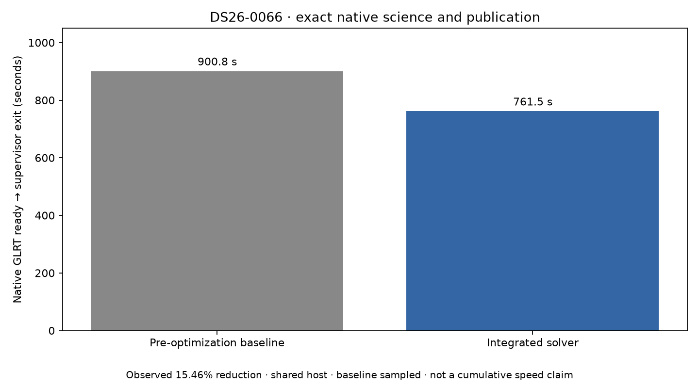
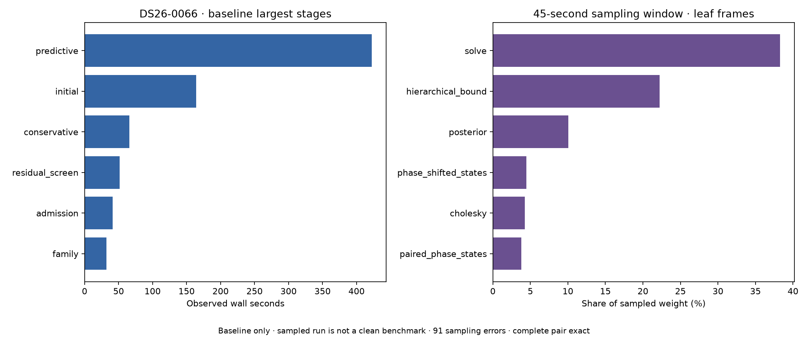

# ALGO07v3: larger native canary and variance-batching experiment

2026-11-05 progress snapshot. Development only; no deployment.

Both the pre-optimization standalone baseline and integrated solver have completed
DS26-0066 from native GLRT through all artifacts and atomic publication.
**All scientific outputs, both calibration arms, eight PNGs, grid/path data and
published fields match exactly.** Both select the guarded reassociation result
and retain **2,770 points (70.5373%)**, 89 components and 20 satellites per arm.
This extends native branch coverage to accepted guarded reassociation; it does
not establish full historical ALGO07 or dataset-wide equivalence.
[Exact comparison](comparison.json), [summary](summary.json).

| Complete native-to-publication run | Observed elapsed time |
| --- | ---: |
| Pre-optimization standalone baseline | 900.763 s |
| Integrated solver | **761.514 s** |
| Observed reduction | **139.249 s / 15.46%** |

These are shared-host observations and the baseline was sampled by a profiler.
They are not a controlled dataset-wide or cumulative speed claim.

This scan was selected to extend branch coverage: the older frozen final-stage
fixture had an accepted satellite replacement. The fresh input bundle includes
all 39 archive snapshots collected in the causal 72-hour window, with no
preselected satellites or evaluation coordinates used for inference. Earlier
installations/results and repository reports are hidden during execution.
[Frozen pair plan](pair-plan.json), [baseline terminal receipt](baseline-supervisor.json),
[isolation checks](baseline-isolation.json).

## The larger case exposes a larger recovery workload

| Baseline stage | Observed time |
| --- | ---: |
| Predictive recovery | **422.640 s** |
| Initial regional search | **163.899 s** |
| Conservative recovery | 66.093 s |
| Residual-family screening | 51.551 s |
| Reassociation admission | 41.451 s |
| Family fitting | 31.916 s |
| Complete supervised native-to-publication path | **900.763 s** |

The baseline processed targets 0–7 and ran the additional-family and final
reassociation fits. The first qualification scan, DS26-0002, exercised fewer
recovery targets and retained its incumbent. More work on this case is a reason
to extend validation, not to reduce hypotheses or terminate recovery early to
make timing look better. Both runs retain their 1,200-second outer bound,
unchanged internal numerical budgets, CPUs 0–2 and one BLAS thread per process.

A 45-second, 49-Hz nonblocking `py-spy` sample included the parent and its
children during later fitting/recovery. It contains 3,742 successful samples
and reports 91 sampling errors. Aggregate sampled process weight is 76.367 s
because multiple processes contribute; it is not 76 seconds of elapsed time.
The leaf-frame shares are approximately 38.3% NumPy solve, 22.2% other work in
`hierarchical_bound`, 10.1% its posterior helper and 4.3% Cholesky. These are
sampling observations, not exact function timers or a complete execution profile.
[Raw profile](baseline-sampling.json), [profiler log](sampling.log).

The profile supports continued work on repeated hierarchical calculations.
It also makes this baseline unsuitable for a clean performance benchmark.
The integrated run's unchanged preparation stages were slower than the baseline,
providing another warning about shared-host timing attribution. The completed
scientific comparison remains meaningful; a cumulative speed claim remains open.

## Prototype: batch independent variance reductions with identical shapes

The current likelihood performs one NumPy product/sum per noise group per
precision iteration. The [external prototype](../../tools/probe_algo07v3_variance_groups.py)
groups equal-width covariance blocks, retains their contiguous multiplication
and reduction length, and restores original group order before updating any
precision. It changes no priors, convergence thresholds, budgets or observation
membership. A native mismatch aborts outside ordinary fit rejection handling.

The first implementation had a variable-shadowing defect caught by the unit
tests; it was corrected before native execution. The ungated version then
passed 24 exactness tests, but a synthetic dense case was about 5% slower. The
revised version limits each stacked matrix batch to 1 MiB and uses the original
per-group reductions for larger batches or singleton groups. This limit is
about computation shape and allocation, not scan identity or location.

| Synthetic case | Ungated observed reduction | Bounded-batch observed reduction |
| --- | ---: | ---: |
| Local support, 32 coefficients | 27.15% | 28.51% |
| Local support, 190 coefficients | 10.29% | 12.62% |
| Dense, 32 coefficients | 14.14% | 22.41% |
| Dense, 190 coefficients | **−5.14%** | 3.81% |

These are short synthetic measurements, not native pipeline improvements or
proof of the dense-case percentage. Each uses four alternating reference/candidate
pairs and compares every returned field exactly. The large local-support case
has 2,783 observations and 70 noise groups. [Ungated measurements](synthetic-ungated.json),
[bounded measurements and input hashes](synthetic-gated.json),
[reproduction CLI](../../tools/benchmark_algo07v3_variance.py).

All **24 revised tests pass**, covering zero/one/many coefficients, C/Fortran
layouts, dense and sparse support, repeated block widths, empty-column groups,
and immutable inputs. They retain exact dtype/shape/byte comparison; no tolerance
was added. [Test results](tests.xml).

The bounded complete native DS26-0002 exact-call probe subsequently **completed
and passed** on CPU 4. All **6,772 calls** retain every field's shape, dtype and
bytes. The complete native scientific snapshot and all eight PNG hashes remain
the same qualified comparison digest, including both calibration arms and all
179 diagnostic grid locations.

| Alternating native kernel measurement | Current integrated kernel | Bounded variance batching |
| --- | ---: | ---: |
| Summed computation | 124.650 s | **110.722 s** |
| Observed component reduction | — | **13.927 s / 11.17%** |

The 420.642-second diagnostic executes both kernels and compares every result;
it is not normal pipeline latency or a complete-path speed ratio. The prototype
is not integrated; it still needs a full owned CLI/publication comparison.
[Native probe receipt](variance-probe.json),
[native scientific/source binding](variance-native-receipt.json).
Raw evidence: `/srv/bulk/leo-dev/algo07v3-variance-groups-20261105`.
The runtime remains at the previously qualified
[solver integration](../2026_11_05_algo07v3_solver_integration/README.md).

## Remaining qualification

Extend the completed DS26-0066 checks to further native cases and
the full DS26 denominator: **159 fast members, 158 available inputs and one
unavailable member**. The variance prototype requires complete-path and broader-case
evidence before integration. Ordinary production admission,
historical metadata semantics and the cumulative 10× target remain open.

The [renderer](render.py) verifies source/input bindings, successful execution
and exact comparison of both runs, isolation checks, profile accounting,
synthetic bindings and the 24-test receipt before producing this snapshot.
