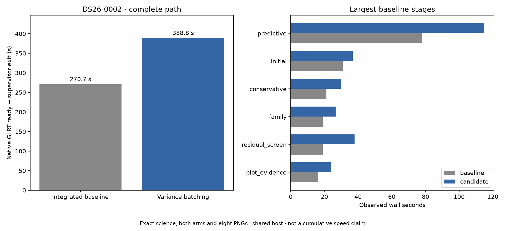

# Bounded variance batching: complete standalone comparison

2026-11-05. External development prototype; no deployment or runtime integration.

The candidate and integrated standalone baseline match **exactly** on DS26-0002:
both calibration arms, all science and audits, all eight PNG bytes, diagnostic
grid/path data and published result fields. Only the declared hierarchical
module differs. This is owned-engine equivalence, not full historical ALGO07
or dataset-wide qualification. [Comparison](comparison.json).

| Native GLRT ready through publication and supervisor exit | Observed seconds |
| --- | ---: |
| Integrated baseline | 270.732 |
| Bounded variance batching | 388.845 |

The candidate was **43.63% slower** in this pair. The candidate ran first; both used
CPUs 0–2, one BLAS thread, identical numerical budgets and a 1,200-second outer
limit. These shared-host timings do not establish a controlled population or
cumulative speedup. Resource observations are preserved alongside the receipts.
This pair does not support promotion: repeat timing with process CPU accounting
is needed to distinguish added computation from host contention. Unchanged
stages, including plot preparation, also ran slower in the candidate execution.

The prototype groups independent equal-width variance products and reductions,
preserving each group's arithmetic and restoring group order before updating
precision. Batches above 1 MiB per stacked matrix tensor and singleton groups
use the original reductions. No observations, priors or iterations are removed.

The preceding native probe compared all 6,772 calls exactly and measured an
11.17% kernel reduction. Nine additional tests now cover the exact batch-memory
boundary, strided arrays, unequal feature scales, noncontiguous group labels,
mixed singleton/empty groups and short iteration budgets. All pass.
[Boundary tests](boundary-tests.xml), [preceding evidence](../README.md).

| Stage | Baseline seconds | Candidate seconds |
| --- | ---: | ---: |
| native_preparation | 12.566 | 12.365 |
| recovery_catalogue | 7.813 | 9.554 |
| initial | 30.844 | 36.835 |
| conservative | 21.256 | 30.027 |
| family | 19.001 | 26.605 |
| signed | 5.493 | 3.610 |
| cavity | 8.211 | 12.337 |
| inventory | 0.211 | 0.273 |
| predictive | 77.822 | 114.941 |
| numerical | 15.899 | 22.815 |
| gap | 0.002 | 0.003 |
| residual | 0.190 | 0.266 |
| residual_screen | 18.991 | 37.849 |
| addition | 0.003 | 0.003 |
| incumbent | 0.287 | 0.364 |
| ranking | 7.088 | 10.842 |
| admission | 11.165 | 20.629 |
| final | 0.064 | 0.090 |
| plot_evidence | 16.330 | 23.799 |
| png_rendering | 5.680 | 7.924 |

Next: resolve the complete-path timing regression and extend this candidate
through the larger native guarded-reassociation case before integration.
Full DS26 retains 159 fast members, 158 available
inputs and one unavailable member. Ordinary admission, full historical
metadata qualification and the cumulative tenfold target remain open.

Reproduce with [pair runner](../run_variance_pair.py) and
[renderer](../render_variance_pair.py); immutable inputs and sources are recorded
in [plan](plan.json). Raw evidence: `/srv/bulk/leo-dev/algo07v3-variance-pair-20261105`.
