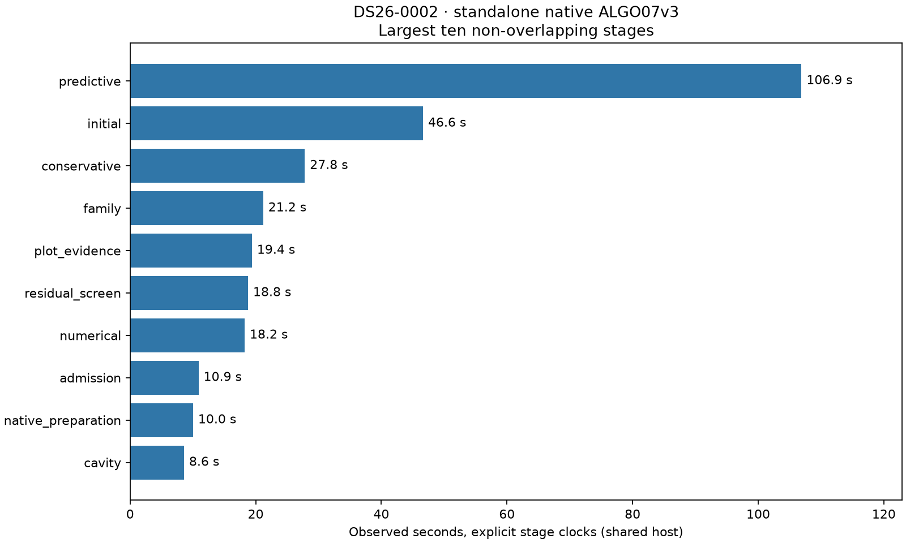
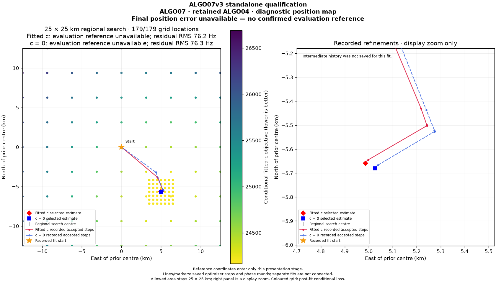

# ALGO07v3: one native-input engine through all eight figures

2026-11-05. Development qualification; no deployment.

The new application entry point constructs tracks from native GLRT evidence,
prepares the causal catalogue, runs all ordered recovery policies, retains the
selected numerical state and renders all eight standard figures. It does not
launch older ALGO workers or load their scientific results. This is now an
executable native-input-to-PNG engine; atomic WebUI publication, production
execution control and population qualification remain unfinished.

**Complete-path speedup remains unmeasured.** The native-input run took 311.064 s
through rendering, excluding qualification serialization and publication. It
cannot be divided by the previous prepared-input observation to claim a speedup:
the scopes and shared-host conditions differ. The 10× target remains open.

## Evidence and scope

DS26-0002 has 4,211 native GLRT observations. Both c=0 and fitted-c retain 2,783
points. Prepared-input, native-input and isolated-native runs must produce the
same entire scientific comparison document, presentation packet and eight PNG
digests as the previously qualified connected run. The verifier checks source
and input bindings, 179/179 grid points and actual PNG bytes. Exact comparison
digest: `4f7c74a132b415e9bd6e130dcbc0d7082fa72c822d53f76810f8a9fa13323d68`.

The [machine-readable comparison](comparison.json) records the verified runs,
timings and isolation evidence. [Artifact bindings](artifact-bindings.json) bind
the external inputs and receipts. This is one retained-incumbent scan, not full
DS26 equivalence or proof of every accepted-recovery branch from native inputs.
The scientific comparator retains both calibration arms, owners, candidates,
numerical policy outputs and presentation data. Only its previously declared
operational timing fields are excluded.

The stronger run **completed and passed exact comparison** in a private mount
and network namespace. `/opt`, the older
bulk result tree and repository reports are hidden. Its read-only bundle
contains only native GLRT, track configuration and 38 causal archive snapshots;
snapshot copying does not filter satellites or use evaluation coordinates.
The entry check verifies every input digest and the namespace/mount restrictions.
Source imports and subprocess/read attempts also pass the existing strict
qualification guard. No old algorithm service is reachable over the network.

## Implementation

- [Owned application runner](../../src/leo/application/localization_v3_engine.py):
  `run_native` composes native preparation, lazy causal history, numerical
  inference and direct presentation. `infer_prepared` exposes the same numerical
  path for diagnosis. No evaluation coordinates enter numerical inference.
- Checkpoint values are ephemeral in-memory audit/state, not new persisted
  contracts or fake older terminals. Native NumPy metadata is materialized to the
  original JSON value types in memory; the orbit bank is retained without a
  redundant large-array copy.
- Selected endpoints and owner counts must agree with the final decision.
  Incomplete stages cannot silently become completed publication. Accepted
  reassociation transfers its selected context; rejection retains the incumbent.
- Explicit clocks separate preparation, catalogue, each policy, grid evidence
  and PNG rendering. Execution callbacks retain original numerical budgets.
  The qualification adapter runs declared work; it is **not** a qualified
  production deadline/cancellation adapter.
- [Qualification CLI](../../tools/check_algo07v3_engine.py) accepts either native
  evidence plus causal archive or prepared inputs. It saves audit comparison
  data and eight PNGs. [Isolation launcher](../../tools/qualify_algo07v3_isolation.sh)
  creates private namespaces before any masking and requires fresh output.
  These are test tools, not the final production CLI/publication interface.

## Runtime and figures

| Run | Through rendering (s) | Including qualification output/checks (s) |
|---|---:|---:|
| Prepared inputs | 303.077 | 309.310 |
| Native inputs | 311.064 | 317.381 |
| Native inputs, stronger isolation | 626.071 | 632.618 |

These are uncontrolled observations, not ABBA runs or a baseline/candidate
comparison. The large runtime variation is retained explicitly. Identical science
does not establish identical runtime, a measured isolation overhead, or a speedup.

See the [full stage table](stage-timings.md). In the ordinary native run,
predictive recovery is the largest stage at 106.894 s, followed by initial
localization at 46.639 s and conservative fitting at 27.820 s. Grid evidence
costs 19.404 s; rendering costs 5.586 s. Preparation and causal recovery catalogue
cost 10.034 and 5.505 s respectively. These are non-overlapping wall-clock spans;
they are descriptive observations under shared-host load, not paired benchmarks.

All eight figures are byte-identical to the
[previous connected report's figures](../2026_11_05_algo07v3_connected_presentation/README.md)
and are linked rather than duplicated. For example:

The qualification figure deliberately uses no evaluation reference. The
previous report also contains a separately rendered evaluation-only figure.
Inference, candidate selection and this comparison receive no evaluation GPS.

The [previous kernel profile](../2026_11_05_algo07v3_connected_presentation/profile.json)
identifies hierarchical likelihood work as a cross-stage cost. Repeated exact
inputs and immutable geometry are the next opportunities to measure before
changing any operation ordering or introducing caches. The new clocks close
the prior profiler's missing wrapper attribution.

### Repeated-input measurement: a limited caching opportunity

The subsequent [observational probe](../../tools/profile_algo07v3_repeats.py)
executes every original hierarchical call. It changes no numerical operation and
does not reuse any answer. Its complete scientific output, 179 grid locations
and eight PNGs still match the same exact comparison digest. The
[profile](repetition-profile.json) records **6,772 calls, 5,933 distinct input
digests and 177.020 s spent inside the likelihood**. Probe bookkeeping costs
another 8.276 s. Its prepared-input-through-rendering observation is 354.558 s;
qualification output/checks bring that to 360.905 s. This is not a speed test.

| Hypothetical LRU entries | Repeated calls | Compute spent on those calls (s) |
|---|---:|---:|
| 8 | 425 | 12.739 |
| 32 | 508 | 14.425 |
| 128 | 510 | 14.465 |
| 512 | 589 | 18.001 |
| 2,048 | 834 | 24.081 |

The digest includes parameter values, array dtype, shape and bytes, but ignores
array strides. These are optimistic reuse opportunities, not a proof that all
such calls can be cached bit-exactly. A real cache must preserve layout-sensitive
arithmetic and protect arrays from callers that mutate posterior results. Its
copying, lookup and retained-memory costs are excluded from the table.

Even the 2,048-entry estimate covers only 13.6% of measured likelihood compute.
A 128-entry cache covers 8.2%. Therefore broad result memoization is **not** the
main route to the requested 10× improvement. No cache is enabled or promoted.
Prioritize completing publication for a valid full-path benchmark, then measure
and optimize the distinct-input likelihood and phase-geometry work. Alternative
linear solvers cannot be assumed equivalent: changed floating-point results fail
the existing exact-output requirement.

Two probe tests verify that every call still executes, mutations cannot become
cached answers, input changes alter the digest and bounded LRU counts are correct.

## Validation and remaining work

The focused component suite passes **543 tests**, with no skips or failures;
the separate observational-probe suite adds **2 passing tests**.
Runner tests cover policy order and inputs, cutoff mismatch, incomplete-stage
failure, accepted and rejected state transfer, native no-curvature exit, lazy
history, finite clocks and evaluation-reference separation. Import tests reject
earlier workers and concrete infrastructure in the application boundary.

Still required before production replacement or speed claims:

1. Owned persisted scientific result and atomic publication through public ports.
2. Production CLI and cancellation, deadline and restart qualification.
3. Native-input accepted-recovery coverage and full DS26 denominator equivalence.
4. Matched baseline/current GLRT-ready-to-publication timings, plus the separately
   required unchanged-detector and capture/queue measurements.
5. Exact-output optimizations and verification of the 10× complete-path target.

No deployment is performed by this work. Complete-path matched scans remain zero.

Regenerate this report with the pinned environment, access to the bound evidence
and `PYTHONPATH=src:tools python -B reports/2026_11_05_algo07v3_native_engine/render.py`.
The generator fails if science, PNG bytes, input/source bindings, isolation
checks or test evidence differ.
