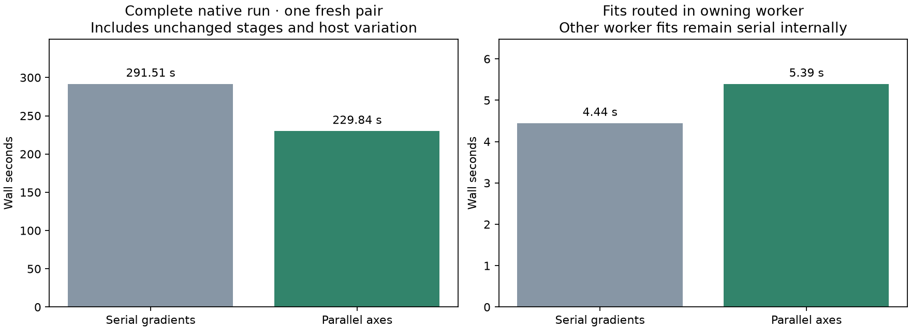
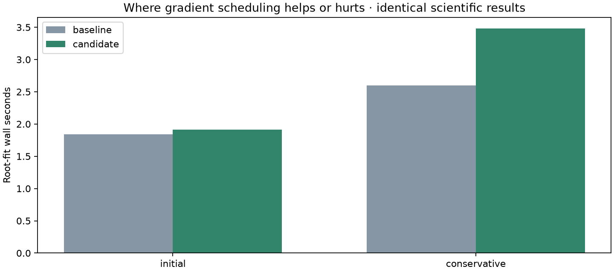
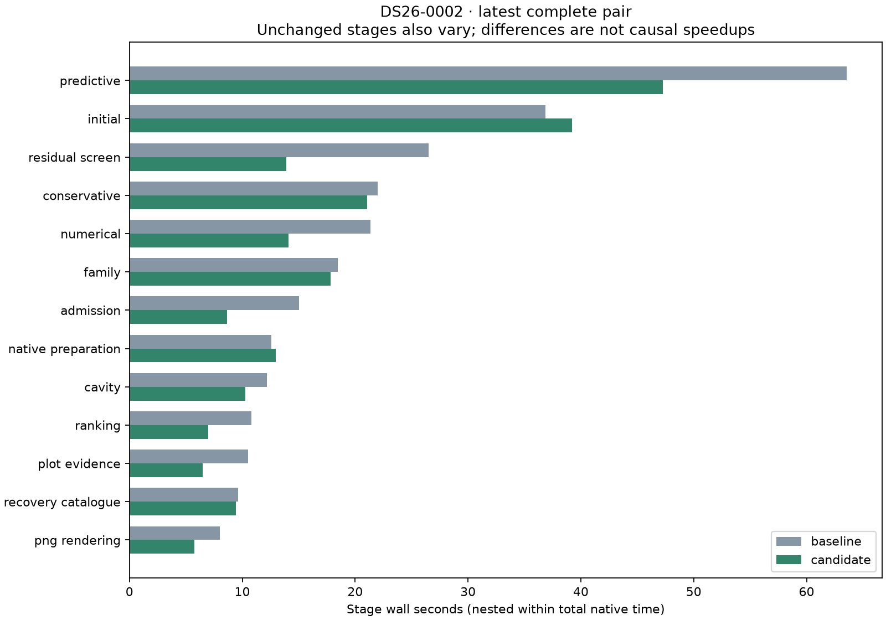

# ALGO07v3: native gradient scheduling qualification

The complete DS26-0002 pair takes **291.515 → 229.841 seconds**, an observed
61.674-second reduction (1.268×), with complete scientific output, both
calibration arms, ownership, public grid/path and **all eight PNG bytes exact**.
However, the seven fits actually changed by this experiment become **21.3%
slower: 4.445 → 5.392 seconds**, and consume **72.7% more CPU**. The large
whole-run difference comes from unchanged work and cannot justify the prototype.
**Reject this owner-only gradient policy for runtime integration.**

This is one matched native scan on a shared host, with lightweight fit timers
on both sides. Original-ALGO07/current-v3 cumulative speedup is **unavailable**
in this experiment. Capture, queue delay and native GLRT extraction are excluded.
No analyzer implementation or production deployment changes in this iteration.

## What was tested

The [earlier prepared-fit experiment](../2026_11_05_algo07v3_grid_hard_case/README.md)
reduced a difficult DS26-0066 training fit by 18–21%, preserving every numerical
result but increasing CPU by 10–12%. Its central-difference gradient computes
the two position axes in two child processes, keeping each axis's plus/minus
order and the parent's arithmetic unchanged.

Those difficult training fits already execute inside a bounded three-worker
queue. Nesting gradient workers underneath that queue would oversubscribe its
capacity. This native experiment therefore substitutes the gradient function
only in the owning CLI process when it has no active children. Child fits keep
their original execution. It is an **external function substitution**, explicitly
bound in the plan, not an integrated owned-runtime implementation. Identical
loaded source hashes alone do not establish identical execution in this probe.

Both runs use fresh private output stores, the same frozen native input and
causal catalogue, CPUs 0–2, one BLAS thread and a 1,200-second outer timeout.
Scientific budgets, priors, phase rounds, stopping rules and acceptance gates
remain unchanged. The baseline runs first. Evaluation coordinates enter only
presentation. Private mount/network namespaces hide prior installations and
reports; the input bundle is read-only. Neither run resumes previous results.

## Targeted result and coverage

| Scope | Baseline | Candidate | Interpretation |
| --- | ---: | ---: | --- |
| Complete native process | 291.515 s | 229.841 s | Shared-host observation; not attributed to this change |
| Seven eligible owner fits | 4.445 s | 5.392 s | 21.3% slower |
| Eligible fit CPU, parent plus reaped children | 4.441 s | 7.669 s | 72.7% more CPU |
| Initial zero-phase controls, two fits | 1.843 s | 1.913 s | Slower |
| Conservative refinement, five fits | 2.602 s | 3.479 s | Slower |

The eligible fits occupy only **1.52%** of baseline complete wall time. Even
eliminating them entirely has a small ceiling on this scan. The seven complete
fit identities, calibration arms, observation counts and evaluation counts
match in order. Their baseline first-residual medians are about 60.7 ms for
initial fits and 28.4 ms for conservative fits. Child startup and communication
outweigh the benefit of concurrent residuals here.

Untouched predictive recovery changes **63.533 → 47.241 s**, numerical replay
**21.341 → 14.081 s**, residual screening **26.518 → 13.903 s**, and grid evidence
**10.491 → 6.490 s**. These variations explain why a faster whole run does not
prove the proposed code is faster. Stage measurements are nested within the
complete clock; do not add nested fit clocks to stage totals.

GNU time, which includes the surrounding harness, records **414.74 → 324.35 CPU
seconds**, **295.43 → 233.24 wall seconds**, maximum RSS **2,319,156 → 2,293,784
KiB**, and **0 → 2 major page faults**. Keep this broader harness clock separate
from the native supervisor clock. Host resource snapshots and complete process
receipts are retained under `baseline/` and `candidate/`.

## Exactness and verification correction

- [comparison.json](comparison.json): both arms, complete science/audits,
  ownership and all eight PNGs match; no owned module changes or additions.
- [baseline-parity.json](baseline-parity.json): the instrumented baseline also
  matches the prior normal owned CLI output, including all PNGs. Only explicitly
  checked CLI entry-point aliases differ; their source bytes are identical.
- [tests.xml](tests.xml): **11 tests pass**, including real fork routing,
  preventing nested child execution, restoration after failure, gradient
  exactness and explicit-empty source-change declarations.
- [plan.json](plan.json): input, source, experiment, request and namespace
  bindings, CPU/thread limits and execution order.
- [summary.json](summary.json), [stages.json](stages.json), and each side's
  `fits.json`: aggregate and individual fit evidence.

The first post-run comparison encountered a verifier bug: `changed_module=[]`
was interpreted as the historical default expectation that `hierarchical`
changed. Explicit empty now requires **no changes**; an omitted declaration
still retains the historical default. Undeclared changes still fail. This fixes
declaration semantics without weakening the source or science comparison.

The original measured verifier is archived at
[measured/compare_algo07v3_runs.py](measured/compare_algo07v3_runs.py).
[recheck.py](recheck.py) verifies that the current verifier differs by exactly
the documented two substitutions, checks every other original binding, and
reruns comparison on saved outputs. Neither inference run was repeated.
The comparison receipt records both verifier hashes and the external function
substitution. Later report and test files are supporting evidence, not measured
runtime source.

## Next opportunities

| Largest baseline stage | Seconds | Share of complete 291.515 s |
| --- | ---: | ---: |
| Predictive recovery | 63.53 | 21.8% |
| Initial position search | 36.85 | 12.6% |
| Residual association screening | 26.52 | 9.1% |
| Conservative recovery | 21.99 | 7.5% |
| Numerical-policy replay | 21.34 | 7.3% |
| Family recovery | 18.44 | 6.3% |
| Candidate admission | 15.02 | 5.2% |

These seven stages total 69.9% of baseline time. The chart displays measured
stages, not an exhaustive partition: process startup, saving and publication
also contribute to the outer timer.

The [complete stage and likelihood profile](../2026_11_05_algo07v3_full_runtime_profile/README.md)
remains the basis for prioritization. Its unprofiled DS26-0002 run spends
38.05 s in predictive recovery, 21.48 s in initial search, 12.55 s in residual
screening and 12.48 s in numerical replay. Diagnostic-grid batching has since
reduced its isolated grid component from 13.78 to 6.40 s; that qualified
improvement is already present on both sides of this experiment.

1. **Investigate coarser independent fits during numerical replay.** Its current
   policy records ordered problem creation, phase updates and optimizer calls.
   Copying policy state per independent arm and merging exact receipt deltas
   might permit useful parallelism without repeated gradient-level forks. First
   prove independence, callback reconstruction and receipt order. Replay is
   almost entirely reused on some scans, so the opportunity is workload-specific.
2. **Measure repeated catalogue preparation separately.** Native preparation and
   recovery catalogue together take 22.20 s in this baseline. Only their repeated
   validation/parsing portion is a potential cache target; its actual fraction
   is not yet measured reliably. Preserve causal bindings and malformed-line
   checks, and avoid sharing mutable propagators.
3. **Reduce exact repeated likelihood work across fits.** Difficult posteriors
   spend much of their time in matrix inversion, factorization and covariance
   calculations. Existing geometry and covariance-index reuse are already
   integrated. Arithmetic-changing solvers that failed exactness and buffer
   variants that regressed remain rejected.

Do not integrate per-gradient process scheduling based on the prepared hard-fit
win alone. Alternate fresh native pairs on DS26-0002 and DS26-0066, retain
regressions, compare total CPU as well as latency, and require complete exactness.
Full DS26 timing, original-ALGO07 cumulative qualification and production admission
equivalence remain outstanding.

## Reproduction

`tools/probe_algo07v3_native_gradients.py --request REQUEST --output FRESH_ROOT`
runs the two isolated native variants; `--candidate-first` reverses order.
The harness needs namespace/mount privileges. The existing measured root is
`/srv/bulk/leo-dev/algo07v3-native-gradients-0002-20261106`.

`render.py --root ROOT --tests TEST_XML` checks bindings, exact comparison,
baseline parity and all 11 tests before exporting these figures and receipts.
For this historical measurement it validates the archived original checker
and the exact verifier-only correction. Use the repository's
[profiling skill](../../.agents/skills/profile-algo07v3/SKILL.md) for subsequent
iterations; do not overwrite the measured sources or reuse the output root.
