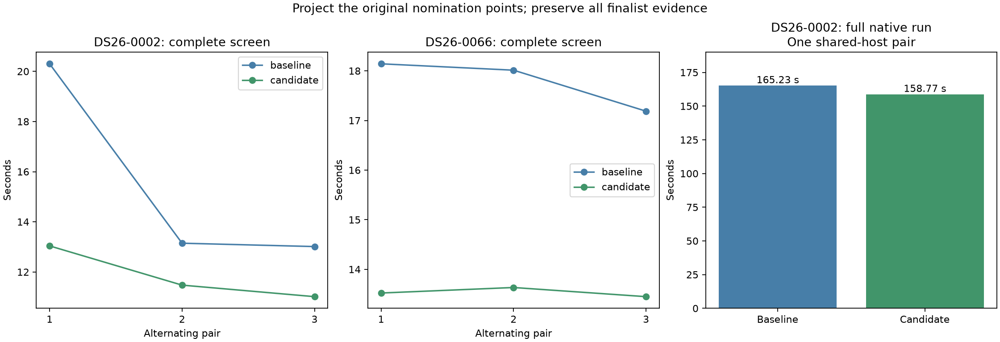

# ALGO07v3: compute only the orbital geometry used by nomination

The change is **integrated in development** after exact native DS26-0002
qualification and **796 passing tests**. Complete native time measures
**165.230 → 158.773 s**, 6.456 seconds shorter, an observed **1.041×** ratio.
The changed screen stage falls **12.622 → 10.587 s**, a 2.035-second reduction;
total CPU falls **233.650 → 231.570 s**. The rest of the wall-clock difference
is outside the changed stage and must not all be credited to this optimization.
Production, full-DS26 and original-ALGO07 cumulative qualification remain unchanged.

Residual screening spends most of its time projecting coarse satellite/phase
hypotheses. It previously computed those projections for every point in each
target even though each nomination fold subsequently used at most 16 points.
The candidate computes the union of the original fold selections and projects
only those points. Every full-data finalist calculation, observation, prior,
phase grid, alias, fold, acceptance gate and callback remains intact.

Twelve complete prepared screens on DS26-0002 and DS26-0066 match exactly.
Mean elapsed times improve **15.487 → 11.844 s** and **17.781 → 13.535 s**,
with essentially identical CPU reductions. The first DS26-0002 baseline is
slower than its later repeats; all pairs are retained below. An independent
DS26-0066 check verifies all **99 coarse phase grids** against the corresponding
columns of the original full projections, for both calibration arms and
both frequency/elevation arrays, byte-for-byte. Its final screen also matches.

These prepared-stage ratios are not original-ALGO07 cumulative or
capture-to-publication speedups. Production remains unchanged.

## Profile first

Both profiles replay complete screens from owned saved evidence with one CPU and
one BLAS thread. All scientific screen fields and callback payloads match the
saved results; inputs remain unchanged. The scoped profiler does not fork, and
its exclusive/cumulative accounting checks pass. Its timing overhead means these
profile clocks are not normal pipeline runtime estimates.

| Scoped work | DS26-0002 | DS26-0066 |
| --- | ---: | ---: |
| Catalogue propagation to ECEF | 2.084 s | 1.604 s |
| Coarse phase geometry | **21.237 s** | **30.359 s** |
| Coarse frequency/rate scoring | 0.892 s | 1.297 s |
| Fine finalist geometry | 0.055 s | 0.084 s |
| Alias/phase evidence components | 0.060 s | 0.084 s |
| Phase marginalization | 0.030 s | 0.036 s |
| Residual noise checks | 0.012 s | 0.013 s |
| Complete profiled screen | **25.690 s** | **34.988 s** |

Unlisted preparation and bookkeeping explain the remainder. Coarse geometry
accounts for 83–87% of these scoped profile clocks, so removing unused projections
has a substantially larger opportunity than optimizing finalist fitting.

## What changes and what stays exact

For each original fold, retain its existing mask, uniformly thinned index
selection and index order. Form a sorted union of those indices, then map each
fold's original indices into the reduced projection matrix. Scoring still uses
the same observations and times in the same order. The full fold and three
reproducible grouped random holdouts are unchanged; union geometry does not
insert held-out measurements into a training score.

| Scan / target | Original point count | Projected for nomination | Folds |
| --- | ---: | ---: | ---: |
| DS26-0002 / 1 | 64 | 44 | 4 |
| DS26-0002 / 2 | 24 | 20 | 2 |
| DS26-0002 / 3 | 25 | 23 | 4 |
| DS26-0066 / 1 | 67 | 38 | 4 |
| DS26-0066 / 2 | 61 | 40 | 4 |
| DS26-0066 / 3 | 35 | 30 | 4 |

No GLRT point is removed from the candidate's scientific evidence. The fine
finalist phase/alias search still uses every original point and the original
training masks. The row order, finalists, ranking, margins and callbacks match
the complete original screen. Invalid or out-of-domain times at omitted indices
are delegated to the original full projection path, preserving rejection rather
than hiding malformed observations. Bank validation remains in every projection.

This is one focused optimization. There is no additional parallelism, no
reduction in candidate satellites or phase hypotheses, and no new cache.

## All alternating complete-screen trials

Each trial includes catalogue parsing and propagation, nomination, finalist
fits, all gates and callbacks. Loading saved evidence is outside the timer.
Both sides use the same prepared packet and causal catalogue; their inputs are
fingerprinted again after every trial. The candidate is first in pair 2.

| Scan / pair | Baseline | Candidate | Exact screen and callbacks |
| --- | ---: | ---: | --- |
| DS26-0002 / 1 | 20.301 s | 13.040 s | Yes |
| DS26-0002 / 2 | 13.147 s | 11.476 s | Yes |
| DS26-0002 / 3 | 13.014 s | 11.016 s | Yes |
| DS26-0066 / 1 | 18.142 s | 13.522 s | Yes |
| DS26-0066 / 2 | 18.014 s | 13.634 s | Yes |
| DS26-0066 / 3 | 17.187 s | 13.449 s | Yes |

Mean CPU is **15.475 → 11.835 s** and **17.779 → 13.534 s**, respectively.
All six pairs improve, including reversed order. The DS26-0002 first baseline's
additional cost makes its aggregate 23.52% reduction less representative of its
later pairs (12.72% and 15.35%). DS26-0066's mean reduction is **23.88%**.
These are component observations on two scans, not population percentiles.



## Complete native qualification

The baseline-first pair starts from native GLRT and ends after successful owned
publication and worker supervision. Both sides have the same three-CPU affinity,
one BLAS thread, causal catalogue, search region, observations, priors and
scientific budgets. Private namespaces hide old installations and reports and
mount the frozen native input read-only. Exactly one loaded module changes.

| Native measurement | Baseline | Candidate |
| --- | ---: | ---: |
| Complete native process | 165.230 s | 158.773 s |
| Residual screen | 12.622 s | 10.587 s |
| User + system CPU | 233.650 s | 231.570 s |
| Maximum reported RSS | 2,376,072 KiB | 2,358,520 KiB |
| Major page faults | 63 | 0 |
| Initial search | 21.321 s | 20.753 s |
| Predictive recovery | 38.811 s | 38.843 s |
| Diagnostic grid evidence | 5.969 s | 7.034 s |
| PNG rendering | 5.533 s | 5.634 s |

Every scientific audit, both calibration arms, ownership, public grid/path and
all eight PNG bytes match exactly. The complete-pipeline CPU saving is close to
the screen-stage saving; the larger wall difference includes host/I/O variation.
The slower diagnostic-grid stage and differing page faults are retained, not
removed from the comparison. This is one full native scan. DS26-0066 has exact
complete-screen and projection qualification, not a fresh full native replay of
this change.

The final source receives only whitespace cleanup after the measured pair; its
complete syntax tree is identical to the measured candidate. A separate fresh
publication replay verifies the formatted source against that measured candidate
through the same full science/eight-PNG gate. Its source bindings, native receipt
and comparison are retained under `formatted/`. This extra execution is a
validation run, not a matched speed comparison; component tests ran on CPU 4
during part of it. It took **265.044 s**, versus 158.773 s for the earlier
semantically identical candidate. This large observed variation prevents a
stable whole-pipeline speed claim from this single pair. The main timing pair
above remains unchanged; the alternating component trials provide the stronger
evidence for the screen optimization.

Both c arms retain 2,783/4,211 points (66.0888%), 74 fragments and 28 satellites.
c=0 remains at (37.854825525185696, −122.48777832614799), RMS 76.3332809324593 Hz;
fitted c remains at (37.855019909306286, −122.48823203934822), RMS
76.1981250553178 Hz. Previously reported evaluation errors remain 665.210 m and
697.464 m. No new localization improvement is claimed from a runtime change.

## Validation and reproduction

The initial 13 focused tests cover index mappings, repeated/unsorted times,
byte-exact selected projection values, hidden NaN/infinity/out-of-domain times,
source extraction, timing-hook restoration and failure propagation. Component
qualification additionally checks the integrated helper and the existing full
four-policy screen/original-oracle comparisons, including callback isolation.
Scientific golden fixtures are unchanged.

The final 796-test suite includes 11 new component-owned nomination checks, the
13 focused tool checks, and the existing four-policy complete-screen/oracle and
callback-isolation checks. Counts are distinct tests in one suite, not a sum of
overlapping runs. Both the initial integrated source and final formatted source
passed this suite; the final receipt is the one published.

```sh
PYTHONPATH=src:tools OPENBLAS_NUM_THREADS=1 timeout -k 2 240 taskset -c 0 python -B \
  tools/profile_algo07v3_screen_parts.py --request REQUEST --output FRESH_PROFILE

PYTHONPATH=src:tools OPENBLAS_NUM_THREADS=1 timeout -k 2 360 taskset -c 0 python -B \
  tools/probe_algo07v3_nomination_points.py --request REQUEST --output FRESH_BENCHMARK

PYTHONPATH=src:tools OPENBLAS_NUM_THREADS=1 timeout -k 2 240 taskset -c 0 python -B \
  tools/check_algo07v3_nomination_geometry.py --request REQUEST --output FRESH_PROOF
```

The original measured probe is archived in `measured/`. The reusable probe now
uses an explicitly frozen pre-change screen oracle to preserve old/new comparisons
after integration. Runtime never imports it. The report renderer verifies original
bindings against those declared archived files; other source/input bindings must
remain unchanged. It requires complete screen, geometry and native parity plus
the component test receipt before exporting figures.

Raw roots: `/srv/bulk/leo-dev/algo07v3-screen-parts-{0002,0066}-20261106`,
`/srv/bulk/leo-dev/algo07v3-nomination-points-{0002,0066}-20261106`,
`/srv/bulk/leo-dev/algo07v3-nomination-geometry-0066-20261106`, and
`/srv/bulk/leo-dev/algo07v3-nomination-native-0002-20261106`.
Capture, native GLRT extraction and queue delay are excluded. GPS is evaluation
only; all TLEs and candidate selection remain causal.

`run_pair.py` and `run_baseline.sh` reproduce the one-module private-overlay pair
from the archived source snapshots/manifests in a fresh root. The
`verify_formatted.py` helper checks syntax-tree equality, records all final source
bindings, runs a fresh native publication and applies the strict comparator.
`render.py` verifies both native comparisons and the final test receipt before
exporting figures and summary data. The formatted raw root is
`/srv/bulk/leo-dev/algo07v3-nomination-formatted-0002-20261106`.

Next: profile the reduced geometry path again. The first profiles show repeated
full-bank validation inside interpolation as a remaining cost. Investigate
whether the screen's internally constructed, unmodified bank can be validated
once within that screen's lifetime, while preserving malformed-input rejection
and leaving general mutable-bank callers unchanged. This is a hypothesis, not
an implemented cache or claimed saving.
