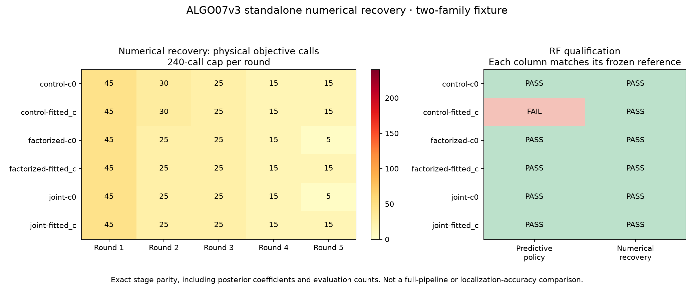

# ALGO07v3: owned numerical recovery policy

Complete-path baseline seconds, candidate seconds, savings and speedup remain
**unavailable**. Complete-path matched scans: **0**. This is a component
extraction and exact-parity qualification, not a full-pipeline speedup result.
Production is unchanged and the standalone engine is not ready for deployment.

## What changed

V3 now owns the numerical policy used by the frozen ALGO04 worker. Single-family,
shared-family and joint recovery fits/audits accept an explicit policy on their
numerical context. They do not import or execute an older worker. The default
context preserves the earlier predictive policy. The numerical policy provides:

- Centered 0.001 km position derivatives, with second-order one-sided derivatives
  at the regional boundaries. The original 25 × 25 km box is unchanged.
- At most 240 distinct physical objective evaluations per round, including
  derivative calls, 48 optimizer iterations and 40 line-search steps. A counted
  evaluation-cap stop returns the last accepted point and cannot claim success.
- A ±30 s numerical phase-reference window, with checks that both the updated
  reference and actual posterior stay inside the existing causal orbit bank.
  Predictive evidence is checked too. This does not widen target phase support
  or physical priors, add catalogue records, or change the five-round budget.
- Explicit problem ownership and per-stage receipts, replacing process-wide
  monkeypatching of optimizer aliases and phase refreshes.

The shared-family custom optimizer remains unchanged. Powell calls are forwarded
unchanged; they still receive the numerical phase-reference checks when the policy
is enabled. No reference GPS enters these operations.

## A mismatch the exact gate caught

The first numerical comparison failed even though endpoints, objectives,
optimizer histories, all RF audits, domains and physical evaluation counts
matched. Three fitted-c results had different orbital posterior coefficient
fingerprints. The frozen ALGO03 runtime uses optimized NumPy contractions in
three joint-density expressions; the frozen ALGO04 runtime uses direct
contractions. These mathematically equivalent operations can round differently.

V3 therefore preserves the contraction order explicitly per stage. This is not
a relaxed tolerance or a change to the oracle. The first failed candidate is
retained under `numerical001/candidate.json`; the corrected candidate is under
`numerical002/candidate.json` in the research evidence root below.

## Verification and scope

The fixture contains two independently proposed families: NORAD 67188 with 27
native points and NORAD 64313 with 22. Both sides receive the same explicit
saved numerical context, target groups, causal bank, priors and inventory. This
qualifies the numerical component, not fresh target selection or the complete
ALGO04 conditional-replay controller.

The comparison covers all six experiments: control, factorized and joint fits,
each with c=0 and fitted-c. It compares complete scientific output fingerprints:
positions, objective and nuisance values, phase integration and orbital
posterior coefficients, five-round histories, physical/domain audits, ownership
and every numerical policy receipt. Operational timing and implementation
provenance are separately bound rather than treated as scientific values.

Both candidate executions run with `/opt` hidden by a read-only empty mount and
the legacy-import guard enabled. Legacy installations are available only to the
external reference process. The test supplies a saved context deliberately;
this does not establish a standalone native-GLRT-to-publication execution.



| Component scope | Frozen reference | V3 | Exact science |
| --- | ---: | ---: | --- |
| Original predictive policy, six fits and audits | 65.473 s | 64.782 s | Pass |
| Numerical policy, six fits and audits | 196.220 s | 118.357 s | Pass |

The numerical run creates 36 checked problems, performs 30 optimizer calls and
records 36 reference checks. Its 740 physical objective evaluations include
derivative calls; the maximum per round is 45 of the unchanged 240-call cap.
The complete numerical scientific fingerprint is identical on both sides:
`7988f2b5aa54ae98c5ac36df20663e34b9f689bbbee262fd4198a0193945621b`.
The default-policy fingerprint is also unchanged:
`efd1dc11516547837bd5a0f3ee63f160dea431cd9503570ca6f46724e4f3a1c3`.

The [machine-readable comparison](comparison.json) includes measured component
times and explicit missing complete-path metrics. These overlapping shared-host
runs are correctness tests, not a controlled performance benchmark. The
[artifact bindings](artifact-bindings.json) bind all loaded scientific source,
tools, input evidence and result receipts used by the figure. The renderer
refuses changed bindings.

The original predictive policy retains its failed fitted-c control on this
fixture; the numerical policy passes all six RF audits. Each policy must match
its own pinned reference. This is reproduction of existing production behavior,
not a new claim of improved association or position accuracy. Final additive
admission against the published incumbent is a separate pending policy.

Validation: **224 focused tests passed**, including independent Gaussian
integration checks for both contraction orders, regional boundary derivatives,
physical evaluation caps, callback protocols, posterior/predictive bank limits,
reference ownership, default-policy preservation and strict receipt comparison.

## Reproduce

Working tree: `/srv/bulk/leo-dev/algo06-promotion-20261101`.
Evidence root: `/srv/bulk/leo/research/algo07v3-20261104`.

`tools/check_algo07v3_joint.py --numerical` enables this policy for the reference
and candidate fixture runs. Use the ALGO04 runtime below for the reference;
omitting the flag tests the original predictive policy against its ALGO03
runtime. Both require `--source`, `--probe` and `--inventory` explicitly. The
receipts bind those exact inputs. The source is the `SCAN` directory under:

```text
/srv/bulk/leo/research/algo07-runtime-20261103/algo03-joint/baseline/worker/recovery/snapshot/inference
```

Pinned references:

```text
ALGO03 /opt/leo-fast-graph-runtime-algo03/f286f3e3029ec17479f4aa2b41312e4220258944
ALGO04 /opt/leo-fast-graph/f9e262f96b6e2e75b397f69d50a0ea9104e293ef
```

Render after running the four component experiments:

```bash
PYTHONPATH=src:tools .venv/bin/python -B reports/2026_11_05_algo07v3_numerical/render.py \
  --reference /srv/bulk/leo/research/algo07v3-20261104/numerical001/reference.json \
  --candidate /srv/bulk/leo/research/algo07v3-20261104/numerical002/candidate.json \
  --default-reference /srv/bulk/leo/research/algo07v3-20261104/numerical001/default-reference.json \
  --default-candidate /srv/bulk/leo/research/algo07v3-20261104/numerical002/default-candidate.json \
  --output reports/2026_11_05_algo07v3_numerical
```

## Still required

Freeze-competition annotation replay, conditional reuse of completed stages,
original logical-time accounting and additive protection of the published
incumbent must be wired into the numerical-recovery controller. Fresh single
and shared numerical trials, fragments and conditional-replay branches require
their own real-data qualification. Later gap, additional-family and guarded
reassociation policies, all eight UI artifacts, full DS26 qualification and
complete-path optimization remain unfinished. The full 10× target is not proven.
