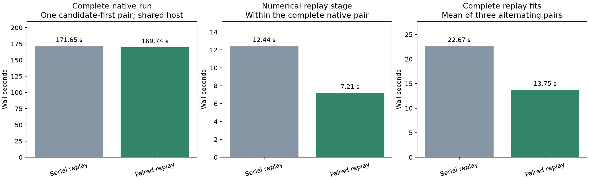
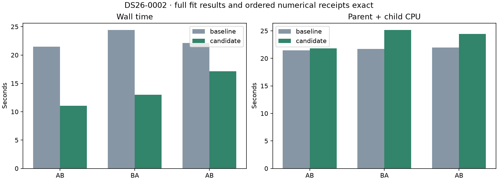

# ALGO07v3: concurrent numerical replay with exact ordered receipts

The fresh DS26-0002 native comparison improves **171.653 → 169.742 seconds**,
saving **1.911 seconds (1.011×, 1.1% lower latency)**. Complete scientific output,
both calibration arms, ordered numerical receipts, point ownership, public
grid/path and **all eight PNG bytes match exactly**. The numerical-replay stage
itself improves **12.438 → 7.208 seconds (42.1%)**; unchanged stages vary enough
to offset much of that saving. This is a modest observed complete-run gain,
not a new large cumulative speedup.

The change is integrated in development after **716 passing tests**. Production
is unchanged. Original-ALGO07/current-v3 cumulative speedup is unavailable in
this experiment; capture, queue delay and native GLRT extraction are excluded.

## Why this target

The preceding owner-only gradient experiment was exact but slower. Numerical
replay offers a coarser task: each independent calibration arm runs all five
phase rounds before returning. The former implementation serialized these arms
because they append to one numerical-policy receipt. The scientific fits are
independent; the receipt requires deterministic reconciliation.

The new execution path gives each arm a private copy of the existing policy,
runs through the existing bounded process mapper, and merges completed receipts
in c=0/fitted-c order. Existing receipt prefixes and constant configuration must
remain unchanged. Problem counts are added as deltas; phase updates and optimizer
calls are appended in original order. A failed child aborts the operation without
committing a partial merged receipt. Missing, extra or reordered arm results are
rejected. Unknown policy implementations retain their serial behavior.

The application forwards its existing recovery-arm execution port through the
numerical checkpoint. Control and addition variants remain sequential; only
their paired arms run concurrently. No nested worker pool, new optimizer,
changed budget, phase window, prior, target order or scientific gate is introduced.
No published contract or production deployment changes.

## Complete-fit experiment

A fresh DS26-0002 pipeline run intercepts the numerical new-family inclusion
fit and alternates three full serial/parallel pairs on its live context. Each
trial gets a fresh copy of the incoming numerical policy. It checks the entire
fit result **and complete resulting numerical receipt**, including both arms,
against the original serial invocation. All six executions match exactly.

| Pair order | Serial wall time | Parallel wall time | Serial CPU | Parallel CPU |
| --- | ---: | ---: | ---: | ---: |
| AB | 21.454 s | 11.070 s | 21.452 s | 21.825 s |
| BA | 24.410 s | 13.013 s | 21.700 s | 25.146 s |
| AB | 22.131 s | 17.155 s | 21.963 s | 24.422 s |
| Mean | 22.665 s | 13.746 s | 21.705 s | 23.797 s |

This is **39.4% lower fit latency (1.649×)**, with **9.6% more total CPU**.
Every pair improves, although the magnitude varies. The instrumented pipeline
takes 470.182 seconds because it includes six extra fit executions; that clock
must not be compared with normal native runtime as a speed result.

The complete instrumented publication matches the prior normal owned output:
scientific audits, both arms, point ownership, public grid/path and all eight PNG
bytes. Instrumentation did not mutate the live policy or any bound sources.
The measured probe is archived under `benchmark/measured-probe.py`; the current
tool subsequently uses a frozen serial inclusion oracle so it remains runnable
after integration. These are external measurement dependencies only.

## Fresh native qualification

The complete exact comparison is saved in [comparison.json](native/comparison.json).
The pair uses frozen five-module source overlays, separate
fresh result stores, private mount/network namespaces, a read-only frozen native
input bundle and causal TLE catalogue, CPUs 0–2 and one BLAS thread. Each native
run has a 1,200-second outer timeout. Candidate runs first. No prior outputs are
used as inference inputs. The scientific comparison includes both arms, complete
audits, ordered numerical receipts, ownership, public grid/path and eight PNGs.

| Scope | Baseline | Candidate |
| --- | ---: | ---: |
| Native worker through publication and exit | 171.653 s | 169.742 s |
| Numerical-replay stage | 12.438 s | 7.208 s |
| Initial search, unchanged scheduling | 23.118 s | 26.667 s |
| Predictive recovery, unchanged scheduling | 40.196 s | 39.063 s |
| Total CPU, GNU time wrapper | 237.61 s | 245.98 s |
| Maximum RSS | 2,285,292 KiB | 2,461,224 KiB |
| Major page faults | 0 | 2 |

The replay-stage saving is **5.230 seconds**; unchanged work costs about 3.319
seconds more overall in the candidate run. Total CPU rises **3.5%** and maximum
RSS **7.7%** in this pair. These resource changes matter for queue throughput,
even when per-scan latency improves. The broader GNU time wrapper clocks are
173.25 and 171.21 seconds; they include harness setup and differ from the native
supervisor clocks reported above. See [stage timings](native/stages.json) and
the retained GNU time/resource receipts.

Both runs retain 2,783/4,211 GLRT points (66.0888%), 74 fragments and 28
satellites. The c=0 position remains [37.854825525185696, -122.48777832614799]
with RMS 76.3332809324593 Hz, and fitted-c remains
[37.855019909306286, -122.48823203934822] with RMS 76.1981250553178 Hz.
The change provides no localization-accuracy improvement; it preserves results.

Timing starts with the native worker and ends after successful publication and
process exit. Capture, queue delay and native GLRT extraction are excluded.
Shared-host variation must be retained; unchanged-stage improvements cannot be
attributed to this change. Original-ALGO07/current-v3 cumulative speedup is
unavailable in this experiment. This is DS26 subset qualification, not a
population runtime or full-dataset equivalence claim.

The previous DS26-0066 replay largely reused saved work, so this optimization
is not expected to save similar time there. Full DS26, another fresh native
case and ordinary production admission remain broader qualification work.

## Validation and reproduction

The focused suite passes 117 tests. The final broader suite passes **716 tests**
without skips or failures, including four complete synthetic inclusion variants
against the frozen serial oracle, real child failure handling, receipt-prefix
and signed-zero protection, transport ordering/completeness, application port
forwarding and the existing bounded executor cleanup tests. The counts overlap;
do not add them.

Use `tools/probe_algo07v3_numerical_arms.py --request REQUEST --output FRESH_ROOT
--repeats 3`, with three CPUs and one BLAS thread, for the prepared-fit experiment.
Its supervisor bounds the entire fresh run plus repeated fits to 1,200 seconds.
The original measured root is
`/srv/bulk/leo-dev/algo07v3-numerical-arm-probe-0002-20261106`.

`run_pair.py --root ROOT --request REQUEST --candidate-first` runs the native
comparison over frozen baseline/candidate source trees. The private overlay
runner requires namespace/mount privileges. The measured native root is
`/srv/bulk/leo-dev/algo07v3-numerical-arms-0002-20261106`.

`render.py --pair ROOT --benchmark BENCHMARK_ROOT` validates source bindings,
publication parity and all 716 tests before exporting the figures and compact
receipts. It resolves the preintegration benchmark's five changed runtime files
against the frozen baseline and its original probe against the measured archive.
It does not pretend current edited files were the measured sources.

The [summary](summary.json), [native plan](native/plan.json),
[benchmark plan](benchmark/plan.json), [benchmark parity](benchmark/parity.json),
and [test receipt](native/tests-broad.xml) bind these claims to saved evidence.

## Next measured opportunity

Initial preparation already uses the bounded `ElementParser` cache of validated
TLE text, rebuilding fresh mutable SGP4 objects on every call. Recovery catalogue
preparation still defaults to the uncached parser. Measure that repeated parsing
before extending the cache's scan-local lifetime across preparation stages.
Archive integrity reads, causal selection and malformed-record validation must
remain intact. No benefit from that proposed change is claimed here.
