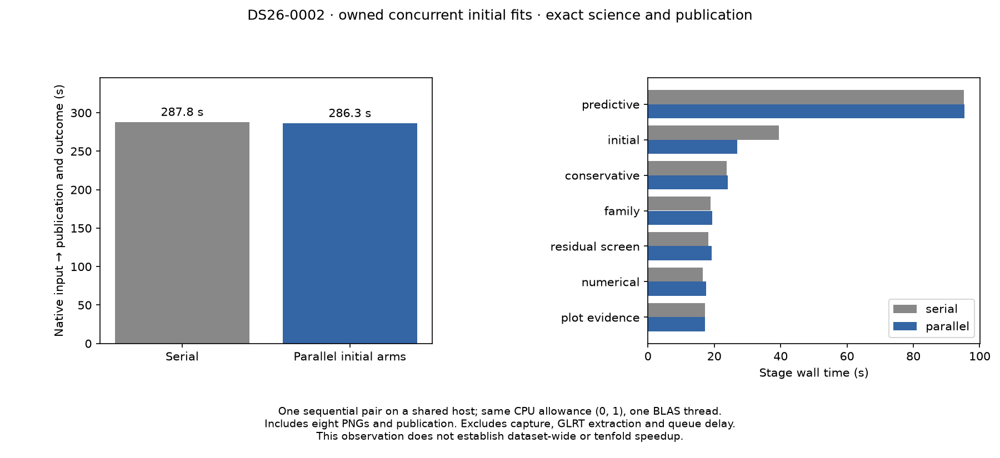

# ALGO07v3: owned concurrent initial fits

2026-11-05. Development CLI integration; no production deployment.

The measured two-arm concurrency prototype is now implemented through an owned
execution port. The numerical layer supplies a pure fit for each calibration arm;
the operations layer owns two child processes, ordered results and cleanup.
No earlier ALGO worker, saved scientific result or external experiment is a
runtime dependency. Public persisted contracts and scientific budgets are unchanged.

The fresh CLI comparison passes: **all owned scientific evidence, both calibration
arms, PNG bytes, grid/path data and published results remain exact**. Initial
search improves **39.453 → 26.903 seconds (31.8%)**. Complete native-to-publication
time improves only **287.835 → 286.322 seconds (0.53%)** in this sequential pair.
The larger stage saving must not be presented as an end-to-end saving.

| Exclusive interval | Serial v3 (s) | Concurrent initial fits (s) |
| --- | ---: | ---: |
| Native preparation through rendering | 278.923 | 270.651 |
| Evidence projection and scientific save | 4.331 | 6.565 |
| Publication | 3.084 | 6.625 |
| Startup and final supervision | 1.497 | 2.481 |
| **Complete supervised process** | **287.835** | **286.322** |

This serial baseline uses the same integrated numerical kernel. The observed
pair ratio is **1.0053×**, on one shared-host scan with the same CPU allowance.
Saving and publication took longer in the concurrent run; their cause was not
isolated. The archive grows by only 103 bytes, consistent with the extra source
metadata, so there is no material result-size increase. The complete-path metric
remains the primary score. Capture, native GLRT extraction and queue delay are
outside this measurement, and dataset-wide speedup remains unqualified.

Predictive recovery is essentially unchanged at **95.168 / 95.321 seconds** and
remains the largest stage. See [all stage timings](stage-timings.md), the
[exact fresh comparison](comparison002.json) and [machine-readable summary](summary.json).

## Implementation and failure behavior

`fit_initial_arm` contains the original arm body. A component test verifies its
AST against the previously qualified external prototype. `initial_search` accepts
an optional ordered mapping port; ordinary numerical calls remain serial. The
application forwards the port only to initial search. Fresh owned CLI jobs supply
the process adapter automatically. Branch ranking, c=0 selection, branch callback
order, phase rounds and zero-phase controls remain unchanged.

The adapter uses Linux fork from a single Python-thread owner, shares the scan
copy-on-write, and inherits the supervisor's CPU allowance. There is no global
task variable, pool-management thread, temporary scientific-result file or
expansion of the CPU affinity. Each initial branch has at most two concurrent
numerical children; branches themselves remain ordered.

Children return complete results over private pipes. The parent consumes results
in c=0/fitted-c order and requires clean process exit before returning the pair.
A failed child, abrupt exit or unserializable result aborts the stage. These
failures inherit the job's interruption type and cannot silently become a rejected
satellite followed by a successful fallback publication.

Cancellation is deferred across fork/registration so a newly created child cannot
escape the cleanup list. Parent interruption closes pipes, terminates workers,
kills signal-ignoring workers and reaps them. Both stay in the CLI worker's process
group, so the existing hard supervisor deadline remains applicable. Normal worker
teardown uses the existing job/stage deadline; it has no new 200 ms acceptance
cutoff. The short grace period is used only during cancellation cleanup.

The focused suite passes **691 tests**, with no failures or skips and one existing
Starlette deprecation warning. Added tests exercise out-of-order completion,
private worker state, exact array transport, numerical exceptions, abrupt child
exit, serialization failure, failure to start the second child, stage timeout,
slow successful teardown, threaded-owner rejection and actual pair cleanup under
the CLI supervisor. Application and job tests verify port wiring. The full suite
was rerun after removing a provisional short worker-exit wait; that provisional
version was never benchmarked or published as a completed optimization.

## Qualification setup

The evidence root is `/srv/bulk/leo-dev/algo07v3-owned-parallel-20261105`.
Both fresh CLI jobs use DS26-0002's same native GLRT, causal archive, configuration,
both calibration arms, regional box, all-work policy, renderer settings and
presentation-only evaluation reference. Both are allowed CPUs 0 and 1, with one
BLAS thread. The serial control binds the previous job composition inside a
private namespace; its current numerical implementation uses the default serial
port. The candidate uses the current job composition and owned adapter.

The serial control independently matches the previously saved science and
publication exactly. This checks the numerical refactor before comparing serial
and concurrent execution. The comparator explicitly enumerates allowed changed
and added implementation modules and refuses unlisted changes or removed modules.
Every scientific field, source/input binding and published artifact remains in
the same established comparison scope.

The first comparison correctly stopped at an undeclared added module:
`multiprocessing` registers `__mp_main__` as an alias of the existing `__main__`.
The [source audit](module-audit.json) verifies identical path and source hash for
that alias. The revised explicit allowance contains exactly that alias and the
new owned adapter; the job-composition module is the only changed loaded source.
The successful comparison retains all numerical, artifact and source-removal
checks. The initial failed comparison log is preserved at the evidence root.
The [prior serial comparison](prior-comparison.json) is correctness evidence;
its older run used a different CPU allowance and its raw ratio is not a speed claim.

Both jobs hide older installations/results and repository reports, bind the
native/TLE bundle read-only and disable external networking. These restrictions
apply to their forked children too. The existing input bundle contains no earlier
scientific result. Source-bound requests, logs, supervision receipts and the test
XML remain at the evidence root. `render.py` checks them before generating the
compact report receipts and visualization.

## Scope and next work

This is one native scan, not full DS26 equivalence or proof of every accepted
recovery branch. The historical audit still has five direct mappings outstanding,
in addition to metadata and production wall-clock admission qualification.
DS26 retains all 159 fast members in its denominator; 158 native inputs are
available and one has no native run. No population claim follows from this pair.

The larger remaining runtime target is predictive recovery. Independent training
folds and paired fits are candidates for the same approach, but mutable numerical
receipts must stay worker-local and be merged in the original order. Dependent
phase rounds and recovery decisions must remain sequential. The 10× complete-path
target is still open. Production services and scan cadence are unchanged.
