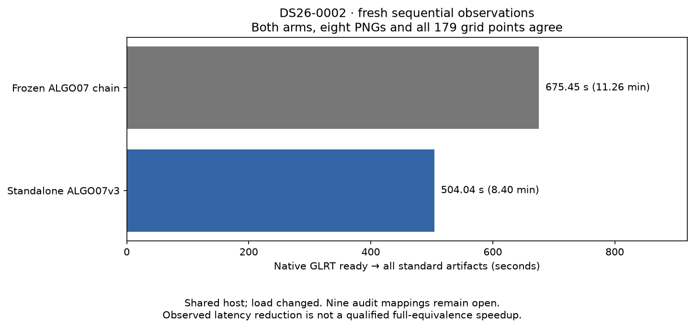

# ALGO07v3: first fresh reference/native timing pair

2026-11-05. Development evidence; no deployment or production changes.

On DS26-0002, the frozen ALGO07 chain takes **675.455 seconds** and standalone
ALGO07v3 takes **504.041 seconds**, including its worker startup. Both start from
fresh native GLRT input and finish all eight standard artifacts and all 179 grid
locations. The public documents, both selected solutions, points, tracks, grid,
path and every PNG compare exactly.

The observed elapsed-time ratio is **1.340×**, or **25.38% less time**. This is not
the fully qualified speedup metric: only eight of seventeen scientific audit
sections currently have a direct mapping to this fresh reference, metadata-link
qualification is incomplete, and host load changed substantially between legs.
The 10× target and full DS26 qualification remain open.

## What ran

The external reference invokes the unchanged installed ALGO02–07 watcher/worker
entry points with their original 1,200-second worker allowances. The existing
bounded benchmark keeps one clock through inference and first publication. It
starts with a public-port native-only export, not a completed scientific result.
The v3 leg starts afterward through the owned run CLI, receives only its explicit
native/configuration/causal archive inputs, and saves its own scientific evidence
before publication. It does not invoke an older worker or read the reference.

Both legs use the same native input digest:
`sha256:d07ccf9ae98391197d52fc9d837806700bee6cef6814ea2e2ea003bdee533be9`.
They use the same recording title, numerical inputs and confirmed evaluation
site; the site enters rendering/error reporting only. Both arms remain matched.
The reference retains ordinary-clock scientific admission, while the candidate
uses its explicitly labeled all-work validation policy. Agreement on this scan
does not prove these admission policies equivalent for arbitrary scans/load.

Both diagnostic grids receive a declared 300-second limit instead of the older
30-second production default. This change is restricted to presentation and is
not described as a production admission-policy qualification. Both first
publications complete the same 179 locations. The reference's historical
presentation code runs in the same Python/NumPy/SciPy/Matplotlib/Pillow environment
as v3, eliminating the discovered Pillow 13.0 versus 12.3 rendering mismatch.
The scientific worker implementations and their original interpreters remain
unchanged. The [protocol](protocol.json) and both timing receipts retain scope,
version/hash bindings, budgets and first-publication evidence.

The source archive view is fixed and read-only in a private mount namespace.
Both execution harnesses use private network namespaces. The candidate additionally
hides older installations, older bulk results and repository reports. No new RF
capture, live publication or production-service action occurs.

## Retained failure and exact historical restoration

The [first reference attempt](first-attempt.json) fails its frozen-source check
before fitting. Three helper files in the development checkout had changed since
the historical reference was frozen. The failed attempt is preserved and receives
no completed-path time.

The second attempt uses a fresh native-only export. The exact historical bytes
were recovered from Git and verified against the original frozen hashes. The
[reference harness](run_reference.py) bind-mounts these three files read-only in a
private namespace; it never rewrites the worktree or installed runtime. Their
[bindings and Git revisions](historical-bindings.json) are preserved. The original
72,405-file manifest passes before/after execution and is unchanged. The fresh
reference-only harness configuration pins the restored private view.

## Timing and attribution limits

| Measured path | Seconds | Minutes |
| --- | ---: | ---: |
| Frozen reference: native GLRT ready → artifacts | 675.455 | 11.26 |
| Native v3: supervised worker → artifacts/outcome | 504.041 | 8.40 |
| Native v3: internal input → publication clock | 501.596 | 8.36 |

The reference includes 598.474 seconds of inference/orchestration and 76.981
seconds of publication. Its six exclusive watcher/worker invocations take:

| Reference stage | Seconds |
| --- | ---: |
| ALGO02 | 134.566 |
| ALGO03 | 169.628 |
| ALGO04 | 66.989 |
| ALGO05 | 27.595 |
| ALGO06 | 57.574 |
| ALGO07 | 94.194 |

These sum to 550.546 seconds, inside the 598.474-second inference interval.
Remaining time includes orchestration, terminal checks and frozen-runtime
verification. Do not add the nested intervals together.

V3 takes 486.468 seconds through figures, 9.258 seconds projecting/saving evidence,
and 5.870 seconds publishing saved artifacts. Publication has different internal
boundaries: the older path reconstructs numerical state and renders during
publication, whereas v3 has already rendered before committing its scientific
result. A ratio of the two publication substeps would be misleading.

The jobs ran sequentially, but the host was not reserved. Reference one-minute
load averages were approximately 9.66 at start and 13.01 at finish; an in-flight
v3 observation was 28.44. That observation shows 377.47 user CPU seconds and 9.95
system CPU seconds over 387.81 elapsed seconds, so it does not demonstrate a
large off-CPU scheduling delay. Cache, memory-bandwidth, frequency and other load
effects are not isolated. Reference evidence export also overlapped the early
candidate leg. Preserve these limitations rather than attributing all elapsed
variation to code or claiming a controlled distribution from one pair.

The earlier 373.342-second standalone observation remains valid for its own
run; it is not substituted for this slower 504.041-second candidate to improve
the ratio. Capture, GLRT extraction and production queues are excluded from all
these numbers.

## Exact comparison and remaining gates

The [comparison tool](../../tools/compare_algo07v3_published.py) uses public stores
and hash-bound worker exports. Its [result](comparison.json) passes all 22 checks:
native observations/tracks, public result values, all eight PNGs, grid/path and
complete-grid checks, plus eight mapped scientific sections. The sections are
initial search, conservative recovery, family policy, cavity nominations, cavity
policy, predictive recovery, residual screening and additional-position fitting.

Predictive mapping verifies the discarded file references against the exported
bytes, maps a verified pair of retry directories to v3's retry boolean, separates
the inventory stage, and removes enumerated process accounting/identity labels.
The scientific values, candidates, ordered attempts and remaining stage outcomes
compare exactly. Unknown persisted fields fail; changing an owner, phase or score
fails. An unbound retry or a nonzero process exit labeled complete also fails.

Nine direct audit mappings remain: signed context, recovery inventory, numerical
recovery, gap recovery, additional-recovery preparation, reassociation handoff,
trigger, screening and completion. Several excluded metadata links still require
their independent semantic qualification. The command deliberately returns
**exit code 2** when its checked fields pass but this full gate remains open.
It never labels a public-artifact-only pass as complete scientific equivalence.

Separately, the complete new native scientific comparison matches the prior
qualified native result exactly; this comparison excludes presentation because
the actual recording title and evaluation annotation were intentionally used in
the new pair. The fresh-reference comparison covers those presentation changes.
Neither check substitutes for the remaining direct mappings or population scope.

## Targeted numerical experiment

The [scatter-assembly prototype](probe_assembly.py) replaces the posterior's
Python loop over precomputed matrix blocks with indexed additions. It retains
the same order of additions at each matrix element and leaves the linear solves,
priors, precision iterations and stopping rules unchanged.

On eight hash-bound captured calls it is bit-exact in every returned field.
Six additional sparse synthetic cases cover empty/nonempty nuisance width and
C/Fortran memory layouts. ABBA mean-summed component observations are **0.257565
seconds** for the reference and **0.241949 seconds** for the prototype. This small,
short measurement is not a reliable full-engine speed prediction. The prototype
is **not enabled**; a broader instrumented native comparison is required before
adoption. [Full probe evidence](assembly-probe.json) is retained.

The focused suite passes **622 tests**, zero failures or skips, with one existing
Starlette test-client deprecation warning. No runtime numerical source or golden
scientific fixture changed in this iteration.

## Evidence and next work

Local root: `/srv/bulk/leo-dev/algo07v3-pair-20261105`. It retains both attempts,
native inputs, frozen source copies, explicit requests, isolated execution
receipts, reference exports, both publications, comparison and test XML.
The [report verifier](render.py) checks the saved evidence and regenerates this
figure and [summary](summary.json).

Next, finish the nine semantic mappings and metadata bindings, then qualify
accepted recovery branches and the full DS26 denominator. Repeat controlled
timing only after those gates, retaining all failures and slowdowns. Numerical
fitting remains a major cost; assess the exact assembly prototype on real native
calls before enabling it. The independent-implementation, full-output and 10×
requirements remain unchanged. Nothing is deployed.
