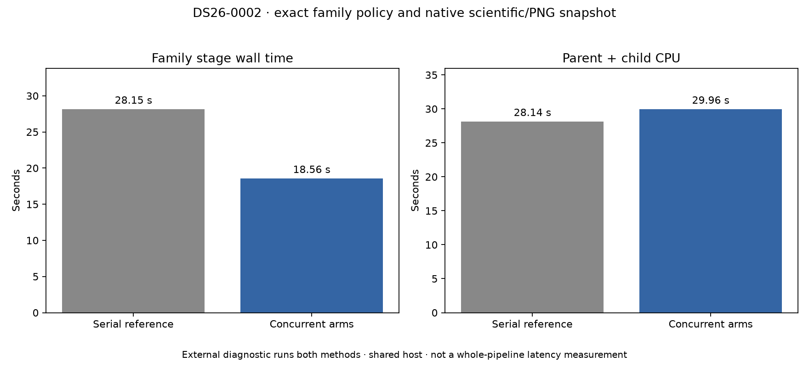

# ALGO07v3: independent family-arm concurrency prototype

2026-11-05. External experiment; no runtime integration or deployment.

The family policy currently fits c=0 and fitted-c sequentially for each curved
gate round, then fits its two predictive-linear alternatives sequentially. The
arms within each pair use the same frozen observations and priors. A pair's
shared rejection decision must finish before the next round or linear proposal.

The [prototype](../../tools/probe_algo07v3_parallel_family.py) replaces only
those two independent pair evaluations with the existing bounded process
adapter. It consumes results in c0/fitted-c order. Masks, rejection rounds,
linear-entry selection, convergence budgets, priors and paired adoption remain
unchanged. It does not parallelize dependent decisions or numerical-policy
receipts. Child failures abort the stage rather than becoming rejected science.

Three [tests](tests.xml) pass: exact numerical records and rejection/mask history
on whole and masked synthetic observations, plus failure propagation when one
child fails. An initial test mistakenly used the flat likelihood comparator on
a nested tuple; the corrected test uses the established recursive scientific
fingerprint, including array dtype/shape/bytes and exact floating representations.
The failed test receipt is retained externally.

The bounded native DS26-0002 probe has **completed exactly** on CPUs 4–6,
one BLAS thread per process. Both the full family policy and the complete
native scientific snapshot match, including both calibration arms and all eight
PNG byte streams. [Comparison](comparison.json), [probe receipt](probe.json).

| Family-stage observation | Serial reference | Concurrent arms |
| --- | ---: | ---: |
| Wall time | 28.147 s | **18.560 s** |
| Parent plus waited-for-child CPU | **28.142 s** | 29.955 s |

Observed stage wall time is **34.06% lower**, while CPU work is **6.44% higher**.
This is a latency/CPU tradeoff, not less total computation. There are three
ordered pairs: successive curved-gate fitting and the subsequent linear trial.
Under an already saturated host, extra parallelism may offer less latency benefit;
the existing per-job CPU allowance and cancellation rules must remain in force.

The probe copies the incoming context outside timing so reference and candidate
start with the same cache state. No reference answer enters candidate inference.
Its **489.988-second** complete diagnostic executes both family methods and
compares the outputs; it is not normal CLI/publication latency. The comparison
also verifies the qualified native snapshot digest and all eight PNGs.
[Summary](summary.json), [native source receipt](native-receipt.json).

The larger DS26-0066 variance correctness experiment runs separately on CPUs
0–2. Both share the host, so any timing interpretation must retain that context.
The next gate is an isolated complete owned CLI/publication comparison with
source changes explicitly declared, followed by broader native branch coverage.
This stage result does not qualify the cumulative tenfold target or full DS26.
The prototype remains external and production is unchanged.

[Source/input plan](plan.json). Raw evidence:
`/srv/bulk/leo-dev/algo07v3-parallel-family-20261105`.
