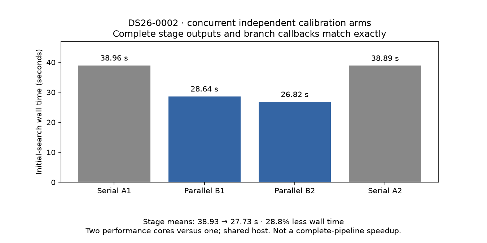

# ALGO07v3: concurrent initial calibration fits

2026-11-05. External development experiment; no production changes.

Running the independent c=0 and fitted-c initial-search arms in two processes
reduces this stage's ABBA mean from **38.928 to 27.731 seconds (28.76%)** on
DS26-0002. Every returned scientific field and ordered branch callback matches
the serial implementation exactly. This is a **1.404× stage ratio**, using two
cores instead of one, not a complete-pipeline speedup or throughput claim.



| Execution order | Initial-search stage | Exact output and callbacks |
| --- | ---: | --- |
| Serial A1 | 38.964 s | Yes |
| Parallel B1 | 28.645 s | Yes |
| Parallel B2 | 26.817 s | Yes |
| Serial A2 | 38.893 s | Yes |

The parent and c=0 work use performance core 0; fitted-c work uses performance
core 1. BLAS remains single-threaded. No test suite or second experiment ran
alongside these four measurements. Production and other users still share the
host; observed one-minute load averages were 7.8–9.3. These timings must not be
compared directly to the earlier efficiency-core complete-path observations.

## Exact scope of the experiment

The original initial-search function's arm body is extracted with AST and run
unchanged. A two-process pool executes each branch's two arms. The parent consumes
results in c=0/fitted-c order, performs the original branch selection, and emits
the original callbacks. Corner discovery, branch ranking, phase-update rounds,
iteration budgets and zero-phase controls are unchanged. There are three branch
pairs per initial-search run; branches themselves still execute in order.

Each serial or parallel stage starts from a newly constructed scan context over
the same native-prepared evidence. The region remains the configured 25 × 25 km
box centered at 37.906, −122.545. No evaluation GPS enters this experiment.
The frozen native/configuration/TLE bundle is hash-checked before preparation.
The comparison fingerprints every returned array's dtype, shape and bytes,
every floating scalar's hexadecimal representation and the ordered callbacks.

Two new tool tests check that the extracted arm returns the original complete
result and unchanged budgets, and that unexpected source structure is refused.
The runtime remains at the integrated-kernel version whose separate focused
suite passed 670 tests. This concurrency prototype is not enabled in the CLI.

## Full downstream check

A fresh native-input run with only the initial arms made concurrent also passes
the established entire scientific snapshot comparison. All **179 grid points**,
recorded paths and **eight actual PNG files** match exactly. The snapshot hash
remains `4f7c74a132b415e9bd6e130dcbc0d7082fa72c822d53f76810f8a9fa13323d68`.
The reference is read only after inference and rendering finish. See the
[full comparison](full-comparison.json) and [timing/source receipt](full-timing.json).

The run takes **279.527 seconds through rendering**, or **289.992 seconds**
including external qualification output and the post-run comparison. It does
not exercise scientific-store/WebUI publication. It is a single unpaired timing
on performance cores, not a speed comparison with the 392-second efficiency-core
publication run. The parallel initial stage itself takes 26.965 seconds in this
run. This experiment does not repeat the stronger private-namespace isolation
test; runtime import/read guards remain active.

## Reproduction

From the checkout root, using the pinned environment and a fresh output path:

```sh
sudo env PYTHONPATH=src:tools OPENBLAS_NUM_THREADS=1 OMP_NUM_THREADS=1 \
  /home/mouse9911/gits/leo-tracker-reduxredux/.venv/bin/python -B \
  tools/probe_algo07v3_parallel_initial.py \
  --bundle /srv/bulk/leo-dev/algo07v3-isolation-20261105 \
  --output /absolute/fresh/comparison.json --cpus 0 1
```

Evidence is preserved under
`/srv/bulk/leo-dev/algo07v3-parallel-initial-20261105`. The original 34 MB receipt
contains all four scientific snapshots; the compact report binds its hash and
checks those snapshots before discarding their duplicate representations.
The report renderer verifies source hashes, CPU assignments and distinct child
processes, as well as the subsequent full native-to-PNG comparison.

## Next integration work

The measured benefit justifies an owned execution port for bounded concurrent
fits. Production integration still needs cancellation/descendant cleanup tests,
fresh publication equivalence, broader scan coverage and controlled complete-path
timing. The operations layer should own processes; the numerical layer should
keep pure fits and ordered aggregation. The existing public contracts need not
change to execute independent work concurrently.

Predictive recovery is the larger opportunity: independent training folds and
calibration arms can be tested similarly. Its numerical policy mutates ordered
receipts, so sharing that policy across workers would be incorrect. Each worker
must own its receipts and the parent must merge them in the original order.
Dependent recovery decisions and phase rounds must remain sequential. The 10×
complete-path target, full DS26 parity and production admission gates remain open.
