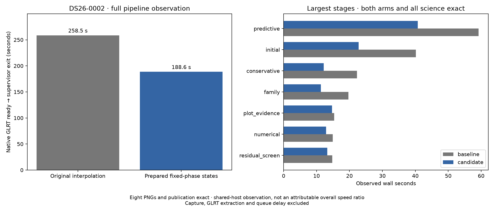
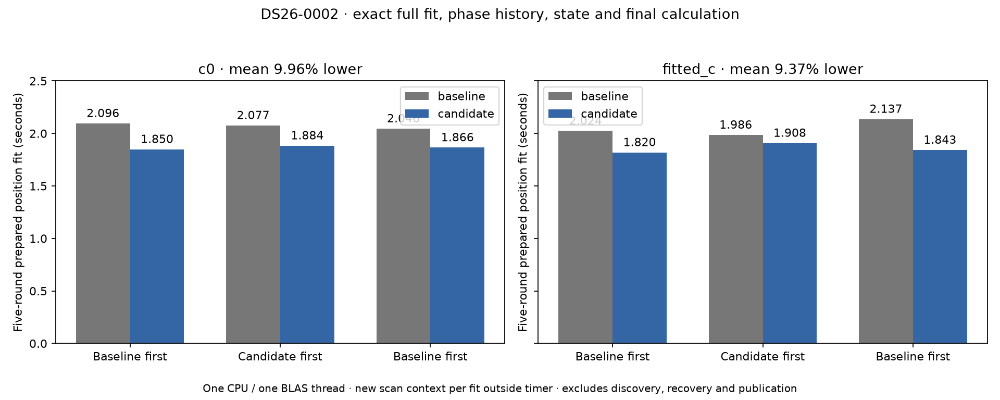

# ALGO07v3 fixed-phase position geometry

2026-11-05. Development runtime optimization; production unchanged.

## Repeated work removed

Every `JointMarginal.calculate` call previously interpolated central-phase orbit
states, two finite-difference phase offsets and orbital-mode states. The same
phase grid is used throughout a fixed-phase position solve. Those interpolated
states do not depend on the trial receiver position.

The integrated development candidate prepares these states once per problem, then calls the existing
position-dependent projection functions on every evaluation. It retains the
same finite-difference step and arithmetic. All feature assembly, uncertainty
priors, likelihood calculations, candidate sets, optimizer steps, phase refreshes
and acceptance gates are unchanged. Phase refreshes still construct new problems.

The per-problem cache retains orbit-buffer references and snapshots the small
time, label and phase grids, including dtype and shape. Changed grids or replaced
orbit buffers trigger preparation again. Shallow copies cannot silently retain
states for a different phase grid. Prepared states are read-only. Search-region
coordinates and prior scales are evaluated outside the cache. Orbit arrays are
fixed inputs, replaced when histories change; this does not support in-place
mutation of an orbit bank, matching the existing prepared-geometry contract.

## Component evidence

The [preceding experiment](../2026_11_05_algo07v3_gate_followup/README.md)
alternated three pairs for each calibration arm on 50 seeded regional positions.
All 600 geometry evaluations, including complete feature matrices, matched
exactly. Fifty evaluations averaged **0.250763 → 0.167064 seconds (33.38% lower)**.
This measures geometry preparation/projection only, including first preparation;
it excludes problem construction, posterior fitting, optimization and publication.

The candidate source passed 636 analysis/application/operations/profiler tests
under a private read-only overlay. Fourteen focused tests then passed using the
repository's frozen original calculator and ported cache regressions. These
overlap the broad suite and must not be added as unique coverage. Tests cover
both c arms, geometry-only and complete Gaussian results, empirical scales,
phase/time/label updates, replaced mode and sky buffers, shallow copies, changed
regional coordinates and priors, input immutability, reuse and phase bounds.

The frozen original module is `tools/algo07v3_preposition_geometry_oracle.py`,
SHA-256 `38535668aa81bb2116250225c457721b91a77fbd81084e8675a109ad3aa21c3f`.
The experiment tool now reads this reference explicitly so future integrations
cannot silently change its baseline. The oracle is not a runtime dependency.

## Full native qualification

The DS26-0002 baseline/candidate pair completed with exact scientific outputs,
both calibration arms, all eight PNGs and public grid/path values. The integrated
source bytes match the qualified candidate overlay exactly (SHA-256
`c80ac51249578e8a2c6c6a13a04aaa22a168353b2c758155858106b91507b609`).

| Scope | Baseline | Candidate |
| --- | ---: | ---: |
| Native GLRT ready through publication/supervisor exit | 258.526 s | 188.557 s |
| Process CPU, user + system | 364.570 s | 252.550 s |
| Maximum RSS reported by GNU time | 2,277,668 KiB | 2,250,804 KiB |
| Initial search | 40.176 s | 22.790 s |
| Conservative recovery | 22.242 s | 12.205 s |
| Predictive recovery | 59.207 s | 40.735 s |
| Diagnostic plot evidence | 15.325 s | 14.717 s |
| PNG rendering | 5.672 s | 5.766 s |



The observed total difference is **69.969 seconds, or 27.06% lower**. This single
shared-host pair does not establish an attributable 27.06% pipeline speedup.
Unchanged native preparation also decreases **12.777 → 8.459 seconds**, and
catalogue loading **9.331 → 5.488 seconds**. Both elapsed and CPU observations
are retained; the CPU reduction alone does not remove changing-host effects.

The raw inputs, snapshots and runs are retained in
`/srv/bulk/leo-dev/algo07v3-position-geometry-20261105`. Both executions use
fresh private outputs, identical native GLRT/TLE/configuration inputs, CPUs 0–2,
one BLAS thread and the existing 1,200-second outer bound. Network and older
installations/results are hidden. Only the declared `marginal.py` overlay differs.
`comparison.json`, `summary.json`, supervisor and resource receipts preserve
the results. This qualifies the complete path on one DS26 scan, not the entire
dataset or all possible recovery branches.

The supplied evaluation GPS position enters presentation only. The matched
`c=0` and fitted-`c` arms retain identical observations, candidate sets, bounds,
other priors and search budgets. This optimization is expected to change no
position, frequency fit, association or diagnostic artifact; the comparison
verifies that expectation for this scan.

## Alternating complete-fit measurement

An additional prepared-input experiment ran the selected initial
hypothesis through the full five phase-refresh rounds and 48 optimizer
iterations per round. Each arm received three alternating baseline/candidate
pairs on CPU 4 with one BLAS thread. It checked complete fit histories, state,
phase references and final calculations exactly. A fresh scan context is built
before each timed fit; context construction and extra fingerprint calculations
are excluded. The experiment is sequential with the native pipeline pair.

| Arm | Baseline mean | Candidate mean | Elapsed reduction | CPU before → after |
| --- | ---: | ---: | ---: | ---: |
| `c=0` | 2.073090 s | 1.866552 s | 9.96% | 2.072404 → 1.866164 s |
| Fitted `c` | 2.048970 s | 1.856914 s | 9.37% | 2.047331 → 1.856574 s |



All twelve fit signatures agree within their respective arm. This supports
about **9–10% less time for this prepared position fit**, with a corresponding
CPU reduction. It does not establish 9–10% for the entire pipeline. The
component's final position, all accepted steps, phase estimates and frequency
fit remain exact; lower compute cost has not changed the scientific answer.

Four benchmark tests cover the declared alternating order, rejection of changed
fit signatures, and restoration of the original calculator on success/failure.
The benchmark and source/input bindings are retained in `complete-fit-pairs.json`.

## Reproduction

`run_pair.py` binds the frozen baseline and candidate modules and runs each
through `tools/qualify_algo07v3_cli.sh`. Run it with the pinned Python environment
and a fresh root containing `baseline-src`, `candidate-src` and their SHA-256
manifests. `render.py --root ROOT` verifies the completed pair, input/source
bindings, isolation, fresh completion and tests before producing the figure and
summary. The comparator requires both arms, all scientific audit fields,
observation ownership, all eight PNG bytes and public position grid/path values.

For the complete-fit experiment, run the following with the pinned Python
environment; stdout retains detailed fingerprints, while `--output` stores the
complete machine-readable receipt:

```sh
PYTHONPATH=src:tools OPENBLAS_NUM_THREADS=1 timeout -k 2 360 taskset -c 4 python -B \
  tools/benchmark_algo07v3_position_geometry.py --request OWNED_REQUEST \
  --output FRESH_JSON > FRESH_LOG
```

`render_fits.py --input FRESH_JSON` verifies signatures and source bindings,
then plots every pair. The full-path renderer also accepts the exact qualified
candidate bytes after integration; it does not permit unrelated source changes.

## Next iteration

Predictive recovery remains the largest recorded candidate stage at **40.735 s**;
initial search takes **22.790 s** and diagnostic grid evidence **14.717 s**.
The next step is to profile these current stages before choosing another edit.
Independent discovery seeds and branch fits are a scheduling candidate, but
they require bounded concurrency, retained proposal/tie order and exact receipts.
The geometry cache also needs a second complete branch case such as DS26-0066
before claiming broader recovery coverage.

Whole DS26, original-worker historical equivalence, ordinary production
admission and a stable cumulative speed ratio are separate qualifications.
Capture, GLRT extraction and queue delay are outside these pipeline timings.
