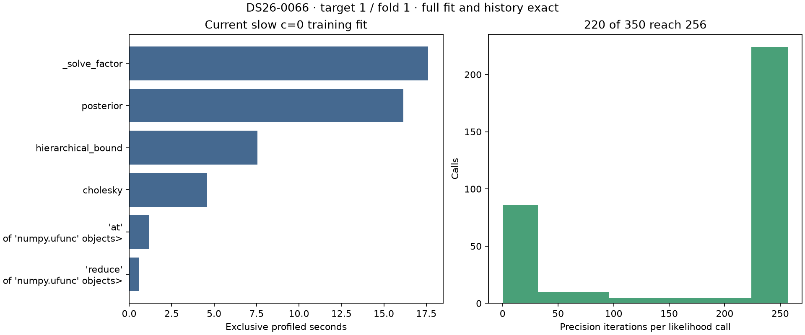
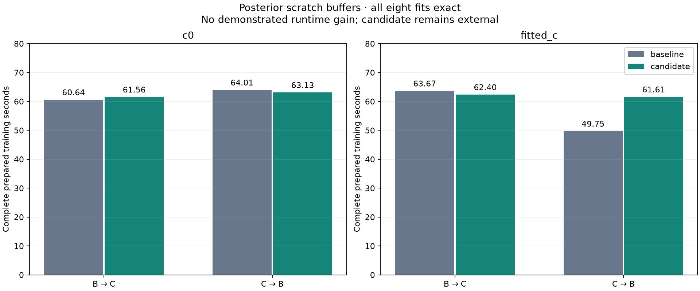

# ALGO07v3: current posterior profile and exactness limits

2026-11-05. Development experiments; production unchanged.

This iteration returns to the largest measured numerical cost after the
initial-cache experiment failed to establish an overall speedup. No new
complete native-input-to-publication or original-ALGO07 cumulative speed ratio
is available for the experiments below. Prepared training and kernel clocks
exclude capture, GLRT extraction, discovery, later recovery and publication.

## Current slow-fold profile

The current covariance-index implementation was profiled on DS26-0066,
target 1 / fold 1 / seed 94721, with `c=0`. All five phase-refresh rounds and
48 position iterations per round remain available. The complete final
calculation, state, endpoint and optimizer history match the previously
qualified covariance-index result exactly.

| Scope | Profiled seconds |
| --- | ---: |
| Complete prepared training fit | 50.998 |
| Hierarchical likelihood, cumulative | 49.633 |
| LAPACK solve wrapper, exclusive | 17.606 |
| Posterior construction, exclusive | 16.152 |
| Other hierarchical-bound work, exclusive | 7.555 |
| Cholesky, exclusive | 4.580 |

These are nested measurements; do not sum cumulative and exclusive rows.
Profiling adds overhead and is not an unprofiled speed benchmark.

There are 350 hierarchical calls and 62,737 posterior evaluations. Of the
350 calls, **220 reach the existing 256-iteration ceiling**. Mean precision
iterations are 178.249. This explains why a small per-posterior cost matters,
but does not justify reducing the ceiling or loosening convergence tolerance.
The same 1e-5 convergence test and all precision updates remain in every trial.



The profiler retains the highest-iteration/slowest observed input locally for
future focused measurements. Selection is based on computational work, never
position accuracy; it does not affect fitting. Its array digest, source bindings
and complete fit fingerprint accompany the report.

## Four hypotheses and their limits

| Candidate | Mechanism | Evidence / disposition |
| --- | --- | --- |
| Reuse solve metadata | Prepare identity pivots once; Fortran-order identity matrix | Exact on both captured real arms; tiny mixed kernel timings |
| Reuse variance buffers | Add bounded scratch arrays for covariance gather/multiply | Exact on both captured real arms; complete-fit measurements below |
| Combine lower solves | Solve the vector and identity right-hand sides together | Rejected: changes results on both captured DS26-0066 arms |
| Direct upper triangular solve | Omit the identity-lower portion of the upper-root solve | Rejected: changes signed-zero results on multi-row inputs |

The combined solve changes coefficients, residuals, objective terms and the
precision-update result despite mathematical equivalence. It is not timed as
a qualifying candidate. The direct triangular solve matches the ordinary random
cases but fails exactness for negative-zero right-hand sides. Tests explicitly
retain this rejection; no tolerance, golden fixture or scientific gate is relaxed.

The buffer candidate preallocates one scratch array for each existing batched
variance block. `numpy.take` gathers the same valid flattened indices, then
in-place multiplication precedes the original contiguous sum. Index generation,
reduction order, group order, model and stopping rules remain unchanged.
Singleton and oversized blocks retain their original implementation; each
existing batched block remains bounded to 1 MiB. Scratch storage is local to
one likelihood call, never shared across scans or positions.

The first captured calls have relatively few precision iterations. Their roughly
20-millisecond timings are too small and unrepresentative of the late-round
256-iteration workload to justify integration. All observations are retained
in `kernel/result.json`; the complete training comparison is the decision basis.

## Complete training comparison

All eight fits match the previously qualified complete result exactly. The
candidate does not demonstrate a useful runtime improvement and remains external.

| Arm | Baseline mean | Buffer candidate mean | Baseline CPU | Candidate CPU |
| --- | ---: | ---: | ---: | ---: |
| c = 0 | 62.323 s | 62.341 s | 62.239 s | 62.201 s |
| Fitted c | 56.711 s | 62.005 s | 56.669 s | 61.884 s |

The c=0 result is essentially flat; fitted-c is **9.33% slower** on the observed
means. Pairwise baseline/candidate elapsed times are 60.635/61.556 and
64.012/63.127 seconds for c=0, and 63.669/62.398 and 49.754/61.611 seconds for
fitted-c. The second pair in each arm executes candidate first. The large
last-baseline change shows why the mean is not an isolated causal estimate;
it is nevertheless retained rather than discarded to manufacture a gain.



Both arms use fresh contexts,
the same causal catalogue, original grouped holdout, unchanged priors and full
solver budgets. Each result must match previously qualified evidence, rather
than only matching a newly computed baseline. Trials pin one CPU and one BLAS
thread. Context reconstruction is outside timing; full training, all phase
rounds and optimizer work are inside it.

**94 tests pass**. They cover both memory layouts, sparse/dense/empty designs,
input preservation, complete training histories in both arms, capture cleanup,
LAPACK failure propagation and explicit signed-zero rejection. The two initial
direct-upper exactness failures are preserved as rejection evidence, not hidden
with skips or tolerances. Source bindings retain the measured probe bytes; a
later unused-import/formatting cleanup does not change any extracted candidate
function, which the report renderer checks byte for byte.

## Decision and next work

Do not integrate any of these four experiments. The current v3 runtime and
production are unchanged. The profile narrows the bottleneck but provides no
license to shorten precision convergence or change solver rounding. Diagnostic
position-grid scoring is a separate remaining opportunity: publication currently
evaluates the two arms and locations serially. Prototype bounded concurrency
through the existing execution port, preserving point order, error behavior,
the time budget, all scores and PNG bytes. Establish its full-stage benefit and
fresh native equivalence before integration.

## Reproduction

Use the pinned Python environment with `PYTHONPATH=src:tools`, one BLAS thread
and one-CPU affinity. Commands require fresh output directories:

```bash
timeout -k 2 180 taskset -c 0 python -B tools/probe_algo07v3_posterior_buffers.py \
  --request REQUEST --output FRESH_KERNEL_DIRECTORY
timeout -k 2 300 taskset -c 0 python -B tools/profile_algo07v3_training_posterior.py \
  --request REQUEST --expected PREVIOUS_C0_CANDIDATE_JSON --arm c0 \
  --output FRESH_PROFILE_DIRECTORY
timeout -k 2 900 taskset -c 0 python -B tools/benchmark_algo07v3_posterior_buffers.py \
  --request REQUEST --expected-root PREVIOUS_TRAINING_DIRECTORY --repeats 2 \
  --output FRESH_TRAINING_DIRECTORY
```

The request is the DS26-0066 candidate at
`/srv/bulk/leo-dev/algo07v3-annotation-training-0066-20261105/candidate-request.json`.
Previous exact full-fit evidence is under
`/srv/bulk/leo-dev/algo07v3-variance-indices-20261105`.
New roots are `algo07v3-posterior-buffers-20261105`,
`algo07v3-posterior-current-profile-20261105`, and
`algo07v3-posterior-buffers-training-20261105` under `/srv/bulk/leo-dev`.
Runtime does not import these external tools or the frozen reference module.
Evaluation GPS enters none of these fitting, selection or benchmarking decisions.
