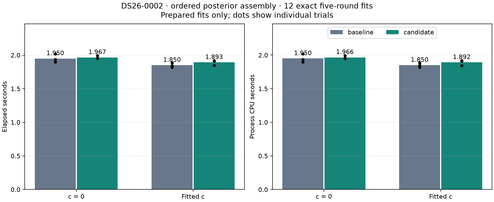
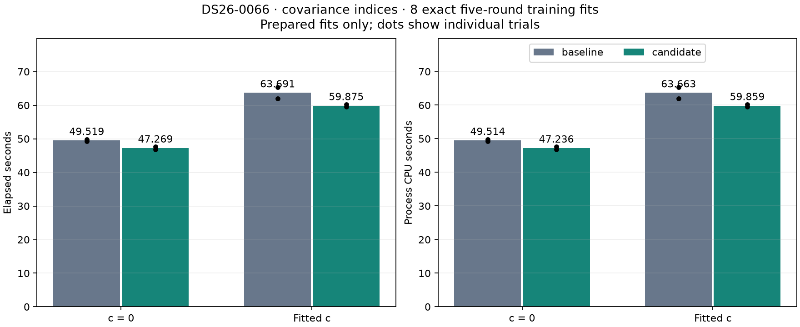
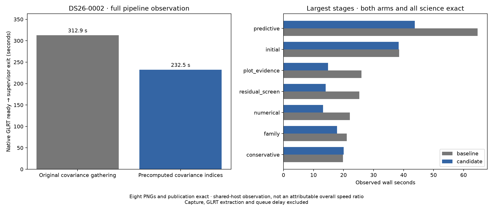

# ALGO07v3: posterior-kernel follow-up

2026-11-05. Covariance-index optimization integrated in development; no production deployment.

The previous [profile](../2026_11_05_algo07v3_predictive_0066_profile/README.md)
identified 125,303 posterior evaluations inside the slow DS26-0066 training
fold. This follow-up tests two ways to remove repeated array work without
changing a numerical model, convergence rule or fit budget.

## Ordered normal-equation assembly: do not integrate

The first candidate replaces `numpy.add.at` with weighted `numpy.bincount`.
It inserts the prior diagonal first and then the existing group contributions
in their original order. The right-hand side uses the same ordered additions.
Twenty-six tests cover empty nuisance designs, sparse/dense designs, both memory
layouts, shared groups, non-unit powers, learned priors, cancellation-sensitive
addition and restoration after failure.

Twelve complete five-round fits on a DS26-0002 initial hypothesis are exact,
including optimizer history, both calibration arms, final likelihood and state.
The speed result is negative:

| Arm | Baseline elapsed | Candidate elapsed | Change | Baseline CPU | Candidate CPU |
| --- | ---: | ---: | ---: | ---: | ---: |
| c = 0 | 1.950 s | 1.967 s | 0.85% slower | 1.950 s | 1.966 s |
| Fitted c | 1.850 s | 1.893 s | 2.29% slower | 1.850 s | 1.892 s |



These are means over three alternating pairs per arm. This candidate has no
measured speed advantage on this workload and remains external. The measured
wrapper is archived because its string-construction formatting was subsequently
cleaned up; the renderer verifies that both extracted kernel source strings
remain byte-identical to those measured. All 26 tests pass again after that edit.

## Precomputed covariance indices

The second candidate precomputes flattened covariance indices once per
hierarchical likelihood evaluation. Each precision iteration then gathers the
same entries with one indexed lookup. The original element multiplication,
contiguous summation, group order, precision updates and stopping test remain
unchanged. Singleton and oversized variance blocks retain their existing path.
The lookup indices are local to the current likelihood call; no cross-position
or cross-scan numerical values are cached.

Twenty-eight tests pass, including complete five-round training histories and
final calculation/state equality for both arms, sparse/dense designs, zero-width
designs, layout changes, repeated indices and exception restoration. The bounded
DS26-0066 benchmark completes two alternating pairs per arm on the measured
slow target-1/fold-1 workload. Every complete training fit, optimizer history,
final likelihood and state is exact.

| Arm | Baseline elapsed | Candidate elapsed | Reduction | Baseline CPU | Candidate CPU |
| --- | ---: | ---: | ---: | ---: | ---: |
| c = 0 | 49.519 s | 47.269 s | 4.54% | 49.514 s | 47.236 s |
| Fitted c | 63.691 s | 59.875 s | 5.99% | 63.663 s | 59.859 s |



The c=0 pairs are 49.240/46.845 and 49.799/47.693 seconds (baseline/candidate,
second pair executed in reverse). Fitted-c pairs are 62.003/59.485 and
65.378/60.265 seconds. These small gains are consistent across the four pairs
and accompanied by CPU reductions. This supports full native qualification;
it does not establish a whole-pipeline speed ratio.

## Full native qualification and integration

The fresh DS26-0002 comparison at
`/srv/bulk/leo-dev/algo07v3-variance-indices-native-20261105` passes exactly:
both calibration arms, all scientific audits, observation/satellite ownership,
all eight PNG bytes and published grid/path values. Both executions complete
without resuming or timing out. Each uses a private read-only source overlay,
the same frozen native input bundle, causal catalogue and fit budgets, three-CPU
affinity and one BLAS thread. Old installations, bulk results and networking
are hidden during inference.

The new baseline also matches the preceding annotation-training candidate in
all scientific values, audits and eight PNGs, with no source-module changes;
see `native/baseline-continuity.json`. This checks continuity with the previous
qualified result, not just agreement between the two new executions.

| Complete native run or stage | Baseline | Candidate |
| --- | ---: | ---: |
| Native GLRT ready through publication/supervisor exit | 312.944 s | 232.515 s |
| Process CPU, user + system | 424.060 s | 313.750 s |
| GNU-time maximum resident set | 2,723,108 KiB | 2,254,628 KiB |
| Native preparation | 13.500 s | 13.068 s |
| Initial search | 38.531 s | 38.361 s |
| Predictive recovery | 64.682 s | 43.776 s |
| Numerical replay | 22.069 s | 13.165 s |
| Diagnostic plot evidence | 25.941 s | 14.858 s |
| PNG rendering | 8.203 s | 5.952 s |



The observed full-process reduction is **80.429 s / 25.70%**, but this is not an
attributable 25.70% algorithm gain. Host variation remains visible, including
in PNG rendering, which does not use the changed kernel. The controlled
prepared-training comparison supports the more modest 4.54–5.99% improvement
for that workload. GNU-time maximum RSS is a process-tree observation, not
aggregate simultaneous memory. Capture, GLRT extraction and queue delay are
outside the complete native clock.

The integrated module is byte-identical to the qualified overlay, SHA-256
`21c5947b4888f9602365af8b4b87a58af4d6becbf1a34ca682cd0d3a63172919`.
Only `leo.analysis.localization_v3.hierarchical` changes in the native
comparison; no runtime module is added. The broad component/tool suite passes
**727 tests**, including the 28 prototype tests. Those counts overlap and must
not be added. The historical numerical oracles and their assertions remain
unchanged; a new frozen pre-index reference preserves the prior implementation
and the test chain checks the newly qualified candidate explicitly.

This is one full native scan plus complete training-fit evidence on DS26-0066.
Full DS26, a fresh full DS26-0066 comparison for this change, ordinary production
admission and a stable cumulative original-ALGO07 speed ratio remain open.
The ordered-assembly candidate remains external and is not included in runtime.

## Measurement scope and reproduction

Both benchmarks construct a fresh owned context before each timed fit. Timers
exclude context reconstruction, capture, GLRT extraction, scan queueing, later
association stages and publication. One CPU and one BLAS thread are pinned.
All five phase-refresh rounds and 48 optimizer iterations per round remain
available. The same causal catalogue, observations, grouped holdouts and priors
are used on both sides. GPS never enters fitting. Exact results imply no change
in position accuracy or frequency fit; lower fitting cost alone is not evidence
of better localization.

The original benchmark roots are:

- `/srv/bulk/leo-dev/algo07v3-posterior-assembly-20261105`
- `/srv/bulk/leo-dev/algo07v3-variance-indices-20261105`

Use the pinned environment with `PYTHONPATH=src:tools`,
`OPENBLAS_NUM_THREADS=1` and `taskset -c 0`:

```bash
timeout -k 2 360 python -B tools/probe_algo07v3_posterior_assembly.py \
  --request /absolute/DS26-0002-request.json --output /fresh/assembly
timeout -k 2 900 python -B tools/benchmark_algo07v3_training_kernel.py \
  --request /absolute/DS26-0066-request.json --output /fresh/variance --repeats 2
```

Each fresh output contains source/request bindings, complete fit fingerprints
and individual timings. Failures remain visible instead of becoming successful
scientific rejections. The renderer checks completion and bindings before
publishing figures. These prepared-fit experiments do not establish a
whole-pipeline or population speedup.

The original hierarchical module is frozen in
`tools/algo07v3_preindex_hierarchical_oracle.py` (SHA-256
`3b02974c822ef2504422dcdb85f10d16198ec8df2ef35936119e42a97877dab2`).
The external tools now reference this snapshot, preserving old/new comparisons
if runtime is promoted. Measured helper bytes are archived with each experiment;
the renderer checks those original bindings and requires both extracted kernel
source strings to remain identical. Runtime never imports this oracle.

For complete native reproduction, `run_pair.py` executes baseline and candidate
snapshots and the strict comparator; `run_baseline.sh` applies the declared
hierarchical-module overlay in a private namespace. `render_native.py` verifies
the source/input bindings, completed supervisors, test receipts and comparison
before producing the full-run figure. The baseline and candidate source maps,
resources, isolation records and comparison are retained under `native/`.

## Next measured opportunity

Initial fitting performs several state and metric requests at the fitted
position. Unlike later event fitting, its normal-position path has no complete
likelihood-result cache. Instrument the actual repeat count and cost before
deciding whether to reuse those results. Any candidate must account for mutable
model state and returned arrays, retain original optimizer evaluation receipts,
and pass complete initial-search and full native comparisons. No cache gain is
claimed by this report.
